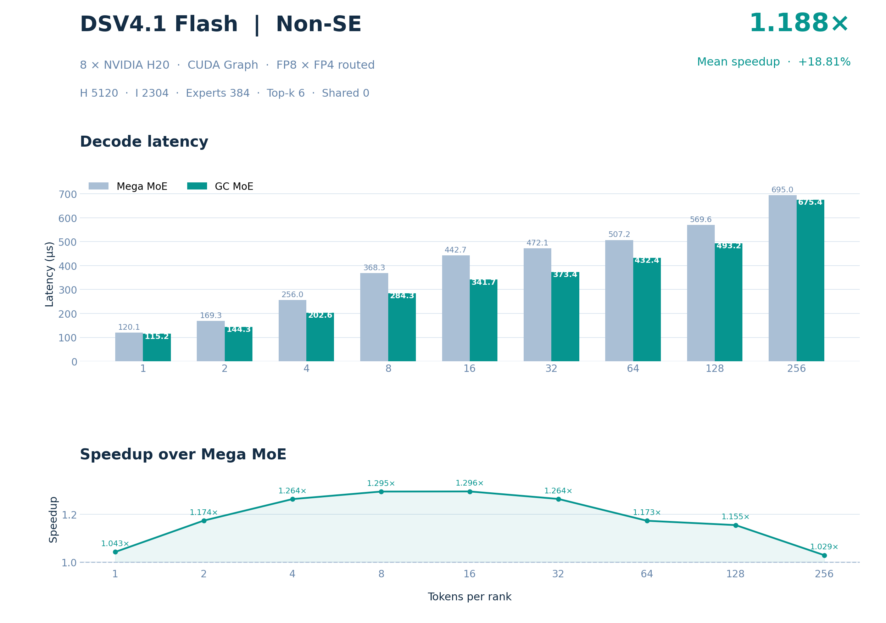
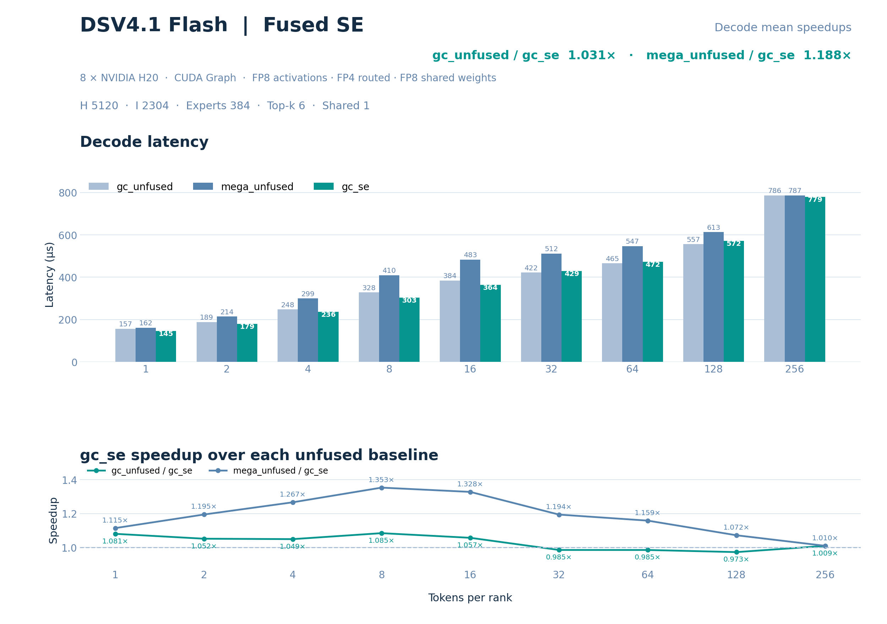
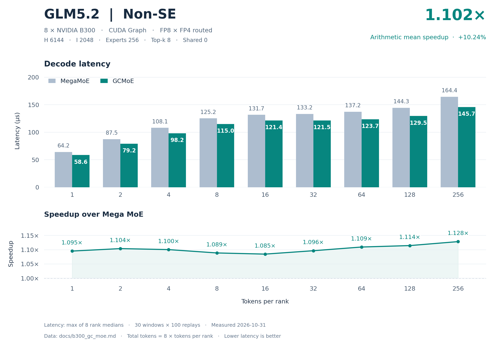
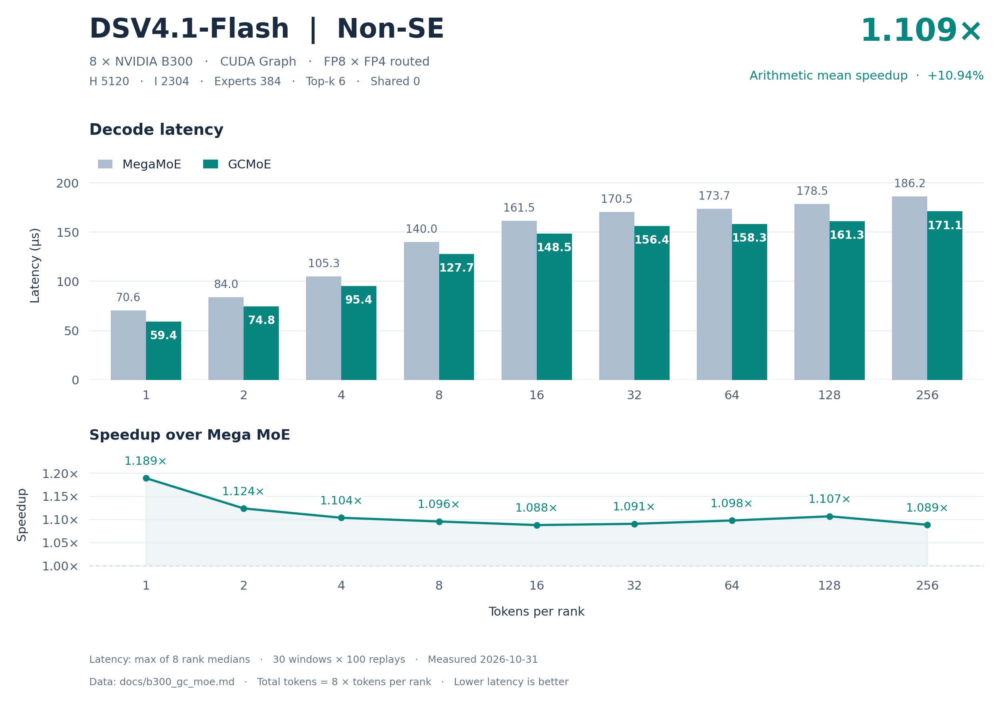
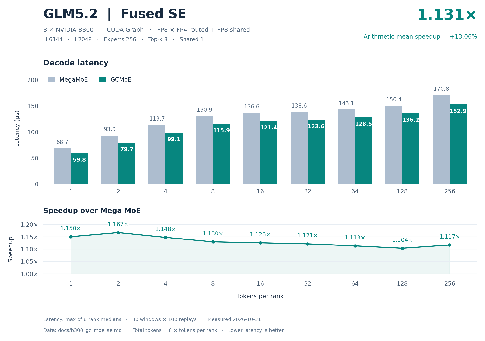
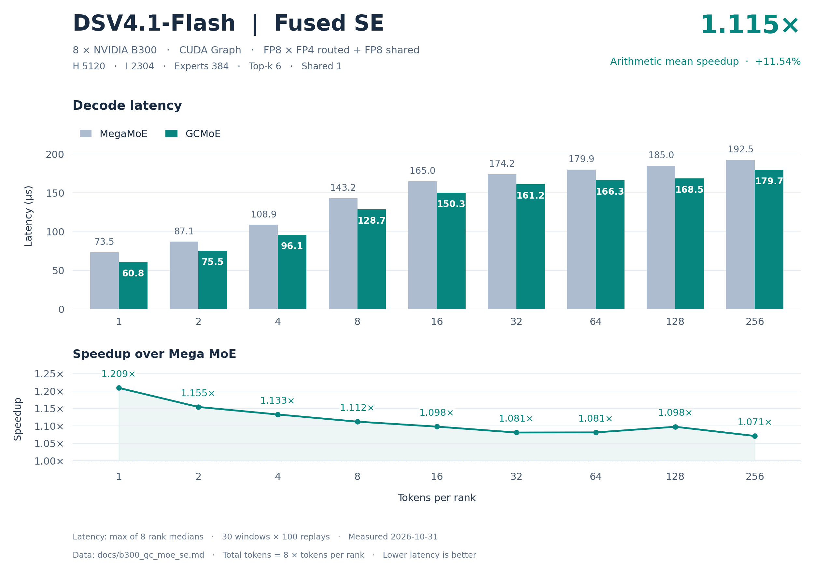

# GC MoE

GC MoE is a CuTe DSL implementation of FP8/FP4 mixture-of-experts inference
with CUDA Green Contexts for NVIDIA Hopper and Blackwell GPUs. It overlaps
expert-parallel token dispatch with
Tensor Core computation, then combines the expert outputs through a CUDA Graph
with three kernel nodes (four for SM90 fused SE).
The operator supports routed experts and optional fused shared
experts (SE), with FP8 activations, packed FP4 routed weights, FP8 shared
weights and BF16 outputs.

GPU kernels are JIT compiled on first use. Installation builds a Python wheel;
it does not compile CUDA kernels. The current package version is `0.3.1`.

## Performance

Decode latency comparing GC MoE with Mega MoE using CUDA Graph replay on eight
GPUs. Each point uses 1–256 tokens per rank; total tokens equal eight times the
per-rank count. The figures use the measurements recorded in the linked reports.

### Hopper

DSV4.1-Flash on eight NVIDIA H20 GPUs.

#### Routed experts (non-SE)



[Full H20 non-SE accuracy and performance data](docs/h20_gc_moe.md).

#### Fused shared experts (SE)



[Full H20 SE accuracy and performance data](docs/h20_gc_moe_se.md).

### Blackwell

GLM5.2 and DSV4.1-Flash on eight NVIDIA B300 GPUs.

#### Routed experts (non-SE)





[Full B300 non-SE accuracy and performance data](docs/b300_gc_moe.md).

#### Fused shared experts (SE)





[Full B300 SE accuracy and performance data](docs/b300_gc_moe_se.md).

## Quick start

### Requirements

- Linux and an NVIDIA Hopper or Blackwell GPU. The Hopper SM90 path uses
  `sm_90a` kernels and is validated on H20; the Blackwell path is validated
  on B300 (compute capability 10.3) and selects `sm_103f`.
- A CUDA driver supporting Green Contexts. Multi-GPU execution also requires
  peer-accessible GPUs and PyTorch symmetric memory, with one process per GPU.
- Python 3.10 or later.
- A system CUDA Toolkit providing `/usr/local/cuda/bin/ptxas`. The validated
  toolchain is CUDA 13.2 with ptxas 13.2.78; the assembler must support the PTX
  emitted by the installed CuTe DSL.

Runtime dependencies are constrained by [setup.py](setup.py):

| Package | Supported version |
| --- | --- |
| PyTorch | `>=2.11.0,<2.12` |
| NVIDIA CUTLASS DSL | `==4.8.1` |
| CUDA Python | `>=13.2,<14` |
| CUDA bindings | `>=13.2,<14` |

[requirements.txt](requirements.txt) records the exact versions used for the
runtime, build, tests and benchmarks. It also includes `deep-gemm==2.8.2`, which
is used by the comparison scripts. Use a reference build exposing
`deep_gemm.fp8_fp4_mega_moe` for Blackwell comparisons or
`deep_gemm.sm90_fp8_fp4_mega_moe` for Hopper comparisons.

### Installation

Run from the repository root with the intended Python environment active:

```bash
# Install the recorded development and comparison dependencies.
python -m pip install -r requirements.txt

# Build and install the Python wheel.
bash build.sh
python -m pip install dist/*.whl
```

`build.sh` uses `python` from `PATH` and replaces the existing `build/`, `dist/`
and package metadata directories. Kernel compilation happens when the operator
first encounters a new configuration. The JIT path uses the system assembler
at `/usr/local/cuda/bin/ptxas` and checks its compatibility with the generated
PTX.

For editable development, use `python -m pip install -e .` instead of installing
the wheel. Wheel versions include the Git revision for a clean tree, or
`+local` for a dirty tree or a source copy without Git metadata. Set
`GC_MOE_USE_LOCAL_VERSION=0` to build the plain `0.3.1` version.

## Interfaces

The public entry points are exported from `gc_moe`. The following interfaces
target Blackwell:

| Interface | Purpose |
| --- | --- |
| `get_symm_buffer_for_gc_moe` | Allocate and rendezvous the symmetric input and workspace buffers. |
| `transform_weights_for_gc_moe` | Convert quantized routed or shared weights to the required layout. |
| `fp8_fp4_gc_moe` | Write routed-expert output, optionally including shared experts, into `y`. |
| `get_block_m_for_gc_moe` | Query the token block size, including for shared-input scale staging. |
| `GCSymmBuffer` | Own input views, peer addresses and workspace storage. |

Hopper uses separate SM90 interfaces, also exported from `gc_moe`:

| Interface | Purpose |
| --- | --- |
| `get_symm_buffer_for_gc_moe_sm90` | Allocate and rendezvous the Hopper input and workspace buffers. |
| `transform_weights_for_gc_moe_sm90` | Convert routed MXFP4 or shared FP8 weights to the SM90 layout. |
| `sm90_fp8_fp4_gc_moe` | Write Hopper routed-expert output, optionally including fused shared experts, into `y`. |
| `SM90GCSymmBuffer` | Own the independent SM90 input views, peer addresses and workspace storage. |

SM90 uses its own buffers and transformed weight layout. Routed activations
use E4M3FN with contiguous FP32 K128 scales. Pass `shared_l1_weights` and
`shared_l2_weights` to `sm90_fp8_fp4_gc_moe` to fuse shared experts. See the
[SM90 interfaces](gc_moe/sm90_gc/__init__.py),
[routed-expert test](tests/test_sm90_gc_moe.py) and
[shared-expert test](tests/test_sm90_gc_moe_se.py) for complete preparation.

The input contract and examples below describe the Blackwell interfaces.

### Input contract

Let `P` be the number of ranks, `E` the total number of routed experts, `H` the
hidden size, `I` the intermediate size and `T` this rank's token count. Experts
are evenly distributed across ranks, so each rank stores `E / P` routed experts.
The total input token count is the sum of all ranks' `T` values; for a symmetric
load it is `P * T`.

| Input | Shape | Data type |
| --- | --- | --- |
| `buffer.x[:T]` | `[T, H]` | `torch.float8_e4m3fn` |
| `buffer.x_sf[:T]` | `[T, H / 128]` | `torch.int32`, packed UE8M0 scales |
| `buffer.topk_idx[:T]` | `[T, topk]` | `torch.int64`, global expert indices |
| `buffer.topk_weights[:T]` | `[T, topk]` | `torch.float32` |
| `y` | `[T, H]` | `torch.bfloat16` |

Activations use one scale per 32 values along K, with four UE8M0 scales packed
into each `int32`. Quantization is the caller's responsibility. Weight
transformation only rearranges already quantized data and packed scales; it
does not quantize floating-point weights.

Routed inputs to `transform_weights_for_gc_moe` are `(data, scales)` pairs.
W1 data has shape
`[E / P, 2 * I, H / 2]` and W2 data has shape `[E / P, H, I / 2]`, both stored
as contiguous `torch.int8` with two FP4 values per byte. Before transformation,
W1 contains the gate rows followed by the up rows. The returned W1/W2 payloads
have contiguous K128 shapes `[E / P, H / 128, 2 * I, 64]` and
`[E / P, I / 128, H, 64]`, respectively. After transformation, the
packed scale shapes are `[E / P, 2 * I, H / 128]` and
`[E / P, H, I / 128]`, respectively, with the required MN-major TMA strides.
Input weight scales must already have
MN-major storage (`stride(-2) == 1`) and TMA-aligned strides; the transform
preserves that storage order while permuting scale rows.

Run the transform once per weight set, outside CUDA Graph capture, with source
writes ordered before it on the current CUDA stream. It returns independent
pairs; after the call returns, the original data and scales may be released.
Reuse the returned pairs across token counts and workspaces; the operator only
accepts transformed pairs. Keep their storage and layout fixed while graphs use
them. Order in-place value updates after previous readers and before replay;
replacing storage or layout requires preparing and capturing new graphs.

The current operator requires:

- `recipe=(1, 1, 32)` and `activation='swiglu'` for routed experts.
- Positive `H` divisible by 256, and positive `I` divisible by 128 with `I <= 4096`.
- `E` divisible by `P`, at most 2048 total experts and at most 512 experts per rank.
- `topk >= 1` and `topk + bool(num_shared_experts) <= 32`.
- CUDA tensors with the shapes, strides and alignment checked by the
  [host interface](gc_moe/apis/gc_moe.py).

`y.shape[0]` determines the local token count. The allocator may round the
requested capacity up; use `buffer.num_max_tokens_per_rank` when querying the
actual capacity. Calls sharing one workspace must be serialized. Keep tensors
and workspace storage alive while captured graphs reference them; retire those
graphs and outstanding GPU work before calling `buffer.destroy()`.

### Routed experts

Initialize the distributed process group and select the local CUDA device
before allocating the buffer. All ranks must participate in allocation and
operator calls. The following example assumes that `x_fp8`, `x_sf`, routing
tensors and the local quantized weight pairs have already been prepared:

```python
import torch
import torch.distributed as dist
import gc_moe

group = dist.group.WORLD
num_experts, topk = 256, 8
hidden, intermediate = 6144, 2048
capacity = 256

buffer = gc_moe.get_symm_buffer_for_gc_moe(
    group, num_experts, capacity, topk, hidden, intermediate,
    mma_type='fp8xfp4',
)
w1, w2 = gc_moe.transform_weights_for_gc_moe(l1_weights, l2_weights)

tokens = x_fp8.shape[0]
buffer.x[:tokens].copy_(x_fp8)
buffer.x_sf[:tokens].copy_(x_sf)
buffer.topk_idx[:tokens].copy_(topk_idx)
buffer.topk_weights[:tokens].copy_(topk_weights)

y = torch.empty((tokens, hidden), dtype=torch.bfloat16, device=x_fp8.device)
gc_moe.fp8_fp4_gc_moe(
    y, w1, w2, buffer,
    recipe=(1, 1, 32), activation='swiglu',
    activation_alpha=1.0, activation_clamp=10.0,
)
```

Weight transformation can be done once and reused. Copy fresh inputs into the
buffer before each invocation. The operator writes to `y` and returns `None`.
See [the routed-expert test](tests/test_gc_moe.py) for quantization, distributed
initialization and Eager/CUDA Graph execution.

### Fused shared experts

Allocate with `num_shared_experts > 0` and supply both shared weight pairs.
Shared inputs to the transform use contiguous 2D FP8 data with shapes `[2 * S * I, H]` and
`[H, S * I]`, where `S` is the number of shared experts. Transform these pairs
separately from the routed weights.

The returned shared W1/W2 payloads have contiguous K128 shapes
`[H / 128, 2 * S * I, 128]` and `[S * I / 128, H, 128]`, respectively.

Supported shared recipes are `(1, 1, 32)` and `(1, 128, 128)`. For K128 weights,
expand block-row scales to one packed scale row per output row before weight
transformation. Shared activation scales always use K32, regardless of the
shared weight recipe, and must be staged in `shared_l1_acts_sf` using the block
size for the actual local token count.

Continuing with the inputs and routed weights above, this example uses one
shared expert and prepared K128 shared weight pairs:

```python
se_buffer = gc_moe.get_symm_buffer_for_gc_moe(
    group, num_experts, capacity, topk, hidden, intermediate,
    num_shared_experts=1,
)
sw1, sw2 = gc_moe.transform_weights_for_gc_moe(
    shared_l1_weights, shared_l2_weights,
)
se_buffer.x[:tokens].copy_(x_fp8)
se_buffer.x_sf[:tokens].copy_(x_sf)
se_buffer.topk_idx[:tokens].copy_(topk_idx)
se_buffer.topk_weights[:tokens].copy_(topk_weights)

block_m = gc_moe.get_block_m_for_gc_moe(
    group.size(), num_experts, se_buffer.num_max_tokens_per_rank, tokens, topk,
)
t = torch.arange(tokens, device=x_fp8.device)
u = t % block_m
rows = ((t // block_m) * ((block_m + 127) // 128 * 128)
        + (u // 128) * 128 + (u % 32) * 4 + (u % 128) // 32)
se_buffer.shared_l1_acts_sf.zero_()
se_buffer.shared_l1_acts_sf[rows] = x_sf

gc_moe.fp8_fp4_gc_moe(
    y, w1, w2, se_buffer,
    shared_l1_weights=sw1, shared_l2_weights=sw2,
    recipe=(1, 1, 32), shared_recipe=(1, 128, 128),
    activation='swiglu', activation_alpha=1.0, activation_clamp=10.0,
)
```

The scale staging can be fused into an upstream producer. Repeat it when inputs
or the local token count change. For complete shared-weight preparation and an
independent mathematical reference, see [the SE test](tests/test_gc_moe_se.py).

The optional `cumulative_local_expert_recv_stats` argument accepts a contiguous
CUDA `int32` tensor with one element per local routed expert. Initialize it to
zero before starting a new accumulation interval.

## Tests and benchmarks

The comparison suites use `deep_gemm.fp8_fp4_mega_moe` as the baseline, with
separate input buffers and weight transforms for each operator. Run from the
repository root:

```bash
# Non-SE, followed by fused SE: accuracy and performance on eight GPUs.
bash scripts/run.sh 8 both
bash scripts/run_se.sh 8 both
```

Both scripts default to the following model presets:

| Model | Hidden | Intermediate | Routed experts | Top-k | Shared experts in SE | Shared weight K group |
| --- | --- | --- | --- | --- | --- | --- |
| `glm5.2` | 6144 | 2048 | 256 | 8 | 1 | 128 |
| `dsv4.1-flash` | 5120 | 2304 | 384 | 6 | 1 | 32 |

The stages are `test`, `bench` and `both`. Select models with `--models` and
accuracy categories with `--test-categories`:

```bash
bash scripts/run.sh 8 test --models glm5.2 --test-categories default
bash scripts/run.sh 8 test --models glm5.2 --test-categories boundary
bash scripts/run.sh 8 test --models glm5.2 --test-categories asymmetric
bash scripts/run_se.sh 8 bench --models glm5.2
```

The default accuracy cases and benchmarks use `1, 2, 4, 8, 16, 32, 64, 128, 256`
tokens **per rank**. Boundary tests add zero and block-size boundaries;
asymmetric tests vary counts across ranks, including empty ranks. The default
cosine thresholds are 0.97 for non-SE and 0.99 for SE. Additional eight-rank
readiness checks are available in [the non-SE readiness test](tests/test_gc_moe_readiness.py)
and [the SE readiness test](tests/test_gc_moe_se_readiness.py).

Each accuracy or benchmark stage waits for all selected GPUs to be idle:
utilization 0%, no compute processes and at least 51200 MiB free per GPU,
observed over at least three samples and ten seconds. `GC_MOE_PYTHON_BIN` selects the
test interpreter; its default is `/opt/conda310/bin/python`. Set `GC_MOE_RESULT_DIR`
to choose the raw JSON output directory; otherwise the script creates a new
directory and prints its path. Use `bash scripts/run.sh --help` for the launch
syntax; `scripts/run_se.sh` accepts the same options.

Performance tests use CUDA Graph replay, with 10 warmup windows, 30 measured
windows and 100 invocations per window by default. Each rank reports the median
per-invocation CUDA-event latency; the final latency is the maximum across
ranks. Decode average speedup is the arithmetic mean of the per-point ratios
`baseline_latency / gc_latency`, rather than the ratio of average latencies.

## Configuration

| Environment variable | Default | Effect |
| --- | --- | --- |
| `GC_MOE_USE_LOCAL_VERSION` | `1` | Include a local revision in the wheel version; use `0` for the public version. |
| `GC_MOE_WHEEL_CUDA_VERSION` | Unset | Append a user-provided CUDA label to the local wheel version. |
| `GC_MOE_DISPATCH_SMS` | `16` | Request dispatch SMs; the driver determines the aligned dispatch/compute partition. |
| `GC_MOE_BALANCED_WORKQUEUES` | `1` | Request balanced Green workqueues when supported by the driver. |
| `GC_MOE_NVLINK_BARRIER_TIMEOUT_SECS` | `3600` | Set the positive cross-rank barrier timeout in seconds. |


### Test and benchmark configuration

| Environment variable | Default | Effect |
| --- | --- | --- |
| `GC_MOE_NUM_GPUS` | `8` | Select the rank count when no positional GPU count is supplied. |
| `GC_MOE_PYTHON_BIN` | `/opt/conda310/bin/python` | Select the test and benchmark interpreter. |
| `GC_MOE_MODELS` | All presets | Select a comma-separated model list; `--models` takes precedence. |
| `GC_MOE_TEST_CATEGORIES` | `default,boundary,asymmetric` | Select accuracy categories; `--test-categories` takes precedence. |
| `GC_MOE_RESULT_DIR` | A new temporary directory | Choose the raw JSON output directory. |
| `GC_MOE_TEST_PORT` | `MASTER_PORT` or `29501` | Select the accuracy launch port. |
| `GC_MOE_BENCH_PORT` | `29502` | Select the benchmark launch port. |
| `GC_MOE_GPU_IDLE_WAIT_S` | `30` | Set the idle-wait progress message interval; waiting continues until GPUs are idle. |
| `GC_MOE_GPU_IDLE_MIN_FREE_MIB` | `51200` | Set the minimum free memory per selected GPU. |
| `GC_MOE_TEST_SCRIPT` | `tests/test_gc_moe.py` | Override the accuracy entry point. |
| `GC_MOE_BENCH_SCRIPT` | `benchmarks/benchmark_gc_moe.py` | Override the benchmark entry point. |
| `GC_MOE_RESULT_SUFFIX` | Empty | Append a suffix to result filenames. |
| `GC_MOE_SE_MODE` | `0` | Enable shared-expert launch arguments. |

`scripts/run_se.sh` sets the SE entry points, result suffix and mode. CUDA,
NCCL, PyTorch and torchrun retain their standard environment variable names,
such as `CUDA_VISIBLE_DEVICES`, `NCCL_DEBUG`, `LOCAL_RANK` and `MASTER_PORT`.

## License

GC MoE is released under the [MIT License](LICENSE).

## Acknowledgments

GC MoE draws inspiration from [DeepGEMM](https://github.com/deepseek-ai/DeepGEMM)
and [FlashInfer](https://github.com/flashinfer-ai/flashinfer). Thank their
developers for their open-source contributions.

## Citation

If you use GC MoE in your research, please cite:

```bibtex
@misc{gcmoe2026,
  title = {GC MoE: FP8/FP4 Mixture-of-Experts Inference with CUDA Green Contexts},
  author = {Bruce-Lee-LY},
  year = {2026},
  publisher = {GitHub},
  howpublished = {\url{https://github.com/Bruce-Lee-LY/gc-moe}},
}
```
