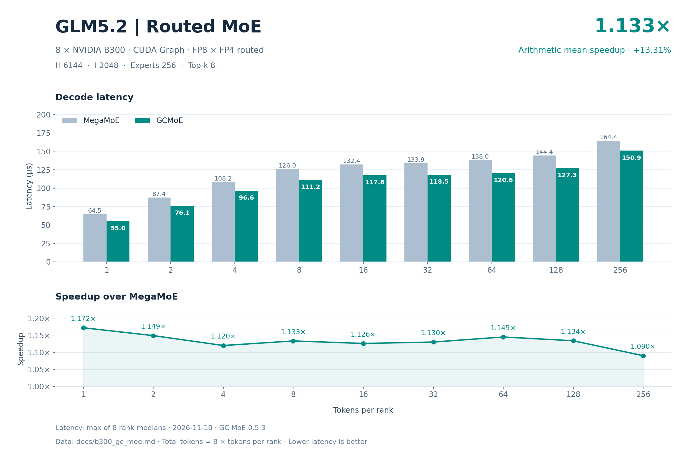
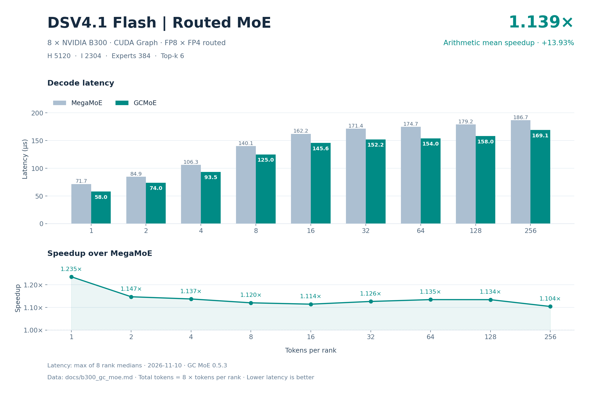

# B300 八卡 GC MoE 精度与 decode 性能

精度结论：两个模型的 default、boundary、asymmetric 全部通过，共 94/94 个 case、752/752 个 rank 检查；所有有限性检查通过。cosine 阈值为 .97。

性能结论：18 个 decode 点中 18/18 点 GC 延迟低于 DeepGEMM MegaMoE；逐点等权平均加速 **1.136213×**，平均加速收益 **13.6213%**，单点范围 1.089973×～1.235214×。

| 模型 | decode 点数 | 平均 Mega / GC | 平均加速收益 | 平均延迟下降 |
| --- | --- | --- | --- | --- |
| glm5.2 | 9 | 1.133100× | 13.3100% | 11.7160% |
| dsv4.1-flash | 9 | 1.139326× | 13.9326% | 12.1460% |
| 全部模型等权 | 18 | 1.136213× | 13.6213% | 11.9310% |

平均加速比为 `mean(Mega_us / GC_us)`；每模型 9 点等权，总计 18 点等权。平均延迟下降为 `mean(1 − GC_us / Mega_us)`，与平均加速收益分别计算。

## 模型与数据口径

2026-11-10；GC MoE 0.5.3；DeepGEMM MegaMoE 2.8.2+73b2279；8 × NVIDIA B300（设备报告名 L20D，compute capability 10.3），CUDA Graph。FP8 激活、FP4 routed 权重。

| 模型 | H | I | routed experts | top-k |
| --- | --- | --- | --- | --- |
| glm5.2 | 6144 | 2048 | 256 | 8 |
| dsv4.1-flash | 5120 | 2304 | 384 | 6 |

SwiGLU；alpha=1、clamp=10、fast_math=true；routed recipe=(1,1,32)。每 rank requested capacity=256、aligned capacity=1920；总 token=8T。

latency 单位 µs，为 8 rank 各自延迟中位数的最大值。

## 精度

独立参考为 BF16 dense MoE。表中取全部 rank 对应指标的最小 cosine 和最大绝对差。

| 模型 | 类别 | 算子 | case 通过 | rank 检查通过 | 最小参考 cosine | 阈值 | finite |
| --- | --- | --- | --- | --- | --- | --- | --- |
| glm5.2 | default | MegaMoE | 9/9 | 72/72 | 0.977091193 | 0.97 | 全部通过 |
| glm5.2 | default | GCMoE | 9/9 | 72/72 | 0.977091193 | 0.97 | 全部通过 |
| glm5.2 | boundary | MegaMoE | 23/23 | 184/184 | 0.977661490 | 0.97 | 全部通过 |
| glm5.2 | boundary | GCMoE | 23/23 | 184/184 | 0.977661490 | 0.97 | 全部通过 |
| glm5.2 | asymmetric | MegaMoE | 15/15 | 120/120 | 0.977209032 | 0.97 | 全部通过 |
| glm5.2 | asymmetric | GCMoE | 15/15 | 120/120 | 0.977209032 | 0.97 | 全部通过 |
| dsv4.1-flash | default | MegaMoE | 9/9 | 72/72 | 0.976701677 | 0.97 | 全部通过 |
| dsv4.1-flash | default | GCMoE | 9/9 | 72/72 | 0.976701677 | 0.97 | 全部通过 |
| dsv4.1-flash | boundary | MegaMoE | 23/23 | 184/184 | 0.977477908 | 0.97 | 全部通过 |
| dsv4.1-flash | boundary | GCMoE | 23/23 | 184/184 | 0.977477908 | 0.97 | 全部通过 |
| dsv4.1-flash | asymmetric | MegaMoE | 15/15 | 120/120 | 0.977477908 | 0.97 | 全部通过 |
| dsv4.1-flash | asymmetric | GCMoE | 15/15 | 120/120 | 0.977477908 | 0.97 | 全部通过 |

| 模型 | 类别 | 最小 GC/Mega cosine | 最大 \|GC−Mega\| |
| --- | --- | --- | --- |
| glm5.2 | default | 0.999999821 | 0.000000 |
| glm5.2 | boundary | 0.999999702 | 0.000000 |
| glm5.2 | asymmetric | 0.999999702 | 0.000000 |
| dsv4.1-flash | default | 0.999999821 | 0.000000 |
| dsv4.1-flash | boundary | 0.999999762 | 0.000000 |
| dsv4.1-flash | asymmetric | 0.999999821 | 0.000000 |

### glm5.2：default 逐组精度

| T/rank 或各 rank token 向量 | 最小 Mega/ref cosine | 最小 GC/ref cosine | 最小 GC/Mega cosine | 最大 \|GC−Mega\| | 结果 |
| --- | --- | --- | --- | --- | --- |
| 1 | 0.977091193 | 0.977091193 | 0.999999940 | 0.000000 | 通过 |
| 2 | 0.977602303 | 0.977602303 | 0.999999881 | 0.000000 | 通过 |
| 4 | 0.977796495 | 0.977796495 | 0.999999881 | 0.000000 | 通过 |
| 8 | 0.977820098 | 0.977820098 | 0.999999821 | 0.000000 | 通过 |
| 16 | 0.977928698 | 0.977928698 | 0.999999940 | 0.000000 | 通过 |
| 32 | 0.977922022 | 0.977922022 | 0.999999940 | 0.000000 | 通过 |
| 64 | 0.978102505 | 0.978102505 | 0.999999881 | 0.000000 | 通过 |
| 128 | 0.978084207 | 0.978084207 | 0.999999940 | 0.000000 | 通过 |
| 256 | 0.978167832 | 0.978167832 | 0.999999881 | 0.000000 | 通过 |

### glm5.2：boundary 逐组精度

| T/rank 或各 rank token 向量 | 最小 Mega/ref cosine | 最小 GC/ref cosine | 最小 GC/Mega cosine | 最大 \|GC−Mega\| | 结果 |
| --- | --- | --- | --- | --- | --- |
| 0 | 1.000000000 | 1.000000000 | 1.000000000 | 0.000000 | 通过 |
| 3 | 0.977661490 | 0.977661490 | 0.999999940 | 0.000000 | 通过 |
| 5 | 0.977937102 | 0.977937102 | 0.999999702 | 0.000000 | 通过 |
| 7 | 0.977811992 | 0.977811992 | 0.999999940 | 0.000000 | 通过 |
| 9 | 0.977936745 | 0.977936745 | 0.999999881 | 0.000000 | 通过 |
| 15 | 0.977853656 | 0.977853656 | 0.999999881 | 0.000000 | 通过 |
| 17 | 0.977879524 | 0.977879524 | 0.999999940 | 0.000000 | 通过 |
| 31 | 0.977914155 | 0.977914155 | 0.999999940 | 0.000000 | 通过 |
| 33 | 0.977928460 | 0.977928460 | 0.999999940 | 0.000000 | 通过 |
| 63 | 0.978082776 | 0.978082776 | 0.999999940 | 0.000000 | 通过 |
| 65 | 0.978096008 | 0.978096008 | 0.999999940 | 0.000000 | 通过 |
| 95 | 0.978142083 | 0.978142083 | 0.999999881 | 0.000000 | 通过 |
| 96 | 0.978137612 | 0.978137612 | 0.999999940 | 0.000000 | 通过 |
| 97 | 0.978134394 | 0.978134394 | 0.999999940 | 0.000000 | 通过 |
| 127 | 0.978098989 | 0.978098989 | 0.999999821 | 0.000000 | 通过 |
| 129 | 0.978082240 | 0.978082240 | 0.999999940 | 0.000000 | 通过 |
| 191 | 0.978168309 | 0.978168309 | 0.999999881 | 0.000000 | 通过 |
| 192 | 0.978163242 | 0.978163242 | 0.999999881 | 0.000000 | 通过 |
| 193 | 0.978166282 | 0.978166282 | 0.999999940 | 0.000000 | 通过 |
| 239 | 0.978165329 | 0.978165329 | 0.999999881 | 0.000000 | 通过 |
| 240 | 0.978169501 | 0.978169501 | 0.999999881 | 0.000000 | 通过 |
| 241 | 0.978163719 | 0.978163719 | 0.999999881 | 0.000000 | 通过 |
| 255 | 0.978164852 | 0.978164852 | 0.999999881 | 0.000000 | 通过 |

### glm5.2：asymmetric 逐组精度

| T/rank 或各 rank token 向量 | 最小 Mega/ref cosine | 最小 GC/ref cosine | 最小 GC/Mega cosine | 最大 \|GC−Mega\| | 结果 |
| --- | --- | --- | --- | --- | --- |
| [0, 0, 0, 0, 0, 0, 0, 0] | 1.000000000 | 1.000000000 | 1.000000000 | 0.000000 | 通过 |
| [256, 0, 256, 0, 256, 0, 256, 0] | 0.978167832 | 0.978167832 | 0.999999940 | 0.000000 | 通过 |
| [1, 0, 1, 0, 1, 0, 1, 0] | 0.977209032 | 0.977209032 | 0.999999940 | 0.000000 | 通过 |
| [1, 2, 4, 8, 16, 32, 64, 128] | 0.977602303 | 0.977602303 | 0.999999940 | 0.000000 | 通过 |
| [256, 0, 0, 0, 0, 0, 0, 0] | 0.978224695 | 0.978224695 | 1.000000000 | 0.000000 | 通过 |
| [256, 0, 256, 256, 256, 256, 256, 256] | 0.978167832 | 0.978167832 | 0.999999881 | 0.000000 | 通过 |
| [256, 256, 0, 256, 256, 256, 256, 256] | 0.978181362 | 0.978181362 | 0.999999881 | 0.000000 | 通过 |
| [256, 256, 256, 0, 256, 256, 256, 256] | 0.978167832 | 0.978167832 | 0.999999881 | 0.000000 | 通过 |
| [0, 0, 0, 0, 0, 256, 0, 0] | 0.978264093 | 0.978264093 | 0.999999881 | 0.000000 | 通过 |
| [0, 0, 0, 0, 0, 0, 256, 0] | 0.978264570 | 0.978264570 | 0.999999940 | 0.000000 | 通过 |
| [256, 256, 256, 256, 256, 256, 256, 0] | 0.978167832 | 0.978167832 | 0.999999881 | 0.000000 | 通过 |
| [0, 1, 2, 3, 4, 5, 7, 8] | 0.977770865 | 0.977770865 | 0.999999702 | 0.000000 | 通过 |
| [9, 15, 16, 17, 31, 32, 33, 63] | 0.977921367 | 0.977921367 | 0.999999881 | 0.000000 | 通过 |
| [64, 65, 95, 96, 97, 127, 128, 129] | 0.978082240 | 0.978082240 | 0.999999940 | 0.000000 | 通过 |
| [191, 192, 193, 239, 240, 241, 255, 256] | 0.978181362 | 0.978181362 | 0.999999940 | 0.000000 | 通过 |

### dsv4.1-flash：default 逐组精度

| T/rank 或各 rank token 向量 | 最小 Mega/ref cosine | 最小 GC/ref cosine | 最小 GC/Mega cosine | 最大 \|GC−Mega\| | 结果 |
| --- | --- | --- | --- | --- | --- |
| 1 | 0.976701677 | 0.976701677 | 0.999999821 | 0.000000 | 通过 |
| 2 | 0.977744222 | 0.977744222 | 0.999999821 | 0.000000 | 通过 |
| 4 | 0.977864444 | 0.977864444 | 0.999999821 | 0.000000 | 通过 |
| 8 | 0.977826953 | 0.977826953 | 0.999999940 | 0.000000 | 通过 |
| 16 | 0.977974653 | 0.977974653 | 0.999999821 | 0.000000 | 通过 |
| 32 | 0.978046060 | 0.978046060 | 0.999999821 | 0.000000 | 通过 |
| 64 | 0.978108108 | 0.978108108 | 0.999999821 | 0.000000 | 通过 |
| 128 | 0.978063345 | 0.978063345 | 0.999999940 | 0.000000 | 通过 |
| 256 | 0.978033245 | 0.978033245 | 0.999999940 | 0.000000 | 通过 |

### dsv4.1-flash：boundary 逐组精度

| T/rank 或各 rank token 向量 | 最小 Mega/ref cosine | 最小 GC/ref cosine | 最小 GC/Mega cosine | 最大 \|GC−Mega\| | 结果 |
| --- | --- | --- | --- | --- | --- |
| 0 | 1.000000000 | 1.000000000 | 1.000000000 | 0.000000 | 通过 |
| 3 | 0.977477908 | 0.977477908 | 0.999999881 | 0.000000 | 通过 |
| 5 | 0.977832675 | 0.977832675 | 0.999999940 | 0.000000 | 通过 |
| 7 | 0.977809906 | 0.977809906 | 0.999999881 | 0.000000 | 通过 |
| 9 | 0.977810621 | 0.977810621 | 0.999999940 | 0.000000 | 通过 |
| 15 | 0.977993906 | 0.977993906 | 0.999999881 | 0.000000 | 通过 |
| 17 | 0.978025436 | 0.978025436 | 0.999999940 | 0.000000 | 通过 |
| 31 | 0.978050292 | 0.978050292 | 0.999999940 | 0.000000 | 通过 |
| 33 | 0.978002608 | 0.978002608 | 0.999999821 | 0.000000 | 通过 |
| 63 | 0.978142679 | 0.978142679 | 0.999999940 | 0.000000 | 通过 |
| 65 | 0.978120208 | 0.978120208 | 0.999999821 | 0.000000 | 通过 |
| 95 | 0.978018522 | 0.978018522 | 0.999999881 | 0.000000 | 通过 |
| 96 | 0.978024125 | 0.978024125 | 0.999999881 | 0.000000 | 通过 |
| 97 | 0.978040338 | 0.978040338 | 0.999999881 | 0.000000 | 通过 |
| 127 | 0.978063405 | 0.978063405 | 0.999999821 | 0.000000 | 通过 |
| 129 | 0.978058457 | 0.978058457 | 0.999999940 | 0.000000 | 通过 |
| 191 | 0.978027523 | 0.978027523 | 0.999999881 | 0.000000 | 通过 |
| 192 | 0.978033781 | 0.978033781 | 0.999999762 | 0.000000 | 通过 |
| 193 | 0.978038609 | 0.978038609 | 0.999999881 | 0.000000 | 通过 |
| 239 | 0.978025854 | 0.978025854 | 0.999999821 | 0.000000 | 通过 |
| 240 | 0.978028178 | 0.978028178 | 0.999999821 | 0.000000 | 通过 |
| 241 | 0.978031874 | 0.978031874 | 0.999999821 | 0.000000 | 通过 |
| 255 | 0.978031993 | 0.978031993 | 0.999999821 | 0.000000 | 通过 |

### dsv4.1-flash：asymmetric 逐组精度

| T/rank 或各 rank token 向量 | 最小 Mega/ref cosine | 最小 GC/ref cosine | 最小 GC/Mega cosine | 最大 \|GC−Mega\| | 结果 |
| --- | --- | --- | --- | --- | --- |
| [0, 0, 0, 0, 0, 0, 0, 0] | 1.000000000 | 1.000000000 | 1.000000000 | 0.000000 | 通过 |
| [256, 0, 256, 0, 256, 0, 256, 0] | 0.978192508 | 0.978192508 | 0.999999940 | 0.000000 | 通过 |
| [1, 0, 1, 0, 1, 0, 1, 0] | 0.978187978 | 0.978187978 | 0.999999821 | 0.000000 | 通过 |
| [1, 2, 4, 8, 16, 32, 64, 128] | 0.977974653 | 0.977974653 | 0.999999821 | 0.000000 | 通过 |
| [256, 0, 0, 0, 0, 0, 0, 0] | 0.978192508 | 0.978192508 | 1.000000000 | 0.000000 | 通过 |
| [256, 0, 256, 256, 256, 256, 256, 256] | 0.978033245 | 0.978033245 | 0.999999940 | 0.000000 | 通过 |
| [256, 256, 0, 256, 256, 256, 256, 256] | 0.978033245 | 0.978033245 | 0.999999940 | 0.000000 | 通过 |
| [256, 256, 256, 0, 256, 256, 256, 256] | 0.978033245 | 0.978033245 | 0.999999940 | 0.000000 | 通过 |
| [0, 0, 0, 0, 0, 256, 0, 0] | 0.978033245 | 0.978033245 | 1.000000000 | 0.000000 | 通过 |
| [0, 0, 0, 0, 0, 0, 256, 0] | 0.978193283 | 0.978193283 | 0.999999940 | 0.000000 | 通过 |
| [256, 256, 256, 256, 256, 256, 256, 0] | 0.978033245 | 0.978033245 | 0.999999940 | 0.000000 | 通过 |
| [0, 1, 2, 3, 4, 5, 7, 8] | 0.977477908 | 0.977477908 | 1.000000000 | 0.000000 | 通过 |
| [9, 15, 16, 17, 31, 32, 33, 63] | 0.978081286 | 0.978081286 | 0.999999940 | 0.000000 | 通过 |
| [64, 65, 95, 96, 97, 127, 128, 129] | 0.978063405 | 0.978063405 | 0.999999940 | 0.000000 | 通过 |
| [191, 192, 193, 239, 240, 241, 255, 256] | 0.978031874 | 0.978031874 | 0.999999881 | 0.000000 | 通过 |

## glm5.2 decode 性能

| T/rank | 总 token | Mega µs | GC µs | Mega / GC | 延迟下降 |
| --- | --- | --- | --- | --- | --- |
| 1 | 8 | 64.503040 | 55.044959 | 1.171825× | 14.6630% |
| 2 | 16 | 87.426877 | 76.104162 | 1.148779× | 12.9511% |
| 4 | 32 | 108.175683 | 96.603360 | 1.119792× | 10.6977% |
| 8 | 64 | 126.023998 | 111.211362 | 1.133194× | 11.7538% |
| 16 | 128 | 132.363358 | 117.567520 | 1.125850× | 11.1782% |
| 32 | 256 | 133.896480 | 118.493123 | 1.129994× | 11.5039% |
| 64 | 512 | 138.048000 | 120.590878 | 1.144763× | 12.6457% |
| 128 | 1024 | 144.372478 | 127.342720 | 1.133732× | 11.7957% |
| 256 | 2048 | 164.426556 | 150.853758 | 1.089973× | 8.2546% |

## dsv4.1-flash decode 性能

| T/rank | 总 token | Mega µs | GC µs | Mega / GC | 延迟下降 |
| --- | --- | --- | --- | --- | --- |
| 1 | 8 | 71.689441 | 58.038080 | 1.235214× | 19.0424% |
| 2 | 16 | 84.857440 | 73.977120 | 1.147077× | 12.8219% |
| 4 | 32 | 106.345282 | 93.504000 | 1.137334× | 12.0751% |
| 8 | 64 | 140.092163 | 125.037441 | 1.120402× | 10.7463% |
| 16 | 128 | 162.224960 | 145.569119 | 1.114419× | 10.2671% |
| 32 | 256 | 171.439352 | 152.199841 | 1.126410× | 11.2223% |
| 64 | 512 | 174.722719 | 154.004960 | 1.134527× | 11.8575% |
| 128 | 1024 | 179.213600 | 157.994080 | 1.134306× | 11.8404% |
| 256 | 2048 | 186.726713 | 169.098396 | 1.104249× | 9.4407% |

## 有效 HBM 带宽

以命中 routed expert 的权重与 scale 工作集各计一次，加上非空 rank 的本地 shared 权重与 scale（SE）。这是模型估算的有效工作集带宽，不是物理 HBM 流量或硬件计数；不计激活、输出、中间结果及缓存/重复 CTA 访存。单位为十进制 GB/s。

### glm5.2

| T/rank | Mega 八卡合计 | GC 八卡合计 | Mega 每 GPU 均值 | GC 每 GPU 均值 |
| --- | --- | --- | --- | --- |
| 1 | 18343.118995 | 21494.919322 | 2292.889874 | 2686.864915 |
| 2 | 24543.707669 | 28195.300532 | 3067.963459 | 3524.412567 |
| 4 | 30588.322140 | 34252.562581 | 3823.540268 | 4281.570323 |
| 8 | 36122.180655 | 40933.422223 | 4515.272582 | 5116.677778 |
| 16 | 38331.348964 | 43155.337817 | 4791.418620 | 5394.417227 |
| 32 | 38341.770531 | 43325.958196 | 4792.721316 | 5415.744775 |
| 64 | 37188.717573 | 42572.275789 | 4648.589697 | 5321.534474 |
| 128 | 35559.603768 | 40315.049771 | 4444.950471 | 5039.381221 |
| 256 | 31222.621408 | 34031.821076 | 3902.827676 | 4253.977634 |

### dsv4.1-flash

| T/rank | Mega 八卡合计 | GC 八卡合计 | Mega 每 GPU 均值 | GC 每 GPU 均值 |
| --- | --- | --- | --- | --- |
| 1 | 12588.056272 | 15548.941730 | 1573.507034 | 1943.617716 |
| 2 | 19496.891729 | 22364.432702 | 2437.111466 | 2795.554088 |
| 4 | 27048.665222 | 30763.367652 | 3381.083153 | 3845.420956 |
| 8 | 33684.686824 | 37740.380743 | 4210.585853 | 4717.547593 |
| 16 | 39055.738816 | 43524.448755 | 4881.967352 | 5440.556094 |
| 32 | 41233.477356 | 46445.782168 | 5154.184669 | 5805.722771 |
| 64 | 41319.444852 | 46878.008067 | 5164.930606 | 5859.751008 |
| 128 | 40284.028409 | 45694.406896 | 5035.503551 | 5711.800862 |
| 256 | 38663.165206 | 42693.756522 | 4832.895651 | 5336.719565 |

## 有效 NVLink 带宽

有效远程 assignment payload=`remote_assignments × (H + H/32 + 2H)`，包含 FP8 激活、packed scale 和 BF16 返回值；不重复计算 TX+RX，不计本地/shared 工作、元数据、控制及协议开销。这是有效 payload 带宽，不是物理计数或单链路峰值。单位为十进制 GB/s。

### glm5.2

| T/rank | Mega 八卡合计 | GC 八卡合计 | Mega 每 GPU 均值 | GC 每 GPU 均值 |
| --- | --- | --- | --- | --- |
| 1 | 16.457643 | 19.285472 | 2.057205 | 2.410684 |
| 2 | 23.219587 | 26.674179 | 2.902448 | 3.334272 |
| 4 | 37.704000 | 42.220643 | 4.713000 | 5.277580 |
| 8 | 66.501620 | 75.359207 | 8.312702 | 9.419901 |
| 16 | 128.884491 | 145.104566 | 16.110561 | 18.138071 |
| 32 | 249.671090 | 282.126752 | 31.208886 | 35.265844 |
| 64 | 483.381084 | 553.356882 | 60.422635 | 69.169610 |
| 128 | 927.894529 | 1051.983435 | 115.986816 | 131.497929 |
| 256 | 1627.751083 | 1774.205083 | 203.468885 | 221.775635 |

### dsv4.1-flash

| T/rank | Mega 八卡合计 | GC 八卡合计 | Mega 每 GPU 均值 | GC 每 GPU 均值 |
| --- | --- | --- | --- | --- |
| 1 | 8.659574 | 10.696426 | 1.082447 | 1.337053 |
| 2 | 14.814494 | 16.993362 | 1.851812 | 2.124170 |
| 4 | 23.934113 | 27.221082 | 2.991764 | 3.402635 |
| 8 | 37.001927 | 41.457022 | 4.625241 | 5.182128 |
| 16 | 64.194314 | 71.539349 | 8.024289 | 8.942419 |
| 32 | 123.208118 | 138.782800 | 15.401015 | 17.347850 |
| 64 | 237.877250 | 269.878061 | 29.734656 | 33.734758 |
| 128 | 467.383279 | 530.155562 | 58.422910 | 66.269445 |
| 256 | 892.251554 | 985.267771 | 111.531444 | 123.158471 |

## 有效矩阵计算吞吐

有效 FLOP=`6 × routed_assignments × H × I`；不计 padding、SwiGLU、量化/解量化或重复运算。单位 TFLOPS（10¹² FLOP/s）。

### glm5.2

| T/rank | Mega 八卡合计 | GC 八卡合计 | Mega 每 GPU 均值 | GC 每 GPU 均值 |
| --- | --- | --- | --- | --- |
| 1 | 74.908689 | 87.779850 | 9.363586 | 10.972481 |
| 2 | 110.534389 | 126.979605 | 13.816799 | 15.872451 |
| 4 | 178.666335 | 200.069157 | 22.333292 | 25.008645 |
| 8 | 306.724959 | 347.578746 | 38.340620 | 43.447343 |
| 16 | 584.069585 | 657.574569 | 73.008698 | 82.196821 |
| 32 | 1154.763912 | 1304.875917 | 144.345489 | 163.109490 |
| 64 | 2240.073341 | 2564.353553 | 280.009168 | 320.544194 |
| 128 | 4283.886383 | 4856.777761 | 535.485798 | 607.097220 |
| 256 | 7522.815135 | 8199.667007 | 940.351892 | 1024.958376 |

### dsv4.1-flash

| T/rank | Mega 八卡合计 | GC 八卡合计 | Mega 每 GPU 均值 | GC 每 GPU 均值 |
| --- | --- | --- | --- | --- |
| 1 | 47.390329 | 58.537192 | 5.923791 | 7.317149 |
| 2 | 80.072796 | 91.849649 | 10.009099 | 11.481206 |
| 4 | 127.787004 | 145.336510 | 15.973376 | 18.167064 |
| 8 | 194.008639 | 217.367611 | 24.251080 | 27.170951 |
| 16 | 335.079015 | 373.418346 | 41.884877 | 46.677293 |
| 32 | 634.138886 | 714.300089 | 79.267361 | 89.287511 |
| 64 | 1244.444457 | 1411.855302 | 155.555557 | 176.481913 |
| 128 | 2426.520299 | 2752.416039 | 303.315037 | 344.052005 |
| 256 | 4657.774255 | 5143.341962 | 582.221782 | 642.917745 |

三项均为有效工作量估算，不是物理硬件计数或峰值。三项吞吐均使用各算子自身的同一 slowest-rank median latency：GB/s=`bytes / (latency_us × 10³)`，TFLOPS=`FLOP / (latency_us × 10⁶)`。八卡合计为全工作量除以该延迟；每 GPU 均值为合计除以 8，不代表每卡实测峰值。Mega 与 GC 使用相同有效工作量分子。
