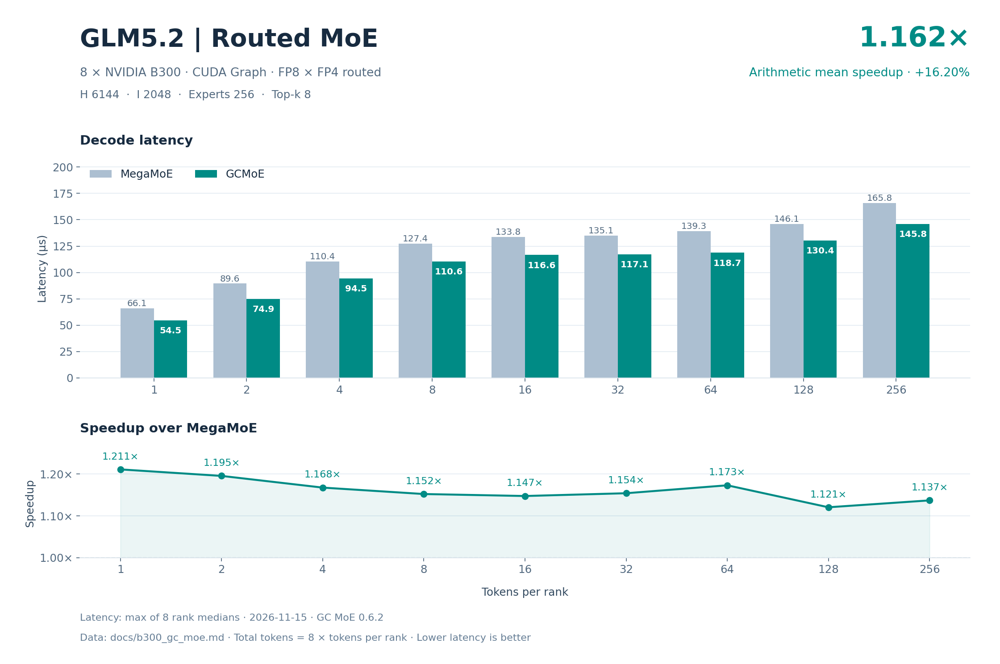
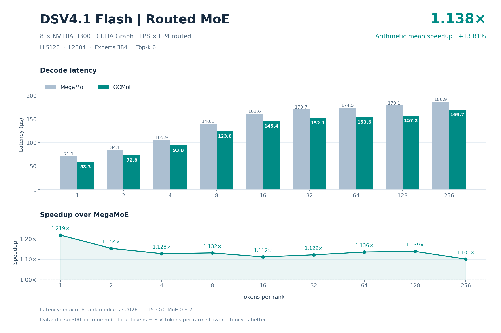

# B300 八卡 GC MoE 精度与 decode 性能

精度结论：两个模型的 default、boundary、asymmetric 全部通过，共 94/94 个 case、752/752 个 rank 检查；所有有限性检查通过。cosine 阈值为 .97。

性能结论：18 个 decode 点中 18/18 点 GC 延迟低于 DeepGEMM MegaMoE；逐点等权平均加速 **1.150043×**，平均加速收益 **15.0043%**，单点范围 1.100912×～1.218944×。

| 模型 | decode 点数 | 平均 Mega / GC | 平均加速收益 | 平均延迟下降 |
| --- | --- | --- | --- | --- |
| glm5.2 | 9 | 1.162008× | 16.2008% | 13.8972% |
| dsv4.1-flash | 9 | 1.138079× | 13.8079% | 12.0656% |
| 全部模型等权 | 18 | 1.150043× | 15.0043% | 12.9814% |

平均加速比为 `mean(Mega_us / GC_us)`；每模型 9 点等权，总计 18 点等权。平均延迟下降为 `mean(1 − GC_us / Mega_us)`，与平均加速收益分别计算。

## 模型与数据口径

2026-11-15；GC MoE 0.6.2；DeepGEMM MegaMoE 2.8.2+fcad603；8 × NVIDIA B300（设备报告名 L20D，compute capability 10.3），CUDA Graph。FP8 激活、FP4 routed 权重。

| 模型 | H | I | routed experts | top-k |
| --- | --- | --- | --- | --- |
| glm5.2 | 6144 | 2048 | 256 | 8 |
| dsv4.1-flash | 5120 | 2304 | 384 | 6 |

SwiGLU；alpha=1、clamp=10、fast_math=true；routed recipe=(1,1,32)。每 rank requested capacity=256、aligned capacity=1920；总 token=8T。

latency 单位 µs，为 8 rank 各自延迟中位数的最大值。

## 精度

独立参考为 BF16 dense MoE。表中取全部 rank 对应指标的最小 cosine 和最大绝对差。

| 模型 | 类别 | 算子 | case 通过 | rank 检查通过 | 最小参考 cosine | 阈值 | finite |
| --- | --- | --- | --- | --- | --- | --- | --- |
| glm5.2 | default | MegaMoE | 9/9 | 72/72 | 0.977091193 | 0.97 | 全部通过 |
| glm5.2 | default | GCMoE | 9/9 | 72/72 | 0.977091193 | 0.97 | 全部通过 |
| glm5.2 | boundary | MegaMoE | 23/23 | 184/184 | 0.977661490 | 0.97 | 全部通过 |
| glm5.2 | boundary | GCMoE | 23/23 | 184/184 | 0.977661490 | 0.97 | 全部通过 |
| glm5.2 | asymmetric | MegaMoE | 15/15 | 120/120 | 0.977209032 | 0.97 | 全部通过 |
| glm5.2 | asymmetric | GCMoE | 15/15 | 120/120 | 0.977209032 | 0.97 | 全部通过 |
| dsv4.1-flash | default | MegaMoE | 9/9 | 72/72 | 0.976701677 | 0.97 | 全部通过 |
| dsv4.1-flash | default | GCMoE | 9/9 | 72/72 | 0.976701677 | 0.97 | 全部通过 |
| dsv4.1-flash | boundary | MegaMoE | 23/23 | 184/184 | 0.977477908 | 0.97 | 全部通过 |
| dsv4.1-flash | boundary | GCMoE | 23/23 | 184/184 | 0.977477908 | 0.97 | 全部通过 |
| dsv4.1-flash | asymmetric | MegaMoE | 15/15 | 120/120 | 0.977477908 | 0.97 | 全部通过 |
| dsv4.1-flash | asymmetric | GCMoE | 15/15 | 120/120 | 0.977477908 | 0.97 | 全部通过 |

| 模型 | 类别 | 最小 GC/Mega cosine | 最大 \|GC−Mega\| |
| --- | --- | --- | --- |
| glm5.2 | default | 0.999999821 | 0.000000 |
| glm5.2 | boundary | 0.999999702 | 0.000000 |
| glm5.2 | asymmetric | 0.999999702 | 0.000000 |
| dsv4.1-flash | default | 0.999999821 | 0.000000 |
| dsv4.1-flash | boundary | 0.999999762 | 0.000000 |
| dsv4.1-flash | asymmetric | 0.999999821 | 0.000000 |

### glm5.2：default 逐组精度

| T/rank 或各 rank token 向量 | 最小 Mega/ref cosine | 最小 GC/ref cosine | 最小 GC/Mega cosine | 最大 \|GC−Mega\| | 结果 |
| --- | --- | --- | --- | --- | --- |
| 1 | 0.977091193 | 0.977091193 | 0.999999940 | 0.000000 | 通过 |
| 2 | 0.977602303 | 0.977602303 | 0.999999881 | 0.000000 | 通过 |
| 4 | 0.977796495 | 0.977796495 | 0.999999881 | 0.000000 | 通过 |
| 8 | 0.977820098 | 0.977820098 | 0.999999821 | 0.000000 | 通过 |
| 16 | 0.977928698 | 0.977928698 | 0.999999940 | 0.000000 | 通过 |
| 32 | 0.977922022 | 0.977922022 | 0.999999940 | 0.000000 | 通过 |
| 64 | 0.978102505 | 0.978102505 | 0.999999881 | 0.000000 | 通过 |
| 128 | 0.978084207 | 0.978084207 | 0.999999940 | 0.000000 | 通过 |
| 256 | 0.978167832 | 0.978167832 | 0.999999881 | 0.000000 | 通过 |

### glm5.2：boundary 逐组精度

| T/rank 或各 rank token 向量 | 最小 Mega/ref cosine | 最小 GC/ref cosine | 最小 GC/Mega cosine | 最大 \|GC−Mega\| | 结果 |
| --- | --- | --- | --- | --- | --- |
| 0 | 1.000000000 | 1.000000000 | 1.000000000 | 0.000000 | 通过 |
| 3 | 0.977661490 | 0.977661490 | 0.999999940 | 0.000000 | 通过 |
| 5 | 0.977937102 | 0.977937102 | 0.999999702 | 0.000000 | 通过 |
| 7 | 0.977811992 | 0.977811992 | 0.999999940 | 0.000000 | 通过 |
| 9 | 0.977936745 | 0.977936745 | 0.999999881 | 0.000000 | 通过 |
| 15 | 0.977853656 | 0.977853656 | 0.999999881 | 0.000000 | 通过 |
| 17 | 0.977879524 | 0.977879524 | 0.999999940 | 0.000000 | 通过 |
| 31 | 0.977914155 | 0.977914155 | 0.999999940 | 0.000000 | 通过 |
| 33 | 0.977928460 | 0.977928460 | 0.999999940 | 0.000000 | 通过 |
| 63 | 0.978082776 | 0.978082776 | 0.999999940 | 0.000000 | 通过 |
| 65 | 0.978096008 | 0.978096008 | 0.999999940 | 0.000000 | 通过 |
| 95 | 0.978142083 | 0.978142083 | 0.999999881 | 0.000000 | 通过 |
| 96 | 0.978137612 | 0.978137612 | 0.999999940 | 0.000000 | 通过 |
| 97 | 0.978134394 | 0.978134394 | 0.999999940 | 0.000000 | 通过 |
| 127 | 0.978098989 | 0.978098989 | 0.999999821 | 0.000000 | 通过 |
| 129 | 0.978082240 | 0.978082240 | 0.999999940 | 0.000000 | 通过 |
| 191 | 0.978168309 | 0.978168309 | 0.999999881 | 0.000000 | 通过 |
| 192 | 0.978163242 | 0.978163242 | 0.999999881 | 0.000000 | 通过 |
| 193 | 0.978166282 | 0.978166282 | 0.999999940 | 0.000000 | 通过 |
| 239 | 0.978165329 | 0.978165329 | 0.999999881 | 0.000000 | 通过 |
| 240 | 0.978169501 | 0.978169501 | 0.999999881 | 0.000000 | 通过 |
| 241 | 0.978163719 | 0.978163719 | 0.999999881 | 0.000000 | 通过 |
| 255 | 0.978164852 | 0.978164852 | 0.999999881 | 0.000000 | 通过 |

### glm5.2：asymmetric 逐组精度

| T/rank 或各 rank token 向量 | 最小 Mega/ref cosine | 最小 GC/ref cosine | 最小 GC/Mega cosine | 最大 \|GC−Mega\| | 结果 |
| --- | --- | --- | --- | --- | --- |
| [0, 0, 0, 0, 0, 0, 0, 0] | 1.000000000 | 1.000000000 | 1.000000000 | 0.000000 | 通过 |
| [256, 0, 256, 0, 256, 0, 256, 0] | 0.978167832 | 0.978167832 | 0.999999940 | 0.000000 | 通过 |
| [1, 0, 1, 0, 1, 0, 1, 0] | 0.977209032 | 0.977209032 | 0.999999940 | 0.000000 | 通过 |
| [1, 2, 4, 8, 16, 32, 64, 128] | 0.977602303 | 0.977602303 | 0.999999940 | 0.000000 | 通过 |
| [256, 0, 0, 0, 0, 0, 0, 0] | 0.978224695 | 0.978224695 | 1.000000000 | 0.000000 | 通过 |
| [256, 0, 256, 256, 256, 256, 256, 256] | 0.978167832 | 0.978167832 | 0.999999881 | 0.000000 | 通过 |
| [256, 256, 0, 256, 256, 256, 256, 256] | 0.978181362 | 0.978181362 | 0.999999881 | 0.000000 | 通过 |
| [256, 256, 256, 0, 256, 256, 256, 256] | 0.978167832 | 0.978167832 | 0.999999881 | 0.000000 | 通过 |
| [0, 0, 0, 0, 0, 256, 0, 0] | 0.978264093 | 0.978264093 | 0.999999881 | 0.000000 | 通过 |
| [0, 0, 0, 0, 0, 0, 256, 0] | 0.978264570 | 0.978264570 | 0.999999940 | 0.000000 | 通过 |
| [256, 256, 256, 256, 256, 256, 256, 0] | 0.978167832 | 0.978167832 | 0.999999881 | 0.000000 | 通过 |
| [0, 1, 2, 3, 4, 5, 7, 8] | 0.977770865 | 0.977770865 | 0.999999702 | 0.000000 | 通过 |
| [9, 15, 16, 17, 31, 32, 33, 63] | 0.977921367 | 0.977921367 | 0.999999881 | 0.000000 | 通过 |
| [64, 65, 95, 96, 97, 127, 128, 129] | 0.978082240 | 0.978082240 | 0.999999940 | 0.000000 | 通过 |
| [191, 192, 193, 239, 240, 241, 255, 256] | 0.978181362 | 0.978181362 | 0.999999940 | 0.000000 | 通过 |

### dsv4.1-flash：default 逐组精度

| T/rank 或各 rank token 向量 | 最小 Mega/ref cosine | 最小 GC/ref cosine | 最小 GC/Mega cosine | 最大 \|GC−Mega\| | 结果 |
| --- | --- | --- | --- | --- | --- |
| 1 | 0.976701677 | 0.976701677 | 0.999999821 | 0.000000 | 通过 |
| 2 | 0.977744222 | 0.977744222 | 0.999999821 | 0.000000 | 通过 |
| 4 | 0.977864444 | 0.977864444 | 0.999999821 | 0.000000 | 通过 |
| 8 | 0.977826953 | 0.977826953 | 0.999999940 | 0.000000 | 通过 |
| 16 | 0.977974653 | 0.977974653 | 0.999999821 | 0.000000 | 通过 |
| 32 | 0.978046060 | 0.978046060 | 0.999999821 | 0.000000 | 通过 |
| 64 | 0.978108108 | 0.978108108 | 0.999999821 | 0.000000 | 通过 |
| 128 | 0.978063345 | 0.978063345 | 0.999999940 | 0.000000 | 通过 |
| 256 | 0.978033245 | 0.978033245 | 0.999999940 | 0.000000 | 通过 |

### dsv4.1-flash：boundary 逐组精度

| T/rank 或各 rank token 向量 | 最小 Mega/ref cosine | 最小 GC/ref cosine | 最小 GC/Mega cosine | 最大 \|GC−Mega\| | 结果 |
| --- | --- | --- | --- | --- | --- |
| 0 | 1.000000000 | 1.000000000 | 1.000000000 | 0.000000 | 通过 |
| 3 | 0.977477908 | 0.977477908 | 0.999999881 | 0.000000 | 通过 |
| 5 | 0.977832675 | 0.977832675 | 0.999999940 | 0.000000 | 通过 |
| 7 | 0.977809906 | 0.977809906 | 0.999999881 | 0.000000 | 通过 |
| 9 | 0.977810621 | 0.977810621 | 0.999999940 | 0.000000 | 通过 |
| 15 | 0.977993906 | 0.977993906 | 0.999999881 | 0.000000 | 通过 |
| 17 | 0.978025436 | 0.978025436 | 0.999999940 | 0.000000 | 通过 |
| 31 | 0.978050292 | 0.978050292 | 0.999999940 | 0.000000 | 通过 |
| 33 | 0.978002608 | 0.978002608 | 0.999999821 | 0.000000 | 通过 |
| 63 | 0.978142679 | 0.978142679 | 0.999999940 | 0.000000 | 通过 |
| 65 | 0.978120208 | 0.978120208 | 0.999999821 | 0.000000 | 通过 |
| 95 | 0.978018522 | 0.978018522 | 0.999999881 | 0.000000 | 通过 |
| 96 | 0.978024125 | 0.978024125 | 0.999999881 | 0.000000 | 通过 |
| 97 | 0.978040338 | 0.978040338 | 0.999999881 | 0.000000 | 通过 |
| 127 | 0.978063405 | 0.978063405 | 0.999999821 | 0.000000 | 通过 |
| 129 | 0.978058457 | 0.978058457 | 0.999999940 | 0.000000 | 通过 |
| 191 | 0.978027523 | 0.978027523 | 0.999999881 | 0.000000 | 通过 |
| 192 | 0.978033781 | 0.978033781 | 0.999999762 | 0.000000 | 通过 |
| 193 | 0.978038609 | 0.978038609 | 0.999999881 | 0.000000 | 通过 |
| 239 | 0.978025854 | 0.978025854 | 0.999999821 | 0.000000 | 通过 |
| 240 | 0.978028178 | 0.978028178 | 0.999999821 | 0.000000 | 通过 |
| 241 | 0.978031874 | 0.978031874 | 0.999999821 | 0.000000 | 通过 |
| 255 | 0.978031993 | 0.978031993 | 0.999999821 | 0.000000 | 通过 |

### dsv4.1-flash：asymmetric 逐组精度

| T/rank 或各 rank token 向量 | 最小 Mega/ref cosine | 最小 GC/ref cosine | 最小 GC/Mega cosine | 最大 \|GC−Mega\| | 结果 |
| --- | --- | --- | --- | --- | --- |
| [0, 0, 0, 0, 0, 0, 0, 0] | 1.000000000 | 1.000000000 | 1.000000000 | 0.000000 | 通过 |
| [256, 0, 256, 0, 256, 0, 256, 0] | 0.978192508 | 0.978192508 | 0.999999940 | 0.000000 | 通过 |
| [1, 0, 1, 0, 1, 0, 1, 0] | 0.978187978 | 0.978187978 | 0.999999821 | 0.000000 | 通过 |
| [1, 2, 4, 8, 16, 32, 64, 128] | 0.977974653 | 0.977974653 | 0.999999821 | 0.000000 | 通过 |
| [256, 0, 0, 0, 0, 0, 0, 0] | 0.978192508 | 0.978192508 | 1.000000000 | 0.000000 | 通过 |
| [256, 0, 256, 256, 256, 256, 256, 256] | 0.978033245 | 0.978033245 | 0.999999940 | 0.000000 | 通过 |
| [256, 256, 0, 256, 256, 256, 256, 256] | 0.978033245 | 0.978033245 | 0.999999940 | 0.000000 | 通过 |
| [256, 256, 256, 0, 256, 256, 256, 256] | 0.978033245 | 0.978033245 | 0.999999940 | 0.000000 | 通过 |
| [0, 0, 0, 0, 0, 256, 0, 0] | 0.978033245 | 0.978033245 | 1.000000000 | 0.000000 | 通过 |
| [0, 0, 0, 0, 0, 0, 256, 0] | 0.978193283 | 0.978193283 | 0.999999940 | 0.000000 | 通过 |
| [256, 256, 256, 256, 256, 256, 256, 0] | 0.978033245 | 0.978033245 | 0.999999940 | 0.000000 | 通过 |
| [0, 1, 2, 3, 4, 5, 7, 8] | 0.977477908 | 0.977477908 | 1.000000000 | 0.000000 | 通过 |
| [9, 15, 16, 17, 31, 32, 33, 63] | 0.978081286 | 0.978081286 | 0.999999940 | 0.000000 | 通过 |
| [64, 65, 95, 96, 97, 127, 128, 129] | 0.978063405 | 0.978063405 | 0.999999940 | 0.000000 | 通过 |
| [191, 192, 193, 239, 240, 241, 255, 256] | 0.978031874 | 0.978031874 | 0.999999881 | 0.000000 | 通过 |

## glm5.2 decode 性能

| T/rank | 总 token | Mega µs | GC µs | Mega / GC | 延迟下降 |
| --- | --- | --- | --- | --- | --- |
| 1 | 8 | 66.054878 | 54.547842 | 1.210953× | 17.4204% |
| 2 | 16 | 89.578881 | 74.935520 | 1.195413× | 16.3469% |
| 4 | 32 | 110.386562 | 94.548960 | 1.167507× | 14.3474% |
| 8 | 64 | 127.393756 | 110.570078 | 1.152154× | 13.2060% |
| 16 | 128 | 133.769441 | 116.580000 | 1.147448× | 12.8501% |
| 32 | 256 | 135.099039 | 117.062402 | 1.154077× | 13.3507% |
| 64 | 512 | 139.259996 | 118.721757 | 1.172995× | 14.7481% |
| 128 | 1024 | 146.078238 | 130.362878 | 1.120551× | 10.7582% |
| 256 | 2048 | 165.811357 | 145.836000 | 1.136971× | 12.0470% |

## dsv4.1-flash decode 性能

| T/rank | 总 token | Mega µs | GC µs | Mega / GC | 延迟下降 |
| --- | --- | --- | --- | --- | --- |
| 1 | 8 | 71.061921 | 58.297920 | 1.218944× | 17.9618% |
| 2 | 16 | 84.060321 | 72.844961 | 1.153962× | 13.3420% |
| 4 | 32 | 105.860639 | 93.842402 | 1.128068× | 11.3529% |
| 8 | 64 | 140.137758 | 123.833761 | 1.131660× | 11.6343% |
| 16 | 128 | 161.614723 | 145.365276 | 1.111784× | 10.0544% |
| 32 | 256 | 170.682878 | 152.093439 | 1.122224× | 10.8912% |
| 64 | 512 | 174.516163 | 153.622718 | 1.136005× | 11.9722% |
| 128 | 1024 | 179.118557 | 157.238879 | 1.139149× | 12.2152% |
| 256 | 2048 | 186.850882 | 169.723682 | 1.100912× | 9.1662% |

## 有效 HBM 带宽

以命中 routed expert 的权重与 scale 工作集各计一次，加上非空 rank 的本地 shared 权重与 scale（SE）。这是模型估算的有效工作集带宽，不是物理 HBM 流量或硬件计数；不计激活、输出、中间结果及缓存/重复 CTA 访存。单位为十进制 GB/s。

### glm5.2

| T/rank | Mega 八卡合计 | GC 八卡合计 | Mega 每 GPU 均值 | GC 每 GPU 均值 |
| --- | --- | --- | --- | --- |
| 1 | 17912.181138 | 21690.811413 | 2239.022642 | 2711.351427 |
| 2 | 23954.080267 | 28635.014753 | 2994.260033 | 3579.376844 |
| 4 | 29975.683359 | 34996.816986 | 3746.960420 | 4374.602123 |
| 8 | 35733.789301 | 41170.827756 | 4466.723663 | 5146.353469 |
| 16 | 37928.438837 | 43520.895963 | 4741.054855 | 5440.111995 |
| 32 | 38000.478249 | 43855.482361 | 4750.059781 | 5481.935295 |
| 64 | 36865.059803 | 43242.521241 | 4608.132475 | 5405.315155 |
| 128 | 35144.372969 | 39381.058326 | 4393.046621 | 4922.632291 |
| 256 | 30961.860354 | 35202.748844 | 3870.232544 | 4400.343606 |

### dsv4.1-flash

| T/rank | Mega 八卡合计 | GC 八卡合计 | Mega 每 GPU 均值 | GC 每 GPU 均值 |
| --- | --- | --- | --- | --- |
| 1 | 12699.216483 | 15479.638321 | 1587.402060 | 1934.954790 |
| 2 | 19681.774982 | 22712.021591 | 2460.221873 | 2839.002699 |
| 4 | 27172.497328 | 30652.432950 | 3396.562166 | 3831.554119 |
| 8 | 33673.727186 | 38107.222083 | 4209.215898 | 4763.402760 |
| 16 | 39203.208435 | 43585.482308 | 4900.401054 | 5448.185289 |
| 32 | 41416.225824 | 46478.274683 | 5177.028228 | 5809.784335 |
| 64 | 41368.350307 | 46994.649364 | 5171.043788 | 5874.331170 |
| 128 | 40305.403761 | 45913.871916 | 5038.175470 | 5739.233990 |
| 256 | 38637.472294 | 42536.466672 | 4829.684037 | 5317.058334 |

## 有效 NVLink 带宽

有效远程 assignment payload=`remote_assignments × (H + H/32 + 2H)`，包含 FP8 激活、packed scale 和 BF16 返回值；不重复计算 TX+RX，不计本地/shared 工作、元数据、控制及协议开销。这是有效 payload 带宽，不是物理计数或单链路峰值。单位为十进制 GB/s。

### glm5.2

| T/rank | Mega 八卡合计 | GC 八卡合计 | Mega 每 GPU 均值 | GC 每 GPU 均值 |
| --- | --- | --- | --- | --- |
| 1 | 16.071001 | 19.461228 | 2.008875 | 2.432654 |
| 2 | 22.661770 | 27.090170 | 2.832721 | 3.386271 |
| 4 | 36.948845 | 43.138031 | 4.618606 | 5.392254 |
| 8 | 65.786584 | 75.796275 | 8.223323 | 9.474534 |
| 16 | 127.529755 | 146.333711 | 15.941219 | 18.291714 |
| 32 | 247.448688 | 285.574869 | 30.931086 | 35.696859 |
| 64 | 479.174161 | 562.068771 | 59.896770 | 70.258596 |
| 128 | 917.059470 | 1027.611803 | 114.632434 | 128.451475 |
| 256 | 1614.156642 | 1835.249892 | 201.769580 | 229.406236 |

### dsv4.1-flash

| T/rank | Mega 八卡合计 | GC 八卡合计 | Mega 每 GPU 均值 | GC 每 GPU 均值 |
| --- | --- | --- | --- | --- |
| 1 | 8.736043 | 10.648750 | 1.092005 | 1.331094 |
| 2 | 14.954975 | 17.257474 | 1.869372 | 2.157184 |
| 4 | 24.043686 | 27.122921 | 3.005461 | 3.390365 |
| 8 | 36.989888 | 41.859990 | 4.623736 | 5.232499 |
| 16 | 64.436703 | 71.639667 | 8.054588 | 8.954958 |
| 32 | 123.754182 | 138.879889 | 15.469273 | 17.359986 |
| 64 | 238.158800 | 270.549568 | 29.769850 | 33.818696 |
| 128 | 467.631280 | 532.701838 | 58.453910 | 66.587730 |
| 256 | 891.658624 | 981.637905 | 111.457328 | 122.704738 |

## 有效矩阵计算吞吐

有效 FLOP=`6 × routed_assignments × H × I`；不计 padding、SwiGLU、量化/解量化或重复运算。单位 TFLOPS（10¹² FLOP/s）。

### glm5.2

| T/rank | Mega 八卡合计 | GC 八卡合计 | Mega 每 GPU 均值 | GC 每 GPU 均值 |
| --- | --- | --- | --- | --- |
| 1 | 73.148847 | 88.579824 | 9.143606 | 11.072478 |
| 2 | 107.878959 | 128.959891 | 13.484870 | 16.119986 |
| 4 | 175.087913 | 204.416346 | 21.885989 | 25.552043 |
| 8 | 303.427004 | 349.594632 | 37.928375 | 43.699329 |
| 16 | 577.930288 | 663.144719 | 72.241286 | 82.893090 |
| 32 | 1144.484992 | 1320.823939 | 143.060624 | 165.102992 |
| 64 | 2220.577720 | 2604.725985 | 277.572215 | 325.590748 |
| 128 | 4233.863285 | 4744.259262 | 529.232911 | 593.032408 |
| 256 | 7459.987059 | 8481.791721 | 932.498382 | 1060.223965 |

### dsv4.1-flash

| T/rank | Mega 八卡合计 | GC 八卡合计 | Mega 每 GPU 均值 | GC 每 GPU 均值 |
| --- | --- | --- | --- | --- |
| 1 | 47.808815 | 58.276285 | 5.976102 | 7.284536 |
| 2 | 80.832103 | 93.277180 | 10.104013 | 11.659647 |
| 4 | 128.372029 | 144.812417 | 16.046504 | 18.101552 |
| 8 | 193.945517 | 219.480452 | 24.243190 | 27.435057 |
| 16 | 336.344231 | 373.941984 | 42.043029 | 46.742748 |
| 32 | 636.949415 | 714.799799 | 79.618677 | 89.349975 |
| 64 | 1245.917374 | 1415.368263 | 155.739672 | 176.921033 |
| 128 | 2427.807850 | 2765.635579 | 303.475981 | 345.704447 |
| 256 | 4654.679015 | 5124.393161 | 581.834877 | 640.549145 |

三项均为有效工作量估算，不是物理硬件计数或峰值。三项吞吐均使用各算子自身的同一 slowest-rank median latency：GB/s=`bytes / (latency_us × 10³)`，TFLOPS=`FLOP / (latency_us × 10⁶)`。八卡合计为全工作量除以该延迟；每 GPU 均值为合计除以 8，不代表每卡实测峰值。Mega 与 GC 使用相同有效工作量分子。
