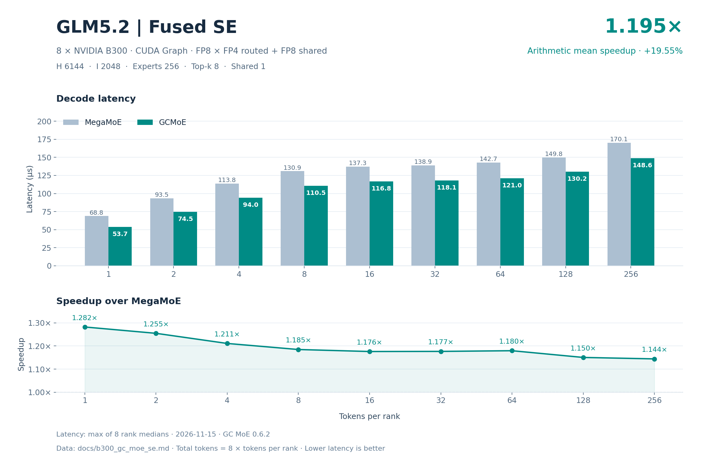
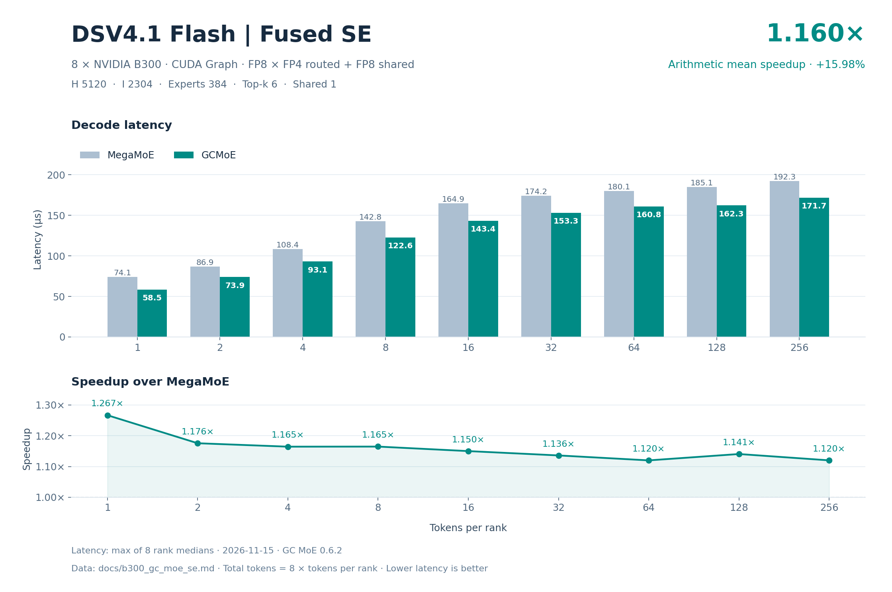

# B300 八卡 GC MoE SE 精度与 decode 性能

精度结论：两个模型的 default、boundary、asymmetric 全部通过，共 94/94 个 case、752/752 个 rank 检查；所有有限性检查通过。cosine 阈值为 .99。

性能结论：18 个 decode 点中 18/18 点 GC 延迟低于 DeepGEMM MegaMoE；逐点等权平均加速 **1.177645×**，平均加速收益 **17.7645%**，单点范围 1.119957×～1.282018×。

| 模型 | decode 点数 | 平均 Mega / GC | 平均加速收益 | 平均延迟下降 |
| --- | --- | --- | --- | --- |
| glm5.2 | 9 | 1.195469× | 19.5469% | 16.2434% |
| dsv4.1-flash | 9 | 1.159821× | 15.9821% | 13.6723% |
| 全部模型等权 | 18 | 1.177645× | 17.7645% | 14.9579% |

平均加速比为 `mean(Mega_us / GC_us)`；每模型 9 点等权，总计 18 点等权。平均延迟下降为 `mean(1 − GC_us / Mega_us)`，与平均加速收益分别计算。

## 模型与数据口径

2026-11-15；GC MoE 0.6.2；DeepGEMM MegaMoE 2.8.2+fcad603；8 × NVIDIA B300（设备报告名 L20D，compute capability 10.3），CUDA Graph。FP8 激活、FP4 routed 权重、FP8 shared 权重。

| 模型 | H | I | routed experts | top-k | shared experts | shared weight gran K | shared recipe |
| --- | --- | --- | --- | --- | --- | --- | --- |
| glm5.2 | 6144 | 2048 | 256 | 8 | 1 | 128 | (1,128,128) |
| dsv4.1-flash | 5120 | 2304 | 384 | 6 | 1 | 32 | (1,1,32) |

SwiGLU；alpha=1、clamp=10、fast_math=true；routed recipe=(1,1,32)。每 rank requested capacity=256、aligned capacity=1920；总 token=8T。

latency 单位 µs，为 8 rank 各自延迟中位数的最大值。

## 精度

独立参考为解量化后的 Torch routed 分支分布式求和及本地 shared 分支；shared residual 与独立 shared 分支比较。表中取全部 rank 对应指标的最小 cosine 和最大绝对差。

| 模型 | 类别 | 算子 | case 通过 | rank 检查通过 | 最小参考 cosine | 阈值 | finite |
| --- | --- | --- | --- | --- | --- | --- | --- |
| glm5.2 | default | MegaMoE | 9/9 | 72/72 | 0.999999464 | 0.99 | 全部通过 |
| glm5.2 | default | GCMoE | 9/9 | 72/72 | 0.999999464 | 0.99 | 全部通过 |
| glm5.2 | boundary | MegaMoE | 23/23 | 184/184 | 0.999999285 | 0.99 | 全部通过 |
| glm5.2 | boundary | GCMoE | 23/23 | 184/184 | 0.999999285 | 0.99 | 全部通过 |
| glm5.2 | asymmetric | MegaMoE | 15/15 | 120/120 | 0.999999523 | 0.99 | 全部通过 |
| glm5.2 | asymmetric | GCMoE | 15/15 | 120/120 | 0.999999523 | 0.99 | 全部通过 |
| dsv4.1-flash | default | MegaMoE | 9/9 | 72/72 | 0.999999702 | 0.99 | 全部通过 |
| dsv4.1-flash | default | GCMoE | 9/9 | 72/72 | 0.999999702 | 0.99 | 全部通过 |
| dsv4.1-flash | boundary | MegaMoE | 23/23 | 184/184 | 0.999999821 | 0.99 | 全部通过 |
| dsv4.1-flash | boundary | GCMoE | 23/23 | 184/184 | 0.999999821 | 0.99 | 全部通过 |
| dsv4.1-flash | asymmetric | MegaMoE | 15/15 | 120/120 | 0.999999821 | 0.99 | 全部通过 |
| dsv4.1-flash | asymmetric | GCMoE | 15/15 | 120/120 | 0.999999821 | 0.99 | 全部通过 |

| 模型 | 类别 | 最小 GC/Mega cosine | 最大 \|GC−Mega\| | 最小 Mega shared cosine | 最小 GC shared cosine |
| --- | --- | --- | --- | --- | --- |
| glm5.2 | default | 0.999999821 | 0.000000 | 0.999997735 | 0.999997735 |
| glm5.2 | boundary | 0.999999821 | 0.000000 | 0.999997795 | 0.999997795 |
| glm5.2 | asymmetric | 0.999999821 | 0.000000 | 0.999997914 | 0.999997914 |
| dsv4.1-flash | default | 0.999999821 | 0.000000 | 0.999998212 | 0.999998212 |
| dsv4.1-flash | boundary | 0.999999821 | 0.000000 | 0.999998152 | 0.999998152 |
| dsv4.1-flash | asymmetric | 0.999999881 | 0.000000 | 0.999998212 | 0.999998212 |

### glm5.2：default 逐组精度

| T/rank 或各 rank token 向量 | 最小 Mega/ref cosine | 最小 GC/ref cosine | 最小 GC/Mega cosine | 最大 \|GC−Mega\| | 结果 |
| --- | --- | --- | --- | --- | --- |
| 1 | 0.999999881 | 0.999999881 | 0.999999881 | 0.000000 | 通过 |
| 2 | 0.999999881 | 0.999999881 | 0.999999881 | 0.000000 | 通过 |
| 4 | 0.999999821 | 0.999999821 | 0.999999821 | 0.000000 | 通过 |
| 8 | 0.999999881 | 0.999999881 | 0.999999940 | 0.000000 | 通过 |
| 16 | 0.999999881 | 0.999999881 | 0.999999940 | 0.000000 | 通过 |
| 32 | 0.999999940 | 0.999999940 | 0.999999881 | 0.000000 | 通过 |
| 64 | 0.999999464 | 0.999999464 | 0.999999940 | 0.000000 | 通过 |
| 128 | 0.999999702 | 0.999999702 | 0.999999881 | 0.000000 | 通过 |
| 256 | 0.999999821 | 0.999999821 | 0.999999940 | 0.000000 | 通过 |

### glm5.2：boundary 逐组精度

| T/rank 或各 rank token 向量 | 最小 Mega/ref cosine | 最小 GC/ref cosine | 最小 GC/Mega cosine | 最大 \|GC−Mega\| | 结果 |
| --- | --- | --- | --- | --- | --- |
| 0 | 1.000000000 | 1.000000000 | 1.000000000 | 0.000000 | 通过 |
| 3 | 0.999999940 | 0.999999940 | 1.000000000 | 0.000000 | 通过 |
| 5 | 0.999999881 | 0.999999881 | 0.999999881 | 0.000000 | 通过 |
| 7 | 0.999999881 | 0.999999881 | 0.999999881 | 0.000000 | 通过 |
| 9 | 0.999999881 | 0.999999881 | 0.999999881 | 0.000000 | 通过 |
| 15 | 0.999999881 | 0.999999881 | 0.999999940 | 0.000000 | 通过 |
| 17 | 0.999999881 | 0.999999881 | 0.999999940 | 0.000000 | 通过 |
| 31 | 0.999999762 | 0.999999762 | 0.999999940 | 0.000000 | 通过 |
| 33 | 0.999999821 | 0.999999821 | 0.999999940 | 0.000000 | 通过 |
| 63 | 0.999999285 | 0.999999285 | 0.999999881 | 0.000000 | 通过 |
| 65 | 0.999999344 | 0.999999344 | 0.999999881 | 0.000000 | 通过 |
| 95 | 0.999999523 | 0.999999523 | 0.999999881 | 0.000000 | 通过 |
| 96 | 0.999999642 | 0.999999642 | 0.999999881 | 0.000000 | 通过 |
| 97 | 0.999999523 | 0.999999523 | 0.999999881 | 0.000000 | 通过 |
| 127 | 0.999999821 | 0.999999821 | 0.999999940 | 0.000000 | 通过 |
| 129 | 0.999999642 | 0.999999642 | 0.999999940 | 0.000000 | 通过 |
| 191 | 0.999999702 | 0.999999702 | 0.999999881 | 0.000000 | 通过 |
| 192 | 0.999999702 | 0.999999702 | 0.999999881 | 0.000000 | 通过 |
| 193 | 0.999999762 | 0.999999762 | 0.999999821 | 0.000000 | 通过 |
| 239 | 0.999999881 | 0.999999881 | 0.999999940 | 0.000000 | 通过 |
| 240 | 0.999999881 | 0.999999881 | 0.999999881 | 0.000000 | 通过 |
| 241 | 0.999999881 | 0.999999881 | 0.999999940 | 0.000000 | 通过 |
| 255 | 0.999999881 | 0.999999881 | 0.999999881 | 0.000000 | 通过 |

### glm5.2：asymmetric 逐组精度

| T/rank 或各 rank token 向量 | 最小 Mega/ref cosine | 最小 GC/ref cosine | 最小 GC/Mega cosine | 最大 \|GC−Mega\| | 结果 |
| --- | --- | --- | --- | --- | --- |
| [0, 0, 0, 0, 0, 0, 0, 0] | 1.000000000 | 1.000000000 | 1.000000000 | 0.000000 | 通过 |
| [256, 0, 256, 0, 256, 0, 256, 0] | 0.999999821 | 0.999999821 | 0.999999940 | 0.000000 | 通过 |
| [1, 0, 1, 0, 1, 0, 1, 0] | 0.999999940 | 0.999999940 | 0.999999940 | 0.000000 | 通过 |
| [1, 2, 4, 8, 16, 32, 64, 128] | 0.999999940 | 0.999999940 | 1.000000000 | 0.000000 | 通过 |
| [256, 0, 0, 0, 0, 0, 0, 0] | 1.000000000 | 1.000000000 | 1.000000000 | 0.000000 | 通过 |
| [256, 0, 256, 256, 256, 256, 256, 256] | 0.999999821 | 0.999999821 | 0.999999940 | 0.000000 | 通过 |
| [256, 256, 0, 256, 256, 256, 256, 256] | 0.999999821 | 0.999999821 | 0.999999940 | 0.000000 | 通过 |
| [256, 256, 256, 0, 256, 256, 256, 256] | 0.999999821 | 0.999999821 | 0.999999940 | 0.000000 | 通过 |
| [0, 0, 0, 0, 0, 256, 0, 0] | 1.000000000 | 1.000000000 | 1.000000000 | 0.000000 | 通过 |
| [0, 0, 0, 0, 0, 0, 256, 0] | 0.999999940 | 0.999999940 | 0.999999940 | 0.000000 | 通过 |
| [256, 256, 256, 256, 256, 256, 256, 0] | 0.999999821 | 0.999999821 | 0.999999940 | 0.000000 | 通过 |
| [0, 1, 2, 3, 4, 5, 7, 8] | 0.999999940 | 0.999999940 | 1.000000000 | 0.000000 | 通过 |
| [9, 15, 16, 17, 31, 32, 33, 63] | 1.000000000 | 1.000000000 | 0.999999940 | 0.000000 | 通过 |
| [64, 65, 95, 96, 97, 127, 128, 129] | 0.999999523 | 0.999999523 | 0.999999881 | 0.000000 | 通过 |
| [191, 192, 193, 239, 240, 241, 255, 256] | 0.999999881 | 0.999999881 | 0.999999821 | 0.000000 | 通过 |

### dsv4.1-flash：default 逐组精度

| T/rank 或各 rank token 向量 | 最小 Mega/ref cosine | 最小 GC/ref cosine | 最小 GC/Mega cosine | 最大 \|GC−Mega\| | 结果 |
| --- | --- | --- | --- | --- | --- |
| 1 | 0.999999881 | 0.999999881 | 0.999999881 | 0.000000 | 通过 |
| 2 | 0.999999881 | 0.999999881 | 0.999999881 | 0.000000 | 通过 |
| 4 | 0.999999881 | 0.999999881 | 0.999999881 | 0.000000 | 通过 |
| 8 | 0.999999881 | 0.999999881 | 0.999999821 | 0.000000 | 通过 |
| 16 | 0.999999881 | 0.999999881 | 0.999999881 | 0.000000 | 通过 |
| 32 | 0.999999702 | 0.999999702 | 0.999999821 | 0.000000 | 通过 |
| 64 | 0.999999881 | 0.999999881 | 0.999999881 | 0.000000 | 通过 |
| 128 | 0.999999821 | 0.999999821 | 0.999999881 | 0.000000 | 通过 |
| 256 | 0.999999821 | 0.999999821 | 0.999999881 | 0.000000 | 通过 |

### dsv4.1-flash：boundary 逐组精度

| T/rank 或各 rank token 向量 | 最小 Mega/ref cosine | 最小 GC/ref cosine | 最小 GC/Mega cosine | 最大 \|GC−Mega\| | 结果 |
| --- | --- | --- | --- | --- | --- |
| 0 | 1.000000000 | 1.000000000 | 1.000000000 | 0.000000 | 通过 |
| 3 | 0.999999940 | 0.999999940 | 0.999999881 | 0.000000 | 通过 |
| 5 | 0.999999940 | 0.999999940 | 0.999999821 | 0.000000 | 通过 |
| 7 | 0.999999940 | 0.999999940 | 0.999999881 | 0.000000 | 通过 |
| 9 | 0.999999881 | 0.999999881 | 0.999999881 | 0.000000 | 通过 |
| 15 | 0.999999881 | 0.999999881 | 0.999999881 | 0.000000 | 通过 |
| 17 | 0.999999881 | 0.999999881 | 0.999999881 | 0.000000 | 通过 |
| 31 | 0.999999881 | 0.999999881 | 0.999999881 | 0.000000 | 通过 |
| 33 | 0.999999881 | 0.999999881 | 0.999999821 | 0.000000 | 通过 |
| 63 | 0.999999881 | 0.999999881 | 0.999999881 | 0.000000 | 通过 |
| 65 | 0.999999881 | 0.999999881 | 0.999999881 | 0.000000 | 通过 |
| 95 | 0.999999940 | 0.999999940 | 0.999999940 | 0.000000 | 通过 |
| 96 | 0.999999881 | 0.999999881 | 0.999999940 | 0.000000 | 通过 |
| 97 | 0.999999881 | 0.999999881 | 0.999999881 | 0.000000 | 通过 |
| 127 | 0.999999821 | 0.999999821 | 0.999999881 | 0.000000 | 通过 |
| 129 | 0.999999881 | 0.999999881 | 0.999999881 | 0.000000 | 通过 |
| 191 | 0.999999940 | 0.999999940 | 0.999999940 | 0.000000 | 通过 |
| 192 | 0.999999881 | 0.999999881 | 0.999999940 | 0.000000 | 通过 |
| 193 | 0.999999940 | 0.999999940 | 0.999999881 | 0.000000 | 通过 |
| 239 | 0.999999881 | 0.999999881 | 0.999999881 | 0.000000 | 通过 |
| 240 | 0.999999881 | 0.999999881 | 0.999999881 | 0.000000 | 通过 |
| 241 | 0.999999881 | 0.999999881 | 0.999999881 | 0.000000 | 通过 |
| 255 | 0.999999881 | 0.999999881 | 0.999999881 | 0.000000 | 通过 |

### dsv4.1-flash：asymmetric 逐组精度

| T/rank 或各 rank token 向量 | 最小 Mega/ref cosine | 最小 GC/ref cosine | 最小 GC/Mega cosine | 最大 \|GC−Mega\| | 结果 |
| --- | --- | --- | --- | --- | --- |
| [0, 0, 0, 0, 0, 0, 0, 0] | 1.000000000 | 1.000000000 | 1.000000000 | 0.000000 | 通过 |
| [256, 0, 256, 0, 256, 0, 256, 0] | 0.999999821 | 0.999999821 | 0.999999881 | 0.000000 | 通过 |
| [1, 0, 1, 0, 1, 0, 1, 0] | 1.000000000 | 1.000000000 | 1.000000000 | 0.000000 | 通过 |
| [1, 2, 4, 8, 16, 32, 64, 128] | 0.999999881 | 0.999999881 | 1.000000000 | 0.000000 | 通过 |
| [256, 0, 0, 0, 0, 0, 0, 0] | 1.000000000 | 1.000000000 | 1.000000000 | 0.000000 | 通过 |
| [256, 0, 256, 256, 256, 256, 256, 256] | 0.999999821 | 0.999999821 | 0.999999881 | 0.000000 | 通过 |
| [256, 256, 0, 256, 256, 256, 256, 256] | 0.999999821 | 0.999999821 | 0.999999881 | 0.000000 | 通过 |
| [256, 256, 256, 0, 256, 256, 256, 256] | 0.999999821 | 0.999999821 | 0.999999881 | 0.000000 | 通过 |
| [0, 0, 0, 0, 0, 256, 0, 0] | 1.000000000 | 1.000000000 | 1.000000000 | 0.000000 | 通过 |
| [0, 0, 0, 0, 0, 0, 256, 0] | 0.999999881 | 0.999999881 | 1.000000000 | 0.000000 | 通过 |
| [256, 256, 256, 256, 256, 256, 256, 0] | 0.999999821 | 0.999999821 | 0.999999881 | 0.000000 | 通过 |
| [0, 1, 2, 3, 4, 5, 7, 8] | 0.999999881 | 0.999999881 | 0.999999881 | 0.000000 | 通过 |
| [9, 15, 16, 17, 31, 32, 33, 63] | 0.999999881 | 0.999999881 | 0.999999881 | 0.000000 | 通过 |
| [64, 65, 95, 96, 97, 127, 128, 129] | 0.999999881 | 0.999999881 | 0.999999881 | 0.000000 | 通过 |
| [191, 192, 193, 239, 240, 241, 255, 256] | 1.000000000 | 1.000000000 | 0.999999940 | 0.000000 | 通过 |

## glm5.2 decode 性能

| T/rank | 总 token | Mega µs | GC µs | Mega / GC | 延迟下降 |
| --- | --- | --- | --- | --- | --- |
| 1 | 8 | 68.788960 | 53.656800 | 1.282018× | 21.9979% |
| 2 | 16 | 93.500643 | 74.523520 | 1.254646× | 20.2962% |
| 4 | 32 | 113.818083 | 93.994083 | 1.210907× | 17.4173% |
| 8 | 64 | 130.912642 | 110.500479 | 1.184725× | 15.5922% |
| 16 | 128 | 137.320161 | 116.760960 | 1.176079× | 14.9717% |
| 32 | 256 | 138.936000 | 118.084321 | 1.176583× | 15.0081% |
| 64 | 512 | 142.743521 | 121.015520 | 1.179547× | 15.2217% |
| 128 | 1024 | 149.792480 | 130.199518 | 1.150484× | 13.0801% |
| 256 | 2048 | 170.069437 | 148.632002 | 1.144232× | 12.6051% |

## dsv4.1-flash decode 性能

| T/rank | 总 token | Mega µs | GC µs | Mega / GC | 延迟下降 |
| --- | --- | --- | --- | --- | --- |
| 1 | 8 | 74.050400 | 58.457601 | 1.266737× | 21.0570% |
| 2 | 16 | 86.873279 | 73.893280 | 1.175659× | 14.9413% |
| 4 | 32 | 108.384957 | 93.073440 | 1.164510× | 14.1270% |
| 8 | 64 | 142.832322 | 122.626400 | 1.164776× | 14.1466% |
| 16 | 128 | 164.935198 | 143.409758 | 1.150097× | 13.0508% |
| 32 | 256 | 174.163675 | 153.311200 | 1.136014× | 11.9729% |
| 64 | 512 | 180.114880 | 160.823040 | 1.119957× | 10.7109% |
| 128 | 1024 | 185.064955 | 162.253599 | 1.140591× | 12.3261% |
| 256 | 2048 | 192.280159 | 171.671038 | 1.120050× | 10.7183% |

## 有效 HBM 带宽

以命中 routed expert 的权重与 scale 工作集各计一次，加上非空 rank 的本地 shared 权重与 scale（SE）。这是模型估算的有效工作集带宽，不是物理 HBM 流量或硬件计数；不计激活、输出、中间结果及缓存/重复 CTA 访存。单位为十进制 GB/s。

### glm5.2

| T/rank | Mega 八卡合计 | GC 八卡合计 | Mega 每 GPU 均值 | GC 每 GPU 均值 |
| --- | --- | --- | --- | --- |
| 1 | 21624.634657 | 27723.161533 | 2703.079332 | 3465.395192 |
| 2 | 26204.406978 | 32877.256476 | 3275.550872 | 4109.657060 |
| 4 | 31745.938210 | 38441.375171 | 3968.242276 | 4805.171896 |
| 8 | 37098.103927 | 43951.038685 | 4637.262991 | 5493.879836 |
| 16 | 39164.061549 | 46060.046519 | 4895.507694 | 5757.505815 |
| 32 | 39141.599622 | 46053.339113 | 4892.699953 | 5756.667389 |
| 64 | 38097.542025 | 44937.849920 | 4762.192753 | 5617.231240 |
| 128 | 36304.741486 | 41768.029214 | 4538.092686 | 5221.003652 |
| 256 | 31976.217333 | 36588.199118 | 3997.027167 | 4573.524890 |

### dsv4.1-flash

| T/rank | Mega 八卡合计 | GC 八卡合计 | Mega 每 GPU 均值 | GC 每 GPU 均值 |
| --- | --- | --- | --- | --- |
| 1 | 16129.468522 | 20431.792926 | 2016.183565 | 2553.974116 |
| 2 | 22405.269272 | 26340.950073 | 2800.658659 | 3292.618759 |
| 4 | 29233.399897 | 34042.588451 | 3654.174987 | 4255.323556 |
| 8 | 35082.560065 | 40863.333836 | 4385.320008 | 5107.916729 |
| 16 | 40184.136844 | 46215.673677 | 5023.017105 | 5776.959210 |
| 32 | 42264.860953 | 48013.475292 | 5283.107619 | 6001.684411 |
| 64 | 41703.432034 | 46706.048086 | 5212.929004 | 5838.256011 |
| 128 | 40587.958157 | 46294.249734 | 5073.494770 | 5786.781217 |
| 256 | 39064.917978 | 43754.664396 | 4883.114747 | 5469.333050 |

## 有效 NVLink 带宽

有效远程 assignment payload=`remote_assignments × (H + H/32 + 2H)`，包含 FP8 激活、packed scale 和 BF16 返回值；不重复计算 TX+RX，不计本地/shared 工作、元数据、控制及协议开销。这是有效 payload 带宽，不是物理计数或单链路峰值。单位为十进制 GB/s。

### glm5.2

| T/rank | Mega 八卡合计 | GC 八卡合计 | Mega 每 GPU 均值 | GC 每 GPU 均值 |
| --- | --- | --- | --- | --- |
| 1 | 15.432244 | 19.784408 | 1.929030 | 2.473051 |
| 2 | 21.711252 | 27.239937 | 2.713906 | 3.404992 |
| 4 | 35.834868 | 43.392689 | 4.479359 | 5.424086 |
| 8 | 64.018263 | 75.844015 | 8.002283 | 9.480502 |
| 16 | 124.232188 | 146.106918 | 15.529023 | 18.263365 |
| 32 | 240.614960 | 283.103461 | 30.076870 | 35.387933 |
| 64 | 467.480357 | 551.415157 | 58.435045 | 68.926895 |
| 128 | 894.320139 | 1028.901135 | 111.790017 | 128.612642 |
| 256 | 1573.742518 | 1800.725958 | 196.717815 | 225.090745 |

### dsv4.1-flash

| T/rank | Mega 八卡合计 | GC 八卡合计 | Mega 每 GPU 均值 | GC 每 GPU 均值 |
| --- | --- | --- | --- | --- |
| 1 | 8.383479 | 10.619663 | 1.047935 | 1.327458 |
| 2 | 14.470733 | 17.012643 | 1.808842 | 2.126580 |
| 4 | 23.483702 | 27.347007 | 2.935463 | 3.418376 |
| 8 | 36.292066 | 42.272137 | 4.536508 | 5.284017 |
| 16 | 63.139464 | 72.616537 | 7.892433 | 9.077067 |
| 32 | 121.280858 | 137.776757 | 15.160107 | 17.222095 |
| 64 | 230.755838 | 258.436602 | 28.844480 | 32.304575 |
| 128 | 452.605628 | 516.237793 | 56.575703 | 64.529724 |
| 256 | 866.481497 | 970.502668 | 108.310187 | 121.312833 |

## 有效矩阵计算吞吐

有效 FLOP=`6 × routed_assignments × H × I`，再加 `6 × global_tokens × H × shared_I`；不计 padding、SwiGLU、量化/解量化或重复运算。单位 TFLOPS（10¹² FLOP/s）。

### glm5.2

| T/rank | Mega 八卡合计 | GC 八卡合计 | Mega 每 GPU 均值 | GC 每 GPU 均值 |
| --- | --- | --- | --- | --- |
| 1 | 79.021663 | 101.307160 | 9.877708 | 12.663395 |
| 2 | 116.273382 | 145.881943 | 14.534173 | 18.235243 |
| 4 | 191.035303 | 231.325964 | 23.879413 | 28.915745 |
| 8 | 332.179865 | 393.541678 | 41.522483 | 49.192710 |
| 16 | 633.359932 | 744.881577 | 79.169991 | 93.110197 |
| 32 | 1251.987790 | 1473.067499 | 156.498474 | 184.133437 |
| 64 | 2437.184884 | 2874.774663 | 304.648110 | 359.346833 |
| 128 | 4644.990855 | 5343.988300 | 580.623857 | 667.998538 |
| 256 | 8182.360265 | 9362.515383 | 1022.795033 | 1170.314423 |

### dsv4.1-flash

| T/rank | Mega 八卡合计 | GC 八卡合计 | Mega 每 GPU 均值 | GC 每 GPU 均值 |
| --- | --- | --- | --- | --- |
| 1 | 53.525940 | 67.803283 | 6.690742 | 8.475410 |
| 2 | 91.250551 | 107.279506 | 11.406319 | 13.409938 |
| 4 | 146.279239 | 170.343647 | 18.284905 | 21.292956 |
| 8 | 222.001139 | 258.581661 | 27.750142 | 32.322708 |
| 16 | 384.501776 | 442.214515 | 48.062722 | 55.276814 |
| 32 | 728.256066 | 827.309113 | 91.032008 | 103.413639 |
| 64 | 1408.387283 | 1577.333110 | 176.048410 | 197.166639 |
| 128 | 2741.432123 | 3126.852128 | 342.679015 | 390.856516 |
| 256 | 5277.122866 | 5910.641873 | 659.640358 | 738.830234 |

三项均为有效工作量估算，不是物理硬件计数或峰值。三项吞吐均使用各算子自身的同一 slowest-rank median latency：GB/s=`bytes / (latency_us × 10³)`，TFLOPS=`FLOP / (latency_us × 10⁶)`。八卡合计为全工作量除以该延迟；每 GPU 均值为合计除以 8，不代表每卡实测峰值。Mega 与 GC 使用相同有效工作量分子。
