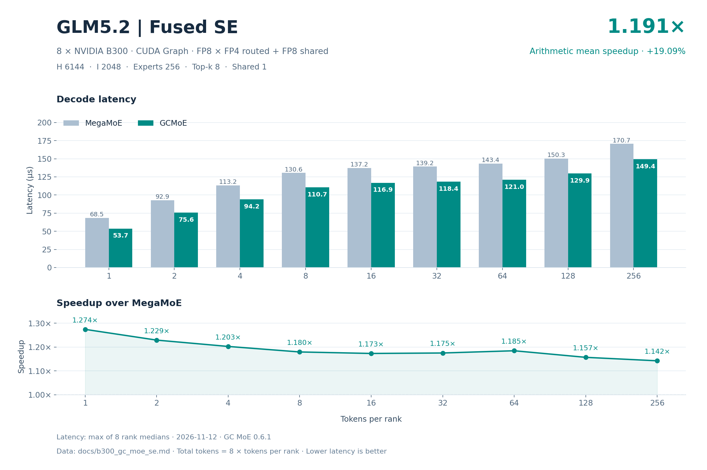
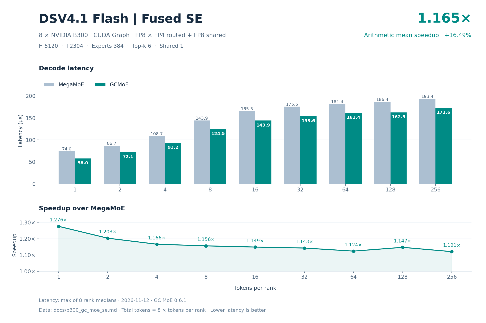

# B300 八卡 GC MoE SE 精度与 decode 性能

精度结论：两个模型的 default、boundary、asymmetric 全部通过，共 94/94 个 case、752/752 个 rank 检查；所有有限性检查通过。cosine 阈值为 .99。

性能结论：18 个 decode 点中 18/18 点 GC 延迟低于 DeepGEMM MegaMoE；逐点等权平均加速 **1.177911×**，平均加速收益 **17.7911%**，单点范围 1.120711×～1.275850×。

| 模型 | decode 点数 | 平均 Mega / GC | 平均加速收益 | 平均延迟下降 |
| --- | --- | --- | --- | --- |
| glm5.2 | 9 | 1.190911× | 19.0911% | 15.9491% |
| dsv4.1-flash | 9 | 1.164912× | 16.4912% | 14.0328% |
| 全部模型等权 | 18 | 1.177911× | 17.7911% | 14.9910% |

平均加速比为 `mean(Mega_us / GC_us)`；每模型 9 点等权，总计 18 点等权。平均延迟下降为 `mean(1 − GC_us / Mega_us)`，与平均加速收益分别计算。

## 模型与数据口径

2026-11-12；GC MoE 0.6.1；DeepGEMM MegaMoE 2.8.2+fcad603；8 × NVIDIA B300（设备报告名 L20D，compute capability 10.3），CUDA Graph。FP8 激活、FP4 routed 权重、FP8 shared 权重。

| 模型 | H | I | routed experts | top-k | shared experts | shared weight gran K | shared recipe |
| --- | --- | --- | --- | --- | --- | --- | --- |
| glm5.2 | 6144 | 2048 | 256 | 8 | 1 | 128 | (1,128,128) |
| dsv4.1-flash | 5120 | 2304 | 384 | 6 | 1 | 32 | (1,1,32) |

SwiGLU；alpha=1、clamp=10、fast_math=true；routed recipe=(1,1,32)。每 rank requested capacity=256、aligned capacity=1920；总 token=8T。

latency 单位 µs，为 8 rank 各自延迟中位数的最大值。

## 精度

独立参考为解量化后的 Torch routed 分支分布式求和及本地 shared 分支；shared residual 与独立 shared 分支比较。表中取全部 rank 对应指标的最小 cosine 和最大绝对差。

| 模型 | 类别 | 算子 | case 通过 | rank 检查通过 | 最小参考 cosine | 阈值 | finite |
| --- | --- | --- | --- | --- | --- | --- | --- |
| glm5.2 | default | MegaMoE | 9/9 | 72/72 | 0.999999464 | 0.99 | 全部通过 |
| glm5.2 | default | GCMoE | 9/9 | 72/72 | 0.999999464 | 0.99 | 全部通过 |
| glm5.2 | boundary | MegaMoE | 23/23 | 184/184 | 0.999999285 | 0.99 | 全部通过 |
| glm5.2 | boundary | GCMoE | 23/23 | 184/184 | 0.999999285 | 0.99 | 全部通过 |
| glm5.2 | asymmetric | MegaMoE | 15/15 | 120/120 | 0.999999523 | 0.99 | 全部通过 |
| glm5.2 | asymmetric | GCMoE | 15/15 | 120/120 | 0.999999523 | 0.99 | 全部通过 |
| dsv4.1-flash | default | MegaMoE | 9/9 | 72/72 | 0.999999702 | 0.99 | 全部通过 |
| dsv4.1-flash | default | GCMoE | 9/9 | 72/72 | 0.999999702 | 0.99 | 全部通过 |
| dsv4.1-flash | boundary | MegaMoE | 23/23 | 184/184 | 0.999999821 | 0.99 | 全部通过 |
| dsv4.1-flash | boundary | GCMoE | 23/23 | 184/184 | 0.999999821 | 0.99 | 全部通过 |
| dsv4.1-flash | asymmetric | MegaMoE | 15/15 | 120/120 | 0.999999821 | 0.99 | 全部通过 |
| dsv4.1-flash | asymmetric | GCMoE | 15/15 | 120/120 | 0.999999821 | 0.99 | 全部通过 |

| 模型 | 类别 | 最小 GC/Mega cosine | 最大 \|GC−Mega\| | 最小 Mega shared cosine | 最小 GC shared cosine |
| --- | --- | --- | --- | --- | --- |
| glm5.2 | default | 0.999999821 | 0.000000 | 0.999997735 | 0.999997735 |
| glm5.2 | boundary | 0.999999821 | 0.000000 | 0.999997795 | 0.999997795 |
| glm5.2 | asymmetric | 0.999999821 | 0.000000 | 0.999997914 | 0.999997914 |
| dsv4.1-flash | default | 0.999999821 | 0.000000 | 0.999998212 | 0.999998212 |
| dsv4.1-flash | boundary | 0.999999821 | 0.000000 | 0.999998152 | 0.999998152 |
| dsv4.1-flash | asymmetric | 0.999999881 | 0.000000 | 0.999998212 | 0.999998212 |

### glm5.2：default 逐组精度

| T/rank 或各 rank token 向量 | 最小 Mega/ref cosine | 最小 GC/ref cosine | 最小 GC/Mega cosine | 最大 \|GC−Mega\| | 结果 |
| --- | --- | --- | --- | --- | --- |
| 1 | 0.999999881 | 0.999999881 | 0.999999881 | 0.000000 | 通过 |
| 2 | 0.999999881 | 0.999999881 | 0.999999881 | 0.000000 | 通过 |
| 4 | 0.999999821 | 0.999999821 | 0.999999821 | 0.000000 | 通过 |
| 8 | 0.999999881 | 0.999999881 | 0.999999940 | 0.000000 | 通过 |
| 16 | 0.999999881 | 0.999999881 | 0.999999940 | 0.000000 | 通过 |
| 32 | 0.999999940 | 0.999999940 | 0.999999881 | 0.000000 | 通过 |
| 64 | 0.999999464 | 0.999999464 | 0.999999940 | 0.000000 | 通过 |
| 128 | 0.999999702 | 0.999999702 | 0.999999881 | 0.000000 | 通过 |
| 256 | 0.999999821 | 0.999999821 | 0.999999940 | 0.000000 | 通过 |

### glm5.2：boundary 逐组精度

| T/rank 或各 rank token 向量 | 最小 Mega/ref cosine | 最小 GC/ref cosine | 最小 GC/Mega cosine | 最大 \|GC−Mega\| | 结果 |
| --- | --- | --- | --- | --- | --- |
| 0 | 1.000000000 | 1.000000000 | 1.000000000 | 0.000000 | 通过 |
| 3 | 0.999999940 | 0.999999940 | 1.000000000 | 0.000000 | 通过 |
| 5 | 0.999999881 | 0.999999881 | 0.999999881 | 0.000000 | 通过 |
| 7 | 0.999999881 | 0.999999881 | 0.999999881 | 0.000000 | 通过 |
| 9 | 0.999999881 | 0.999999881 | 0.999999881 | 0.000000 | 通过 |
| 15 | 0.999999881 | 0.999999881 | 0.999999940 | 0.000000 | 通过 |
| 17 | 0.999999881 | 0.999999881 | 0.999999940 | 0.000000 | 通过 |
| 31 | 0.999999762 | 0.999999762 | 0.999999940 | 0.000000 | 通过 |
| 33 | 0.999999821 | 0.999999821 | 0.999999940 | 0.000000 | 通过 |
| 63 | 0.999999285 | 0.999999285 | 0.999999881 | 0.000000 | 通过 |
| 65 | 0.999999344 | 0.999999344 | 0.999999881 | 0.000000 | 通过 |
| 95 | 0.999999523 | 0.999999523 | 0.999999881 | 0.000000 | 通过 |
| 96 | 0.999999642 | 0.999999642 | 0.999999881 | 0.000000 | 通过 |
| 97 | 0.999999523 | 0.999999523 | 0.999999881 | 0.000000 | 通过 |
| 127 | 0.999999821 | 0.999999821 | 0.999999940 | 0.000000 | 通过 |
| 129 | 0.999999642 | 0.999999642 | 0.999999940 | 0.000000 | 通过 |
| 191 | 0.999999702 | 0.999999702 | 0.999999881 | 0.000000 | 通过 |
| 192 | 0.999999702 | 0.999999702 | 0.999999881 | 0.000000 | 通过 |
| 193 | 0.999999762 | 0.999999762 | 0.999999821 | 0.000000 | 通过 |
| 239 | 0.999999881 | 0.999999881 | 0.999999940 | 0.000000 | 通过 |
| 240 | 0.999999881 | 0.999999881 | 0.999999881 | 0.000000 | 通过 |
| 241 | 0.999999881 | 0.999999881 | 0.999999940 | 0.000000 | 通过 |
| 255 | 0.999999881 | 0.999999881 | 0.999999881 | 0.000000 | 通过 |

### glm5.2：asymmetric 逐组精度

| T/rank 或各 rank token 向量 | 最小 Mega/ref cosine | 最小 GC/ref cosine | 最小 GC/Mega cosine | 最大 \|GC−Mega\| | 结果 |
| --- | --- | --- | --- | --- | --- |
| [0, 0, 0, 0, 0, 0, 0, 0] | 1.000000000 | 1.000000000 | 1.000000000 | 0.000000 | 通过 |
| [256, 0, 256, 0, 256, 0, 256, 0] | 0.999999821 | 0.999999821 | 0.999999940 | 0.000000 | 通过 |
| [1, 0, 1, 0, 1, 0, 1, 0] | 0.999999940 | 0.999999940 | 0.999999940 | 0.000000 | 通过 |
| [1, 2, 4, 8, 16, 32, 64, 128] | 0.999999940 | 0.999999940 | 1.000000000 | 0.000000 | 通过 |
| [256, 0, 0, 0, 0, 0, 0, 0] | 1.000000000 | 1.000000000 | 1.000000000 | 0.000000 | 通过 |
| [256, 0, 256, 256, 256, 256, 256, 256] | 0.999999821 | 0.999999821 | 0.999999940 | 0.000000 | 通过 |
| [256, 256, 0, 256, 256, 256, 256, 256] | 0.999999821 | 0.999999821 | 0.999999940 | 0.000000 | 通过 |
| [256, 256, 256, 0, 256, 256, 256, 256] | 0.999999821 | 0.999999821 | 0.999999940 | 0.000000 | 通过 |
| [0, 0, 0, 0, 0, 256, 0, 0] | 1.000000000 | 1.000000000 | 1.000000000 | 0.000000 | 通过 |
| [0, 0, 0, 0, 0, 0, 256, 0] | 0.999999940 | 0.999999940 | 0.999999940 | 0.000000 | 通过 |
| [256, 256, 256, 256, 256, 256, 256, 0] | 0.999999821 | 0.999999821 | 0.999999940 | 0.000000 | 通过 |
| [0, 1, 2, 3, 4, 5, 7, 8] | 0.999999940 | 0.999999940 | 1.000000000 | 0.000000 | 通过 |
| [9, 15, 16, 17, 31, 32, 33, 63] | 1.000000000 | 1.000000000 | 0.999999940 | 0.000000 | 通过 |
| [64, 65, 95, 96, 97, 127, 128, 129] | 0.999999523 | 0.999999523 | 0.999999881 | 0.000000 | 通过 |
| [191, 192, 193, 239, 240, 241, 255, 256] | 0.999999881 | 0.999999881 | 0.999999821 | 0.000000 | 通过 |

### dsv4.1-flash：default 逐组精度

| T/rank 或各 rank token 向量 | 最小 Mega/ref cosine | 最小 GC/ref cosine | 最小 GC/Mega cosine | 最大 \|GC−Mega\| | 结果 |
| --- | --- | --- | --- | --- | --- |
| 1 | 0.999999881 | 0.999999881 | 0.999999881 | 0.000000 | 通过 |
| 2 | 0.999999881 | 0.999999881 | 0.999999881 | 0.000000 | 通过 |
| 4 | 0.999999881 | 0.999999881 | 0.999999881 | 0.000000 | 通过 |
| 8 | 0.999999881 | 0.999999881 | 0.999999821 | 0.000000 | 通过 |
| 16 | 0.999999881 | 0.999999881 | 0.999999881 | 0.000000 | 通过 |
| 32 | 0.999999702 | 0.999999702 | 0.999999821 | 0.000000 | 通过 |
| 64 | 0.999999881 | 0.999999881 | 0.999999881 | 0.000000 | 通过 |
| 128 | 0.999999821 | 0.999999821 | 0.999999881 | 0.000000 | 通过 |
| 256 | 0.999999821 | 0.999999821 | 0.999999881 | 0.000000 | 通过 |

### dsv4.1-flash：boundary 逐组精度

| T/rank 或各 rank token 向量 | 最小 Mega/ref cosine | 最小 GC/ref cosine | 最小 GC/Mega cosine | 最大 \|GC−Mega\| | 结果 |
| --- | --- | --- | --- | --- | --- |
| 0 | 1.000000000 | 1.000000000 | 1.000000000 | 0.000000 | 通过 |
| 3 | 0.999999940 | 0.999999940 | 0.999999881 | 0.000000 | 通过 |
| 5 | 0.999999940 | 0.999999940 | 0.999999821 | 0.000000 | 通过 |
| 7 | 0.999999940 | 0.999999940 | 0.999999881 | 0.000000 | 通过 |
| 9 | 0.999999881 | 0.999999881 | 0.999999881 | 0.000000 | 通过 |
| 15 | 0.999999881 | 0.999999881 | 0.999999881 | 0.000000 | 通过 |
| 17 | 0.999999881 | 0.999999881 | 0.999999881 | 0.000000 | 通过 |
| 31 | 0.999999881 | 0.999999881 | 0.999999881 | 0.000000 | 通过 |
| 33 | 0.999999881 | 0.999999881 | 0.999999821 | 0.000000 | 通过 |
| 63 | 0.999999881 | 0.999999881 | 0.999999881 | 0.000000 | 通过 |
| 65 | 0.999999881 | 0.999999881 | 0.999999881 | 0.000000 | 通过 |
| 95 | 0.999999940 | 0.999999940 | 0.999999940 | 0.000000 | 通过 |
| 96 | 0.999999881 | 0.999999881 | 0.999999940 | 0.000000 | 通过 |
| 97 | 0.999999881 | 0.999999881 | 0.999999881 | 0.000000 | 通过 |
| 127 | 0.999999821 | 0.999999821 | 0.999999881 | 0.000000 | 通过 |
| 129 | 0.999999881 | 0.999999881 | 0.999999881 | 0.000000 | 通过 |
| 191 | 0.999999940 | 0.999999940 | 0.999999940 | 0.000000 | 通过 |
| 192 | 0.999999881 | 0.999999881 | 0.999999940 | 0.000000 | 通过 |
| 193 | 0.999999940 | 0.999999940 | 0.999999881 | 0.000000 | 通过 |
| 239 | 0.999999881 | 0.999999881 | 0.999999881 | 0.000000 | 通过 |
| 240 | 0.999999881 | 0.999999881 | 0.999999881 | 0.000000 | 通过 |
| 241 | 0.999999881 | 0.999999881 | 0.999999881 | 0.000000 | 通过 |
| 255 | 0.999999881 | 0.999999881 | 0.999999881 | 0.000000 | 通过 |

### dsv4.1-flash：asymmetric 逐组精度

| T/rank 或各 rank token 向量 | 最小 Mega/ref cosine | 最小 GC/ref cosine | 最小 GC/Mega cosine | 最大 \|GC−Mega\| | 结果 |
| --- | --- | --- | --- | --- | --- |
| [0, 0, 0, 0, 0, 0, 0, 0] | 1.000000000 | 1.000000000 | 1.000000000 | 0.000000 | 通过 |
| [256, 0, 256, 0, 256, 0, 256, 0] | 0.999999821 | 0.999999821 | 0.999999881 | 0.000000 | 通过 |
| [1, 0, 1, 0, 1, 0, 1, 0] | 1.000000000 | 1.000000000 | 1.000000000 | 0.000000 | 通过 |
| [1, 2, 4, 8, 16, 32, 64, 128] | 0.999999881 | 0.999999881 | 1.000000000 | 0.000000 | 通过 |
| [256, 0, 0, 0, 0, 0, 0, 0] | 1.000000000 | 1.000000000 | 1.000000000 | 0.000000 | 通过 |
| [256, 0, 256, 256, 256, 256, 256, 256] | 0.999999821 | 0.999999821 | 0.999999881 | 0.000000 | 通过 |
| [256, 256, 0, 256, 256, 256, 256, 256] | 0.999999821 | 0.999999821 | 0.999999881 | 0.000000 | 通过 |
| [256, 256, 256, 0, 256, 256, 256, 256] | 0.999999821 | 0.999999821 | 0.999999881 | 0.000000 | 通过 |
| [0, 0, 0, 0, 0, 256, 0, 0] | 1.000000000 | 1.000000000 | 1.000000000 | 0.000000 | 通过 |
| [0, 0, 0, 0, 0, 0, 256, 0] | 0.999999881 | 0.999999881 | 1.000000000 | 0.000000 | 通过 |
| [256, 256, 256, 256, 256, 256, 256, 0] | 0.999999821 | 0.999999821 | 0.999999881 | 0.000000 | 通过 |
| [0, 1, 2, 3, 4, 5, 7, 8] | 0.999999881 | 0.999999881 | 0.999999881 | 0.000000 | 通过 |
| [9, 15, 16, 17, 31, 32, 33, 63] | 0.999999881 | 0.999999881 | 0.999999881 | 0.000000 | 通过 |
| [64, 65, 95, 96, 97, 127, 128, 129] | 0.999999881 | 0.999999881 | 0.999999881 | 0.000000 | 通过 |
| [191, 192, 193, 239, 240, 241, 255, 256] | 1.000000000 | 1.000000000 | 0.999999940 | 0.000000 | 通过 |

## glm5.2 decode 性能

| T/rank | 总 token | Mega µs | GC µs | Mega / GC | 延迟下降 |
| --- | --- | --- | --- | --- | --- |
| 1 | 8 | 68.464320 | 53.731041 | 1.274204× | 21.5196% |
| 2 | 16 | 92.896962 | 75.574238 | 1.229215× | 18.6472% |
| 4 | 32 | 113.247838 | 94.165440 | 1.202648× | 16.8501% |
| 8 | 64 | 130.569763 | 110.694079 | 1.179555× | 15.2223% |
| 16 | 128 | 137.168961 | 116.914558 | 1.173241× | 14.7660% |
| 32 | 256 | 139.157758 | 118.410716 | 1.175213× | 14.9090% |
| 64 | 512 | 143.356318 | 121.016164 | 1.184605× | 15.5837% |
| 128 | 1024 | 150.258241 | 129.865279 | 1.157032× | 13.5719% |
| 256 | 2048 | 170.655842 | 149.371681 | 1.142491× | 12.4720% |

## dsv4.1-flash decode 性能

| T/rank | 总 token | Mega µs | GC µs | Mega / GC | 延迟下降 |
| --- | --- | --- | --- | --- | --- |
| 1 | 8 | 73.967681 | 57.975199 | 1.275850× | 21.6209% |
| 2 | 16 | 86.718559 | 72.076800 | 1.203141× | 16.8842% |
| 4 | 32 | 108.735037 | 93.245440 | 1.166116× | 14.2453% |
| 8 | 64 | 143.922243 | 124.495196 | 1.156047× | 13.4983% |
| 16 | 128 | 165.323038 | 143.916321 | 1.148744× | 12.9484% |
| 32 | 256 | 175.520163 | 153.592963 | 1.142762× | 12.4927% |
| 64 | 512 | 181.381283 | 161.395836 | 1.123829× | 11.0185% |
| 128 | 1024 | 186.427355 | 162.534237 | 1.147004× | 12.8163% |
| 256 | 2048 | 193.418560 | 172.585602 | 1.120711× | 10.7709% |

## 有效 HBM 带宽

以命中 routed expert 的权重与 scale 工作集各计一次，加上非空 rank 的本地 shared 权重与 scale（SE）。这是模型估算的有效工作集带宽，不是物理 HBM 流量或硬件计数；不计激活、输出、中间结果及缓存/重复 CTA 访存。单位为十进制 GB/s。

### glm5.2

| T/rank | Mega 八卡合计 | GC 八卡合计 | Mega 每 GPU 均值 | GC 每 GPU 均值 |
| --- | --- | --- | --- | --- |
| 1 | 21727.173138 | 27684.855934 | 2715.896642 | 3460.606992 |
| 2 | 26374.693412 | 32420.159979 | 3296.836676 | 4052.519997 |
| 4 | 31905.790761 | 38371.422033 | 3988.223845 | 4796.427754 |
| 8 | 37195.524428 | 43874.169625 | 4649.440553 | 5484.271203 |
| 16 | 39207.231794 | 45999.534233 | 4900.903974 | 5749.941779 |
| 32 | 39079.224670 | 45926.394680 | 4884.903084 | 5740.799335 |
| 64 | 37934.688459 | 44937.610878 | 4741.836057 | 5617.201360 |
| 128 | 36192.206528 | 41875.529114 | 4524.025816 | 5234.441139 |
| 256 | 31866.341180 | 36407.016617 | 3983.292647 | 4550.877077 |

### dsv4.1-flash

| T/rank | Mega 八卡合计 | GC 八卡合计 | Mega 每 GPU 均值 | GC 每 GPU 均值 |
| --- | --- | --- | --- | --- |
| 1 | 16147.506383 | 20601.802426 | 2018.438298 | 2575.225303 |
| 2 | 22445.243746 | 27004.794934 | 2805.655468 | 3375.599367 |
| 4 | 29139.281061 | 33979.793714 | 3642.410133 | 4247.474214 |
| 8 | 34816.880361 | 40249.934674 | 4352.110045 | 5031.241834 |
| 16 | 40089.866701 | 46053.001655 | 5011.233338 | 5756.625207 |
| 32 | 41938.221864 | 47925.395576 | 5242.277733 | 5990.674447 |
| 64 | 41412.258882 | 46540.287729 | 5176.532360 | 5817.535966 |
| 128 | 40291.343765 | 46214.316337 | 5036.417971 | 5776.789542 |
| 256 | 38834.994113 | 43522.800056 | 4854.374264 | 5440.350007 |

## 有效 NVLink 带宽

有效远程 assignment payload=`remote_assignments × (H + H/32 + 2H)`，包含 FP8 激活、packed scale 和 BF16 返回值；不重复计算 TX+RX，不计本地/shared 工作、元数据、控制及协议开销。这是有效 payload 带宽，不是物理计数或单链路峰值。单位为十进制 GB/s。

### glm5.2

| T/rank | Mega 八卡合计 | GC 八卡合计 | Mega 每 GPU 均值 | GC 每 GPU 均值 |
| --- | --- | --- | --- | --- |
| 1 | 15.505420 | 19.757071 | 1.938177 | 2.469634 |
| 2 | 21.852340 | 26.861217 | 2.731542 | 3.357652 |
| 4 | 36.015310 | 43.313725 | 4.501914 | 5.414216 |
| 8 | 64.186377 | 75.711366 | 8.023297 | 9.463921 |
| 16 | 124.369128 | 145.914968 | 15.546141 | 18.239371 |
| 32 | 240.231522 | 282.323096 | 30.028940 | 35.290387 |
| 64 | 465.482043 | 551.412224 | 58.185255 | 68.926528 |
| 128 | 891.547987 | 1031.549255 | 111.443498 | 128.943657 |
| 256 | 1568.334849 | 1791.808875 | 196.041856 | 223.976109 |

### dsv4.1-flash

| T/rank | Mega 八卡合计 | GC 八卡合计 | Mega 每 GPU 均值 | GC 每 GPU 均值 |
| --- | --- | --- | --- | --- |
| 1 | 8.392855 | 10.708027 | 1.049107 | 1.338503 |
| 2 | 14.496551 | 17.441396 | 1.812069 | 2.180174 |
| 4 | 23.408094 | 27.296563 | 2.926012 | 3.412070 |
| 8 | 36.017226 | 41.637590 | 4.502153 | 5.204699 |
| 16 | 62.991342 | 72.360938 | 7.873918 | 9.045117 |
| 32 | 120.343553 | 137.524009 | 15.042944 | 17.190501 |
| 64 | 229.144702 | 257.519407 | 28.643088 | 32.189926 |
| 128 | 449.298013 | 515.346438 | 56.162252 | 64.418305 |
| 256 | 861.381658 | 965.359788 | 107.672707 | 120.669974 |

## 有效矩阵计算吞吐

有效 FLOP=`6 × routed_assignments × H × I`，再加 `6 × global_tokens × H × shared_I`；不计 padding、SwiGLU、量化/解量化或重复运算。单位 TFLOPS（10¹² FLOP/s）。

### glm5.2

| T/rank | Mega 八卡合计 | GC 八卡合计 | Mega 每 GPU 均值 | GC 每 GPU 均值 |
| --- | --- | --- | --- | --- |
| 1 | 79.396363 | 101.167182 | 9.924545 | 12.645898 |
| 2 | 117.028972 | 143.853729 | 14.628621 | 17.981716 |
| 4 | 191.997236 | 230.905012 | 23.999655 | 28.863126 |
| 8 | 333.052177 | 392.853386 | 41.631522 | 49.106673 |
| 16 | 634.058080 | 743.902974 | 79.257260 | 92.987872 |
| 32 | 1249.992658 | 1469.007040 | 156.249082 | 183.625880 |
| 64 | 2426.766777 | 2874.759371 | 303.345847 | 359.344921 |
| 128 | 4630.592630 | 5357.742318 | 578.824079 | 669.717790 |
| 256 | 8154.244174 | 9316.152785 | 1019.280522 | 1164.519098 |

### dsv4.1-flash

| T/rank | Mega 八卡合计 | GC 八卡合计 | Mega 每 GPU 均值 | GC 每 GPU 均值 |
| --- | --- | --- | --- | --- |
| 1 | 53.585799 | 68.367463 | 6.698225 | 8.545933 |
| 2 | 91.413356 | 109.983165 | 11.426670 | 13.747896 |
| 4 | 145.808284 | 170.029432 | 18.226035 | 21.253679 |
| 8 | 220.319928 | 254.700094 | 27.539991 | 31.837512 |
| 16 | 383.599752 | 440.657989 | 47.949969 | 55.082249 |
| 32 | 722.627823 | 825.791431 | 90.328478 | 103.223929 |
| 64 | 1398.553930 | 1571.735135 | 174.819241 | 196.466892 |
| 128 | 2721.397900 | 3121.453187 | 340.174737 | 390.181648 |
| 256 | 5246.063374 | 5879.320251 | 655.757922 | 734.915031 |

三项均为有效工作量估算，不是物理硬件计数或峰值。三项吞吐均使用各算子自身的同一 slowest-rank median latency：GB/s=`bytes / (latency_us × 10³)`，TFLOPS=`FLOP / (latency_us × 10⁶)`。八卡合计为全工作量除以该延迟；每 GPU 均值为合计除以 8，不代表每卡实测峰值。Mega 与 GC 使用相同有效工作量分子。
