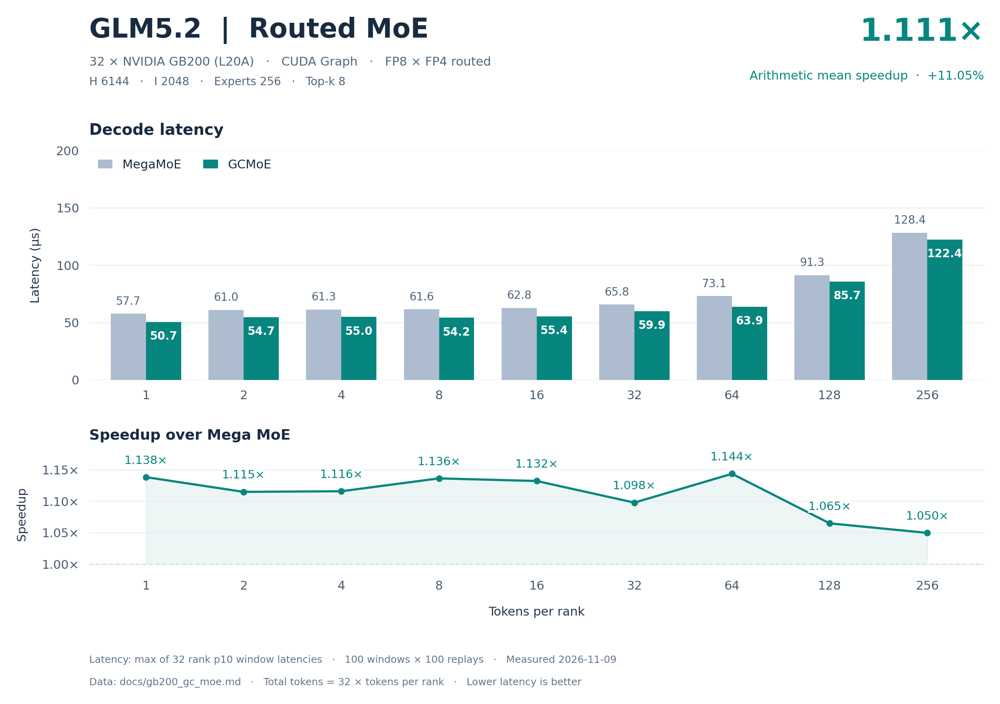
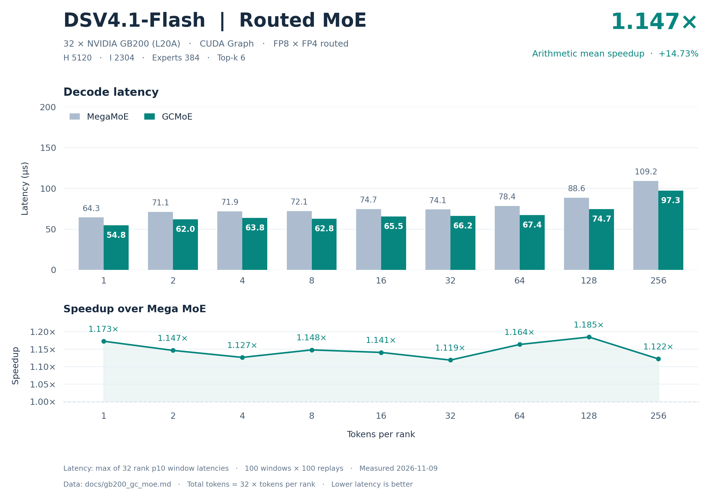

# GB200 32 卡 GC MoE 精度与 decode 性能

精度结论：两个模型的 default、boundary、asymmetric 全部通过，共 138/138 个 case、4416/4416 个 rank 检查；所有有限性检查通过。cosine 阈值为 0.97。

性能结论：18 个 decode 点中 18/18 点 GC 延迟低于 DeepGEMM MegaMoE；逐点等权平均加速 **1.128888×**，平均加速收益 **12.8888%**，单点范围 1.049679×～1.184968×。

| 模型 | decode 点数 | 平均 Mega / GC | 平均加速收益 | 平均延迟下降 |
| --- | --- | --- | --- | --- |
| glm5.2 | 9 | 1.110512× | 11.0512% | 9.8763% |
| dsv4.1-flash | 9 | 1.147263× | 14.7263% | 12.8050% |
| 全部模型等权 | 18 | 1.128888× | 12.8888% | 11.3406% |

平均加速比为 `mean(Mega_us / GC_us)`；每模型 9 点等权，总计 18 点等权。平均延迟下降为 `mean(1 − GC_us / Mega_us)`，与平均加速收益分别计算。

## 模型与数据口径

2026-11-09；GC MoE 0.5.0；DeepGEMM MegaMoE 2.8.2+local；32 × NVIDIA GB200（设备报告名 L20A，compute capability 10.0），CUDA Graph。FP8 激活、FP4 routed 权重。

| 模型 | H | I | routed experts | top-k |
| --- | --- | --- | --- | --- |
| glm5.2 | 6144 | 2048 | 256 | 8 |
| dsv4.1-flash | 5120 | 2304 | 384 | 6 |

SwiGLU；alpha=1、clamp=10、fast_math=true；routed recipe=(1,1,32)。每 rank requested capacity=256、aligned capacity=1920；总 token=32T。

latency 单位 µs，每个 rank 取 100 个计时窗口（每窗口 100 次 CUDA Graph replay）延迟的 10 分位，再取 32 rank 的最大值；窗口内与窗口间的偶发外部干扰由分位数剔除。

## 精度

独立参考为 BF16 dense MoE。表中取全部 rank 对应指标的最小 cosine 和最大绝对差。

| 模型 | 类别 | 算子 | case 通过 | rank 检查通过 | 最小参考 cosine | 阈值 | finite |
| --- | --- | --- | --- | --- | --- | --- | --- |
| glm5.2 | default | MegaMoE | 9/9 | 288/288 | 0.976948023 | 0.97 | 全部通过 |
| glm5.2 | default | GCMoE | 9/9 | 288/288 | 0.976948023 | 0.97 | 全部通过 |
| glm5.2 | boundary | MegaMoE | 23/23 | 736/736 | 0.977337837 | 0.97 | 全部通过 |
| glm5.2 | boundary | GCMoE | 23/23 | 736/736 | 0.977337837 | 0.97 | 全部通过 |
| glm5.2 | asymmetric | MegaMoE | 37/37 | 1184/1184 | 0.977011621 | 0.97 | 全部通过 |
| glm5.2 | asymmetric | GCMoE | 37/37 | 1184/1184 | 0.977011621 | 0.97 | 全部通过 |
| dsv4.1-flash | default | MegaMoE | 9/9 | 288/288 | 0.976691663 | 0.97 | 全部通过 |
| dsv4.1-flash | default | GCMoE | 9/9 | 288/288 | 0.976691663 | 0.97 | 全部通过 |
| dsv4.1-flash | boundary | MegaMoE | 23/23 | 736/736 | 0.977024913 | 0.97 | 全部通过 |
| dsv4.1-flash | boundary | GCMoE | 23/23 | 736/736 | 0.977024913 | 0.97 | 全部通过 |
| dsv4.1-flash | asymmetric | MegaMoE | 37/37 | 1184/1184 | 0.976691663 | 0.97 | 全部通过 |
| dsv4.1-flash | asymmetric | GCMoE | 37/37 | 1184/1184 | 0.976691663 | 0.97 | 全部通过 |

| 模型 | 类别 | 最小 GC/Mega cosine | 最大 \|GC−Mega\| |
| --- | --- | --- | --- |
| glm5.2 | default | 0.999999821 | 0.000000 |
| glm5.2 | boundary | 0.999999762 | 0.000000 |
| glm5.2 | asymmetric | 0.999999821 | 0.000000 |
| dsv4.1-flash | default | 0.999999762 | 0.000000 |
| dsv4.1-flash | boundary | 0.999999762 | 0.000000 |
| dsv4.1-flash | asymmetric | 0.999999762 | 0.000000 |

### glm5.2：default 逐组精度

| T/rank 或各 rank token 向量 | 最小 Mega/ref cosine | 最小 GC/ref cosine | 最小 GC/Mega cosine | 最大 \|GC−Mega\| | 结果 |
| --- | --- | --- | --- | --- | --- |
| 1 | 0.976948023 | 0.976948023 | 0.999999821 | 0.000000 | 通过 |
| 2 | 0.977368176 | 0.977368176 | 0.999999881 | 0.000000 | 通过 |
| 4 | 0.977443516 | 0.977443516 | 0.999999821 | 0.000000 | 通过 |
| 8 | 0.977654457 | 0.977654457 | 0.999999881 | 0.000000 | 通过 |
| 16 | 0.977686882 | 0.977686882 | 0.999999940 | 0.000000 | 通过 |
| 32 | 0.977801263 | 0.977801263 | 0.999999940 | 0.000000 | 通过 |
| 64 | 0.977931380 | 0.977931380 | 0.999999821 | 0.000000 | 通过 |
| 128 | 0.978072405 | 0.978072405 | 0.999999940 | 0.000000 | 通过 |
| 256 | 0.978109062 | 0.978109062 | 0.999999881 | 0.000000 | 通过 |

### glm5.2：boundary 逐组精度

| T/rank 或各 rank token 向量 | 最小 Mega/ref cosine | 最小 GC/ref cosine | 最小 GC/Mega cosine | 最大 \|GC−Mega\| | 结果 |
| --- | --- | --- | --- | --- | --- |
| 0 | 1.000000000 | 1.000000000 | 1.000000000 | 0.000000 | 通过 |
| 3 | 0.977573991 | 0.977573991 | 0.999999821 | 0.000000 | 通过 |
| 5 | 0.977337837 | 0.977337837 | 0.999999881 | 0.000000 | 通过 |
| 7 | 0.977636755 | 0.977636755 | 0.999999821 | 0.000000 | 通过 |
| 9 | 0.977620661 | 0.977620661 | 0.999999881 | 0.000000 | 通过 |
| 15 | 0.977700233 | 0.977700233 | 0.999999821 | 0.000000 | 通过 |
| 17 | 0.977634251 | 0.977634251 | 0.999999881 | 0.000000 | 通过 |
| 31 | 0.977792323 | 0.977792323 | 0.999999881 | 0.000000 | 通过 |
| 33 | 0.977858305 | 0.977858305 | 0.999999881 | 0.000000 | 通过 |
| 63 | 0.977927685 | 0.977927685 | 0.999999881 | 0.000000 | 通过 |
| 65 | 0.977923751 | 0.977923751 | 0.999999940 | 0.000000 | 通过 |
| 95 | 0.977997243 | 0.977997243 | 0.999999881 | 0.000000 | 通过 |
| 96 | 0.977991462 | 0.977991462 | 0.999999821 | 0.000000 | 通过 |
| 97 | 0.978022218 | 0.978022218 | 0.999999762 | 0.000000 | 通过 |
| 127 | 0.978063583 | 0.978063583 | 0.999999821 | 0.000000 | 通过 |
| 129 | 0.978070438 | 0.978070438 | 0.999999940 | 0.000000 | 通过 |
| 191 | 0.978109717 | 0.978109717 | 0.999999821 | 0.000000 | 通过 |
| 192 | 0.978113651 | 0.978113651 | 0.999999821 | 0.000000 | 通过 |
| 193 | 0.978109956 | 0.978109956 | 0.999999881 | 0.000000 | 通过 |
| 239 | 0.978112876 | 0.978112876 | 0.999999881 | 0.000000 | 通过 |
| 240 | 0.978109896 | 0.978109896 | 0.999999940 | 0.000000 | 通过 |
| 241 | 0.978112340 | 0.978112340 | 0.999999881 | 0.000000 | 通过 |
| 255 | 0.978113830 | 0.978113830 | 0.999999821 | 0.000000 | 通过 |

### glm5.2：asymmetric 逐组精度

| T/rank 或各 rank token 向量 | 最小 Mega/ref cosine | 最小 GC/ref cosine | 最小 GC/Mega cosine | 最大 \|GC−Mega\| | 结果 |
| --- | --- | --- | --- | --- | --- |
| 0 | 1.000000000 | 1.000000000 | 1.000000000 | 0.000000 | 通过 |
| [256, 0, 256, 0, 256, 0, 256, 0, 256, 0, 256, 0, 256, 0, 256, 0, 256, 0, 256, 0, 256, 0, 256, 0, 256, 0, 256, 0, 256, 0, 256, 0] | 0.978109062 | 0.978109062 | 0.999999940 | 0.000000 | 通过 |
| [1, 0, 1, 0, 1, 0, 1, 0, 1, 0, 1, 0, 1, 0, 1, 0, 1, 0, 1, 0, 1, 0, 1, 0, 1, 0, 1, 0, 1, 0, 1, 0] | 0.977011621 | 0.977011621 | 0.999999821 | 0.000000 | 通过 |
| [256, 256, 256, 256, 256, 256, 256, 256, 256, 256, 256, 256, 256, 256, 256, 256, 1, 1, 1, 1, 1, 1, 1, 1, 1, 1, 1, 1, 1, 1, 1, 1] | 0.977011621 | 0.977011621 | 0.999999821 | 0.000000 | 通过 |
| [256, 128, 64, 32, 16, 8, 4, 2, 1, 256, 128, 64, 32, 16, 8, 4, 2, 1, 256, 128, 64, 32, 16, 8, 4, 2, 1, 256, 128, 64, 32, 16] | 0.977575839 | 0.977575839 | 0.999999881 | 0.000000 | 通过 |
| [0, 256, 256, 256, 256, 256, 256, 256, 256, 256, 256, 256, 256, 256, 256, 256, 256, 256, 256, 256, 256, 256, 256, 256, 256, 256, 256, 256, 256, 256, 256, 256] | 0.978109062 | 0.978109062 | 0.999999881 | 0.000000 | 通过 |
| [256, 0, 256, 256, 256, 256, 256, 256, 256, 256, 256, 256, 256, 256, 256, 256, 256, 256, 256, 256, 256, 256, 256, 256, 256, 256, 256, 256, 256, 256, 256, 256] | 0.978109062 | 0.978109062 | 0.999999881 | 0.000000 | 通过 |
| [256, 256, 0, 256, 256, 256, 256, 256, 256, 256, 256, 256, 256, 256, 256, 256, 256, 256, 256, 256, 256, 256, 256, 256, 256, 256, 256, 256, 256, 256, 256, 256] | 0.978109062 | 0.978109062 | 0.999999881 | 0.000000 | 通过 |
| [256, 256, 256, 0, 256, 256, 256, 256, 256, 256, 256, 256, 256, 256, 256, 256, 256, 256, 256, 256, 256, 256, 256, 256, 256, 256, 256, 256, 256, 256, 256, 256] | 0.978109062 | 0.978109062 | 0.999999881 | 0.000000 | 通过 |
| [256, 256, 256, 256, 0, 256, 256, 256, 256, 256, 256, 256, 256, 256, 256, 256, 256, 256, 256, 256, 256, 256, 256, 256, 256, 256, 256, 256, 256, 256, 256, 256] | 0.978109062 | 0.978109062 | 0.999999881 | 0.000000 | 通过 |
| [256, 256, 256, 256, 256, 0, 256, 256, 256, 256, 256, 256, 256, 256, 256, 256, 256, 256, 256, 256, 256, 256, 256, 256, 256, 256, 256, 256, 256, 256, 256, 256] | 0.978109062 | 0.978109062 | 0.999999881 | 0.000000 | 通过 |
| [256, 256, 256, 256, 256, 256, 0, 256, 256, 256, 256, 256, 256, 256, 256, 256, 256, 256, 256, 256, 256, 256, 256, 256, 256, 256, 256, 256, 256, 256, 256, 256] | 0.978109062 | 0.978109062 | 0.999999881 | 0.000000 | 通过 |
| [256, 256, 256, 256, 256, 256, 256, 0, 256, 256, 256, 256, 256, 256, 256, 256, 256, 256, 256, 256, 256, 256, 256, 256, 256, 256, 256, 256, 256, 256, 256, 256] | 0.978109062 | 0.978109062 | 0.999999881 | 0.000000 | 通过 |
| [256, 256, 256, 256, 256, 256, 256, 256, 0, 256, 256, 256, 256, 256, 256, 256, 256, 256, 256, 256, 256, 256, 256, 256, 256, 256, 256, 256, 256, 256, 256, 256] | 0.978109062 | 0.978109062 | 0.999999881 | 0.000000 | 通过 |
| [256, 256, 256, 256, 256, 256, 256, 256, 256, 0, 256, 256, 256, 256, 256, 256, 256, 256, 256, 256, 256, 256, 256, 256, 256, 256, 256, 256, 256, 256, 256, 256] | 0.978109062 | 0.978109062 | 0.999999881 | 0.000000 | 通过 |
| [256, 256, 256, 256, 256, 256, 256, 256, 256, 256, 0, 256, 256, 256, 256, 256, 256, 256, 256, 256, 256, 256, 256, 256, 256, 256, 256, 256, 256, 256, 256, 256] | 0.978109062 | 0.978109062 | 0.999999881 | 0.000000 | 通过 |
| [256, 256, 256, 256, 256, 256, 256, 256, 256, 256, 256, 0, 256, 256, 256, 256, 256, 256, 256, 256, 256, 256, 256, 256, 256, 256, 256, 256, 256, 256, 256, 256] | 0.978109062 | 0.978109062 | 0.999999881 | 0.000000 | 通过 |
| [256, 256, 256, 256, 256, 256, 256, 256, 256, 256, 256, 256, 0, 256, 256, 256, 256, 256, 256, 256, 256, 256, 256, 256, 256, 256, 256, 256, 256, 256, 256, 256] | 0.978109062 | 0.978109062 | 0.999999881 | 0.000000 | 通过 |
| [0, 0, 0, 0, 0, 0, 0, 0, 0, 0, 0, 0, 0, 0, 256, 0, 0, 0, 0, 0, 0, 0, 0, 0, 0, 0, 0, 0, 0, 0, 0, 0] | 0.978194833 | 0.978194833 | 1.000000000 | 0.000000 | 通过 |
| [0, 0, 0, 0, 0, 0, 0, 0, 0, 0, 0, 0, 0, 0, 0, 256, 0, 0, 0, 0, 0, 0, 0, 0, 0, 0, 0, 0, 0, 0, 0, 0] | 0.978165925 | 0.978165925 | 0.999999940 | 0.000000 | 通过 |
| [0, 0, 0, 0, 0, 0, 0, 0, 0, 0, 0, 0, 0, 0, 0, 0, 256, 0, 0, 0, 0, 0, 0, 0, 0, 0, 0, 0, 0, 0, 0, 0] | 0.978120744 | 0.978120744 | 0.999999940 | 0.000000 | 通过 |
| [0, 0, 0, 0, 0, 0, 0, 0, 0, 0, 0, 0, 0, 0, 0, 0, 0, 256, 0, 0, 0, 0, 0, 0, 0, 0, 0, 0, 0, 0, 0, 0] | 0.978309691 | 0.978309691 | 1.000000000 | 0.000000 | 通过 |
| [0, 0, 0, 0, 0, 0, 0, 0, 0, 0, 0, 0, 0, 0, 0, 0, 0, 0, 256, 0, 0, 0, 0, 0, 0, 0, 0, 0, 0, 0, 0, 0] | 0.978261709 | 0.978261709 | 0.999999940 | 0.000000 | 通过 |
| [0, 0, 0, 0, 0, 0, 0, 0, 0, 0, 0, 0, 0, 0, 0, 0, 0, 0, 0, 256, 0, 0, 0, 0, 0, 0, 0, 0, 0, 0, 0, 0] | 0.978235900 | 0.978235900 | 1.000000000 | 0.000000 | 通过 |
| [0, 0, 0, 0, 0, 0, 0, 0, 0, 0, 0, 0, 0, 0, 0, 0, 0, 0, 0, 0, 256, 0, 0, 0, 0, 0, 0, 0, 0, 0, 0, 0] | 0.978236020 | 0.978236020 | 1.000000000 | 0.000000 | 通过 |
| [0, 0, 0, 0, 0, 0, 0, 0, 0, 0, 0, 0, 0, 0, 0, 0, 0, 0, 0, 0, 0, 256, 0, 0, 0, 0, 0, 0, 0, 0, 0, 0] | 0.978213489 | 0.978213489 | 0.999999940 | 0.000000 | 通过 |
| [0, 0, 0, 0, 0, 0, 0, 0, 0, 0, 0, 0, 0, 0, 0, 0, 0, 0, 0, 0, 0, 0, 256, 0, 0, 0, 0, 0, 0, 0, 0, 0] | 0.978109062 | 0.978109062 | 1.000000000 | 0.000000 | 通过 |
| [0, 0, 0, 0, 0, 0, 0, 0, 0, 0, 0, 0, 0, 0, 0, 0, 0, 0, 0, 0, 0, 0, 0, 256, 0, 0, 0, 0, 0, 0, 0, 0] | 0.978170991 | 0.978170991 | 1.000000000 | 0.000000 | 通过 |
| [0, 0, 0, 0, 0, 0, 0, 0, 0, 0, 0, 0, 0, 0, 0, 0, 0, 0, 0, 0, 0, 0, 0, 0, 256, 0, 0, 0, 0, 0, 0, 0] | 0.978190184 | 0.978190184 | 1.000000000 | 0.000000 | 通过 |
| [0, 0, 0, 0, 0, 0, 0, 0, 0, 0, 0, 0, 0, 0, 0, 0, 0, 0, 0, 0, 0, 0, 0, 0, 0, 256, 0, 0, 0, 0, 0, 0] | 0.978234470 | 0.978234470 | 1.000000000 | 0.000000 | 通过 |
| [0, 0, 0, 0, 0, 0, 0, 0, 0, 0, 0, 0, 0, 0, 0, 0, 0, 0, 0, 0, 0, 0, 0, 0, 0, 0, 256, 0, 0, 0, 0, 0] | 0.978120863 | 0.978120863 | 0.999999940 | 0.000000 | 通过 |
| [0, 0, 0, 0, 0, 0, 0, 0, 0, 0, 0, 0, 0, 0, 0, 0, 0, 0, 0, 0, 0, 0, 0, 0, 0, 0, 0, 256, 0, 0, 0, 0] | 0.978231668 | 0.978231668 | 1.000000000 | 0.000000 | 通过 |
| [0, 0, 0, 0, 0, 0, 0, 0, 0, 0, 0, 0, 0, 0, 0, 0, 0, 0, 0, 0, 0, 0, 0, 0, 0, 0, 0, 0, 256, 0, 0, 0] | 0.978247344 | 0.978247344 | 1.000000000 | 0.000000 | 通过 |
| [0, 0, 0, 0, 0, 0, 0, 0, 0, 0, 0, 0, 0, 0, 0, 0, 0, 0, 0, 0, 0, 0, 0, 0, 0, 0, 0, 0, 0, 256, 0, 0] | 0.978221297 | 0.978221297 | 1.000000000 | 0.000000 | 通过 |
| [0, 0, 0, 0, 0, 0, 0, 0, 0, 0, 0, 0, 0, 0, 0, 0, 0, 0, 0, 0, 0, 0, 0, 0, 0, 0, 0, 0, 0, 0, 256, 0] | 0.978134274 | 0.978134274 | 1.000000000 | 0.000000 | 通过 |
| [256, 256, 256, 256, 256, 256, 256, 256, 256, 256, 256, 256, 256, 256, 256, 256, 256, 256, 256, 256, 256, 256, 256, 256, 256, 256, 256, 256, 256, 256, 256, 0] | 0.978109062 | 0.978109062 | 0.999999881 | 0.000000 | 通过 |
| [0, 1, 2, 3, 4, 5, 7, 8, 9, 15, 16, 17, 31, 32, 33, 63, 64, 65, 95, 96, 97, 127, 128, 129, 191, 192, 193, 239, 240, 241, 255, 256] | 0.977636755 | 0.977636755 | 0.999999881 | 0.000000 | 通过 |

### dsv4.1-flash：default 逐组精度

| T/rank 或各 rank token 向量 | 最小 Mega/ref cosine | 最小 GC/ref cosine | 最小 GC/Mega cosine | 最大 \|GC−Mega\| | 结果 |
| --- | --- | --- | --- | --- | --- |
| 1 | 0.976691663 | 0.976691663 | 0.999999762 | 0.000000 | 通过 |
| 2 | 0.976715505 | 0.976715505 | 0.999999821 | 0.000000 | 通过 |
| 4 | 0.977072954 | 0.977072954 | 0.999999821 | 0.000000 | 通过 |
| 8 | 0.977285087 | 0.977285087 | 0.999999821 | 0.000000 | 通过 |
| 16 | 0.977629244 | 0.977629244 | 0.999999821 | 0.000000 | 通过 |
| 32 | 0.977676272 | 0.977676272 | 0.999999940 | 0.000000 | 通过 |
| 64 | 0.977918208 | 0.977918208 | 0.999999821 | 0.000000 | 通过 |
| 128 | 0.977997243 | 0.977997243 | 0.999999821 | 0.000000 | 通过 |
| 256 | 0.978031695 | 0.978031695 | 0.999999821 | 0.000000 | 通过 |

### dsv4.1-flash：boundary 逐组精度

| T/rank 或各 rank token 向量 | 最小 Mega/ref cosine | 最小 GC/ref cosine | 最小 GC/Mega cosine | 最大 \|GC−Mega\| | 结果 |
| --- | --- | --- | --- | --- | --- |
| 0 | 1.000000000 | 1.000000000 | 1.000000000 | 0.000000 | 通过 |
| 3 | 0.977024913 | 0.977024913 | 0.999999762 | 0.000000 | 通过 |
| 5 | 0.977118850 | 0.977118850 | 0.999999881 | 0.000000 | 通过 |
| 7 | 0.977383673 | 0.977383673 | 0.999999821 | 0.000000 | 通过 |
| 9 | 0.977398992 | 0.977398992 | 0.999999881 | 0.000000 | 通过 |
| 15 | 0.977563024 | 0.977563024 | 0.999999821 | 0.000000 | 通过 |
| 17 | 0.977679193 | 0.977679193 | 0.999999940 | 0.000000 | 通过 |
| 31 | 0.977691293 | 0.977691293 | 0.999999821 | 0.000000 | 通过 |
| 33 | 0.977646947 | 0.977646947 | 0.999999821 | 0.000000 | 通过 |
| 63 | 0.977913737 | 0.977913737 | 0.999999821 | 0.000000 | 通过 |
| 65 | 0.977931738 | 0.977931738 | 0.999999821 | 0.000000 | 通过 |
| 95 | 0.977986753 | 0.977986753 | 0.999999881 | 0.000000 | 通过 |
| 96 | 0.977977276 | 0.977977276 | 0.999999762 | 0.000000 | 通过 |
| 97 | 0.977974772 | 0.977974772 | 0.999999762 | 0.000000 | 通过 |
| 127 | 0.977984548 | 0.977984548 | 0.999999821 | 0.000000 | 通过 |
| 129 | 0.977994204 | 0.977994204 | 0.999999821 | 0.000000 | 通过 |
| 191 | 0.977999985 | 0.977999985 | 0.999999762 | 0.000000 | 通过 |
| 192 | 0.977996945 | 0.977996945 | 0.999999762 | 0.000000 | 通过 |
| 193 | 0.978001535 | 0.978001535 | 0.999999881 | 0.000000 | 通过 |
| 239 | 0.978014827 | 0.978014827 | 0.999999821 | 0.000000 | 通过 |
| 240 | 0.978013873 | 0.978013873 | 0.999999762 | 0.000000 | 通过 |
| 241 | 0.978016019 | 0.978016019 | 0.999999821 | 0.000000 | 通过 |
| 255 | 0.978031695 | 0.978031695 | 0.999999821 | 0.000000 | 通过 |

### dsv4.1-flash：asymmetric 逐组精度

| T/rank 或各 rank token 向量 | 最小 Mega/ref cosine | 最小 GC/ref cosine | 最小 GC/Mega cosine | 最大 \|GC−Mega\| | 结果 |
| --- | --- | --- | --- | --- | --- |
| 0 | 1.000000000 | 1.000000000 | 1.000000000 | 0.000000 | 通过 |
| [256, 0, 256, 0, 256, 0, 256, 0, 256, 0, 256, 0, 256, 0, 256, 0, 256, 0, 256, 0, 256, 0, 256, 0, 256, 0, 256, 0, 256, 0, 256, 0] | 0.978031695 | 0.978031695 | 0.999999821 | 0.000000 | 通过 |
| [1, 0, 1, 0, 1, 0, 1, 0, 1, 0, 1, 0, 1, 0, 1, 0, 1, 0, 1, 0, 1, 0, 1, 0, 1, 0, 1, 0, 1, 0, 1, 0] | 0.976691663 | 0.976691663 | 0.999999762 | 0.000000 | 通过 |
| [256, 256, 256, 256, 256, 256, 256, 256, 256, 256, 256, 256, 256, 256, 256, 256, 1, 1, 1, 1, 1, 1, 1, 1, 1, 1, 1, 1, 1, 1, 1, 1] | 0.976691663 | 0.976691663 | 0.999999762 | 0.000000 | 通过 |
| [256, 128, 64, 32, 16, 8, 4, 2, 1, 256, 128, 64, 32, 16, 8, 4, 2, 1, 256, 128, 64, 32, 16, 8, 4, 2, 1, 256, 128, 64, 32, 16] | 0.977072954 | 0.977072954 | 0.999999821 | 0.000000 | 通过 |
| [0, 256, 256, 256, 256, 256, 256, 256, 256, 256, 256, 256, 256, 256, 256, 256, 256, 256, 256, 256, 256, 256, 256, 256, 256, 256, 256, 256, 256, 256, 256, 256] | 0.978031695 | 0.978031695 | 0.999999821 | 0.000000 | 通过 |
| [256, 0, 256, 256, 256, 256, 256, 256, 256, 256, 256, 256, 256, 256, 256, 256, 256, 256, 256, 256, 256, 256, 256, 256, 256, 256, 256, 256, 256, 256, 256, 256] | 0.978031695 | 0.978031695 | 0.999999821 | 0.000000 | 通过 |
| [256, 256, 0, 256, 256, 256, 256, 256, 256, 256, 256, 256, 256, 256, 256, 256, 256, 256, 256, 256, 256, 256, 256, 256, 256, 256, 256, 256, 256, 256, 256, 256] | 0.978031695 | 0.978031695 | 0.999999821 | 0.000000 | 通过 |
| [256, 256, 256, 0, 256, 256, 256, 256, 256, 256, 256, 256, 256, 256, 256, 256, 256, 256, 256, 256, 256, 256, 256, 256, 256, 256, 256, 256, 256, 256, 256, 256] | 0.978031695 | 0.978031695 | 0.999999821 | 0.000000 | 通过 |
| [256, 256, 256, 256, 0, 256, 256, 256, 256, 256, 256, 256, 256, 256, 256, 256, 256, 256, 256, 256, 256, 256, 256, 256, 256, 256, 256, 256, 256, 256, 256, 256] | 0.978031695 | 0.978031695 | 0.999999821 | 0.000000 | 通过 |
| [256, 256, 256, 256, 256, 0, 256, 256, 256, 256, 256, 256, 256, 256, 256, 256, 256, 256, 256, 256, 256, 256, 256, 256, 256, 256, 256, 256, 256, 256, 256, 256] | 0.978031695 | 0.978031695 | 0.999999821 | 0.000000 | 通过 |
| [256, 256, 256, 256, 256, 256, 0, 256, 256, 256, 256, 256, 256, 256, 256, 256, 256, 256, 256, 256, 256, 256, 256, 256, 256, 256, 256, 256, 256, 256, 256, 256] | 0.978031695 | 0.978031695 | 0.999999821 | 0.000000 | 通过 |
| [256, 256, 256, 256, 256, 256, 256, 0, 256, 256, 256, 256, 256, 256, 256, 256, 256, 256, 256, 256, 256, 256, 256, 256, 256, 256, 256, 256, 256, 256, 256, 256] | 0.978031695 | 0.978031695 | 0.999999821 | 0.000000 | 通过 |
| [256, 256, 256, 256, 256, 256, 256, 256, 0, 256, 256, 256, 256, 256, 256, 256, 256, 256, 256, 256, 256, 256, 256, 256, 256, 256, 256, 256, 256, 256, 256, 256] | 0.978031695 | 0.978031695 | 0.999999821 | 0.000000 | 通过 |
| [256, 256, 256, 256, 256, 256, 256, 256, 256, 0, 256, 256, 256, 256, 256, 256, 256, 256, 256, 256, 256, 256, 256, 256, 256, 256, 256, 256, 256, 256, 256, 256] | 0.978031695 | 0.978031695 | 0.999999821 | 0.000000 | 通过 |
| [256, 256, 256, 256, 256, 256, 256, 256, 256, 256, 0, 256, 256, 256, 256, 256, 256, 256, 256, 256, 256, 256, 256, 256, 256, 256, 256, 256, 256, 256, 256, 256] | 0.978031695 | 0.978031695 | 0.999999821 | 0.000000 | 通过 |
| [256, 256, 256, 256, 256, 256, 256, 256, 256, 256, 256, 0, 256, 256, 256, 256, 256, 256, 256, 256, 256, 256, 256, 256, 256, 256, 256, 256, 256, 256, 256, 256] | 0.978031695 | 0.978031695 | 0.999999821 | 0.000000 | 通过 |
| [256, 256, 256, 256, 256, 256, 256, 256, 256, 256, 256, 256, 0, 256, 256, 256, 256, 256, 256, 256, 256, 256, 256, 256, 256, 256, 256, 256, 256, 256, 256, 256] | 0.978078246 | 0.978078246 | 0.999999821 | 0.000000 | 通过 |
| [0, 0, 0, 0, 0, 0, 0, 0, 0, 0, 0, 0, 0, 0, 256, 0, 0, 0, 0, 0, 0, 0, 0, 0, 0, 0, 0, 0, 0, 0, 0, 0] | 0.978238642 | 0.978238642 | 1.000000000 | 0.000000 | 通过 |
| [0, 0, 0, 0, 0, 0, 0, 0, 0, 0, 0, 0, 0, 0, 0, 256, 0, 0, 0, 0, 0, 0, 0, 0, 0, 0, 0, 0, 0, 0, 0, 0] | 0.978225231 | 0.978225231 | 0.999999940 | 0.000000 | 通过 |
| [0, 0, 0, 0, 0, 0, 0, 0, 0, 0, 0, 0, 0, 0, 0, 0, 256, 0, 0, 0, 0, 0, 0, 0, 0, 0, 0, 0, 0, 0, 0, 0] | 0.978161752 | 0.978161752 | 0.999999821 | 0.000000 | 通过 |
| [0, 0, 0, 0, 0, 0, 0, 0, 0, 0, 0, 0, 0, 0, 0, 0, 0, 256, 0, 0, 0, 0, 0, 0, 0, 0, 0, 0, 0, 0, 0, 0] | 0.978210688 | 0.978210688 | 1.000000000 | 0.000000 | 通过 |
| [0, 0, 0, 0, 0, 0, 0, 0, 0, 0, 0, 0, 0, 0, 0, 0, 0, 0, 256, 0, 0, 0, 0, 0, 0, 0, 0, 0, 0, 0, 0, 0] | 0.978186190 | 0.978186190 | 0.999999940 | 0.000000 | 通过 |
| [0, 0, 0, 0, 0, 0, 0, 0, 0, 0, 0, 0, 0, 0, 0, 0, 0, 0, 0, 256, 0, 0, 0, 0, 0, 0, 0, 0, 0, 0, 0, 0] | 0.978156090 | 0.978156090 | 1.000000000 | 0.000000 | 通过 |
| [0, 0, 0, 0, 0, 0, 0, 0, 0, 0, 0, 0, 0, 0, 0, 0, 0, 0, 0, 0, 256, 0, 0, 0, 0, 0, 0, 0, 0, 0, 0, 0] | 0.978239298 | 0.978239298 | 0.999999940 | 0.000000 | 通过 |
| [0, 0, 0, 0, 0, 0, 0, 0, 0, 0, 0, 0, 0, 0, 0, 0, 0, 0, 0, 0, 0, 256, 0, 0, 0, 0, 0, 0, 0, 0, 0, 0] | 0.978273451 | 0.978273451 | 1.000000000 | 0.000000 | 通过 |
| [0, 0, 0, 0, 0, 0, 0, 0, 0, 0, 0, 0, 0, 0, 0, 0, 0, 0, 0, 0, 0, 0, 256, 0, 0, 0, 0, 0, 0, 0, 0, 0] | 0.978264332 | 0.978264332 | 0.999999940 | 0.000000 | 通过 |
| [0, 0, 0, 0, 0, 0, 0, 0, 0, 0, 0, 0, 0, 0, 0, 0, 0, 0, 0, 0, 0, 0, 0, 256, 0, 0, 0, 0, 0, 0, 0, 0] | 0.978197575 | 0.978197575 | 0.999999940 | 0.000000 | 通过 |
| [0, 0, 0, 0, 0, 0, 0, 0, 0, 0, 0, 0, 0, 0, 0, 0, 0, 0, 0, 0, 0, 0, 0, 0, 256, 0, 0, 0, 0, 0, 0, 0] | 0.978157520 | 0.978157520 | 1.000000000 | 0.000000 | 通过 |
| [0, 0, 0, 0, 0, 0, 0, 0, 0, 0, 0, 0, 0, 0, 0, 0, 0, 0, 0, 0, 0, 0, 0, 0, 0, 256, 0, 0, 0, 0, 0, 0] | 0.978158295 | 0.978158295 | 1.000000000 | 0.000000 | 通过 |
| [0, 0, 0, 0, 0, 0, 0, 0, 0, 0, 0, 0, 0, 0, 0, 0, 0, 0, 0, 0, 0, 0, 0, 0, 0, 0, 256, 0, 0, 0, 0, 0] | 0.978107572 | 0.978107572 | 1.000000000 | 0.000000 | 通过 |
| [0, 0, 0, 0, 0, 0, 0, 0, 0, 0, 0, 0, 0, 0, 0, 0, 0, 0, 0, 0, 0, 0, 0, 0, 0, 0, 0, 256, 0, 0, 0, 0] | 0.978099048 | 0.978099048 | 0.999999940 | 0.000000 | 通过 |
| [0, 0, 0, 0, 0, 0, 0, 0, 0, 0, 0, 0, 0, 0, 0, 0, 0, 0, 0, 0, 0, 0, 0, 0, 0, 0, 0, 0, 256, 0, 0, 0] | 0.978201628 | 0.978201628 | 0.999999940 | 0.000000 | 通过 |
| [0, 0, 0, 0, 0, 0, 0, 0, 0, 0, 0, 0, 0, 0, 0, 0, 0, 0, 0, 0, 0, 0, 0, 0, 0, 0, 0, 0, 0, 256, 0, 0] | 0.978146970 | 0.978146970 | 1.000000000 | 0.000000 | 通过 |
| [0, 0, 0, 0, 0, 0, 0, 0, 0, 0, 0, 0, 0, 0, 0, 0, 0, 0, 0, 0, 0, 0, 0, 0, 0, 0, 0, 0, 0, 0, 256, 0] | 0.978263617 | 0.978263617 | 1.000000000 | 0.000000 | 通过 |
| [256, 256, 256, 256, 256, 256, 256, 256, 256, 256, 256, 256, 256, 256, 256, 256, 256, 256, 256, 256, 256, 256, 256, 256, 256, 256, 256, 256, 256, 256, 256, 0] | 0.978031695 | 0.978031695 | 0.999999821 | 0.000000 | 通过 |
| [0, 1, 2, 3, 4, 5, 7, 8, 9, 15, 16, 17, 31, 32, 33, 63, 64, 65, 95, 96, 97, 127, 128, 129, 191, 192, 193, 239, 240, 241, 255, 256] | 0.977383673 | 0.977383673 | 0.999999821 | 0.000000 | 通过 |

## glm5.2 decode 性能

| T/rank | 总 token | Mega µs | GC µs | Mega / GC | 延迟下降 |
| --- | --- | --- | --- | --- | --- |
| 1 | 32 | 57.723842 | 50.703039 | 1.138469× | 12.1627% |
| 2 | 64 | 60.957761 | 54.670081 | 1.115011× | 10.3148% |
| 4 | 128 | 61.349120 | 54.971519 | 1.116016× | 10.3956% |
| 8 | 256 | 61.621122 | 54.220481 | 1.136492× | 12.0099% |
| 16 | 512 | 62.782402 | 55.444479 | 1.132347× | 11.6879% |
| 32 | 1024 | 65.785279 | 59.918399 | 1.097915× | 8.9182% |
| 64 | 2048 | 73.091202 | 63.901439 | 1.143812× | 12.5730% |
| 128 | 4096 | 91.296320 | 85.734720 | 1.064870× | 6.0918% |
| 256 | 8192 | 128.439360 | 122.360640 | 1.049679× | 4.7328% |

## dsv4.1-flash decode 性能

| T/rank | 总 token | Mega µs | GC µs | Mega / GC | 延迟下降 |
| --- | --- | --- | --- | --- | --- |
| 1 | 32 | 64.318719 | 54.833279 | 1.172987× | 14.7476% |
| 2 | 64 | 71.111360 | 62.016320 | 1.146656× | 12.7899% |
| 4 | 128 | 71.896000 | 63.813438 | 1.126659× | 11.2420% |
| 8 | 256 | 72.107840 | 62.800961 | 1.148196× | 12.9069% |
| 16 | 512 | 74.690242 | 65.464640 | 1.140925× | 12.3518% |
| 32 | 1024 | 74.094081 | 66.216640 | 1.118965× | 10.6317% |
| 64 | 2048 | 78.396158 | 67.366400 | 1.163728× | 14.0693% |
| 128 | 4096 | 88.575678 | 74.749441 | 1.184968× | 15.6095% |
| 256 | 8192 | 109.167995 | 97.272959 | 1.122285× | 10.8961% |

## 有效 HBM 带宽

以命中 routed expert 的权重与 scale 工作集各计一次，加上非空 rank 的本地 shared 权重与 scale（SE）。这是模型估算的有效工作集带宽，不是物理 HBM 流量或硬件计数；不计激活、输出、中间结果及缓存/重复 CTA 访存。单位为十进制 GB/s。

### glm5.2

| T/rank | Mega 全32卡合计 | GC 全32卡合计 | Mega 每 GPU 均值 | GC 每 GPU 均值 |
| --- | --- | --- | --- | --- |
| 1 | 56975.741 | 64865.118 | 1780.492 | 2027.035 |
| 2 | 75994.880 | 84735.153 | 2374.840 | 2647.974 |
| 4 | 82701.529 | 92296.269 | 2584.423 | 2884.258 |
| 8 | 83312.798 | 94684.297 | 2603.525 | 2958.884 |
| 16 | 81771.769 | 92594.036 | 2555.368 | 2893.564 |
| 32 | 78039.162 | 85680.328 | 2438.724 | 2677.510 |
| 64 | 70238.660 | 80339.789 | 2194.958 | 2510.618 |
| 128 | 56232.585 | 59880.385 | 1757.268 | 1871.262 |
| 256 | 39970.832 | 41956.532 | 1249.089 | 1311.142 |

### dsv4.1-flash

| T/rank | Mega 全32卡合计 | GC 全32卡合计 | Mega 每 GPU 均值 | GC 每 GPU 均值 |
| --- | --- | --- | --- | --- |
| 1 | 44137.954 | 51773.243 | 1379.311 | 1617.914 |
| 2 | 65567.003 | 75182.770 | 2048.969 | 2349.462 |
| 4 | 89432.220 | 100759.637 | 2794.757 | 3148.739 |
| 8 | 99077.205 | 113760.094 | 3096.163 | 3555.003 |
| 16 | 96658.487 | 110280.081 | 3020.578 | 3446.253 |
| 32 | 97436.201 | 109027.666 | 3044.881 | 3407.115 |
| 64 | 92089.280 | 107166.863 | 2877.790 | 3348.964 |
| 128 | 81505.961 | 96581.936 | 2547.061 | 3018.186 |
| 256 | 66131.523 | 74218.425 | 2066.610 | 2319.326 |

## 有效 NVLink 带宽

有效远程 assignment payload=`remote_assignments × (H + H/32 + 2H)`，包含 FP8 激活、packed scale 和 BF16 返回值；不重复计算 TX+RX，不计本地/shared 工作、元数据、控制及协议开销。这是有效 payload 带宽，不是物理计数或单链路峰值。单位为十进制 GB/s。

### glm5.2

| T/rank | Mega 全32卡合计 | GC 全32卡合计 | Mega 每 GPU 均值 | GC 每 GPU 均值 |
| --- | --- | --- | --- | --- |
| 1 | 79.692 | 90.727 | 2.490 | 2.835 |
| 2 | 150.928 | 168.287 | 4.717 | 5.259 |
| 4 | 300.235 | 335.067 | 9.382 | 10.471 |
| 8 | 599.028 | 680.790 | 18.720 | 21.275 |
| 16 | 1178.269 | 1334.209 | 36.821 | 41.694 |
| 32 | 2250.101 | 2470.419 | 70.316 | 77.201 |
| 64 | 4046.048 | 4627.916 | 126.439 | 144.622 |
| 128 | 6471.336 | 6891.131 | 202.229 | 215.348 |
| 256 | 9196.625 | 9653.501 | 287.395 | 301.672 |

### dsv4.1-flash

| T/rank | Mega 全32卡合计 | GC 全32卡合计 | Mega 每 GPU 均值 | GC 每 GPU 均值 |
| --- | --- | --- | --- | --- |
| 1 | 43.434 | 50.947 | 1.357 | 1.592 |
| 2 | 79.661 | 91.344 | 2.489 | 2.854 |
| 4 | 158.663 | 178.759 | 4.958 | 5.586 |
| 8 | 320.267 | 367.729 | 10.008 | 11.492 |
| 16 | 617.556 | 704.586 | 19.299 | 22.018 |
| 32 | 1246.307 | 1394.574 | 38.947 | 43.580 |
| 64 | 2356.424 | 2742.236 | 73.638 | 85.695 |
| 128 | 4172.627 | 4944.429 | 130.395 | 154.513 |
| 256 | 6770.524 | 7598.458 | 211.579 | 237.452 |

## 有效矩阵计算吞吐

有效 FLOP=`6 × routed_assignments × H × I`；不计 padding、SwiGLU、量化/解量化或重复运算。单位 TFLOPS（10¹² FLOP/s）。

### glm5.2

| T/rank | Mega 全32卡合计 | GC 全32卡合计 | Mega 每 GPU 均值 | GC 每 GPU 均值 |
| --- | --- | --- | --- | --- |
| 1 | 334.824 | 381.187 | 10.463 | 11.912 |
| 2 | 634.123 | 707.054 | 19.816 | 22.095 |
| 4 | 1260.155 | 1406.354 | 39.380 | 43.949 |
| 8 | 2509.185 | 2851.668 | 78.412 | 89.115 |
| 16 | 4925.547 | 5577.429 | 153.923 | 174.295 |
| 32 | 9401.424 | 10321.960 | 293.794 | 322.561 |
| 64 | 16923.385 | 19357.163 | 528.856 | 604.911 |
| 128 | 27097.490 | 28855.301 | 846.797 | 901.728 |
| 256 | 38522.477 | 40436.225 | 1203.827 | 1263.632 |

### dsv4.1-flash

| T/rank | Mega 全32卡合计 | GC 全32卡合计 | Mega 每 GPU 均值 | GC 每 GPU 均值 |
| --- | --- | --- | --- | --- |
| 1 | 211.284 | 247.834 | 6.603 | 7.745 |
| 2 | 382.205 | 438.257 | 11.944 | 13.696 |
| 4 | 756.067 | 851.830 | 23.627 | 26.620 |
| 8 | 1507.691 | 1731.126 | 47.115 | 54.098 |
| 16 | 2911.126 | 3321.377 | 90.973 | 103.793 |
| 32 | 5869.098 | 6567.314 | 183.409 | 205.229 |
| 64 | 11094.050 | 12910.455 | 346.689 | 403.452 |
| 128 | 19638.142 | 23270.565 | 613.692 | 727.205 |
| 256 | 31867.614 | 35764.549 | 995.863 | 1117.642 |

三项吞吐均使用各算子自身的同一 slowest-rank p10 latency：GB/s=`bytes / (latency_us × 10³)`，TFLOPS=`FLOP / (latency_us × 10⁶)`。全 32 卡合计为全工作量除以该延迟；每 GPU 均值为合计除以 32，不代表每卡实测峰值。Mega 与 GC 使用相同有效工作量分子。
