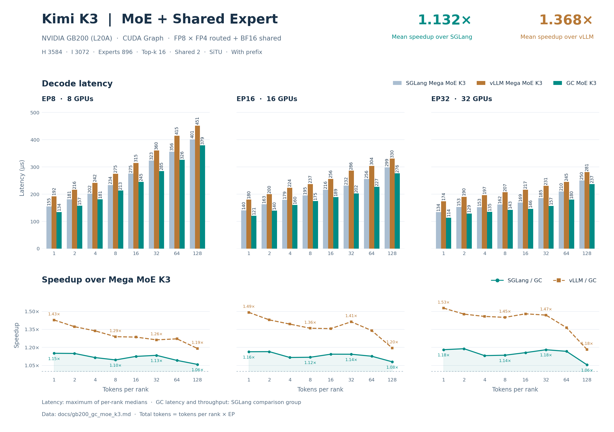

# GB200 8、16、32 卡 GC MoE K3 精度与 decode 性能

**精度结论**　本轮 GC 与 SGLang 对照通过 **142/142 个用例、2936/2936 个 rank 检查**。历史 GC 与 vLLM 对照也通过了全部 142 个用例、2936 个 rank 检查。GC、SGLang 和 vLLM 最低余弦相似度分别为 0.999995、0.999996、0.999996。

**性能结论**　24 个 EP 与 token 组合中，GC 在 **24/24** 个点快于 SGLang，在 **24/24** 个点快于 vLLM。逐点等权平均加速比分别为 **1.1324×** 和 **1.3679×**。

| 模型 | EP | decode 点数 | SGLang / GC | 对 SGLang 平均加速收益 | 对 SGLang 平均延迟下降 | vLLM / GC | 对 vLLM 平均加速收益 | 对 vLLM 平均延迟下降 |
| --- | --- | --- | --- | --- | --- | --- | --- | --- |
| Kimi K3 | 8 | 8 | 1.115332× | +11.5332% | +10.2761% | 1.305009× | +30.5009% | +23.1633% |
| Kimi K3 | 16 | 8 | 1.132200× | +13.2200% | +11.6283% | 1.372468× | +37.2468% | +26.8685% |
| Kimi K3 | 32 | 8 | 1.149688× | +14.9688% | +12.9046% | 1.426093× | +42.6093% | +29.4772% |
| Kimi K3 | 全部 | 24 | 1.132407× | +13.2407% | +11.6030% | 1.367857× | +36.7857% | +26.5030% |

## 模型与数据口径

2026-11-27 · GC MoE 0.7.0 · NVIDIA GB200（L20A）· CUDA Graph · 带 prefix 的 Kimi K3 decode。输入为注意力后的 BF16 hidden states，输出为 routed 分支经 RMSNorm 和 BF16 升维后与 shared expert、prefix 的 BF16 加和。

| 模型 | H | I | routed experts | top-k | shared H | shared I | shared experts | 激活 |
| --- | --- | --- | --- | --- | --- | --- | --- | --- |
| Kimi K3 | 3584 | 3072 | 896 | 16 | 7168 | 6144 | 2 | SiTU |

routed 采用 FP8 激活与 FP4 权重，shared 采用 BF16 权重，SiTU 参数为 beta=4、linear_beta=25。延迟取各 rank 回放时延中位数的最大值。GC 与 SGLang 的精度和性能均取本轮 SGLang 对照组（PyTorch 2.13）的实测值。vLLM 的精度、延迟和吞吐数据沿用上一份报告（PyTorch 2.14）。两列加速比分别以 SGLang、vLLM 的延迟除以同一 GC 延迟。每个 EP 内八点等权，整体对 24 点等权。

## 精度

每个用例在每个 rank 上计一次检查，rank 检查数等于用例数乘以 EP。默认八档的最大输入为每 rank 128 个 token。余弦相似度阈值为 0.99，相对 L2 阈值为 0.02。“GC 与 SGLang 最小 cosine”来自本轮对照，“GC 与 vLLM 最小 cosine”沿用上次两者的配对结果。每个算子的误差均相对于其独立 BF16 参考输出。

| EP | 类别 | 用例数 | 每套 rank 检查 | GC 最小 cosine | GC 最大相对 L2 | GC 最大绝对误差 | SGLang 最小 cosine | SGLang 最大相对 L2 | SGLang 最大绝对误差 | vLLM 最小 cosine | vLLM 最大相对 L2 | vLLM 最大绝对误差 | 结果 |
| --- | --- | --- | --- | --- | --- | --- | --- | --- | --- | --- | --- | --- | --- |
| 8 | default | 8 | 64 | 0.999995410 | 0.003025480 | 0.500000000 | 0.999997973 | 0.002018749 | 0.500000000 | 0.999997854 | 0.002044154 | 0.500000000 | 通过 |
| 8 | boundary | 15 | 120 | 0.999997139 | 0.002404836 | 0.500000000 | 0.999998152 | 0.001961348 | 0.500000000 | 0.999998212 | 0.001859217 | 0.500000000 | 通过 |
| 8 | asymmetric | 14 | 112 | 0.999995410 | 0.003025480 | 0.500000000 | 0.999998033 | 0.002018502 | 0.500000000 | 0.999997854 | 0.002043648 | 0.500000000 | 通过 |
| 16 | default | 8 | 128 | 0.999995410 | 0.003025480 | 0.500000000 | 0.999997437 | 0.002274619 | 0.500000000 | 0.999997258 | 0.002321602 | 0.500000000 | 通过 |
| 16 | boundary | 15 | 240 | 0.999997139 | 0.002404836 | 0.500000000 | 0.999997854 | 0.002079466 | 0.500000000 | 0.999997973 | 0.001995493 | 0.500000000 | 通过 |
| 16 | asymmetric | 22 | 352 | 0.999995410 | 0.003025480 | 0.500000000 | 0.999997437 | 0.002274619 | 0.500000000 | 0.999997258 | 0.002321602 | 0.500000000 | 通过 |
| 32 | default | 8 | 256 | 0.999995410 | 0.003025480 | 0.500000000 | 0.999996305 | 0.002748258 | 0.500000000 | 0.999996006 | 0.002818683 | 0.500000000 | 通过 |
| 32 | boundary | 15 | 480 | 0.999997199 | 0.002404156 | 0.500000000 | 0.999997795 | 0.002079466 | 0.500000000 | 0.999997973 | 0.001995493 | 0.500000000 | 通过 |
| 32 | asymmetric | 37 | 1184 | 0.999995410 | 0.003025480 | 0.500000000 | 0.999996305 | 0.002748258 | 0.500000000 | 0.999996006 | 0.002818683 | 0.500000000 | 通过 |

非对称行数按 rank 顺序列出，值×次数表示相邻 rank 连续取相同值。

### EP8 Kimi K3 default 逐组精度

| T/rank 或各 rank 行数 | GC 最小 cosine | GC 最大相对 L2 | GC 最大绝对误差 | SGLang 最小 cosine | SGLang 最大相对 L2 | SGLang 最大绝对误差 | vLLM 最小 cosine | vLLM 最大相对 L2 | vLLM 最大绝对误差 | GC 与 SGLang 最小 cosine | GC 与 vLLM 最小 cosine | 结果 |
| --- | --- | --- | --- | --- | --- | --- | --- | --- | --- | --- | --- | --- |
| 1 | 0.999995410 | 0.003025480 | 0.250000000 | 0.999998927 | 0.001403593 | 0.250000000 | 0.999998808 | 0.001569640 | 0.250000000 | 0.999986768 | 0.999986708 | 通过 |
| 2 | 0.999997079 | 0.002427246 | 0.250000000 | 0.999997973 | 0.002018749 | 0.250000000 | 0.999997854 | 0.002044154 | 0.250000000 | 0.999987006 | 0.999987066 | 通过 |
| 4 | 0.999997497 | 0.002238087 | 0.250000000 | 0.999998450 | 0.001735528 | 0.250000000 | 0.999998331 | 0.001813236 | 0.250000000 | 0.999987960 | 0.999987960 | 通过 |
| 8 | 0.999997616 | 0.002155474 | 0.250000000 | 0.999998569 | 0.001684414 | 0.250000000 | 0.999998569 | 0.001751312 | 0.250000000 | 0.999988377 | 0.999988258 | 通过 |
| 16 | 0.999998450 | 0.001776991 | 0.250000000 | 0.999998748 | 0.001579793 | 0.250000000 | 0.999998629 | 0.001692165 | 0.250000000 | 0.999988437 | 0.999988437 | 通过 |
| 32 | 0.999998450 | 0.001753461 | 0.250000000 | 0.999998927 | 0.001453146 | 0.250000000 | 0.999998748 | 0.001616514 | 0.250000000 | 0.999988556 | 0.999988556 | 通过 |
| 64 | 0.999998450 | 0.001782488 | 0.500000000 | 0.999998450 | 0.001807500 | 0.500000000 | 0.999998629 | 0.001653922 | 0.375000000 | 0.999989212 | 0.999989092 | 通过 |
| 128 | 0.999998331 | 0.001725903 | 0.500000000 | 0.999998331 | 0.001762563 | 0.500000000 | 0.999998510 | 0.001719147 | 0.500000000 | 0.999989033 | 0.999989033 | 通过 |

### EP8 Kimi K3 boundary 逐组精度

| T/rank 或各 rank 行数 | GC 最小 cosine | GC 最大相对 L2 | GC 最大绝对误差 | SGLang 最小 cosine | SGLang 最大相对 L2 | SGLang 最大绝对误差 | vLLM 最小 cosine | vLLM 最大相对 L2 | vLLM 最大绝对误差 | GC 与 SGLang 最小 cosine | GC 与 vLLM 最小 cosine | 结果 |
| --- | --- | --- | --- | --- | --- | --- | --- | --- | --- | --- | --- | --- |
| 0 | 1.000000000 | 0.000000000 | 0.000000000 | 1.000000000 | 0.000000000 | 0.000000000 | 1.000000000 | 0.000000000 | 0.000000000 | 1.000000000 | 1.000000000 | 通过 |
| 3 | 0.999997139 | 0.002404836 | 0.250000000 | 0.999998391 | 0.001822252 | 0.250000000 | 0.999998212 | 0.001859217 | 0.250000000 | 0.999987483 | 0.999987483 | 通过 |
| 5 | 0.999997735 | 0.002091739 | 0.250000000 | 0.999998748 | 0.001582395 | 0.250000000 | 0.999998450 | 0.001683305 | 0.250000000 | 0.999987960 | 0.999987900 | 通过 |
| 7 | 0.999997914 | 0.002072746 | 0.250000000 | 0.999998868 | 0.001529206 | 0.250000000 | 0.999998748 | 0.001617371 | 0.250000000 | 0.999988079 | 0.999988079 | 通过 |
| 9 | 0.999997795 | 0.002069739 | 0.250000000 | 0.999998152 | 0.001961348 | 0.250000000 | 0.999998748 | 0.001593636 | 0.250000000 | 0.999988317 | 0.999988437 | 通过 |
| 15 | 0.999998391 | 0.001801168 | 0.250000000 | 0.999998450 | 0.001714015 | 0.250000000 | 0.999998748 | 0.001579657 | 0.250000000 | 0.999988377 | 0.999988377 | 通过 |
| 17 | 0.999998391 | 0.001788341 | 0.250000000 | 0.999998629 | 0.001639297 | 0.250000000 | 0.999998808 | 0.001519586 | 0.250000000 | 0.999988496 | 0.999988616 | 通过 |
| 31 | 0.999998391 | 0.001760965 | 0.250000000 | 0.999998271 | 0.001802896 | 0.250000000 | 0.999998569 | 0.001611608 | 0.250000000 | 0.999988794 | 0.999988675 | 通过 |
| 33 | 0.999998391 | 0.001770659 | 0.250000000 | 0.999998689 | 0.001610530 | 0.250000000 | 0.999998391 | 0.001752727 | 0.250000000 | 0.999988914 | 0.999988794 | 通过 |
| 63 | 0.999998331 | 0.001776369 | 0.500000000 | 0.999998391 | 0.001809885 | 0.500000000 | 0.999998391 | 0.001749352 | 0.500000000 | 0.999989271 | 0.999989092 | 通过 |
| 65 | 0.999998391 | 0.001806877 | 0.500000000 | 0.999998271 | 0.001826408 | 0.500000000 | 0.999998450 | 0.001764885 | 0.500000000 | 0.999989092 | 0.999989092 | 通过 |
| 95 | 0.999998391 | 0.001813541 | 0.500000000 | 0.999998271 | 0.001823676 | 0.500000000 | 0.999998391 | 0.001787052 | 0.500000000 | 0.999989212 | 0.999989152 | 通过 |
| 96 | 0.999998450 | 0.001805542 | 0.500000000 | 0.999998450 | 0.001815617 | 0.500000000 | 0.999998331 | 0.001781206 | 0.500000000 | 0.999989092 | 0.999989092 | 通过 |
| 97 | 0.999998450 | 0.001793466 | 0.500000000 | 0.999998391 | 0.001807862 | 0.500000000 | 0.999998510 | 0.001786796 | 0.500000000 | 0.999989092 | 0.999989152 | 通过 |
| 127 | 0.999998391 | 0.001726396 | 0.500000000 | 0.999998450 | 0.001747518 | 0.500000000 | 0.999998391 | 0.001720851 | 0.500000000 | 0.999989033 | 0.999989092 | 通过 |

### EP8 Kimi K3 asymmetric 逐组精度

| T/rank 或各 rank 行数 | GC 最小 cosine | GC 最大相对 L2 | GC 最大绝对误差 | SGLang 最小 cosine | SGLang 最大相对 L2 | SGLang 最大绝对误差 | vLLM 最小 cosine | vLLM 最大相对 L2 | vLLM 最大绝对误差 | GC 与 SGLang 最小 cosine | GC 与 vLLM 最小 cosine | 结果 |
| --- | --- | --- | --- | --- | --- | --- | --- | --- | --- | --- | --- | --- |
| 0 | 1.000000000 | 0.000000000 | 0.000000000 | 1.000000000 | 0.000000000 | 0.000000000 | 1.000000000 | 0.000000000 | 0.000000000 | 1.000000000 | 1.000000000 | 通过 |
| 128, 0, 128, 0, 128, 0, 128, 0 | 0.999998450 | 0.001725924 | 0.500000000 | 0.999998450 | 0.001743781 | 0.375000000 | 0.999998569 | 0.001719134 | 0.375000000 | 0.999989033 | 0.999989033 | 通过 |
| 1, 0, 1, 0, 1, 0, 1, 0 | 0.999995410 | 0.003025480 | 0.250000000 | 0.999998927 | 0.001403593 | 0.250000000 | 0.999998808 | 0.001569640 | 0.250000000 | 0.999987662 | 0.999987543 | 通过 |
| 1, 2, 4, 8, 16, 32, 64, 128 | 0.999995410 | 0.003025480 | 0.250000000 | 0.999998033 | 0.002018502 | 0.250000000 | 0.999997854 | 0.002043648 | 0.250000000 | 0.999987185 | 0.999987125 | 通过 |
| 128, 0×7 | 0.999998569 | 0.001711267 | 0.250000000 | 0.999998450 | 0.001738792 | 0.375000000 | 0.999998629 | 0.001674455 | 0.375000000 | 0.999989212 | 0.999989212 | 通过 |
| 128, 0, 128×6 | 0.999998331 | 0.001725903 | 0.500000000 | 0.999998331 | 0.001762567 | 0.500000000 | 0.999998510 | 0.001719147 | 0.375000000 | 0.999989033 | 0.999989033 | 通过 |
| 128×2, 0, 128×5 | 0.999998331 | 0.001721475 | 0.500000000 | 0.999998331 | 0.001762599 | 0.500000000 | 0.999998510 | 0.001714717 | 0.500000000 | 0.999989152 | 0.999989092 | 通过 |
| 128×3, 0, 128×4 | 0.999998331 | 0.001725903 | 0.500000000 | 0.999998331 | 0.001762599 | 0.500000000 | 0.999998510 | 0.001719147 | 0.500000000 | 0.999989033 | 0.999989033 | 通过 |
| 0×5, 128, 0×2 | 0.999998510 | 0.001646465 | 0.500000000 | 0.999998629 | 0.001679420 | 0.500000000 | 0.999998629 | 0.001657880 | 0.375000000 | 0.999989331 | 0.999989331 | 通过 |
| 0×6, 128, 0 | 0.999998569 | 0.001704678 | 0.250000000 | 0.999998450 | 0.001736352 | 0.250000000 | 0.999998569 | 0.001691394 | 0.250000000 | 0.999989271 | 0.999989390 | 通过 |
| 128×7, 0 | 0.999998331 | 0.001725888 | 0.500000000 | 0.999998331 | 0.001743757 | 0.500000000 | 0.999998510 | 0.001719134 | 0.500000000 | 0.999989033 | 0.999989033 | 通过 |
| 0, 1, 2, 3, 4, 5, 7, 8 | 0.999997914 | 0.002027083 | 0.250000000 | 0.999998868 | 0.001443678 | 0.250000000 | 0.999998569 | 0.001613367 | 0.250000000 | 0.999986768 | 0.999986708 | 通过 |
| 9, 15, 16, 17, 31, 32, 33, 63 | 0.999998391 | 0.001801168 | 0.250000000 | 0.999998629 | 0.001698164 | 0.250000000 | 0.999998391 | 0.001752727 | 0.250000000 | 0.999988675 | 0.999988675 | 通过 |
| 64, 65, 95, 96, 97, 127, 128, 0 | 0.999998391 | 0.001813565 | 0.500000000 | 0.999998271 | 0.001826408 | 0.500000000 | 0.999998391 | 0.001787052 | 0.500000000 | 0.999989092 | 0.999989152 | 通过 |

### EP16 Kimi K3 default 逐组精度

| T/rank 或各 rank 行数 | GC 最小 cosine | GC 最大相对 L2 | GC 最大绝对误差 | SGLang 最小 cosine | SGLang 最大相对 L2 | SGLang 最大绝对误差 | vLLM 最小 cosine | vLLM 最大相对 L2 | vLLM 最大绝对误差 | GC 与 SGLang 最小 cosine | GC 与 vLLM 最小 cosine | 结果 |
| --- | --- | --- | --- | --- | --- | --- | --- | --- | --- | --- | --- | --- |
| 1 | 0.999995410 | 0.003025480 | 0.250000000 | 0.999997437 | 0.002274619 | 0.250000000 | 0.999997258 | 0.002321602 | 0.250000000 | 0.999986768 | 0.999986708 | 通过 |
| 2 | 0.999996960 | 0.002427246 | 0.250000000 | 0.999997675 | 0.002175638 | 0.250000000 | 0.999997556 | 0.002185736 | 0.250000000 | 0.999986708 | 0.999986708 | 通过 |
| 4 | 0.999997258 | 0.002339422 | 0.250000000 | 0.999997854 | 0.002116202 | 0.250000000 | 0.999997675 | 0.002168441 | 0.250000000 | 0.999987721 | 0.999987662 | 通过 |
| 8 | 0.999997199 | 0.002307572 | 0.250000000 | 0.999998391 | 0.001762091 | 0.250000000 | 0.999998331 | 0.001814797 | 0.250000000 | 0.999988377 | 0.999988258 | 通过 |
| 16 | 0.999997854 | 0.002039786 | 0.250000000 | 0.999998748 | 0.001579793 | 0.250000000 | 0.999998569 | 0.001705687 | 0.250000000 | 0.999988437 | 0.999988437 | 通过 |
| 32 | 0.999998033 | 0.001997202 | 0.250000000 | 0.999998808 | 0.001497467 | 0.250000000 | 0.999998629 | 0.001661319 | 0.250000000 | 0.999988556 | 0.999988556 | 通过 |
| 64 | 0.999998212 | 0.001828797 | 0.500000000 | 0.999998331 | 0.001840662 | 0.500000000 | 0.999998450 | 0.001708490 | 0.375000000 | 0.999989152 | 0.999989092 | 通过 |
| 128 | 0.999998331 | 0.001831230 | 0.500000000 | 0.999998331 | 0.001840918 | 0.500000000 | 0.999998450 | 0.001784916 | 0.500000000 | 0.999989033 | 0.999989033 | 通过 |

### EP16 Kimi K3 boundary 逐组精度

| T/rank 或各 rank 行数 | GC 最小 cosine | GC 最大相对 L2 | GC 最大绝对误差 | SGLang 最小 cosine | SGLang 最大相对 L2 | SGLang 最大绝对误差 | vLLM 最小 cosine | vLLM 最大相对 L2 | vLLM 最大绝对误差 | GC 与 SGLang 最小 cosine | GC 与 vLLM 最小 cosine | 结果 |
| --- | --- | --- | --- | --- | --- | --- | --- | --- | --- | --- | --- | --- |
| 0 | 1.000000000 | 0.000000000 | 0.000000000 | 1.000000000 | 0.000000000 | 0.000000000 | 1.000000000 | 0.000000000 | 0.000000000 | 1.000000000 | 1.000000000 | 通过 |
| 3 | 0.999997139 | 0.002404836 | 0.250000000 | 0.999998331 | 0.001831145 | 0.250000000 | 0.999998212 | 0.001892429 | 0.250000000 | 0.999987483 | 0.999987483 | 通过 |
| 5 | 0.999997616 | 0.002167120 | 0.250000000 | 0.999997973 | 0.001988789 | 0.250000000 | 0.999997973 | 0.001995493 | 0.250000000 | 0.999987960 | 0.999987900 | 通过 |
| 7 | 0.999997318 | 0.002291856 | 0.250000000 | 0.999998450 | 0.001728867 | 0.250000000 | 0.999998450 | 0.001789162 | 0.250000000 | 0.999988079 | 0.999988079 | 通过 |
| 9 | 0.999997616 | 0.002215734 | 0.250000000 | 0.999997854 | 0.002079466 | 0.250000000 | 0.999998510 | 0.001704418 | 0.250000000 | 0.999988317 | 0.999988437 | 通过 |
| 15 | 0.999997795 | 0.002088259 | 0.250000000 | 0.999998093 | 0.001964135 | 0.250000000 | 0.999998748 | 0.001579657 | 0.250000000 | 0.999988377 | 0.999988377 | 通过 |
| 17 | 0.999998093 | 0.002018322 | 0.250000000 | 0.999998271 | 0.001912177 | 0.250000000 | 0.999998629 | 0.001598435 | 0.250000000 | 0.999988496 | 0.999988616 | 通过 |
| 31 | 0.999997973 | 0.002012232 | 0.250000000 | 0.999997973 | 0.002012503 | 0.375000000 | 0.999998569 | 0.001718276 | 0.250000000 | 0.999988794 | 0.999988675 | 通过 |
| 33 | 0.999998033 | 0.001974149 | 0.250000000 | 0.999998629 | 0.001630150 | 0.250000000 | 0.999998331 | 0.001780380 | 0.250000000 | 0.999988914 | 0.999988794 | 通过 |
| 63 | 0.999998212 | 0.001835979 | 0.500000000 | 0.999998271 | 0.001834406 | 0.500000000 | 0.999998391 | 0.001751081 | 0.500000000 | 0.999989152 | 0.999989092 | 通过 |
| 65 | 0.999998271 | 0.001844108 | 0.500000000 | 0.999998271 | 0.001842093 | 0.500000000 | 0.999998450 | 0.001765084 | 0.500000000 | 0.999989092 | 0.999989092 | 通过 |
| 95 | 0.999998271 | 0.001835293 | 0.500000000 | 0.999998212 | 0.001833052 | 0.500000000 | 0.999998331 | 0.001790080 | 0.500000000 | 0.999989092 | 0.999989092 | 通过 |
| 96 | 0.999998212 | 0.001851827 | 0.500000000 | 0.999998271 | 0.001851777 | 0.500000000 | 0.999998391 | 0.001792550 | 0.500000000 | 0.999989092 | 0.999989092 | 通过 |
| 97 | 0.999998331 | 0.001846556 | 0.500000000 | 0.999998271 | 0.001847079 | 0.500000000 | 0.999998391 | 0.001790340 | 0.500000000 | 0.999989092 | 0.999989152 | 通过 |
| 127 | 0.999998391 | 0.001836975 | 0.500000000 | 0.999998212 | 0.001847573 | 0.500000000 | 0.999998391 | 0.001789023 | 0.500000000 | 0.999989033 | 0.999989033 | 通过 |

### EP16 Kimi K3 asymmetric 逐组精度

| T/rank 或各 rank 行数 | GC 最小 cosine | GC 最大相对 L2 | GC 最大绝对误差 | SGLang 最小 cosine | SGLang 最大相对 L2 | SGLang 最大绝对误差 | vLLM 最小 cosine | vLLM 最大相对 L2 | vLLM 最大绝对误差 | GC 与 SGLang 最小 cosine | GC 与 vLLM 最小 cosine | 结果 |
| --- | --- | --- | --- | --- | --- | --- | --- | --- | --- | --- | --- | --- |
| 0 | 1.000000000 | 0.000000000 | 0.000000000 | 1.000000000 | 0.000000000 | 0.000000000 | 1.000000000 | 0.000000000 | 0.000000000 | 1.000000000 | 1.000000000 | 通过 |
| 128, 0, 128, 0, 128, 0, 128, 0, 128, 0, 128, 0, 128, 0, 128, 0 | 0.999998331 | 0.001831249 | 0.500000000 | 0.999998331 | 0.001840905 | 0.375000000 | 0.999998450 | 0.001784903 | 0.375000000 | 0.999989033 | 0.999989033 | 通过 |
| 1, 0, 1, 0, 1, 0, 1, 0, 1, 0, 1, 0, 1, 0, 1, 0 | 0.999995410 | 0.003025480 | 0.250000000 | 0.999998927 | 0.001403593 | 0.250000000 | 0.999998748 | 0.001569640 | 0.250000000 | 0.999986947 | 0.999986947 | 通过 |
| 128×8, 1×8 | 0.999997377 | 0.002297066 | 0.500000000 | 0.999997437 | 0.002274619 | 0.500000000 | 0.999997258 | 0.002321602 | 0.500000000 | 0.999986947 | 0.999986947 | 通过 |
| 128, 64, 32, 16, 8, 4, 2, 1, 128, 64, 32, 16, 8, 4, 2, 1 | 0.999998093 | 0.001955588 | 0.250000000 | 0.999998450 | 0.001840905 | 0.375000000 | 0.999998450 | 0.001784903 | 0.375000000 | 0.999987006 | 0.999987185 | 通过 |
| 0, 128×15 | 0.999998331 | 0.001831201 | 0.500000000 | 0.999998331 | 0.001840918 | 0.500000000 | 0.999998450 | 0.001784916 | 0.500000000 | 0.999989033 | 0.999989033 | 通过 |
| 128, 0, 128×14 | 0.999998331 | 0.001831220 | 0.500000000 | 0.999998331 | 0.001840918 | 0.500000000 | 0.999998450 | 0.001784916 | 0.375000000 | 0.999989033 | 0.999989033 | 通过 |
| 128×2, 0, 128×13 | 0.999998331 | 0.001831220 | 0.500000000 | 0.999998331 | 0.001840918 | 0.500000000 | 0.999998450 | 0.001784916 | 0.500000000 | 0.999989152 | 0.999989092 | 通过 |
| 128×3, 0, 128×12 | 0.999998331 | 0.001831220 | 0.500000000 | 0.999998331 | 0.001840918 | 0.500000000 | 0.999998450 | 0.001784916 | 0.500000000 | 0.999989033 | 0.999989033 | 通过 |
| 128×4, 0, 128×11 | 0.999998331 | 0.001831201 | 0.500000000 | 0.999998331 | 0.001840918 | 0.500000000 | 0.999998450 | 0.001784916 | 0.500000000 | 0.999989033 | 0.999989033 | 通过 |
| 0×6, 128, 0×9 | 0.999998569 | 0.001704678 | 0.250000000 | 0.999998450 | 0.001736352 | 0.250000000 | 0.999998569 | 0.001691394 | 0.250000000 | 0.999989271 | 0.999989390 | 通过 |
| 0×7, 128, 0×8 | 0.999998450 | 0.001721544 | 0.250000000 | 0.999998510 | 0.001762623 | 0.250000000 | 0.999998629 | 0.001698637 | 0.250000000 | 0.999989152 | 0.999989152 | 通过 |
| 0×8, 128, 0×7 | 0.999998331 | 0.001829276 | 0.250000000 | 0.999998450 | 0.001840889 | 0.375000000 | 0.999998450 | 0.001784957 | 0.250000000 | 0.999989271 | 0.999989331 | 通过 |
| 0×9, 128, 0×6 | 0.999998569 | 0.001717149 | 0.250000000 | 0.999998510 | 0.001751062 | 0.375000000 | 0.999998510 | 0.001695860 | 0.375000000 | 0.999989212 | 0.999989092 | 通过 |
| 0×10, 128, 0×5 | 0.999998510 | 0.001697114 | 0.375000000 | 0.999998510 | 0.001716617 | 0.250000000 | 0.999998629 | 0.001677464 | 0.250000000 | 0.999989271 | 0.999989271 | 通过 |
| 0×11, 128, 0×4 | 0.999998569 | 0.001669965 | 0.250000000 | 0.999998629 | 0.001698003 | 0.250000000 | 0.999998569 | 0.001691049 | 0.250000000 | 0.999989212 | 0.999989212 | 通过 |
| 0×12, 128, 0×3 | 0.999998450 | 0.001736859 | 0.375000000 | 0.999998569 | 0.001758137 | 0.250000000 | 0.999998569 | 0.001738174 | 0.250000000 | 0.999989212 | 0.999989331 | 通过 |
| 0×13, 128, 0×2 | 0.999998450 | 0.001764477 | 0.250000000 | 0.999998271 | 0.001797302 | 0.250000000 | 0.999998510 | 0.001716482 | 0.250000000 | 0.999989271 | 0.999989331 | 通过 |
| 0×14, 128, 0 | 0.999998450 | 0.001728586 | 0.250000000 | 0.999998331 | 0.001758431 | 0.250000000 | 0.999998629 | 0.001658205 | 0.250000000 | 0.999989271 | 0.999989271 | 通过 |
| 128×15, 0 | 0.999998331 | 0.001831201 | 0.500000000 | 0.999998331 | 0.001840918 | 0.500000000 | 0.999998450 | 0.001784916 | 0.500000000 | 0.999989033 | 0.999989033 | 通过 |
| 0, 1, 2, 3, 4, 5, 7, 8, 9, 15, 16, 17, 31, 32, 33, 63 | 0.999997616 | 0.002215811 | 0.250000000 | 0.999997854 | 0.002079466 | 0.250000000 | 0.999998510 | 0.001724832 | 0.250000000 | 0.999986768 | 0.999986708 | 通过 |
| 64, 65, 95, 96, 97, 127, 128, 0, 1, 2, 3, 4, 5, 7, 8, 9 | 0.999997258 | 0.002339422 | 0.500000000 | 0.999997795 | 0.002118383 | 0.500000000 | 0.999997675 | 0.002168441 | 0.500000000 | 0.999988437 | 0.999988496 | 通过 |

### EP32 Kimi K3 default 逐组精度

| T/rank 或各 rank 行数 | GC 最小 cosine | GC 最大相对 L2 | GC 最大绝对误差 | SGLang 最小 cosine | SGLang 最大相对 L2 | SGLang 最大绝对误差 | vLLM 最小 cosine | vLLM 最大相对 L2 | vLLM 最大绝对误差 | GC 与 SGLang 最小 cosine | GC 与 vLLM 最小 cosine | 结果 |
| --- | --- | --- | --- | --- | --- | --- | --- | --- | --- | --- | --- | --- |
| 1 | 0.999995410 | 0.003025480 | 0.250000000 | 0.999996305 | 0.002748258 | 0.250000000 | 0.999996006 | 0.002818683 | 0.250000000 | 0.999986768 | 0.999986708 | 通过 |
| 2 | 0.999996960 | 0.002427246 | 0.250000000 | 0.999997675 | 0.002175638 | 0.250000000 | 0.999997556 | 0.002239668 | 0.250000000 | 0.999986708 | 0.999986708 | 通过 |
| 4 | 0.999997258 | 0.002339422 | 0.250000000 | 0.999997795 | 0.002118383 | 0.250000000 | 0.999997675 | 0.002168441 | 0.250000000 | 0.999987602 | 0.999987662 | 通过 |
| 8 | 0.999997318 | 0.002307655 | 0.500000000 | 0.999998510 | 0.001706679 | 0.500000000 | 0.999998450 | 0.001814804 | 0.500000000 | 0.999987960 | 0.999987960 | 通过 |
| 16 | 0.999997973 | 0.002052913 | 0.500000000 | 0.999998689 | 0.001619803 | 0.500000000 | 0.999998391 | 0.001762113 | 0.500000000 | 0.999988437 | 0.999988437 | 通过 |
| 32 | 0.999997973 | 0.002004237 | 0.500000000 | 0.999998629 | 0.001594700 | 0.500000000 | 0.999998331 | 0.001742150 | 0.500000000 | 0.999988556 | 0.999988556 | 通过 |
| 64 | 0.999998271 | 0.001864977 | 0.500000000 | 0.999998152 | 0.001870381 | 0.500000000 | 0.999998450 | 0.001708463 | 0.500000000 | 0.999988914 | 0.999988794 | 通过 |
| 128 | 0.999998331 | 0.001831316 | 0.500000000 | 0.999998331 | 0.001840914 | 0.500000000 | 0.999998450 | 0.001784916 | 0.500000000 | 0.999988973 | 0.999988973 | 通过 |

### EP32 Kimi K3 boundary 逐组精度

| T/rank 或各 rank 行数 | GC 最小 cosine | GC 最大相对 L2 | GC 最大绝对误差 | SGLang 最小 cosine | SGLang 最大相对 L2 | SGLang 最大绝对误差 | vLLM 最小 cosine | vLLM 最大相对 L2 | vLLM 最大绝对误差 | GC 与 SGLang 最小 cosine | GC 与 vLLM 最小 cosine | 结果 |
| --- | --- | --- | --- | --- | --- | --- | --- | --- | --- | --- | --- | --- |
| 0 | 1.000000000 | 0.000000000 | 0.000000000 | 1.000000000 | 0.000000000 | 0.000000000 | 1.000000000 | 0.000000000 | 0.000000000 | 1.000000000 | 1.000000000 | 通过 |
| 3 | 0.999997199 | 0.002404156 | 0.250000000 | 0.999998331 | 0.001833334 | 0.250000000 | 0.999998093 | 0.001942025 | 0.250000000 | 0.999987483 | 0.999987483 | 通过 |
| 5 | 0.999997616 | 0.002167120 | 0.500000000 | 0.999997973 | 0.001988789 | 0.375000000 | 0.999997973 | 0.001995493 | 0.250000000 | 0.999987662 | 0.999987662 | 通过 |
| 7 | 0.999997318 | 0.002291906 | 0.500000000 | 0.999998331 | 0.001761982 | 0.500000000 | 0.999998450 | 0.001789162 | 0.500000000 | 0.999988079 | 0.999988079 | 通过 |
| 9 | 0.999997616 | 0.002215811 | 0.500000000 | 0.999997795 | 0.002079466 | 0.500000000 | 0.999998510 | 0.001704418 | 0.500000000 | 0.999988258 | 0.999988258 | 通过 |
| 15 | 0.999997735 | 0.002088233 | 0.500000000 | 0.999998093 | 0.001964135 | 0.500000000 | 0.999998629 | 0.001622876 | 0.500000000 | 0.999988377 | 0.999988377 | 通过 |
| 17 | 0.999998033 | 0.002031109 | 0.500000000 | 0.999998271 | 0.001912177 | 0.500000000 | 0.999998629 | 0.001653338 | 0.500000000 | 0.999988496 | 0.999988496 | 通过 |
| 31 | 0.999997973 | 0.002019447 | 0.500000000 | 0.999997973 | 0.002012503 | 0.500000000 | 0.999998510 | 0.001718041 | 0.500000000 | 0.999988794 | 0.999988675 | 通过 |
| 33 | 0.999998033 | 0.001981018 | 0.500000000 | 0.999998271 | 0.001721735 | 0.500000000 | 0.999998331 | 0.001848871 | 0.500000000 | 0.999988794 | 0.999988794 | 通过 |
| 63 | 0.999998093 | 0.001874515 | 0.500000000 | 0.999998093 | 0.001881690 | 0.500000000 | 0.999998391 | 0.001787801 | 0.500000000 | 0.999988914 | 0.999989033 | 通过 |
| 65 | 0.999998271 | 0.001859161 | 0.500000000 | 0.999998271 | 0.001869004 | 0.500000000 | 0.999998450 | 0.001789678 | 0.500000000 | 0.999988973 | 0.999988973 | 通过 |
| 95 | 0.999998271 | 0.001835358 | 0.500000000 | 0.999998271 | 0.001833047 | 0.500000000 | 0.999998331 | 0.001790081 | 0.500000000 | 0.999988973 | 0.999989033 | 通过 |
| 96 | 0.999998331 | 0.001851891 | 0.500000000 | 0.999998271 | 0.001851773 | 0.500000000 | 0.999998391 | 0.001792551 | 0.500000000 | 0.999989092 | 0.999988973 | 通过 |
| 97 | 0.999998331 | 0.001846717 | 0.500000000 | 0.999998271 | 0.001847074 | 0.500000000 | 0.999998450 | 0.001790341 | 0.500000000 | 0.999989033 | 0.999989033 | 通过 |
| 127 | 0.999998331 | 0.001837065 | 0.500000000 | 0.999998212 | 0.001847570 | 0.500000000 | 0.999998391 | 0.001789023 | 0.500000000 | 0.999989033 | 0.999989033 | 通过 |

### EP32 Kimi K3 asymmetric 逐组精度

| T/rank 或各 rank 行数 | GC 最小 cosine | GC 最大相对 L2 | GC 最大绝对误差 | SGLang 最小 cosine | SGLang 最大相对 L2 | SGLang 最大绝对误差 | vLLM 最小 cosine | vLLM 最大相对 L2 | vLLM 最大绝对误差 | GC 与 SGLang 最小 cosine | GC 与 vLLM 最小 cosine | 结果 |
| --- | --- | --- | --- | --- | --- | --- | --- | --- | --- | --- | --- | --- |
| 0 | 1.000000000 | 0.000000000 | 0.000000000 | 1.000000000 | 0.000000000 | 0.000000000 | 1.000000000 | 0.000000000 | 0.000000000 | 1.000000000 | 1.000000000 | 通过 |
| 128, 0, 128, 0, 128, 0, 128, 0, 128, 0, 128, 0, 128, 0, 128, 0, 128, 0, 128, 0, 128, 0, 128, 0, 128, 0, 128, 0, 128, 0, 128, 0 | 0.999998331 | 0.001831268 | 0.500000000 | 0.999998331 | 0.001840918 | 0.375000000 | 0.999998450 | 0.001784916 | 0.375000000 | 0.999988973 | 0.999989033 | 通过 |
| 1, 0, 1, 0, 1, 0, 1, 0, 1, 0, 1, 0, 1, 0, 1, 0, 1, 0, 1, 0, 1, 0, 1, 0, 1, 0, 1, 0, 1, 0, 1, 0 | 0.999995410 | 0.003025480 | 0.250000000 | 0.999996305 | 0.002748258 | 0.250000000 | 0.999996006 | 0.002818683 | 0.250000000 | 0.999986887 | 0.999986768 | 通过 |
| 128×16, 1×16 | 0.999995887 | 0.002919162 | 0.500000000 | 0.999996305 | 0.002748258 | 0.500000000 | 0.999996006 | 0.002818683 | 0.500000000 | 0.999986887 | 0.999986768 | 通过 |
| 128, 64, 32, 16, 8, 4, 2, 1, 128, 64, 32, 16, 8, 4, 2, 1, 128, 64, 32, 16, 8, 4, 2, 1, 128, 64, 32, 16, 8, 4, 2, 1 | 0.999997914 | 0.002045096 | 0.500000000 | 0.999998331 | 0.001840905 | 0.500000000 | 0.999998271 | 0.001784903 | 0.500000000 | 0.999987006 | 0.999987185 | 通过 |
| 0, 128×31 | 0.999998331 | 0.001831316 | 0.500000000 | 0.999998331 | 0.001840914 | 0.500000000 | 0.999998450 | 0.001784916 | 0.500000000 | 0.999988973 | 0.999988973 | 通过 |
| 128, 0, 128×30 | 0.999998331 | 0.001831316 | 0.500000000 | 0.999998331 | 0.001840914 | 0.500000000 | 0.999998450 | 0.001784916 | 0.500000000 | 0.999988973 | 0.999988973 | 通过 |
| 128×2, 0, 128×29 | 0.999998331 | 0.001831316 | 0.500000000 | 0.999998331 | 0.001840914 | 0.500000000 | 0.999998450 | 0.001784916 | 0.500000000 | 0.999988973 | 0.999988973 | 通过 |
| 128×3, 0, 128×28 | 0.999998331 | 0.001831316 | 0.500000000 | 0.999998331 | 0.001840914 | 0.500000000 | 0.999998450 | 0.001784916 | 0.500000000 | 0.999988973 | 0.999988973 | 通过 |
| 128×4, 0, 128×27 | 0.999998331 | 0.001831316 | 0.500000000 | 0.999998331 | 0.001840914 | 0.500000000 | 0.999998450 | 0.001784916 | 0.500000000 | 0.999988973 | 0.999988973 | 通过 |
| 128×5, 0, 128×26 | 0.999998331 | 0.001831316 | 0.500000000 | 0.999998331 | 0.001840914 | 0.500000000 | 0.999998450 | 0.001784916 | 0.500000000 | 0.999988973 | 0.999988973 | 通过 |
| 128×6, 0, 128×25 | 0.999998331 | 0.001831316 | 0.500000000 | 0.999998331 | 0.001840914 | 0.500000000 | 0.999998450 | 0.001784916 | 0.500000000 | 0.999988973 | 0.999988973 | 通过 |
| 128×7, 0, 128×24 | 0.999998331 | 0.001831316 | 0.500000000 | 0.999998331 | 0.001840914 | 0.500000000 | 0.999998450 | 0.001784916 | 0.500000000 | 0.999988973 | 0.999988973 | 通过 |
| 128×8, 0, 128×23 | 0.999998331 | 0.001783670 | 0.500000000 | 0.999998331 | 0.001814784 | 0.500000000 | 0.999998450 | 0.001738372 | 0.500000000 | 0.999988973 | 0.999988973 | 通过 |
| 128×9, 0, 128×22 | 0.999998331 | 0.001831316 | 0.500000000 | 0.999998331 | 0.001840914 | 0.500000000 | 0.999998450 | 0.001784916 | 0.500000000 | 0.999988973 | 0.999988973 | 通过 |
| 128×10, 0, 128×21 | 0.999998331 | 0.001831316 | 0.500000000 | 0.999998331 | 0.001840914 | 0.500000000 | 0.999998450 | 0.001784916 | 0.500000000 | 0.999988973 | 0.999988973 | 通过 |
| 128×11, 0, 128×20 | 0.999998331 | 0.001831316 | 0.500000000 | 0.999998331 | 0.001840914 | 0.500000000 | 0.999998450 | 0.001784916 | 0.500000000 | 0.999988973 | 0.999988973 | 通过 |
| 128×12, 0, 128×19 | 0.999998331 | 0.001831316 | 0.500000000 | 0.999998331 | 0.001840914 | 0.500000000 | 0.999998450 | 0.001784916 | 0.500000000 | 0.999988973 | 0.999988973 | 通过 |
| 0×14, 128, 0×17 | 0.999998450 | 0.001728586 | 0.250000000 | 0.999998331 | 0.001758431 | 0.250000000 | 0.999998629 | 0.001658205 | 0.250000000 | 0.999989271 | 0.999989271 | 通过 |
| 0×15, 128, 0×16 | 0.999998510 | 0.001722974 | 0.250000000 | 0.999998450 | 0.001747670 | 0.312500000 | 0.999998510 | 0.001704815 | 0.250000000 | 0.999989331 | 0.999989331 | 通过 |
| 0×16, 128, 0×15 | 0.999998569 | 0.001739620 | 0.500000000 | 0.999998450 | 0.001756236 | 0.375000000 | 0.999998629 | 0.001620305 | 0.250000000 | 0.999989390 | 0.999989390 | 通过 |
| 0×17, 128, 0×14 | 0.999998629 | 0.001630469 | 0.250000000 | 0.999998629 | 0.001630357 | 0.250000000 | 0.999998629 | 0.001662443 | 0.250000000 | 0.999989390 | 0.999989271 | 通过 |
| 0×18, 128, 0×13 | 0.999998569 | 0.001710419 | 0.375000000 | 0.999998569 | 0.001728124 | 0.250000000 | 0.999998569 | 0.001704661 | 0.250000000 | 0.999989331 | 0.999989331 | 通过 |
| 0×19, 128, 0×12 | 0.999998689 | 0.001655400 | 0.375000000 | 0.999998510 | 0.001687658 | 0.500000000 | 0.999998629 | 0.001672080 | 0.500000000 | 0.999989033 | 0.999988973 | 通过 |
| 0×20, 128, 0×11 | 0.999998629 | 0.001733640 | 0.500000000 | 0.999998450 | 0.001756854 | 0.250000000 | 0.999998510 | 0.001659505 | 0.250000000 | 0.999989271 | 0.999989152 | 通过 |
| 0×21, 128, 0×10 | 0.999998331 | 0.001770756 | 0.250000000 | 0.999998629 | 0.001771291 | 0.375000000 | 0.999998510 | 0.001703044 | 0.375000000 | 0.999989092 | 0.999989033 | 通过 |
| 0×22, 128, 0×9 | 0.999998510 | 0.001693940 | 0.500000000 | 0.999998450 | 0.001736329 | 0.250000000 | 0.999998569 | 0.001652977 | 0.250000000 | 0.999989331 | 0.999989212 | 通过 |
| 0×23, 128, 0×8 | 0.999998629 | 0.001710304 | 0.500000000 | 0.999998450 | 0.001723749 | 0.375000000 | 0.999998748 | 0.001680653 | 0.375000000 | 0.999989033 | 0.999989152 | 通过 |
| 0×24, 128, 0×7 | 0.999998450 | 0.001750108 | 0.500000000 | 0.999998450 | 0.001761758 | 0.250000000 | 0.999998510 | 0.001690682 | 0.250000000 | 0.999989212 | 0.999989271 | 通过 |
| 0×25, 128, 0×6 | 0.999998450 | 0.001783617 | 0.250000000 | 0.999998450 | 0.001814729 | 0.250000000 | 0.999998629 | 0.001698191 | 0.250000000 | 0.999989271 | 0.999989212 | 通过 |
| 0×26, 128, 0×5 | 0.999998629 | 0.001586867 | 0.250000000 | 0.999998748 | 0.001627157 | 0.312500000 | 0.999998450 | 0.001703246 | 0.250000000 | 0.999988973 | 0.999989152 | 通过 |
| 0×27, 128, 0×4 | 0.999998629 | 0.001640411 | 0.250000000 | 0.999998569 | 0.001673926 | 0.500000000 | 0.999998629 | 0.001619217 | 0.500000000 | 0.999989331 | 0.999989212 | 通过 |
| 0×28, 128, 0×3 | 0.999998510 | 0.001690038 | 0.375000000 | 0.999998629 | 0.001713543 | 0.250000000 | 0.999998450 | 0.001696499 | 0.250000000 | 0.999989271 | 0.999989271 | 通过 |
| 0×29, 128, 0×2 | 0.999998510 | 0.001714799 | 0.250000000 | 0.999998450 | 0.001756359 | 0.375000000 | 0.999998629 | 0.001703441 | 0.375000000 | 0.999989271 | 0.999989152 | 通过 |
| 0×30, 128, 0 | 0.999998510 | 0.001676366 | 0.250000000 | 0.999998510 | 0.001718174 | 0.250000000 | 0.999998629 | 0.001684791 | 0.250000000 | 0.999989271 | 0.999989271 | 通过 |
| 128×31, 0 | 0.999998331 | 0.001831316 | 0.500000000 | 0.999998331 | 0.001840914 | 0.500000000 | 0.999998450 | 0.001784916 | 0.500000000 | 0.999988973 | 0.999988973 | 通过 |
| 0, 1, 2, 3, 4, 5, 7, 8, 9, 15, 16, 17, 31, 32, 33, 63, 64, 65, 95, 96, 97, 127, 128, 0, 1, 2, 3, 4, 5, 7, 8, 9 | 0.999997616 | 0.002215734 | 0.500000000 | 0.999997854 | 0.002079466 | 0.500000000 | 0.999998391 | 0.001783492 | 0.500000000 | 0.999986768 | 0.999986708 | 通过 |

## Kimi K3 decode 性能

| EP | T/rank | 总 token | GC MoE K3 µs | SGLang Mega MoE K3 µs | vLLM Mega MoE K3 µs | SGLang / GC | vLLM / GC |
| --- | --- | --- | --- | --- | --- | --- | --- |
| 8 | 1 | 8 | 134.497595 | 154.847199 | 192.140800 | 1.151301× | 1.428582× |
| 8 | 2 | 16 | 157.364804 | 180.923998 | 215.983200 | 1.149711× | 1.372500× |
| 8 | 4 | 32 | 180.694401 | 201.591194 | 241.794395 | 1.115647× | 1.338140× |
| 8 | 8 | 64 | 213.367999 | 233.826399 | 275.103998 | 1.095883× | 1.289340× |
| 8 | 16 | 128 | 244.711196 | 275.386393 | 314.660001 | 1.125353× | 1.285842× |
| 8 | 32 | 256 | 285.188806 | 323.424804 | 360.201597 | 1.134073× | 1.263029× |
| 8 | 64 | 512 | 326.232791 | 356.239200 | 414.776778 | 1.091979× | 1.271414× |
| 8 | 128 | 1024 | 378.999197 | 401.251197 | 451.474404 | 1.058713× | 1.191228× |
| 16 | 1 | 16 | 120.640004 | 140.422404 | 179.953605 | 1.163979× | 1.491658× |
| 16 | 2 | 32 | 139.674401 | 162.712002 | 199.620801 | 1.164938× | 1.429187× |
| 16 | 4 | 64 | 160.458398 | 179.131198 | 223.704803 | 1.116372× | 1.394161× |
| 16 | 8 | 128 | 174.673599 | 195.305604 | 237.469602 | 1.118117× | 1.359505× |
| 16 | 16 | 256 | 189.006400 | 216.171193 | 256.376791 | 1.143724× | 1.356445× |
| 16 | 32 | 512 | 202.483201 | 231.516004 | 286.224008 | 1.143384× | 1.413569× |
| 16 | 64 | 1024 | 226.906395 | 255.666411 | 304.059207 | 1.126748× | 1.340020× |
| 16 | 128 | 2048 | 276.459193 | 298.670399 | 330.423999 | 1.080342× | 1.195200× |
| 32 | 1 | 32 | 113.653600 | 134.244001 | 173.552001 | 1.181168× | 1.527026× |
| 32 | 2 | 64 | 128.940797 | 153.341597 | 190.450400 | 1.189240× | 1.477038× |
| 32 | 4 | 128 | 134.829599 | 152.591199 | 196.571201 | 1.131734× | 1.457923× |
| 32 | 8 | 256 | 142.753601 | 162.051201 | 207.027197 | 1.135181× | 1.450242× |
| 32 | 16 | 512 | 146.406400 | 169.332796 | 216.627204 | 1.156594× | 1.479629× |
| 32 | 32 | 1024 | 156.935203 | 185.294402 | 230.521595 | 1.180706× | 1.468897× |
| 32 | 64 | 2048 | 179.851997 | 209.985602 | 245.426404 | 1.167547× | 1.364602× |
| 32 | 128 | 4096 | 237.289596 | 250.420010 | 280.805600 | 1.055335× | 1.183388× |

## 有效 HBM 带宽

按权重与 scale 的有效工作集字节数折算，含 Front、routed、shared、归一化和升维权重。 集群总量除以 EP 得到单卡平均值。GC 使用 SGLang 对照组的有效工作量和延迟。

| EP | T/rank | GC 总 GB/s | GC 单卡平均 GB/s | SGLang 总 GB/s | SGLang 单卡平均 GB/s | vLLM 总 GB/s | vLLM 单卡平均 GB/s |
| --- | --- | --- | --- | --- | --- | --- | --- |
| 8 | 1 | 36031.862057 | 4503.982757 | 31296.651305 | 3912.081413 | 25222.122475 | 3152.765309 |
| 8 | 2 | 39381.983595 | 4922.747949 | 34253.820214 | 4281.727527 | 28693.611864 | 3586.701483 |
| 8 | 4 | 46436.115637 | 5804.514455 | 41622.582609 | 5202.822826 | 34701.987598 | 4337.748450 |
| 8 | 8 | 49358.443577 | 6169.805447 | 45039.877327 | 5629.984666 | 38281.931159 | 4785.241395 |
| 8 | 16 | 51210.980941 | 6401.372618 | 45506.607194 | 5688.325899 | 39826.798399 | 4978.349800 |
| 8 | 32 | 50956.728326 | 6369.591041 | 44932.510812 | 5616.563851 | 40344.875271 | 5043.109409 |
| 8 | 64 | 49386.642665 | 6173.330333 | 45226.752947 | 5653.344118 | 38843.886924 | 4855.485866 |
| 8 | 128 | 45381.290394 | 5672.661299 | 42864.601463 | 5358.075183 | 38096.229764 | 4762.028720 |
| 16 | 1 | 75977.945692 | 4748.621606 | 65274.339416 | 4079.646213 | 50935.237731 | 3183.452358 |
| 16 | 2 | 80071.329501 | 5004.458094 | 68734.419614 | 4295.901226 | 56025.799617 | 3501.612476 |
| 16 | 4 | 84462.987468 | 5278.936717 | 75658.488330 | 4728.655521 | 60583.391446 | 3786.461965 |
| 16 | 8 | 91552.847340 | 5722.052959 | 81881.241693 | 5117.577606 | 67342.789284 | 4208.924330 |
| 16 | 16 | 92408.698912 | 5775.543682 | 80796.313642 | 5049.769603 | 68125.649954 | 4257.853122 |
| 16 | 32 | 94750.909185 | 5921.931824 | 82868.860437 | 5179.303777 | 67029.553364 | 4189.347085 |
| 16 | 64 | 88882.969472 | 5555.185592 | 78884.488984 | 4930.280561 | 66329.562409 | 4145.597651 |
| 16 | 128 | 75744.248355 | 4734.015522 | 70111.379798 | 4381.961237 | 63373.707315 | 3960.856707 |
| 32 | 1 | 152959.580752 | 4779.986899 | 129498.576636 | 4046.830520 | 100168.289548 | 3130.259048 |
| 32 | 2 | 152652.217952 | 4770.381811 | 128361.116411 | 4011.284888 | 103350.261339 | 3229.695667 |
| 32 | 4 | 161602.278133 | 5050.071192 | 142791.789383 | 4462.243418 | 110844.163253 | 3463.880102 |
| 32 | 8 | 166644.891764 | 5207.652868 | 146800.259873 | 4587.508121 | 114908.373190 | 3590.886662 |
| 32 | 16 | 171236.425710 | 5351.138303 | 148052.292377 | 4626.634137 | 115729.272043 | 3616.539751 |
| 32 | 32 | 167239.566685 | 5226.236459 | 141643.649926 | 4426.364060 | 113853.868249 | 3557.933383 |
| 32 | 64 | 149539.758200 | 4673.117444 | 128080.324957 | 4002.510155 | 109584.884256 | 3424.527633 |
| 32 | 128 | 115117.388078 | 3597.418377 | 109081.372747 | 3408.792898 | 97277.826704 | 3039.932084 |

## 有效 NVLink 带宽

按跨 rank 的 routed 有效负载字节数折算。 集群总量除以 EP 得到单卡平均值。GC 使用 SGLang 对照组的有效工作量和延迟。

| EP | T/rank | GC 总 GB/s | GC 单卡平均 GB/s | SGLang 总 GB/s | SGLang 单卡平均 GB/s | vLLM 总 GB/s | vLLM 单卡平均 GB/s |
| --- | --- | --- | --- | --- | --- | --- | --- |
| 8 | 1 | 9.369863 | 1.171233 | 8.138500 | 1.017313 | 6.558857 | 0.819857 |
| 8 | 2 | 15.947556 | 1.993444 | 13.870929 | 1.733866 | 11.619348 | 1.452419 |
| 8 | 4 | 27.296120 | 3.412015 | 24.466624 | 3.058328 | 20.398554 | 2.549819 |
| 8 | 8 | 45.926887 | 5.740861 | 41.908561 | 5.238570 | 35.620449 | 4.452556 |
| 8 | 16 | 80.177713 | 10.022214 | 71.246745 | 8.905843 | 62.354236 | 7.794280 |
| 8 | 32 | 137.138622 | 17.142328 | 120.925790 | 15.115724 | 108.579196 | 13.572400 |
| 8 | 64 | 238.870752 | 29.858844 | 218.750413 | 27.343802 | 187.878098 | 23.484762 |
| 8 | 128 | 410.597007 | 51.324626 | 387.826721 | 48.478340 | 344.683850 | 43.085481 |
| 16 | 1 | 21.072413 | 1.317026 | 18.103778 | 1.131486 | 14.126841 | 0.882928 |
| 16 | 2 | 37.257049 | 2.328566 | 31.982005 | 1.998875 | 26.068706 | 1.629294 |
| 16 | 4 | 65.539430 | 4.096214 | 58.707540 | 3.669221 | 47.009952 | 2.938122 |
| 16 | 8 | 119.229741 | 7.451859 | 106.634360 | 6.664647 | 87.700859 | 5.481304 |
| 16 | 16 | 221.928485 | 13.870530 | 194.040211 | 12.127513 | 163.610379 | 10.225649 |
| 16 | 32 | 413.295481 | 25.830968 | 361.466986 | 22.591687 | 292.377263 | 18.273579 |
| 16 | 64 | 736.519180 | 46.032449 | 653.667846 | 40.854240 | 549.632795 | 34.352050 |
| 16 | 128 | 1207.084069 | 75.442754 | 1117.316912 | 69.832307 | 1009.943252 | 63.121453 |
| 32 | 1 | 47.220818 | 1.475651 | 39.978070 | 1.249315 | 30.923389 | 0.966356 |
| 32 | 2 | 83.413165 | 2.606661 | 70.139872 | 2.191871 | 56.473286 | 1.764790 |
| 32 | 4 | 159.862346 | 4.995698 | 141.254385 | 4.414200 | 109.650732 | 3.426585 |
| 32 | 8 | 302.433954 | 9.451061 | 266.419106 | 8.325597 | 208.540407 | 6.516888 |
| 32 | 16 | 588.811964 | 18.400374 | 509.091221 | 15.909101 | 397.945587 | 12.435800 |
| 32 | 32 | 1097.717049 | 34.303658 | 929.712104 | 29.053503 | 747.307200 | 23.353350 |
| 32 | 64 | 1915.630841 | 59.863464 | 1640.731692 | 51.272865 | 1403.801815 | 43.868807 |
| 32 | 128 | 2905.984168 | 90.812005 | 2753.613051 | 86.050408 | 2455.648352 | 76.739011 |

## 有效算力

按 Front、routed、shared 与升维矩阵乘法的有效浮点运算量折算。 集群总量除以 EP 得到单卡平均值。GC 使用 SGLang 对照组的有效工作量和延迟。

| EP | T/rank | GC 总 TFLOPS | GC 单卡平均 TFLOPS | SGLang 总 TFLOPS | SGLang 单卡平均 TFLOPS | vLLM 总 TFLOPS | vLLM 单卡平均 TFLOPS |
| --- | --- | --- | --- | --- | --- | --- | --- |
| 8 | 1 | 85.462421 | 10.682803 | 74.231179 | 9.278897 | 59.823266 | 7.477908 |
| 8 | 2 | 146.087179 | 18.260897 | 127.064295 | 15.883037 | 106.438743 | 13.304843 |
| 8 | 4 | 254.451494 | 31.806437 | 228.075243 | 28.509405 | 190.153127 | 23.769141 |
| 8 | 8 | 430.973349 | 53.871669 | 393.265779 | 49.158222 | 334.258759 | 41.782345 |
| 8 | 16 | 751.546494 | 93.943312 | 667.831986 | 83.478998 | 584.477980 | 73.059748 |
| 8 | 32 | 1289.754983 | 161.219373 | 1137.277286 | 142.159661 | 1021.160612 | 127.645077 |
| 8 | 64 | 2254.976776 | 281.872097 | 2065.037671 | 258.129709 | 1773.598248 | 221.699781 |
| 8 | 128 | 3882.052374 | 485.256547 | 3666.767217 | 458.345902 | 3258.866328 | 407.358291 |
| 16 | 1 | 190.558517 | 11.909907 | 163.713051 | 10.232066 | 127.749484 | 7.984343 |
| 16 | 2 | 329.179578 | 20.573724 | 282.572643 | 17.660790 | 230.326500 | 14.395406 |
| 16 | 4 | 573.082632 | 35.817664 | 513.343973 | 32.083998 | 411.059216 | 25.691201 |
| 16 | 8 | 1052.888604 | 65.805538 | 941.661879 | 58.853867 | 774.464776 | 48.404048 |
| 16 | 16 | 1946.091156 | 121.630697 | 1701.538851 | 106.346178 | 1434.699616 | 89.668726 |
| 16 | 32 | 3633.127901 | 227.070494 | 3177.522744 | 198.595172 | 2570.180515 | 160.636282 |
| 16 | 64 | 6484.148385 | 405.259274 | 5754.743961 | 359.671498 | 4838.842891 | 302.427681 |
| 16 | 128 | 10643.847413 | 665.240463 | 9852.296969 | 615.768561 | 8905.495603 | 556.593475 |
| 32 | 1 | 404.544690 | 12.642022 | 342.495457 | 10.702983 | 264.923252 | 8.278852 |
| 32 | 2 | 713.163895 | 22.286372 | 599.680207 | 18.740006 | 482.833960 | 15.088561 |
| 32 | 4 | 1364.031664 | 42.625989 | 1205.258517 | 37.664329 | 935.599115 | 29.237472 |
| 32 | 8 | 2576.633310 | 80.519791 | 2269.799185 | 70.931225 | 1776.692575 | 55.521643 |
| 32 | 16 | 5024.694044 | 157.021689 | 4344.387993 | 135.762125 | 3395.914050 | 106.122314 |
| 32 | 32 | 9375.173355 | 292.974167 | 7940.308618 | 248.134644 | 6382.459445 | 199.451858 |
| 32 | 64 | 16361.172072 | 511.286627 | 14013.291588 | 437.915362 | 11989.702065 | 374.678190 |
| 32 | 128 | 24801.672919 | 775.052279 | 23501.232730 | 734.413523 | 20958.196503 | 654.943641 |
