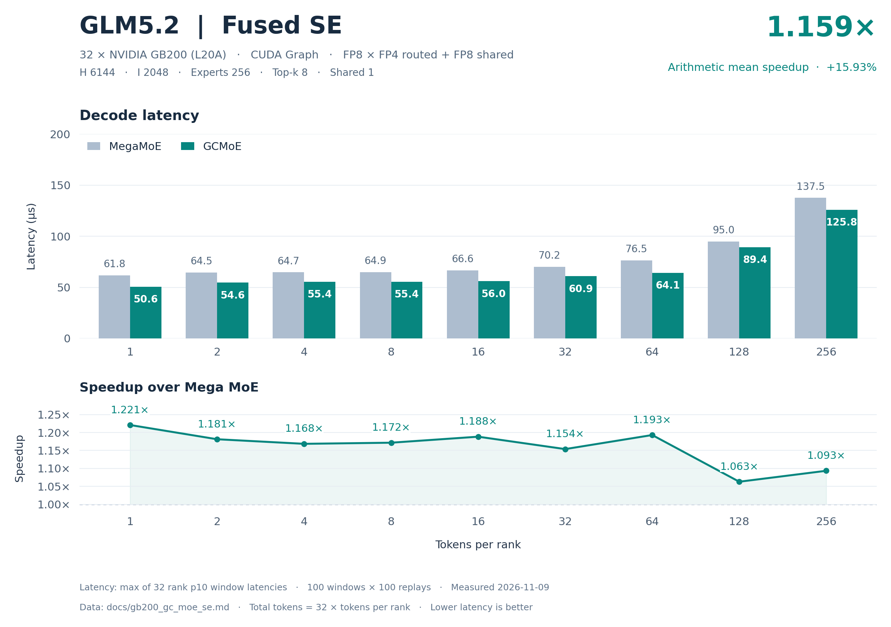
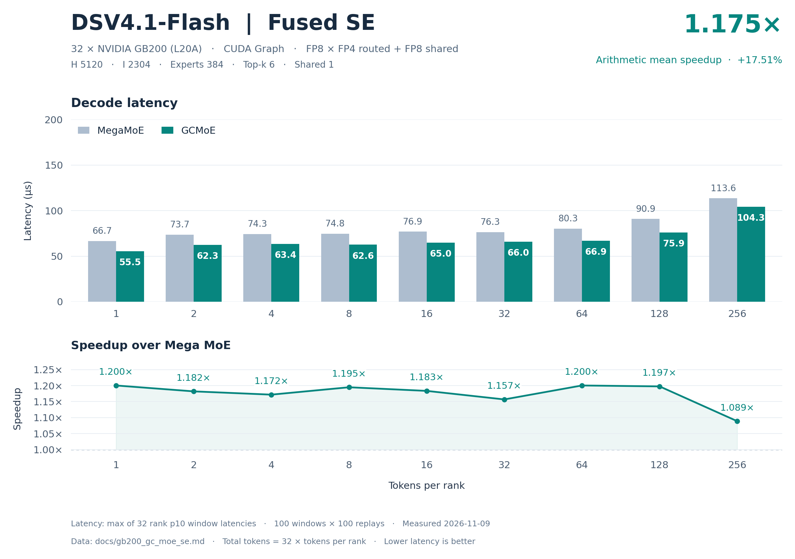

# GB200 32 卡 GC MoE SE 精度与 decode 性能

精度结论：两个模型的 default、boundary、asymmetric 全部通过，共 138/138 个 case、4416/4416 个 rank 检查；所有有限性检查通过。cosine 阈值为 0.99。

性能结论：18 个 decode 点中 18/18 点 GC 延迟低于 DeepGEMM MegaMoE；逐点等权平均加速 **1.167192×**，平均加速收益 **16.7192%**，单点范围 1.063030×～1.220811×。

| 模型 | decode 点数 | 平均 Mega / GC | 平均加速收益 | 平均延迟下降 |
| --- | --- | --- | --- | --- |
| glm5.2 | 9 | 1.159297× | 15.9297% | 13.5914% |
| dsv4.1-flash | 9 | 1.175086× | 17.5086% | 14.8273% |
| 全部模型等权 | 18 | 1.167192× | 16.7192% | 14.2093% |

平均加速比为 `mean(Mega_us / GC_us)`；每模型 9 点等权，总计 18 点等权。平均延迟下降为 `mean(1 − GC_us / Mega_us)`，与平均加速收益分别计算。

## 模型与数据口径

2026-11-09；GC MoE 0.5.0；DeepGEMM MegaMoE 2.8.2+local；32 × NVIDIA GB200（设备报告名 L20A，compute capability 10.0），CUDA Graph。FP8 激活、FP4 routed 权重、FP8 shared 权重。

| 模型 | H | I | routed experts | top-k | shared experts | shared weight gran K | shared recipe |
| --- | --- | --- | --- | --- | --- | --- | --- |
| glm5.2 | 6144 | 2048 | 256 | 8 | 1 | 128 | (1,128,128) |
| dsv4.1-flash | 5120 | 2304 | 384 | 6 | 1 | 32 | (1,1,32) |

SwiGLU；alpha=1、clamp=10、fast_math=true；routed recipe=(1,1,32)。每 rank requested capacity=256、aligned capacity=1920；总 token=32T。

latency 单位 µs，每个 rank 取 100 个计时窗口（每窗口 100 次 CUDA Graph replay）延迟的 10 分位，再取 32 rank 的最大值；窗口内与窗口间的偶发外部干扰由分位数剔除。

## 精度

独立参考为解量化后的 Torch routed 分支分布式求和及本地 shared 分支；shared residual 与独立 shared 分支比较。表中取全部 rank 对应指标的最小 cosine 和最大绝对差。

| 模型 | 类别 | 算子 | case 通过 | rank 检查通过 | 最小参考 cosine | 阈值 | finite |
| --- | --- | --- | --- | --- | --- | --- | --- |
| glm5.2 | default | MegaMoE | 9/9 | 288/288 | 0.999999642 | 0.99 | 全部通过 |
| glm5.2 | default | GCMoE | 9/9 | 288/288 | 0.999999642 | 0.99 | 全部通过 |
| glm5.2 | boundary | MegaMoE | 23/23 | 736/736 | 0.999999642 | 0.99 | 全部通过 |
| glm5.2 | boundary | GCMoE | 23/23 | 736/736 | 0.999999642 | 0.99 | 全部通过 |
| glm5.2 | asymmetric | MegaMoE | 37/37 | 1184/1184 | 0.999999821 | 0.99 | 全部通过 |
| glm5.2 | asymmetric | GCMoE | 37/37 | 1184/1184 | 0.999999821 | 0.99 | 全部通过 |
| dsv4.1-flash | default | MegaMoE | 9/9 | 288/288 | 0.999998569 | 0.99 | 全部通过 |
| dsv4.1-flash | default | GCMoE | 9/9 | 288/288 | 0.999998569 | 0.99 | 全部通过 |
| dsv4.1-flash | boundary | MegaMoE | 23/23 | 736/736 | 0.999998391 | 0.99 | 全部通过 |
| dsv4.1-flash | boundary | GCMoE | 23/23 | 736/736 | 0.999998391 | 0.99 | 全部通过 |
| dsv4.1-flash | asymmetric | MegaMoE | 37/37 | 1184/1184 | 0.999998569 | 0.99 | 全部通过 |
| dsv4.1-flash | asymmetric | GCMoE | 37/37 | 1184/1184 | 0.999998569 | 0.99 | 全部通过 |

| 模型 | 类别 | 最小 GC/Mega cosine | 最大 \|GC−Mega\| | 最小 Mega shared cosine | 最小 GC shared cosine |
| --- | --- | --- | --- | --- | --- |
| glm5.2 | default | 0.999999762 | 0.000000 | 0.999998093 | 0.999998093 |
| glm5.2 | boundary | 0.999999762 | 0.000000 | 0.999998093 | 0.999998093 |
| glm5.2 | asymmetric | 0.999999821 | 0.000000 | 0.999998212 | 0.999998212 |
| dsv4.1-flash | default | 0.999999762 | 0.000000 | 0.999996662 | 0.999996662 |
| dsv4.1-flash | boundary | 0.999999702 | 0.000000 | 0.999996603 | 0.999996603 |
| dsv4.1-flash | asymmetric | 0.999999821 | 0.000000 | 0.999996722 | 0.999996722 |

### glm5.2：default 逐组精度

| T/rank 或各 rank token 向量 | 最小 Mega/ref cosine | 最小 GC/ref cosine | 最小 GC/Mega cosine | 最大 \|GC−Mega\| | 结果 |
| --- | --- | --- | --- | --- | --- |
| 1 | 0.999999881 | 0.999999881 | 0.999999881 | 0.000000 | 通过 |
| 2 | 0.999999821 | 0.999999821 | 0.999999762 | 0.000000 | 通过 |
| 4 | 0.999999881 | 0.999999881 | 0.999999881 | 0.000000 | 通过 |
| 8 | 0.999999881 | 0.999999881 | 0.999999881 | 0.000000 | 通过 |
| 16 | 0.999999940 | 0.999999940 | 0.999999940 | 0.000000 | 通过 |
| 32 | 0.999999940 | 0.999999940 | 0.999999881 | 0.000000 | 通过 |
| 64 | 0.999999821 | 0.999999821 | 0.999999881 | 0.000000 | 通过 |
| 128 | 0.999999642 | 0.999999642 | 0.999999881 | 0.000000 | 通过 |
| 256 | 0.999999821 | 0.999999821 | 0.999999940 | 0.000000 | 通过 |

### glm5.2：boundary 逐组精度

| T/rank 或各 rank token 向量 | 最小 Mega/ref cosine | 最小 GC/ref cosine | 最小 GC/Mega cosine | 最大 \|GC−Mega\| | 结果 |
| --- | --- | --- | --- | --- | --- |
| 0 | 1.000000000 | 1.000000000 | 1.000000000 | 0.000000 | 通过 |
| 3 | 0.999999821 | 0.999999821 | 0.999999821 | 0.000000 | 通过 |
| 5 | 0.999999821 | 0.999999821 | 0.999999762 | 0.000000 | 通过 |
| 7 | 0.999999940 | 0.999999940 | 0.999999940 | 0.000000 | 通过 |
| 9 | 0.999999881 | 0.999999881 | 0.999999821 | 0.000000 | 通过 |
| 15 | 0.999999940 | 0.999999940 | 0.999999881 | 0.000000 | 通过 |
| 17 | 0.999999940 | 0.999999940 | 0.999999940 | 0.000000 | 通过 |
| 31 | 0.999999881 | 0.999999881 | 0.999999881 | 0.000000 | 通过 |
| 33 | 0.999999940 | 0.999999940 | 0.999999821 | 0.000000 | 通过 |
| 63 | 0.999999881 | 0.999999881 | 0.999999881 | 0.000000 | 通过 |
| 65 | 0.999999881 | 0.999999881 | 0.999999881 | 0.000000 | 通过 |
| 95 | 0.999999821 | 0.999999821 | 0.999999881 | 0.000000 | 通过 |
| 96 | 0.999999881 | 0.999999881 | 0.999999821 | 0.000000 | 通过 |
| 97 | 0.999999821 | 0.999999821 | 0.999999821 | 0.000000 | 通过 |
| 127 | 0.999999702 | 0.999999702 | 0.999999881 | 0.000000 | 通过 |
| 129 | 0.999999762 | 0.999999762 | 0.999999881 | 0.000000 | 通过 |
| 191 | 0.999999702 | 0.999999702 | 0.999999821 | 0.000000 | 通过 |
| 192 | 0.999999642 | 0.999999642 | 0.999999821 | 0.000000 | 通过 |
| 193 | 0.999999821 | 0.999999821 | 0.999999821 | 0.000000 | 通过 |
| 239 | 0.999999762 | 0.999999762 | 0.999999881 | 0.000000 | 通过 |
| 240 | 0.999999762 | 0.999999762 | 0.999999881 | 0.000000 | 通过 |
| 241 | 0.999999762 | 0.999999762 | 0.999999762 | 0.000000 | 通过 |
| 255 | 0.999999821 | 0.999999821 | 0.999999881 | 0.000000 | 通过 |

### glm5.2：asymmetric 逐组精度

| T/rank 或各 rank token 向量 | 最小 Mega/ref cosine | 最小 GC/ref cosine | 最小 GC/Mega cosine | 最大 \|GC−Mega\| | 结果 |
| --- | --- | --- | --- | --- | --- |
| 0 | 1.000000000 | 1.000000000 | 1.000000000 | 0.000000 | 通过 |
| [256, 0, 256, 0, 256, 0, 256, 0, 256, 0, 256, 0, 256, 0, 256, 0, 256, 0, 256, 0, 256, 0, 256, 0, 256, 0, 256, 0, 256, 0, 256, 0] | 0.999999821 | 0.999999821 | 0.999999940 | 0.000000 | 通过 |
| [1, 0, 1, 0, 1, 0, 1, 0, 1, 0, 1, 0, 1, 0, 1, 0, 1, 0, 1, 0, 1, 0, 1, 0, 1, 0, 1, 0, 1, 0, 1, 0] | 0.999999881 | 0.999999881 | 0.999999881 | 0.000000 | 通过 |
| [256, 256, 256, 256, 256, 256, 256, 256, 256, 256, 256, 256, 256, 256, 256, 256, 1, 1, 1, 1, 1, 1, 1, 1, 1, 1, 1, 1, 1, 1, 1, 1] | 0.999999821 | 0.999999821 | 0.999999881 | 0.000000 | 通过 |
| [256, 128, 64, 32, 16, 8, 4, 2, 1, 256, 128, 64, 32, 16, 8, 4, 2, 1, 256, 128, 64, 32, 16, 8, 4, 2, 1, 256, 128, 64, 32, 16] | 0.999999940 | 0.999999940 | 0.999999881 | 0.000000 | 通过 |
| [0, 256, 256, 256, 256, 256, 256, 256, 256, 256, 256, 256, 256, 256, 256, 256, 256, 256, 256, 256, 256, 256, 256, 256, 256, 256, 256, 256, 256, 256, 256, 256] | 0.999999821 | 0.999999821 | 0.999999940 | 0.000000 | 通过 |
| [256, 0, 256, 256, 256, 256, 256, 256, 256, 256, 256, 256, 256, 256, 256, 256, 256, 256, 256, 256, 256, 256, 256, 256, 256, 256, 256, 256, 256, 256, 256, 256] | 0.999999821 | 0.999999821 | 0.999999940 | 0.000000 | 通过 |
| [256, 256, 0, 256, 256, 256, 256, 256, 256, 256, 256, 256, 256, 256, 256, 256, 256, 256, 256, 256, 256, 256, 256, 256, 256, 256, 256, 256, 256, 256, 256, 256] | 0.999999821 | 0.999999821 | 0.999999940 | 0.000000 | 通过 |
| [256, 256, 256, 0, 256, 256, 256, 256, 256, 256, 256, 256, 256, 256, 256, 256, 256, 256, 256, 256, 256, 256, 256, 256, 256, 256, 256, 256, 256, 256, 256, 256] | 0.999999821 | 0.999999821 | 0.999999940 | 0.000000 | 通过 |
| [256, 256, 256, 256, 0, 256, 256, 256, 256, 256, 256, 256, 256, 256, 256, 256, 256, 256, 256, 256, 256, 256, 256, 256, 256, 256, 256, 256, 256, 256, 256, 256] | 0.999999821 | 0.999999821 | 0.999999940 | 0.000000 | 通过 |
| [256, 256, 256, 256, 256, 0, 256, 256, 256, 256, 256, 256, 256, 256, 256, 256, 256, 256, 256, 256, 256, 256, 256, 256, 256, 256, 256, 256, 256, 256, 256, 256] | 0.999999821 | 0.999999821 | 0.999999940 | 0.000000 | 通过 |
| [256, 256, 256, 256, 256, 256, 0, 256, 256, 256, 256, 256, 256, 256, 256, 256, 256, 256, 256, 256, 256, 256, 256, 256, 256, 256, 256, 256, 256, 256, 256, 256] | 0.999999821 | 0.999999821 | 0.999999940 | 0.000000 | 通过 |
| [256, 256, 256, 256, 256, 256, 256, 0, 256, 256, 256, 256, 256, 256, 256, 256, 256, 256, 256, 256, 256, 256, 256, 256, 256, 256, 256, 256, 256, 256, 256, 256] | 0.999999821 | 0.999999821 | 0.999999940 | 0.000000 | 通过 |
| [256, 256, 256, 256, 256, 256, 256, 256, 0, 256, 256, 256, 256, 256, 256, 256, 256, 256, 256, 256, 256, 256, 256, 256, 256, 256, 256, 256, 256, 256, 256, 256] | 0.999999821 | 0.999999821 | 0.999999940 | 0.000000 | 通过 |
| [256, 256, 256, 256, 256, 256, 256, 256, 256, 0, 256, 256, 256, 256, 256, 256, 256, 256, 256, 256, 256, 256, 256, 256, 256, 256, 256, 256, 256, 256, 256, 256] | 0.999999821 | 0.999999821 | 0.999999940 | 0.000000 | 通过 |
| [256, 256, 256, 256, 256, 256, 256, 256, 256, 256, 0, 256, 256, 256, 256, 256, 256, 256, 256, 256, 256, 256, 256, 256, 256, 256, 256, 256, 256, 256, 256, 256] | 0.999999821 | 0.999999821 | 0.999999940 | 0.000000 | 通过 |
| [256, 256, 256, 256, 256, 256, 256, 256, 256, 256, 256, 0, 256, 256, 256, 256, 256, 256, 256, 256, 256, 256, 256, 256, 256, 256, 256, 256, 256, 256, 256, 256] | 0.999999821 | 0.999999821 | 0.999999940 | 0.000000 | 通过 |
| [256, 256, 256, 256, 256, 256, 256, 256, 256, 256, 256, 256, 0, 256, 256, 256, 256, 256, 256, 256, 256, 256, 256, 256, 256, 256, 256, 256, 256, 256, 256, 256] | 0.999999821 | 0.999999821 | 0.999999940 | 0.000000 | 通过 |
| [0, 0, 0, 0, 0, 0, 0, 0, 0, 0, 0, 0, 0, 0, 256, 0, 0, 0, 0, 0, 0, 0, 0, 0, 0, 0, 0, 0, 0, 0, 0, 0] | 0.999999940 | 0.999999940 | 1.000000000 | 0.000000 | 通过 |
| [0, 0, 0, 0, 0, 0, 0, 0, 0, 0, 0, 0, 0, 0, 0, 256, 0, 0, 0, 0, 0, 0, 0, 0, 0, 0, 0, 0, 0, 0, 0, 0] | 1.000000000 | 1.000000000 | 1.000000000 | 0.000000 | 通过 |
| [0, 0, 0, 0, 0, 0, 0, 0, 0, 0, 0, 0, 0, 0, 0, 0, 256, 0, 0, 0, 0, 0, 0, 0, 0, 0, 0, 0, 0, 0, 0, 0] | 0.999999940 | 0.999999940 | 1.000000000 | 0.000000 | 通过 |
| [0, 0, 0, 0, 0, 0, 0, 0, 0, 0, 0, 0, 0, 0, 0, 0, 0, 256, 0, 0, 0, 0, 0, 0, 0, 0, 0, 0, 0, 0, 0, 0] | 1.000000000 | 1.000000000 | 1.000000000 | 0.000000 | 通过 |
| [0, 0, 0, 0, 0, 0, 0, 0, 0, 0, 0, 0, 0, 0, 0, 0, 0, 0, 256, 0, 0, 0, 0, 0, 0, 0, 0, 0, 0, 0, 0, 0] | 0.999999940 | 0.999999940 | 0.999999940 | 0.000000 | 通过 |
| [0, 0, 0, 0, 0, 0, 0, 0, 0, 0, 0, 0, 0, 0, 0, 0, 0, 0, 0, 256, 0, 0, 0, 0, 0, 0, 0, 0, 0, 0, 0, 0] | 1.000000000 | 1.000000000 | 0.999999940 | 0.000000 | 通过 |
| [0, 0, 0, 0, 0, 0, 0, 0, 0, 0, 0, 0, 0, 0, 0, 0, 0, 0, 0, 0, 256, 0, 0, 0, 0, 0, 0, 0, 0, 0, 0, 0] | 1.000000000 | 1.000000000 | 0.999999940 | 0.000000 | 通过 |
| [0, 0, 0, 0, 0, 0, 0, 0, 0, 0, 0, 0, 0, 0, 0, 0, 0, 0, 0, 0, 0, 256, 0, 0, 0, 0, 0, 0, 0, 0, 0, 0] | 0.999999821 | 0.999999821 | 1.000000000 | 0.000000 | 通过 |
| [0, 0, 0, 0, 0, 0, 0, 0, 0, 0, 0, 0, 0, 0, 0, 0, 0, 0, 0, 0, 0, 0, 256, 0, 0, 0, 0, 0, 0, 0, 0, 0] | 0.999999940 | 0.999999940 | 0.999999940 | 0.000000 | 通过 |
| [0, 0, 0, 0, 0, 0, 0, 0, 0, 0, 0, 0, 0, 0, 0, 0, 0, 0, 0, 0, 0, 0, 0, 256, 0, 0, 0, 0, 0, 0, 0, 0] | 1.000000000 | 1.000000000 | 1.000000000 | 0.000000 | 通过 |
| [0, 0, 0, 0, 0, 0, 0, 0, 0, 0, 0, 0, 0, 0, 0, 0, 0, 0, 0, 0, 0, 0, 0, 0, 256, 0, 0, 0, 0, 0, 0, 0] | 1.000000000 | 1.000000000 | 1.000000000 | 0.000000 | 通过 |
| [0, 0, 0, 0, 0, 0, 0, 0, 0, 0, 0, 0, 0, 0, 0, 0, 0, 0, 0, 0, 0, 0, 0, 0, 0, 256, 0, 0, 0, 0, 0, 0] | 0.999999940 | 0.999999940 | 1.000000000 | 0.000000 | 通过 |
| [0, 0, 0, 0, 0, 0, 0, 0, 0, 0, 0, 0, 0, 0, 0, 0, 0, 0, 0, 0, 0, 0, 0, 0, 0, 0, 256, 0, 0, 0, 0, 0] | 1.000000000 | 1.000000000 | 0.999999940 | 0.000000 | 通过 |
| [0, 0, 0, 0, 0, 0, 0, 0, 0, 0, 0, 0, 0, 0, 0, 0, 0, 0, 0, 0, 0, 0, 0, 0, 0, 0, 0, 256, 0, 0, 0, 0] | 0.999999940 | 0.999999940 | 1.000000000 | 0.000000 | 通过 |
| [0, 0, 0, 0, 0, 0, 0, 0, 0, 0, 0, 0, 0, 0, 0, 0, 0, 0, 0, 0, 0, 0, 0, 0, 0, 0, 0, 0, 256, 0, 0, 0] | 1.000000000 | 1.000000000 | 0.999999940 | 0.000000 | 通过 |
| [0, 0, 0, 0, 0, 0, 0, 0, 0, 0, 0, 0, 0, 0, 0, 0, 0, 0, 0, 0, 0, 0, 0, 0, 0, 0, 0, 0, 0, 256, 0, 0] | 0.999999940 | 0.999999940 | 0.999999940 | 0.000000 | 通过 |
| [0, 0, 0, 0, 0, 0, 0, 0, 0, 0, 0, 0, 0, 0, 0, 0, 0, 0, 0, 0, 0, 0, 0, 0, 0, 0, 0, 0, 0, 0, 256, 0] | 1.000000000 | 1.000000000 | 1.000000000 | 0.000000 | 通过 |
| [256, 256, 256, 256, 256, 256, 256, 256, 256, 256, 256, 256, 256, 256, 256, 256, 256, 256, 256, 256, 256, 256, 256, 256, 256, 256, 256, 256, 256, 256, 256, 0] | 0.999999821 | 0.999999821 | 0.999999940 | 0.000000 | 通过 |
| [0, 1, 2, 3, 4, 5, 7, 8, 9, 15, 16, 17, 31, 32, 33, 63, 64, 65, 95, 96, 97, 127, 128, 129, 191, 192, 193, 239, 240, 241, 255, 256] | 0.999999821 | 0.999999821 | 0.999999821 | 0.000000 | 通过 |

### dsv4.1-flash：default 逐组精度

| T/rank 或各 rank token 向量 | 最小 Mega/ref cosine | 最小 GC/ref cosine | 最小 GC/Mega cosine | 最大 \|GC−Mega\| | 结果 |
| --- | --- | --- | --- | --- | --- |
| 1 | 0.999999821 | 0.999999821 | 0.999999821 | 0.000000 | 通过 |
| 2 | 0.999999881 | 0.999999881 | 0.999999881 | 0.000000 | 通过 |
| 4 | 0.999999821 | 0.999999821 | 0.999999821 | 0.000000 | 通过 |
| 8 | 0.999999464 | 0.999999464 | 0.999999762 | 0.000000 | 通过 |
| 16 | 0.999999881 | 0.999999881 | 0.999999881 | 0.000000 | 通过 |
| 32 | 0.999998569 | 0.999998569 | 0.999999881 | 0.000000 | 通过 |
| 64 | 0.999999166 | 0.999999166 | 0.999999821 | 0.000000 | 通过 |
| 128 | 0.999999464 | 0.999999464 | 0.999999821 | 0.000000 | 通过 |
| 256 | 0.999999702 | 0.999999702 | 0.999999821 | 0.000000 | 通过 |

### dsv4.1-flash：boundary 逐组精度

| T/rank 或各 rank token 向量 | 最小 Mega/ref cosine | 最小 GC/ref cosine | 最小 GC/Mega cosine | 最大 \|GC−Mega\| | 结果 |
| --- | --- | --- | --- | --- | --- |
| 0 | 1.000000000 | 1.000000000 | 1.000000000 | 0.000000 | 通过 |
| 3 | 0.999999881 | 0.999999881 | 0.999999821 | 0.000000 | 通过 |
| 5 | 0.999999821 | 0.999999821 | 0.999999821 | 0.000000 | 通过 |
| 7 | 0.999999762 | 0.999999762 | 0.999999762 | 0.000000 | 通过 |
| 9 | 0.999999702 | 0.999999702 | 0.999999821 | 0.000000 | 通过 |
| 15 | 0.999999762 | 0.999999762 | 0.999999881 | 0.000000 | 通过 |
| 17 | 0.999999166 | 0.999999166 | 0.999999881 | 0.000000 | 通过 |
| 31 | 0.999998510 | 0.999998510 | 0.999999762 | 0.000000 | 通过 |
| 33 | 0.999998391 | 0.999998391 | 0.999999821 | 0.000000 | 通过 |
| 63 | 0.999999285 | 0.999999285 | 0.999999762 | 0.000000 | 通过 |
| 65 | 0.999999166 | 0.999999166 | 0.999999702 | 0.000000 | 通过 |
| 95 | 0.999999583 | 0.999999583 | 0.999999881 | 0.000000 | 通过 |
| 96 | 0.999999464 | 0.999999464 | 0.999999881 | 0.000000 | 通过 |
| 97 | 0.999999523 | 0.999999523 | 0.999999881 | 0.000000 | 通过 |
| 127 | 0.999999583 | 0.999999583 | 0.999999881 | 0.000000 | 通过 |
| 129 | 0.999999464 | 0.999999464 | 0.999999821 | 0.000000 | 通过 |
| 191 | 0.999999642 | 0.999999642 | 0.999999881 | 0.000000 | 通过 |
| 192 | 0.999999702 | 0.999999702 | 0.999999821 | 0.000000 | 通过 |
| 193 | 0.999999702 | 0.999999702 | 0.999999881 | 0.000000 | 通过 |
| 239 | 0.999999642 | 0.999999642 | 0.999999762 | 0.000000 | 通过 |
| 240 | 0.999999642 | 0.999999642 | 0.999999881 | 0.000000 | 通过 |
| 241 | 0.999999762 | 0.999999762 | 0.999999881 | 0.000000 | 通过 |
| 255 | 0.999999702 | 0.999999702 | 0.999999821 | 0.000000 | 通过 |

### dsv4.1-flash：asymmetric 逐组精度

| T/rank 或各 rank token 向量 | 最小 Mega/ref cosine | 最小 GC/ref cosine | 最小 GC/Mega cosine | 最大 \|GC−Mega\| | 结果 |
| --- | --- | --- | --- | --- | --- |
| 0 | 1.000000000 | 1.000000000 | 1.000000000 | 0.000000 | 通过 |
| [256, 0, 256, 0, 256, 0, 256, 0, 256, 0, 256, 0, 256, 0, 256, 0, 256, 0, 256, 0, 256, 0, 256, 0, 256, 0, 256, 0, 256, 0, 256, 0] | 0.999999881 | 0.999999881 | 0.999999881 | 0.000000 | 通过 |
| [1, 0, 1, 0, 1, 0, 1, 0, 1, 0, 1, 0, 1, 0, 1, 0, 1, 0, 1, 0, 1, 0, 1, 0, 1, 0, 1, 0, 1, 0, 1, 0] | 0.999999821 | 0.999999821 | 0.999999821 | 0.000000 | 通过 |
| [256, 256, 256, 256, 256, 256, 256, 256, 256, 256, 256, 256, 256, 256, 256, 256, 1, 1, 1, 1, 1, 1, 1, 1, 1, 1, 1, 1, 1, 1, 1, 1] | 0.999999702 | 0.999999702 | 0.999999821 | 0.000000 | 通过 |
| [256, 128, 64, 32, 16, 8, 4, 2, 1, 256, 128, 64, 32, 16, 8, 4, 2, 1, 256, 128, 64, 32, 16, 8, 4, 2, 1, 256, 128, 64, 32, 16] | 0.999998569 | 0.999998569 | 0.999999821 | 0.000000 | 通过 |
| [0, 256, 256, 256, 256, 256, 256, 256, 256, 256, 256, 256, 256, 256, 256, 256, 256, 256, 256, 256, 256, 256, 256, 256, 256, 256, 256, 256, 256, 256, 256, 256] | 0.999999702 | 0.999999702 | 0.999999821 | 0.000000 | 通过 |
| [256, 0, 256, 256, 256, 256, 256, 256, 256, 256, 256, 256, 256, 256, 256, 256, 256, 256, 256, 256, 256, 256, 256, 256, 256, 256, 256, 256, 256, 256, 256, 256] | 0.999999702 | 0.999999702 | 0.999999821 | 0.000000 | 通过 |
| [256, 256, 0, 256, 256, 256, 256, 256, 256, 256, 256, 256, 256, 256, 256, 256, 256, 256, 256, 256, 256, 256, 256, 256, 256, 256, 256, 256, 256, 256, 256, 256] | 0.999999702 | 0.999999702 | 0.999999821 | 0.000000 | 通过 |
| [256, 256, 256, 0, 256, 256, 256, 256, 256, 256, 256, 256, 256, 256, 256, 256, 256, 256, 256, 256, 256, 256, 256, 256, 256, 256, 256, 256, 256, 256, 256, 256] | 0.999999821 | 0.999999821 | 0.999999821 | 0.000000 | 通过 |
| [256, 256, 256, 256, 0, 256, 256, 256, 256, 256, 256, 256, 256, 256, 256, 256, 256, 256, 256, 256, 256, 256, 256, 256, 256, 256, 256, 256, 256, 256, 256, 256] | 0.999999702 | 0.999999702 | 0.999999821 | 0.000000 | 通过 |
| [256, 256, 256, 256, 256, 0, 256, 256, 256, 256, 256, 256, 256, 256, 256, 256, 256, 256, 256, 256, 256, 256, 256, 256, 256, 256, 256, 256, 256, 256, 256, 256] | 0.999999702 | 0.999999702 | 0.999999821 | 0.000000 | 通过 |
| [256, 256, 256, 256, 256, 256, 0, 256, 256, 256, 256, 256, 256, 256, 256, 256, 256, 256, 256, 256, 256, 256, 256, 256, 256, 256, 256, 256, 256, 256, 256, 256] | 0.999999702 | 0.999999702 | 0.999999821 | 0.000000 | 通过 |
| [256, 256, 256, 256, 256, 256, 256, 0, 256, 256, 256, 256, 256, 256, 256, 256, 256, 256, 256, 256, 256, 256, 256, 256, 256, 256, 256, 256, 256, 256, 256, 256] | 0.999999702 | 0.999999702 | 0.999999821 | 0.000000 | 通过 |
| [256, 256, 256, 256, 256, 256, 256, 256, 0, 256, 256, 256, 256, 256, 256, 256, 256, 256, 256, 256, 256, 256, 256, 256, 256, 256, 256, 256, 256, 256, 256, 256] | 0.999999702 | 0.999999702 | 0.999999821 | 0.000000 | 通过 |
| [256, 256, 256, 256, 256, 256, 256, 256, 256, 0, 256, 256, 256, 256, 256, 256, 256, 256, 256, 256, 256, 256, 256, 256, 256, 256, 256, 256, 256, 256, 256, 256] | 0.999999702 | 0.999999702 | 0.999999821 | 0.000000 | 通过 |
| [256, 256, 256, 256, 256, 256, 256, 256, 256, 256, 0, 256, 256, 256, 256, 256, 256, 256, 256, 256, 256, 256, 256, 256, 256, 256, 256, 256, 256, 256, 256, 256] | 0.999999702 | 0.999999702 | 0.999999821 | 0.000000 | 通过 |
| [256, 256, 256, 256, 256, 256, 256, 256, 256, 256, 256, 0, 256, 256, 256, 256, 256, 256, 256, 256, 256, 256, 256, 256, 256, 256, 256, 256, 256, 256, 256, 256] | 0.999999702 | 0.999999702 | 0.999999881 | 0.000000 | 通过 |
| [256, 256, 256, 256, 256, 256, 256, 256, 256, 256, 256, 256, 0, 256, 256, 256, 256, 256, 256, 256, 256, 256, 256, 256, 256, 256, 256, 256, 256, 256, 256, 256] | 0.999999702 | 0.999999702 | 0.999999821 | 0.000000 | 通过 |
| [0, 0, 0, 0, 0, 0, 0, 0, 0, 0, 0, 0, 0, 0, 256, 0, 0, 0, 0, 0, 0, 0, 0, 0, 0, 0, 0, 0, 0, 0, 0, 0] | 0.999999881 | 0.999999881 | 0.999999881 | 0.000000 | 通过 |
| [0, 0, 0, 0, 0, 0, 0, 0, 0, 0, 0, 0, 0, 0, 0, 256, 0, 0, 0, 0, 0, 0, 0, 0, 0, 0, 0, 0, 0, 0, 0, 0] | 0.999999881 | 0.999999881 | 1.000000000 | 0.000000 | 通过 |
| [0, 0, 0, 0, 0, 0, 0, 0, 0, 0, 0, 0, 0, 0, 0, 0, 256, 0, 0, 0, 0, 0, 0, 0, 0, 0, 0, 0, 0, 0, 0, 0] | 0.999999881 | 0.999999881 | 1.000000000 | 0.000000 | 通过 |
| [0, 0, 0, 0, 0, 0, 0, 0, 0, 0, 0, 0, 0, 0, 0, 0, 0, 256, 0, 0, 0, 0, 0, 0, 0, 0, 0, 0, 0, 0, 0, 0] | 0.999999881 | 0.999999881 | 1.000000000 | 0.000000 | 通过 |
| [0, 0, 0, 0, 0, 0, 0, 0, 0, 0, 0, 0, 0, 0, 0, 0, 0, 0, 256, 0, 0, 0, 0, 0, 0, 0, 0, 0, 0, 0, 0, 0] | 0.999999881 | 0.999999881 | 0.999999881 | 0.000000 | 通过 |
| [0, 0, 0, 0, 0, 0, 0, 0, 0, 0, 0, 0, 0, 0, 0, 0, 0, 0, 0, 256, 0, 0, 0, 0, 0, 0, 0, 0, 0, 0, 0, 0] | 1.000000000 | 1.000000000 | 0.999999881 | 0.000000 | 通过 |
| [0, 0, 0, 0, 0, 0, 0, 0, 0, 0, 0, 0, 0, 0, 0, 0, 0, 0, 0, 0, 256, 0, 0, 0, 0, 0, 0, 0, 0, 0, 0, 0] | 0.999999881 | 0.999999881 | 1.000000000 | 0.000000 | 通过 |
| [0, 0, 0, 0, 0, 0, 0, 0, 0, 0, 0, 0, 0, 0, 0, 0, 0, 0, 0, 0, 0, 256, 0, 0, 0, 0, 0, 0, 0, 0, 0, 0] | 1.000000000 | 1.000000000 | 1.000000000 | 0.000000 | 通过 |
| [0, 0, 0, 0, 0, 0, 0, 0, 0, 0, 0, 0, 0, 0, 0, 0, 0, 0, 0, 0, 0, 0, 256, 0, 0, 0, 0, 0, 0, 0, 0, 0] | 1.000000000 | 1.000000000 | 1.000000000 | 0.000000 | 通过 |
| [0, 0, 0, 0, 0, 0, 0, 0, 0, 0, 0, 0, 0, 0, 0, 0, 0, 0, 0, 0, 0, 0, 0, 256, 0, 0, 0, 0, 0, 0, 0, 0] | 1.000000000 | 1.000000000 | 1.000000000 | 0.000000 | 通过 |
| [0, 0, 0, 0, 0, 0, 0, 0, 0, 0, 0, 0, 0, 0, 0, 0, 0, 0, 0, 0, 0, 0, 0, 0, 256, 0, 0, 0, 0, 0, 0, 0] | 1.000000000 | 1.000000000 | 1.000000000 | 0.000000 | 通过 |
| [0, 0, 0, 0, 0, 0, 0, 0, 0, 0, 0, 0, 0, 0, 0, 0, 0, 0, 0, 0, 0, 0, 0, 0, 0, 256, 0, 0, 0, 0, 0, 0] | 1.000000000 | 1.000000000 | 1.000000000 | 0.000000 | 通过 |
| [0, 0, 0, 0, 0, 0, 0, 0, 0, 0, 0, 0, 0, 0, 0, 0, 0, 0, 0, 0, 0, 0, 0, 0, 0, 0, 256, 0, 0, 0, 0, 0] | 1.000000000 | 1.000000000 | 1.000000000 | 0.000000 | 通过 |
| [0, 0, 0, 0, 0, 0, 0, 0, 0, 0, 0, 0, 0, 0, 0, 0, 0, 0, 0, 0, 0, 0, 0, 0, 0, 0, 0, 256, 0, 0, 0, 0] | 1.000000000 | 1.000000000 | 1.000000000 | 0.000000 | 通过 |
| [0, 0, 0, 0, 0, 0, 0, 0, 0, 0, 0, 0, 0, 0, 0, 0, 0, 0, 0, 0, 0, 0, 0, 0, 0, 0, 0, 0, 256, 0, 0, 0] | 1.000000000 | 1.000000000 | 1.000000000 | 0.000000 | 通过 |
| [0, 0, 0, 0, 0, 0, 0, 0, 0, 0, 0, 0, 0, 0, 0, 0, 0, 0, 0, 0, 0, 0, 0, 0, 0, 0, 0, 0, 0, 256, 0, 0] | 1.000000000 | 1.000000000 | 1.000000000 | 0.000000 | 通过 |
| [0, 0, 0, 0, 0, 0, 0, 0, 0, 0, 0, 0, 0, 0, 0, 0, 0, 0, 0, 0, 0, 0, 0, 0, 0, 0, 0, 0, 0, 0, 256, 0] | 1.000000000 | 1.000000000 | 1.000000000 | 0.000000 | 通过 |
| [256, 256, 256, 256, 256, 256, 256, 256, 256, 256, 256, 256, 256, 256, 256, 256, 256, 256, 256, 256, 256, 256, 256, 256, 256, 256, 256, 256, 256, 256, 256, 0] | 0.999999702 | 0.999999702 | 0.999999821 | 0.000000 | 通过 |
| [0, 1, 2, 3, 4, 5, 7, 8, 9, 15, 16, 17, 31, 32, 33, 63, 64, 65, 95, 96, 97, 127, 128, 129, 191, 192, 193, 239, 240, 241, 255, 256] | 0.999998629 | 0.999998629 | 0.999999821 | 0.000000 | 通过 |

## glm5.2 decode 性能

| T/rank | 总 token | Mega µs | GC µs | Mega / GC | 延迟下降 |
| --- | --- | --- | --- | --- | --- |
| 1 | 32 | 61.755838 | 50.585918 | 1.220811× | 18.0872% |
| 2 | 64 | 64.470720 | 54.579840 | 1.181219× | 15.3417% |
| 4 | 128 | 64.688640 | 55.361600 | 1.168475× | 14.4184% |
| 8 | 256 | 64.874878 | 55.373120 | 1.171595× | 14.6463% |
| 16 | 512 | 66.550078 | 56.003518 | 1.188320× | 15.8476% |
| 32 | 1024 | 70.221119 | 60.860481 | 1.153805× | 13.3302% |
| 64 | 2048 | 76.502080 | 64.129281 | 1.192935× | 16.1732% |
| 128 | 4096 | 94.986563 | 89.354563 | 1.063030× | 5.9293% |
| 256 | 8192 | 137.534084 | 125.776320 | 1.093482× | 8.5490% |

## dsv4.1-flash decode 性能

| T/rank | 总 token | Mega µs | GC µs | Mega / GC | 延迟下降 |
| --- | --- | --- | --- | --- | --- |
| 1 | 32 | 66.663680 | 55.537920 | 1.200327× | 16.6894% |
| 2 | 64 | 73.650880 | 62.313919 | 1.181933× | 15.3928% |
| 4 | 128 | 74.304962 | 63.414402 | 1.171736× | 14.6566% |
| 8 | 256 | 74.762878 | 62.573762 | 1.194796× | 16.3037% |
| 16 | 512 | 76.928000 | 65.003200 | 1.183449× | 15.5012% |
| 32 | 1024 | 76.309438 | 65.965118 | 1.156815× | 13.5558% |
| 64 | 2048 | 80.295038 | 66.894078 | 1.200331× | 16.6896% |
| 128 | 4096 | 90.919676 | 75.925441 | 1.197486× | 16.4917% |
| 256 | 8192 | 113.561277 | 104.289598 | 1.088903× | 8.1645% |

## 有效 HBM 带宽

以命中 routed expert 的权重与 scale 工作集各计一次，加上非空 rank 的本地 shared 权重与 scale（SE）。这是模型估算的有效工作集带宽，不是物理 HBM 流量或硬件计数；不计激活、输出、中间结果及缓存/重复 CTA 访存。单位为十进制 GB/s。

### glm5.2

| T/rank | Mega 全32卡合计 | GC 全32卡合计 | Mega 每 GPU 均值 | GC 每 GPU 均值 |
| --- | --- | --- | --- | --- |
| 1 | 72968.896 | 89081.221 | 2280.278 | 2783.788 |
| 2 | 90736.918 | 107180.132 | 2835.529 | 3349.379 |
| 4 | 97251.431 | 113635.856 | 3039.107 | 3551.120 |
| 8 | 97899.604 | 114698.699 | 3059.363 | 3584.334 |
| 16 | 95435.272 | 113407.605 | 2982.352 | 3543.988 |
| 32 | 90446.078 | 104357.125 | 2826.440 | 3261.160 |
| 64 | 83020.290 | 99037.830 | 2594.384 | 3094.932 |
| 128 | 66864.456 | 71078.909 | 2089.514 | 2221.216 |
| 256 | 46179.279 | 50496.189 | 1443.102 | 1578.006 |

### dsv4.1-flash

| T/rank | Mega 全32卡合计 | GC 全32卡合计 | Mega 每 GPU 均值 | GC 每 GPU 均值 |
| --- | --- | --- | --- | --- |
| 1 | 60103.915 | 72144.368 | 1878.247 | 2254.512 |
| 2 | 79162.805 | 93565.135 | 2473.838 | 2923.910 |
| 4 | 102249.839 | 119809.856 | 3195.307 | 3744.058 |
| 8 | 111179.437 | 132836.743 | 3474.357 | 4151.148 |
| 16 | 109027.886 | 129028.991 | 3407.121 | 4032.156 |
| 32 | 109911.664 | 127147.460 | 3434.739 | 3973.358 |
| 64 | 104455.985 | 125381.760 | 3264.250 | 3918.180 |
| 128 | 92249.529 | 110467.548 | 2882.798 | 3452.111 |
| 256 | 73857.018 | 80423.143 | 2308.032 | 2513.223 |

## 有效 NVLink 带宽

有效远程 assignment payload=`remote_assignments × (H + H/32 + 2H)`，包含 FP8 激活、packed scale 和 BF16 返回值；不重复计算 TX+RX，不计本地/shared 工作、元数据、控制及协议开销。这是有效 payload 带宽，不是物理计数或单链路峰值。单位为十进制 GB/s。

### glm5.2

| T/rank | Mega 全32卡合计 | GC 全32卡合计 | Mega 每 GPU 均值 | GC 每 GPU 均值 |
| --- | --- | --- | --- | --- |
| 1 | 74.489 | 90.937 | 2.328 | 2.842 |
| 2 | 142.704 | 168.565 | 4.460 | 5.268 |
| 4 | 284.735 | 332.706 | 8.898 | 10.397 |
| 8 | 568.984 | 666.619 | 17.781 | 20.832 |
| 16 | 1111.562 | 1320.891 | 34.736 | 41.278 |
| 32 | 2107.963 | 2432.178 | 65.874 | 76.006 |
| 64 | 3865.653 | 4611.474 | 120.802 | 144.109 |
| 128 | 6219.923 | 6611.964 | 194.373 | 206.624 |
| 256 | 8588.479 | 9391.343 | 268.390 | 293.479 |

### dsv4.1-flash

| T/rank | Mega 全32卡合计 | GC 全32卡合计 | Mega 每 GPU 均值 | GC 每 GPU 均值 |
| --- | --- | --- | --- | --- |
| 1 | 41.906 | 50.301 | 1.310 | 1.572 |
| 2 | 76.914 | 90.907 | 2.404 | 2.841 |
| 4 | 153.519 | 179.883 | 4.797 | 5.621 |
| 8 | 308.893 | 369.065 | 9.653 | 11.533 |
| 16 | 599.592 | 709.587 | 18.737 | 22.175 |
| 32 | 1210.126 | 1399.891 | 37.816 | 43.747 |
| 64 | 2300.697 | 2761.598 | 71.897 | 86.300 |
| 128 | 4065.053 | 4867.845 | 127.033 | 152.120 |
| 256 | 6508.596 | 7087.231 | 203.394 | 221.476 |

## 有效矩阵计算吞吐

有效 FLOP=`6 × routed_assignments × H × I`；不计 padding、SwiGLU、量化/解量化或重复运算。单位 TFLOPS（10¹² FLOP/s）。

### glm5.2

| T/rank | Mega 全32卡合计 | GC 全32卡合计 | Mega 每 GPU 均值 | GC 每 GPU 均值 |
| --- | --- | --- | --- | --- |
| 1 | 352.084 | 429.829 | 11.003 | 13.432 |
| 2 | 674.516 | 796.751 | 21.079 | 24.898 |
| 4 | 1344.488 | 1571.000 | 42.015 | 49.094 |
| 8 | 2681.256 | 3141.347 | 83.789 | 98.167 |
| 16 | 5227.527 | 6211.973 | 163.360 | 194.124 |
| 32 | 9908.482 | 11432.455 | 309.640 | 357.264 |
| 64 | 18189.955 | 21699.439 | 568.436 | 678.107 |
| 128 | 29300.342 | 31147.137 | 915.636 | 973.348 |
| 256 | 40471.987 | 44255.370 | 1264.750 | 1382.980 |

### dsv4.1-flash

| T/rank | Mega 全32卡合计 | GC 全32卡合计 | Mega 每 GPU 均值 | GC 每 GPU 均值 |
| --- | --- | --- | --- | --- |
| 1 | 237.828 | 285.471 | 7.432 | 8.921 |
| 2 | 430.530 | 508.858 | 13.454 | 15.902 |
| 4 | 853.481 | 1000.055 | 26.671 | 31.252 |
| 8 | 1696.507 | 2026.980 | 53.016 | 63.343 |
| 16 | 3297.519 | 3902.446 | 103.047 | 121.951 |
| 32 | 6648.496 | 7691.080 | 207.766 | 240.346 |
| 64 | 12636.970 | 15168.548 | 394.905 | 474.017 |
| 128 | 22320.494 | 26728.486 | 697.515 | 835.265 |
| 256 | 35740.564 | 38918.014 | 1116.893 | 1216.188 |

三项吞吐均使用各算子自身的同一 slowest-rank p10 latency：GB/s=`bytes / (latency_us × 10³)`，TFLOPS=`FLOP / (latency_us × 10⁶)`。全 32 卡合计为全工作量除以该延迟；每 GPU 均值为合计除以 32，不代表每卡实测峰值。Mega 与 GC 使用相同有效工作量分子。
