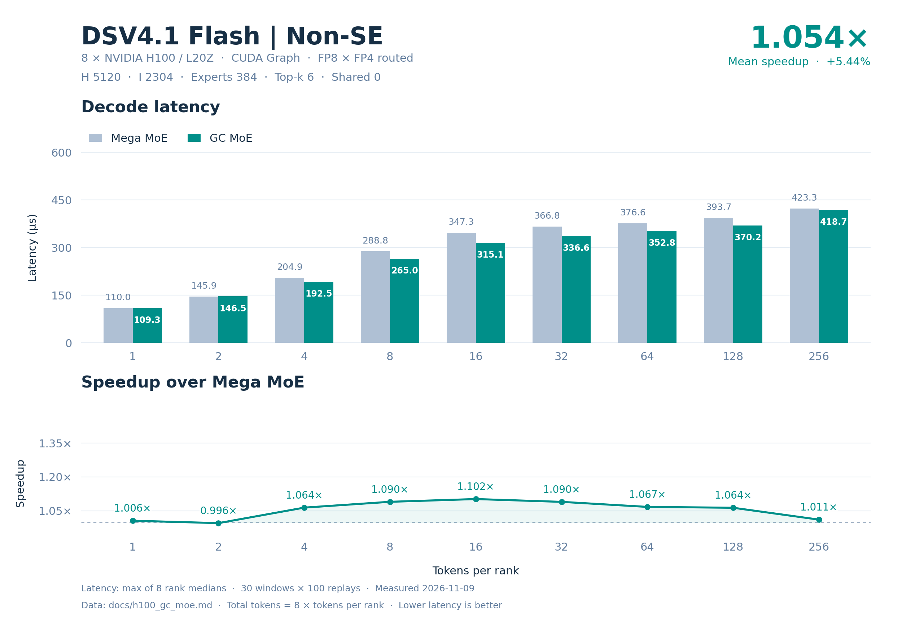

# H100 / L20Z DSV4.1-Flash Routed experts 精度与性能

8 卡 **47/47 精度用例通过**（376 rank-case）；GC/BF16 最小 cosine **0.977384567**、GC 最大 processed diff **1.36215387e-05**。GC 相对 Mega 的九点 decode 平均加速 **1.054416×**，8/9 点更快。

## 配置与数据口径

| 配置 | 取值 |
| --- | --- |
| 模型 | DSV4.1-Flash；输入和权重为固定随机种子的合成数据 |
| 数据分布 | 输入 BF16 randn×0.5，seed=42+7919×rank；路由分数 FP32 randn，seed=1000+31×rank，top-k 后 softmax |
| 权重分布 | 量化前 BF16 randn×0.05；精度用全局权重 seed=7；性能用本地权重 seed=7+rank |
| 硬件 | 8 × NVIDIA L20Z（H100），每卡 132 SM、81559 MiB；GPU 间 NV18 互连 |
| 并行方式 | 单机 EP8，每卡 1 rank；每 rank 最多 256 tokens |
| Routed experts | hidden 5120，intermediate 2304，384 experts，top-k 6 |
| Shared experts | 0 |
| 数值格式 | Routed 输入 E4M3 FP8 / K128 FP32 scale；权重 FP4 E2M1 / K32 二次幂 scale，Humming 布局使用 8-bit 相对指数与 FP32 secondary scale；输出 BF16 |
| 激活 | SwiGLU；alpha=1，clamp=10，fast_math=True |
| 软件 | Python 3.12.3；PyTorch 2.11.0+cu130；DeepGEMM 2.8.2；GC MoE 0.5.1；CUTLASS DSL 4.8.1 |
| CUDA | PyTorch CUDA 13.0；nvcc 13.2.51；CUDA Python/bindings 13.2.0；驱动 580.105.08 |
| 数据日期 | 2026-11-09 |

Decode 点为每 rank 1、2、4、8、16、32、64、128、256 tokens。延迟来自 CUDA Graph replay：10 个预热窗口、30 个计时窗口，每窗口 100 次调用，窗口间刷新 L2。单次延迟先在每个 rank 上取 30 个窗口的中位数，再取 8 个 rank 中的最大值，单位 µs。输入准备和权重转换不计入算子延迟。

加速比使用未舍入的“对照算子延迟 / GC 算子延迟”；decode 平均加速为九个逐点加速比的等权算术平均，不是平均延迟之比。表内延迟保留六位小数，加速比保留六位小数。
Green Context：每卡 4 个 dispatch SM、128 个 compute SM。

## Decode 延迟与逐点加速

| Tokens/rank | Total tokens | Mega (µs) | GC (µs) | Mega/GC |
| --- | --- | --- | --- | --- |
| 1 | 8 | 109.986076 | 109.303517 | 1.006245× |
| 2 | 16 | 145.884161 | 146.541920 | 0.995511× |
| 4 | 32 | 204.883833 | 192.531033 | 1.064160× |
| 8 | 64 | 288.813286 | 264.973917 | 1.089969× |
| 16 | 128 | 347.329445 | 315.142555 | 1.102134× |
| 32 | 256 | 366.764011 | 336.573601 | 1.089699× |
| 64 | 512 | 376.552334 | 352.768803 | 1.067420× |
| 128 | 1024 | 393.749599 | 370.221920 | 1.063550× |
| 256 | 2048 | 423.331203 | 418.701591 | 1.011057× |

## 模型估算的有效吞吐

以下三张表均为全 8 卡合计的模型估算/有效吞吐，分母使用各算子的上述端到端延迟。它们不是硬件计数器测得的实际 HBM 流量、NVLink 流量或 Tensor Core 利用率，也不能据此判断是否达到硬件峰值。单卡平均值等于表中合计值除以 8。GB/s 使用十进制 10⁹ byte/s，TFLOPS 使用 10¹² FLOP/s。

HBM 分子是本次路由中每个活跃 expert 的权重及 scale 存储量之和；shared 分支另计每个活跃 rank 的 shared 权重及 scale。使用基准中审计的公共存储口径，排除激活、输出、中间量、元数据、重复 CTA 装载及缓存命中影响。该值表示权重工作集的有效带宽，可能高于实际 HBM 带宽。

NVLink 分子是远程 routed assignment 的单向有用载荷：每个 assignment 为 FP8 输入 H byte、K128 FP32 scale H/32 byte 和 BF16 返回 2H byte，共 3H+H/32 byte。逐 assignment 计数，不按目标去重，不重复累加 TX+RX；不含路由、权重及控制元数据、屏障和协议开销。各算子共用该逻辑载荷模型，shared experts 在本地执行。

计算分子只含两层矩阵乘：routed 为 6×H×I×routed assignments FLOP；shared 另加 6×H×I_shared×global tokens FLOP。不含 padding、SwiGLU、量化/反量化、加法和重复计算。

### HBM 权重与 scale 工作集有效带宽

| Tokens/rank | Total tokens | Mega (GB/s) | GC (GB/s) |
| --- | --- | --- | --- |
| 1 | 8 | 8204.957699 | 8256.194548 |
| 2 | 16 | 11340.895493 | 11289.991473 |
| 4 | 32 | 14039.658976 | 14940.444175 |
| 8 | 64 | 16339.146707 | 17809.159110 |
| 16 | 128 | 18241.523917 | 20104.610662 |
| 32 | 256 | 19274.092955 | 21002.965271 |
| 64 | 512 | 19172.497906 | 20465.100026 |
| 128 | 1024 | 18335.126796 | 19500.327889 |
| 256 | 2048 | 17053.901940 | 17242.468094 |

### NVLink 单向有用载荷有效带宽

| Tokens/rank | Total tokens | Mega (GB/s) | GC (GB/s) |
| --- | --- | --- | --- |
| 1 | 8 | 5.644351 | 5.679598 |
| 2 | 16 | 8.617248 | 8.578569 |
| 4 | 32 | 12.423040 | 13.220103 |
| 8 | 64 | 17.948205 | 19.562982 |
| 16 | 128 | 29.982831 | 33.045109 |
| 32 | 256 | 57.592128 | 62.758101 |
| 64 | 512 | 110.376583 | 117.818128 |
| 128 | 1024 | 212.727683 | 226.246571 |
| 256 | 2048 | 393.562295 | 397.913940 |

### 有效计算吞吐

| Tokens/rank | Total tokens | Mega (TFLOPS) | GC (TFLOPS) |
| --- | --- | --- | --- |
| 1 | 8 | 30.889239 | 31.082131 |
| 2 | 16 | 46.576492 | 46.367432 |
| 4 | 32 | 66.328049 | 70.583660 |
| 8 | 64 | 94.106093 | 102.572699 |
| 16 | 128 | 156.503230 | 172.487590 |
| 32 | 256 | 296.420467 | 323.009171 |
| 64 | 512 | 577.430279 | 616.360397 |
| 128 | 1024 | 1104.421285 | 1174.607486 |
| 256 | 2048 | 2054.492724 | 2077.209390 |

### 吞吐模型的分子

Routed 使用两算子字节数一致的变换后 tensor 存储，每个 expert 为 18800648 byte，包含两层 packed payload、相对指数和 FP32 secondary scale。

| Tokens/rank | 活跃 routed experts | 远程 assignments | 权重/scale 工作集 (byte) | NVLink 有用载荷 (byte) | 矩阵乘 FLOP |
| --- | --- | --- | --- | --- | --- |
| 1 | 48 | 40 | 902431104 | 620800 | 3397386240 |
| 2 | 88 | 81 | 1654457024 | 1257120 | 6794772480 |
| 4 | 153 | 164 | 2876499144 | 2545280 | 13589544960 |
| 8 | 251 | 334 | 4718962648 | 5183680 | 27179089920 |
| 16 | 337 | 671 | 6335818376 | 10413920 | 54358179840 |
| 32 | 376 | 1361 | 7069043648 | 21122720 | 108716359680 |
| 64 | 384 | 2678 | 7219448832 | 41562560 | 217432719360 |
| 128 | 384 | 5397 | 7219448832 | 83761440 | 434865438720 |
| 256 | 384 | 10735 | 7219448832 | 166607200 | 869730877440 |

## 每个 rank 的延迟中位数

下表为每个 rank 的窗口中位数，单位 µs；各行最大值即对应算子的最终延迟。

### Mega

| Tokens/rank | rank 0 | rank 1 | rank 2 | rank 3 | rank 4 | rank 5 | rank 6 | rank 7 |
| --- | --- | --- | --- | --- | --- | --- | --- | --- |
| 1 | 109.986076 | 109.862719 | 109.861283 | 109.981918 | 109.944797 | 109.980001 | 109.978881 | 109.954720 |
| 2 | 145.876002 | 145.827999 | 145.776157 | 145.868797 | 145.884161 | 145.840158 | 145.692477 | 145.852318 |
| 4 | 204.800482 | 204.854555 | 204.879684 | 204.718237 | 204.864006 | 204.829283 | 204.804802 | 204.883833 |
| 8 | 288.700962 | 288.760157 | 288.735838 | 288.660793 | 288.647833 | 288.813286 | 288.806887 | 288.756638 |
| 16 | 347.289276 | 347.248631 | 347.329445 | 347.317772 | 347.283363 | 347.268486 | 347.325592 | 347.241917 |
| 32 | 366.743202 | 366.758556 | 366.764011 | 366.727371 | 366.743526 | 366.738892 | 366.762562 | 366.713428 |
| 64 | 376.527843 | 376.539993 | 376.552334 | 376.513119 | 376.523533 | 376.542721 | 376.529121 | 376.533279 |
| 128 | 393.727360 | 393.734550 | 393.696957 | 393.688316 | 393.749599 | 393.664799 | 393.661289 | 393.716965 |
| 256 | 423.269291 | 423.279362 | 423.274403 | 423.256950 | 423.331203 | 423.301754 | 423.279209 | 423.267841 |

### GC

| Tokens/rank | rank 0 | rank 1 | rank 2 | rank 3 | rank 4 | rank 5 | rank 6 | rank 7 |
| --- | --- | --- | --- | --- | --- | --- | --- | --- |
| 1 | 109.209762 | 109.303517 | 109.211679 | 109.285922 | 109.182401 | 109.243999 | 109.269600 | 109.274879 |
| 2 | 146.401443 | 146.526561 | 146.511998 | 146.541920 | 146.496959 | 146.522560 | 146.360803 | 146.521759 |
| 4 | 192.499514 | 192.531033 | 192.506237 | 192.500963 | 192.454872 | 192.509441 | 192.483845 | 192.484322 |
| 8 | 264.950409 | 264.922886 | 264.950237 | 264.926233 | 264.971685 | 264.973917 | 264.945602 | 264.949121 |
| 16 | 315.064478 | 315.142555 | 314.923677 | 315.112000 | 315.084162 | 315.101767 | 314.978237 | 315.054398 |
| 32 | 336.508465 | 336.514721 | 336.563988 | 336.371040 | 336.573601 | 336.503677 | 336.537914 | 336.550388 |
| 64 | 352.672958 | 352.699680 | 352.768803 | 352.761116 | 352.728176 | 352.687206 | 352.758560 | 352.647190 |
| 128 | 370.189610 | 370.221920 | 370.177593 | 370.129433 | 370.137444 | 370.156307 | 370.184479 | 370.135193 |
| 256 | 418.676014 | 418.701591 | 418.699512 | 418.687687 | 418.675041 | 418.690891 | 418.628635 | 418.656483 |

## 精度

GC/BF16、Mega/BF16、GC/Mega 的 cosine 阈值均为 ≥0.97。独立 BF16 参考使用原始权重；processed 参考独立建模 Humming FP4 指数裁剪/舍入、FP8 中间量量化和 BF16 输出边界。processed diff = 1−2〈x,y〉/(‖x‖²+‖y‖²)，零分母记为 0，阈值为 ≤0.002。GC eager/graph 重复差异使用同一 diff 阈值。

下表 cosine 为各 rank 的最小值，diff 为各 rank 的最大值；每个用例覆盖全部 8 rank。全部输出须有限，receive stats 须精确匹配。最大绝对误差和 relative L2 均相对 processed 参考；relative L2 = ‖实际−参考‖₂ / max(‖参考‖₂, 10⁻¹²)，空输出记为 0。

| 用例组 | 通过 | Rank-case | GC/BF16 cosine | Mega/BF16 cosine | GC/Mega cosine | GC processed diff | Mega processed diff | GC 重复 diff |
| --- | --- | --- | --- | --- | --- | --- | --- | --- |
| default | 9/9 | 72 | 0.977384567 | 0.977384567 | 0.999999821 | 1.36151116e-05 | 1.36155116e-05 | 0 |
| boundary | 23/23 | 184 | 0.977769315 | 0.977769315 | 0.999999821 | 1.36215387e-05 | 1.36219401e-05 | 0 |
| asymmetric | 15/15 | 120 | 0.977384567 | 0.977384567 | 0.999999821 | 1.36151116e-05 | 1.36155116e-05 | 0 |

| 用例组 | 算子 | 最大绝对误差 | 最大 relative L2 |
| --- | --- | --- | --- |
| default | GC | 0.125 | 0.0052180104 |
| default | Mega | 0.125 | 0.00521808723 |
| boundary | GC | 0.125 | 0.0052192416 |
| boundary | Mega | 0.125 | 0.00521931844 |
| asymmetric | GC | 0.125 | 0.0052180104 |
| asymmetric | Mega | 0.125 | 0.00521808723 |

### 全部精度用例

| 组 | Tokens/rank 或 rank 向量 | Total tokens | GC/BF16 cosine | Mega/BF16 cosine | GC/Mega cosine | GC processed diff | Mega processed diff | GC 重复 diff | 结果 |
| --- | --- | --- | --- | --- | --- | --- | --- | --- | --- |
| default | T=1 | 8 | 0.977384567 | 0.977384567 | 0.999999881 | 1.29635734e-05 | 1.29635734e-05 | 0 | PASS |
| default | T=2 | 16 | 0.977459133 | 0.977459133 | 0.999999821 | 7.57727921e-06 | 7.57727921e-06 | 0 | PASS |
| default | T=4 | 32 | 0.977384865 | 0.977384865 | 0.99999994 | 6.97639653e-06 | 6.97639653e-06 | 0 | PASS |
| default | T=8 | 64 | 0.977982163 | 0.977982163 | 0.99999994 | 9.15602489e-06 | 9.15654757e-06 | 0 | PASS |
| default | T=16 | 128 | 0.978017688 | 0.978017688 | 0.99999994 | 9.14401289e-06 | 9.14361227e-06 | 0 | PASS |
| default | T=32 | 256 | 0.978082776 | 0.978082955 | 0.999999821 | 1.08456113e-05 | 1.08454896e-05 | 0 | PASS |
| default | T=64 | 512 | 0.978244424 | 0.978244483 | 1 | 1.15691864e-05 | 1.15691504e-05 | 0 | PASS |
| default | T=128 | 1024 | 0.978254378 | 0.978254437 | 0.99999994 | 1.25276777e-05 | 1.2527602e-05 | 0 | PASS |
| default | T=256 | 2048 | 0.978255868 | 0.978255808 | 0.99999994 | 1.36151116e-05 | 1.36155116e-05 | 0 | PASS |
| boundary | T=0 | 0 | 1 | 1 | 1 | 0 | 0 | 0 | PASS |
| boundary | T=3 | 24 | 0.977769315 | 0.977769315 | 0.999999881 | 7.860846e-06 | 7.86216343e-06 | 0 | PASS |
| boundary | T=5 | 40 | 0.977852941 | 0.977852821 | 0.999999881 | 9.12677331e-06 | 9.12566392e-06 | 0 | PASS |
| boundary | T=7 | 56 | 0.978006721 | 0.978006721 | 1 | 8.68874295e-06 | 8.68933284e-06 | 0 | PASS |
| boundary | T=9 | 72 | 0.97798264 | 0.97798264 | 0.99999994 | 8.91849663e-06 | 8.91896604e-06 | 0 | PASS |
| boundary | T=15 | 120 | 0.978051603 | 0.978051603 | 0.99999994 | 9.39320175e-06 | 9.39348236e-06 | 0 | PASS |
| boundary | T=17 | 136 | 0.977958083 | 0.977958083 | 1 | 9.86379829e-06 | 9.86357297e-06 | 0 | PASS |
| boundary | T=31 | 248 | 0.978121459 | 0.9781214 | 0.99999994 | 1.08482096e-05 | 1.0848083e-05 | 0 | PASS |
| boundary | T=33 | 264 | 0.978072345 | 0.978072345 | 0.99999994 | 1.07066753e-05 | 1.07065572e-05 | 0 | PASS |
| boundary | T=63 | 504 | 0.978247166 | 0.978247285 | 0.99999994 | 1.16493486e-05 | 1.16493121e-05 | 0 | PASS |
| boundary | T=65 | 520 | 0.978250027 | 0.978250027 | 0.99999994 | 1.19656167e-05 | 1.19655813e-05 | 0 | PASS |
| boundary | T=95 | 760 | 0.978166878 | 0.978166878 | 0.999999881 | 1.26423257e-05 | 1.26422503e-05 | 0 | PASS |
| boundary | T=96 | 768 | 0.97817117 | 0.97817117 | 0.999999881 | 1.26055027e-05 | 1.2605374e-05 | 0 | PASS |
| boundary | T=97 | 776 | 0.978172421 | 0.978172421 | 0.999999881 | 1.25908829e-05 | 1.25907521e-05 | 0 | PASS |
| boundary | T=127 | 1016 | 0.978262126 | 0.978262126 | 0.99999994 | 1.25497709e-05 | 1.25496947e-05 | 0 | PASS |
| boundary | T=129 | 1032 | 0.978259504 | 0.978259265 | 0.999999821 | 1.25345413e-05 | 1.25344661e-05 | 0 | PASS |
| boundary | T=191 | 1528 | 0.978235662 | 0.978235662 | 0.999999881 | 1.35022814e-05 | 1.35022171e-05 | 0 | PASS |
| boundary | T=192 | 1536 | 0.978238761 | 0.978238881 | 0.999999881 | 1.35480805e-05 | 1.35480231e-05 | 0 | PASS |
| boundary | T=193 | 1544 | 0.9782359 | 0.9782359 | 0.999999881 | 1.35407667e-05 | 1.35406962e-05 | 0 | PASS |
| boundary | T=239 | 1912 | 0.978251815 | 0.978251874 | 0.999999821 | 1.35249967e-05 | 1.35249132e-05 | 0 | PASS |
| boundary | T=240 | 1920 | 0.978254497 | 0.978254616 | 0.99999994 | 1.35389433e-05 | 1.35388695e-05 | 0 | PASS |
| boundary | T=241 | 1928 | 0.978254557 | 0.978254616 | 0.999999821 | 1.35162128e-05 | 1.3516137e-05 | 0 | PASS |
| boundary | T=255 | 2040 | 0.978253365 | 0.978253365 | 0.99999994 | 1.36215387e-05 | 1.36219401e-05 | 0 | PASS |
| asymmetric | T=0 | 0 | 1 | 1 | 1 | 0 | 0 | 0 | PASS |
| asymmetric | [256,0,256,0,256,0,256,0] | 1024 | 0.978319705 | 0.978319705 | 1 | 1.35397609e-05 | 1.35396994e-05 | 0 | PASS |
| asymmetric | [1,0,1,0,1,0,1,0] | 4 | 0.977384567 | 0.977384567 | 0.99999994 | 9.6108324e-06 | 9.6108324e-06 | 0 | PASS |
| asymmetric | [1,2,4,8,16,32,64,128] | 255 | 0.977813482 | 0.977813482 | 0.99999994 | 1.23041618e-05 | 1.2302621e-05 | 0 | PASS |
| asymmetric | [256,0,0,0,0,0,0,0] | 256 | 0.978383839 | 0.978383958 | 1 | 1.28292639e-05 | 1.28293092e-05 | 0 | PASS |
| asymmetric | [256,0,256,256,256,256,256,256] | 1792 | 0.978255868 | 0.978255808 | 0.99999994 | 1.36151116e-05 | 1.36155116e-05 | 0 | PASS |
| asymmetric | [256,256,0,256,256,256,256,256] | 1792 | 0.978255868 | 0.978255808 | 0.99999994 | 1.36151116e-05 | 1.36155116e-05 | 0 | PASS |
| asymmetric | [256,256,256,0,256,256,256,256] | 1792 | 0.978255868 | 0.978255808 | 0.99999994 | 1.36151116e-05 | 1.36155116e-05 | 0 | PASS |
| asymmetric | [0,0,0,0,0,256,0,0] | 256 | 0.978255868 | 0.978255808 | 1 | 1.36151116e-05 | 1.36155116e-05 | 0 | PASS |
| asymmetric | [0,0,0,0,0,0,256,0] | 256 | 0.978319705 | 0.978319705 | 1 | 1.28158451e-05 | 1.28158207e-05 | 0 | PASS |
| asymmetric | [256,256,256,256,256,256,256,0] | 1792 | 0.978255868 | 0.978255808 | 1 | 1.36151116e-05 | 1.36155116e-05 | 0 | PASS |
| asymmetric | [0,1,2,3,4,5,7,8] | 30 | 0.977384865 | 0.977384865 | 0.99999994 | 7.09858568e-06 | 7.09858568e-06 | 0 | PASS |
| asymmetric | [9,15,16,17,31,32,33,63] | 216 | 0.978121459 | 0.9781214 | 0.99999994 | 1.05729229e-05 | 1.0572908e-05 | 0 | PASS |
| asymmetric | [64,65,95,96,97,127,128,129] | 801 | 0.978254735 | 0.978254735 | 0.999999881 | 1.26423257e-05 | 1.26422503e-05 | 0 | PASS |
| asymmetric | [191,192,193,239,240,241,255,256] | 1807 | 0.978254557 | 0.978254616 | 0.999999821 | 1.35407667e-05 | 1.35406962e-05 | 0 | PASS |
