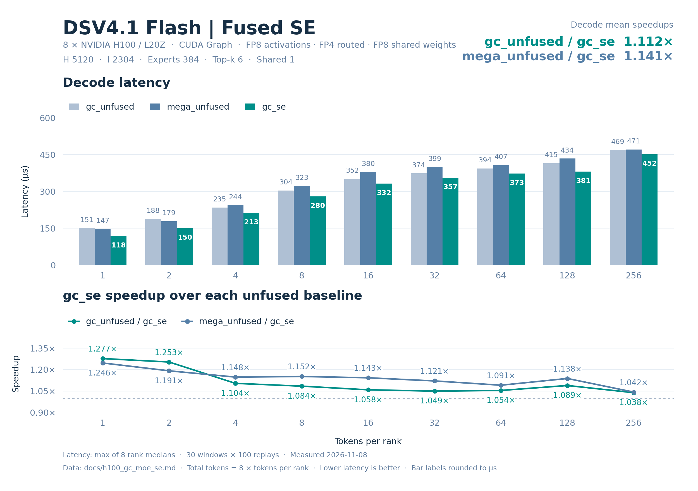

# H100 / L20Z DSV4.1-Flash 融合 shared expert 精度与性能

8 卡 **47/47 精度用例通过**（376 rank-case）；三种算子相对独立量化参考的最小 cosine **0.99998045**、最大 processed diff **1.9482409e-05**。gc_se 相对 gc_unfused 的九点 decode 平均加速 **1.111829×**（9/9 点更快），相对 mega_unfused 为 **1.141225×**（9/9 点更快）。

## 配置与数据口径

| 配置 | 取值 |
| --- | --- |
| 模型 | DSV4.1-Flash；输入和权重为固定随机种子的合成数据 |
| 数据分布 | 输入 BF16 randn×0.5，seed=42+7919×rank；路由分数 FP32 randn，seed=1000+31×rank，top-k 后 softmax |
| 权重分布 | 量化前 BF16 randn×0.05；routed 本地权重 seed=7+rank，shared 权重 seed=11 |
| 硬件 | 8 × NVIDIA L20Z（H100），每卡 132 SM、81559 MiB；GPU 间 NV18 互连 |
| 并行方式 | 单机 EP8，每卡 1 rank；每 rank 最多 256 tokens |
| Routed experts | hidden 5120，intermediate 2304，384 experts，top-k 6 |
| Shared experts | 1；shared FP8 权重 N32/K32，激活逐 token K32 UE8M0 scale |
| 数值格式 | Routed 输入 E4M3 FP8 / K128 FP32 scale；权重 FP4 E2M1 / K32 二次幂 scale，Humming 布局使用 8-bit 相对指数与 FP32 secondary scale；输出 BF16 |
| 激活 | SwiGLU；alpha=1，clamp=10，fast_math=True |
| 软件 | Python 3.12.3；PyTorch 2.11.0+cu130；DeepGEMM 2.8.2；GC MoE 0.4.2；CUTLASS DSL 4.8.1 |
| CUDA | PyTorch CUDA 13.0；nvcc 13.2.51；CUDA Python/bindings 13.2.0；驱动 580.105.08 |
| 数据日期 | 2026-11-08 |

Green Context：每卡 4 个 dispatch SM、128 个 compute SM。

Decode 点为每 rank 1、2、4、8、16、32、64、128、256 tokens。延迟来自 CUDA Graph replay：10 个预热窗口、30 个计时窗口，每窗口 100 次调用，窗口间刷新 L2。单次延迟先在每个 rank 上取 30 个窗口的中位数，再取 8 个 rank 中的最大值，单位 µs。输入准备和权重转换不计入算子延迟。

加速比使用未舍入的“对照算子延迟 / GC 算子延迟”；decode 平均加速为九个逐点加速比的等权算术平均，不是平均延迟之比。表内延迟保留六位小数，加速比保留六位小数。

## gc_se 相对 gc_unfused 的逐点加速

| Tokens/rank | Total tokens | gc_se (µs) | gc_unfused (µs) | gc_unfused/gc_se |
| --- | --- | --- | --- | --- |
| 1 | 8 | 118.326082 | 151.114240 | 1.277100× |
| 2 | 16 | 150.290723 | 188.336477 | 1.253148× |
| 4 | 32 | 212.989759 | 235.075846 | 1.103696× |
| 8 | 64 | 280.381117 | 303.923359 | 1.083965× |
| 16 | 128 | 332.233925 | 351.616783 | 1.058341× |
| 32 | 256 | 356.512966 | 374.096642 | 1.049321× |
| 64 | 512 | 373.463993 | 393.617916 | 1.053965× |
| 128 | 1024 | 381.425133 | 415.201759 | 1.088554× |
| 256 | 2048 | 451.945286 | 469.289131 | 1.038376× |

九点 decode 平均加速：**1.111829×**；gc_se 在 9/9 个点更快。

## gc_se 相对 mega_unfused 的逐点加速

| Tokens/rank | Total tokens | gc_se (µs) | mega_unfused (µs) | mega_unfused/gc_se |
| --- | --- | --- | --- | --- |
| 1 | 8 | 118.326082 | 147.472477 | 1.246323× |
| 2 | 16 | 150.290723 | 179.056320 | 1.191400× |
| 4 | 32 | 212.989759 | 244.407997 | 1.147511× |
| 8 | 64 | 280.381117 | 322.953110 | 1.151836× |
| 16 | 128 | 332.233925 | 379.610729 | 1.142601× |
| 32 | 256 | 356.512966 | 399.487514 | 1.120541× |
| 64 | 512 | 373.463993 | 407.319679 | 1.090653× |
| 128 | 1024 | 381.425133 | 433.978233 | 1.137781× |
| 256 | 2048 | 451.945286 | 471.099205 | 1.042381× |

九点 decode 平均加速：**1.141225×**；gc_se 在 9/9 个点更快。

## 模型估算的有效吞吐

以下三张表均为全 8 卡合计的模型估算/有效吞吐，分母使用各算子的上述端到端延迟。它们不是硬件计数器测得的实际 HBM 流量、NVLink 流量或 Tensor Core 利用率，也不能据此判断是否达到硬件峰值。单卡平均值等于表中合计值除以 8。GB/s 使用十进制 10⁹ byte/s，TFLOPS 使用 10¹² FLOP/s。

HBM 分子是本次路由中每个活跃 expert 的权重及 scale 存储量之和；shared 分支另计每个活跃 rank 的 shared 权重及 scale。使用基准中审计的公共存储口径，排除激活、输出、中间量、元数据、重复 CTA 装载及缓存命中影响。该值表示权重工作集的有效带宽，可能高于实际 HBM 带宽。

NVLink 分子是远程 routed assignment 的单向有用载荷：每个 assignment 为 FP8 输入 H byte、K128 FP32 scale H/32 byte 和 BF16 返回 2H byte，共 3H+H/32 byte。逐 assignment 计数，不按目标去重，不重复累加 TX+RX；不含路由、权重及控制元数据、屏障和协议开销。各算子共用该逻辑载荷模型，shared experts 在本地执行。

计算分子只含两层矩阵乘：routed 为 6×H×I×routed assignments FLOP；shared 另加 6×H×I_shared×global tokens FLOP。不含 padding、SwiGLU、量化/反量化、加法和重复计算。

### HBM 权重与 scale 工作集有效带宽

| Tokens/rank | Total tokens | gc_unfused (GB/s) | mega_unfused (GB/s) | gc_se (GB/s) |
| --- | --- | --- | --- | --- |
| 1 | 8 | 7852.685137 | 8046.603464 | 10028.664193 |
| 2 | 16 | 10293.696112 | 10827.199297 | 12899.521855 |
| 4 | 32 | 13445.535309 | 12932.148788 | 14839.777237 |
| 8 | 64 | 16461.992608 | 15491.983006 | 17844.226259 |
| 16 | 128 | 18827.428420 | 17439.021889 | 19925.839358 |
| 32 | 256 | 19656.057477 | 18406.745696 | 20625.519367 |
| 64 | 512 | 19063.335191 | 18422.066632 | 20092.084943 |
| 128 | 1024 | 18072.347005 | 17290.430016 | 19672.721139 |
| 256 | 2048 | 15989.439716 | 15928.004531 | 16603.050209 |

### NVLink 单向有用载荷有效带宽

| Tokens/rank | Total tokens | gc_unfused (GB/s) | mega_unfused (GB/s) | gc_se (GB/s) |
| --- | --- | --- | --- | --- |
| 1 | 8 | 4.108150 | 4.209599 | 5.246519 |
| 2 | 16 | 6.674862 | 7.020808 | 8.364588 |
| 4 | 32 | 10.827484 | 10.414062 | 11.950246 |
| 8 | 64 | 17.055879 | 16.050875 | 18.487978 |
| 16 | 128 | 29.617244 | 27.433155 | 31.345143 |
| 32 | 256 | 56.463271 | 52.874544 | 59.248112 |
| 64 | 512 | 105.591129 | 102.039165 | 111.289337 |
| 128 | 1024 | 201.736717 | 193.008390 | 219.601261 |
| 256 | 2048 | 355.020368 | 353.656296 | 368.644624 |

### 有效计算吞吐

| Tokens/rank | Total tokens | gc_unfused (TFLOPS) | mega_unfused (TFLOPS) | gc_se (TFLOPS) |
| --- | --- | --- | --- | --- |
| 1 | 8 | 26.229277 | 26.876997 | 33.497410 |
| 2 | 16 | 42.090808 | 44.272297 | 52.746001 |
| 4 | 32 | 67.444059 | 64.868864 | 74.437706 |
| 8 | 64 | 104.332021 | 98.184341 | 113.092275 |
| 16 | 128 | 180.360778 | 167.060285 | 190.883205 |
| 32 | 256 | 339.045420 | 317.496163 | 355.767574 |
| 64 | 512 | 644.461280 | 622.782347 | 679.239527 |
| 128 | 1024 | 1221.919225 | 1169.051747 | 1330.124757 |
| 256 | 2048 | 2162.176697 | 2153.869106 | 2245.152357 |

### 吞吐模型的分子

Routed 使用两算子字节数一致的变换后 tensor 存储，每个 expert 为 18800648 byte，包含两层 packed payload、相对指数和 FP32 secondary scale。

Shared 使用共同的原始量化输入存储，每个活跃 rank 为 35527680 byte，包含 FP8 payload 与 N32/K32 scale。融合与非融合布局的 scale 字节数不同，故这里不使用各自变换后的 scale 存储量；该口径用于比较同一逻辑工作集。

| Tokens/rank | 活跃 routed experts | 远程 assignments | 权重/scale 工作集 (byte) | NVLink 有用载荷 (byte) | 矩阵乘 FLOP |
| --- | --- | --- | --- | --- | --- |
| 1 | 48 | 40 | 1186652544 | 620800 | 3963617280 |
| 2 | 88 | 81 | 1938678464 | 1257120 | 7927234560 |
| 4 | 153 | 164 | 3160720584 | 2545280 | 15854469120 |
| 8 | 251 | 334 | 5003184088 | 5183680 | 31708938240 |
| 16 | 337 | 671 | 6620039816 | 10413920 | 63417876480 |
| 32 | 376 | 1361 | 7353265088 | 21122720 | 126835752960 |
| 64 | 384 | 2678 | 7503670272 | 41562560 | 253671505920 |
| 128 | 384 | 5397 | 7503670272 | 83761440 | 507343011840 |
| 256 | 384 | 10735 | 7503670272 | 166607200 | 1014686023680 |

## 每个 rank 的延迟中位数

下表为每个 rank 的窗口中位数，单位 µs；各行最大值即对应算子的最终延迟。

### gc_unfused

| Tokens/rank | rank 0 | rank 1 | rank 2 | rank 3 | rank 4 | rank 5 | rank 6 | rank 7 |
| --- | --- | --- | --- | --- | --- | --- | --- | --- |
| 1 | 151.114240 | 151.067038 | 151.091042 | 151.112962 | 151.082401 | 151.078238 | 151.049280 | 151.051679 |
| 2 | 188.265753 | 188.317442 | 188.307524 | 188.317604 | 188.336477 | 188.295517 | 188.252640 | 188.272324 |
| 4 | 235.062561 | 234.943838 | 235.075846 | 235.055037 | 235.060644 | 235.052166 | 235.035677 | 235.034399 |
| 8 | 303.923359 | 303.813925 | 303.861599 | 303.921442 | 303.895197 | 303.885927 | 303.862715 | 303.903198 |
| 16 | 351.616783 | 351.607361 | 351.543522 | 351.589928 | 351.568642 | 351.560478 | 351.492004 | 351.568317 |
| 32 | 374.091682 | 374.091377 | 374.096642 | 374.095840 | 374.042244 | 374.076633 | 373.984165 | 374.001122 |
| 64 | 393.617916 | 393.596954 | 393.616962 | 393.315353 | 393.594246 | 393.436642 | 393.451672 | 393.551350 |
| 128 | 415.185928 | 415.201759 | 415.168800 | 415.164967 | 415.173435 | 415.136795 | 415.110874 | 415.014076 |
| 256 | 469.289131 | 469.246883 | 469.247837 | 469.046574 | 469.212303 | 469.220638 | 469.228153 | 469.214878 |

### mega_unfused

| Tokens/rank | rank 0 | rank 1 | rank 2 | rank 3 | rank 4 | rank 5 | rank 6 | rank 7 |
| --- | --- | --- | --- | --- | --- | --- | --- | --- |
| 1 | 147.244959 | 147.472477 | 147.434559 | 147.169919 | 147.466884 | 147.420321 | 147.412963 | 147.392321 |
| 2 | 178.975677 | 178.998241 | 179.046402 | 179.051685 | 179.056320 | 178.990879 | 178.951683 | 179.008636 |
| 4 | 244.351358 | 244.362888 | 244.391680 | 244.407845 | 244.400473 | 244.407997 | 244.359522 | 244.387684 |
| 8 | 322.926407 | 322.910557 | 322.909603 | 322.808800 | 322.934875 | 322.953110 | 322.950573 | 322.911053 |
| 16 | 379.599857 | 379.507675 | 379.610729 | 379.544334 | 379.585114 | 379.604321 | 379.581432 | 379.547997 |
| 32 | 399.453926 | 399.437923 | 399.487514 | 399.454727 | 399.434547 | 399.419041 | 399.404812 | 399.413109 |
| 64 | 407.287369 | 407.241611 | 407.319679 | 407.212639 | 407.294712 | 407.039528 | 407.261448 | 407.248955 |
| 128 | 433.962574 | 433.978233 | 433.964958 | 433.884640 | 433.962402 | 433.922863 | 433.875046 | 433.904953 |
| 256 | 471.099205 | 471.083679 | 471.063366 | 471.010075 | 471.053123 | 470.948792 | 471.013603 | 471.015358 |

### gc_se

| Tokens/rank | rank 0 | rank 1 | rank 2 | rank 3 | rank 4 | rank 5 | rank 6 | rank 7 |
| --- | --- | --- | --- | --- | --- | --- | --- | --- |
| 1 | 118.315043 | 118.308802 | 118.309121 | 118.326082 | 118.311200 | 118.247356 | 118.216958 | 118.269439 |
| 2 | 150.277281 | 150.271678 | 150.290723 | 150.271683 | 150.279999 | 150.284801 | 150.245762 | 150.256319 |
| 4 | 212.859840 | 212.888317 | 212.989759 | 212.974567 | 212.965117 | 212.920485 | 212.948647 | 212.903204 |
| 8 | 280.321760 | 280.366392 | 280.303679 | 280.381117 | 280.318241 | 280.363836 | 280.266562 | 280.350084 |
| 16 | 332.170563 | 332.233925 | 332.184811 | 332.123833 | 332.222080 | 332.224636 | 332.110252 | 332.156639 |
| 32 | 356.451683 | 356.512966 | 356.443195 | 356.480160 | 356.510410 | 356.495361 | 356.474552 | 356.493435 |
| 64 | 373.380318 | 373.388157 | 373.463993 | 373.384323 | 373.421764 | 373.436012 | 373.358402 | 373.338547 |
| 128 | 381.352482 | 381.425133 | 381.408806 | 381.336632 | 381.379681 | 381.332493 | 381.296787 | 381.385765 |
| 256 | 451.883526 | 451.861115 | 451.945286 | 451.886559 | 451.901760 | 451.918716 | 451.847839 | 451.903687 |

## 精度

cosine 阈值为 ≥0.99，processed diff 阈值为 ≤0.002。独立 FP32 参考保留 routed FP4 指数裁剪/舍入、FP8 中间量量化、shared GEMM1 的 BF16 舍入、shared K32 FP8 再量化、GEMM2 BF16 舍入及最终 BF16 相加边界。processed diff = 1−2〈x,y〉/(‖x‖²+‖y‖²)，零分母记为 0。

gc_unfused 为 GC routed + 两次独立 DeepGEMM shared GEMM + BF16 相加；mega_unfused 以 Mega routed 替代 GC routed；gc_se 融合 routed 与 shared。下列 cosine 取全部 rank/重复输出的最小值，diff 取最大值。两算子之间的 relative L2 以表内右侧对照为参考，定义为 ‖gc_se−对照‖₂ / max(‖对照‖₂, 10⁻¹²)，空输出记为 0。

| 用例组 | 通过 | Rank-case |
| --- | --- | --- |
| default | 9/9 | 72 |
| boundary | 23/23 | 184 |
| asymmetric | 15/15 | 120 |

| 用例组 | 比较 | 最小 cosine | 最大 processed diff |
| --- | --- | --- | --- |
| default | gc_unfused/independent | 0.99998045 | 1.9482409e-05 |
| default | mega_unfused/independent | 0.99998045 | 1.9482409e-05 |
| default | gc_se/independent | 0.99998045 | 1.9482409e-05 |
| default | gc_se/gc_unfused | 0.999999762 | 0 |
| default | gc_se/mega_unfused | 0.999999762 | 5.21753862e-09 |
| boundary | gc_unfused/independent | 0.999989212 | 1.08510417e-05 |
| boundary | mega_unfused/independent | 0.999989212 | 1.08510136e-05 |
| boundary | gc_se/independent | 0.999989212 | 1.08510417e-05 |
| boundary | gc_se/gc_unfused | 0.999999702 | 0 |
| boundary | gc_se/mega_unfused | 0.999999821 | 5.29472099e-09 |
| asymmetric | gc_unfused/independent | 0.999985158 | 1.48206778e-05 |
| asymmetric | mega_unfused/independent | 0.999985158 | 1.48206778e-05 |
| asymmetric | gc_se/independent | 0.999985158 | 1.48206778e-05 |
| asymmetric | gc_se/gc_unfused | 0.999999762 | 0 |
| asymmetric | gc_se/mega_unfused | 0.999999762 | 5.21753862e-09 |

| 用例组 | 比较 | 最大绝对误差 | 最大 relative L2 |
| --- | --- | --- | --- |
| default | gc_se/gc_unfused | 0 | 0 |
| default | gc_se/mega_unfused | 0.125 | 0.000102152211 |
| boundary | gc_se/gc_unfused | 0 | 0 |
| boundary | gc_se/mega_unfused | 0.125 | 0.000102905011 |
| asymmetric | gc_se/gc_unfused | 0 | 0 |
| asymmetric | gc_se/mega_unfused | 0.125 | 0.000102152211 |

### Shared 与边界一致性数据

下表给出 shared 输出、重复输入、换输入与 epoch 边界的一致性数据；diff 使用上述定义。覆盖数仅统计实际存在字段的用例和 rank-case；缺失值不作为 0 或 PASS 参与聚合，— 表示无记录。

| 用例组 | 指标 | 有数据用例数/组用例数 | 有数据 rank-case/组 rank-case | 最大 diff 或检查结果 |
| --- | --- | --- | --- | --- |
| default | shared_diff | 9/9 | 72/72 | 1.91083277e-05 |
| default | standalone_shared_diff | 9/9 | 72/72 | 1.91083277e-05 |
| default | shared_gc_unfused_diff | 9/9 | 72/72 | 0 |
| default | changing_input_diff | 1/9 | 8/72 | 7.21164762e-06 |
| default | half_changing_input_diff | 1/9 | 8/72 | 7.21164762e-06 |
| default | receive stats / finite / repeats_exact | 9/9 | 72/72 | 全部精确匹配 / 全部有限 / 全部逐元素一致 |
| default | uint32 epoch 回绕 | 1/9 | 8/72 | 8/8 PASS |
| default | epoch 最高位翻转 | 1/9 | 8/72 | 8/8 PASS |
| boundary | shared_diff | 23/23 | 184/184 | 1.01040314e-05 |
| boundary | standalone_shared_diff | 23/23 | 184/184 | 1.01040314e-05 |
| boundary | shared_gc_unfused_diff | 23/23 | 184/184 | 0 |
| boundary | changing_input_diff | 1/23 | 8/184 | 0 |
| boundary | half_changing_input_diff | 1/23 | 8/184 | 0 |
| boundary | receive stats / finite / repeats_exact | 23/23 | 184/184 | 全部精确匹配 / 全部有限 / 全部逐元素一致 |
| boundary | uint32 epoch 回绕 | 1/23 | 8/184 | 8/8 PASS |
| boundary | epoch 最高位翻转 | 1/23 | 8/184 | 8/8 PASS |
| asymmetric | shared_diff | 15/15 | 120/120 | 1.40599515e-05 |
| asymmetric | standalone_shared_diff | 15/15 | 120/120 | 1.40599515e-05 |
| asymmetric | shared_gc_unfused_diff | 15/15 | 120/120 | 0 |
| asymmetric | changing_input_diff | 1/15 | 8/120 | 0 |
| asymmetric | half_changing_input_diff | 1/15 | 8/120 | 0 |
| asymmetric | receive stats / finite / repeats_exact | 15/15 | 120/120 | 全部精确匹配 / 全部有限 / 全部逐元素一致 |
| asymmetric | uint32 epoch 回绕 | 1/15 | 8/120 | 8/8 PASS |
| asymmetric | epoch 最高位翻转 | 1/15 | 8/120 | 8/8 PASS |

### 全部精度用例

| 组 | Tokens/rank 或 rank 向量 | Total tokens | gc_unfused cosine | gc_unfused diff | mega_unfused cosine | mega_unfused diff | gc_se cosine | gc_se diff | gc_se/gc_unfused diff | gc_se/mega_unfused diff | 结果 |
| --- | --- | --- | --- | --- | --- | --- | --- | --- | --- | --- | --- |
| default | T=1 | 8 | 0.99998045 | 1.9482409e-05 | 0.99998045 | 1.9482409e-05 | 0.99998045 | 1.9482409e-05 | 0 | 0 | PASS |
| default | T=2 | 16 | 0.999988854 | 1.1215648e-05 | 0.999988854 | 1.1215648e-05 | 0.999988854 | 1.1215648e-05 | 0 | 1.0418244e-10 | PASS |
| default | T=4 | 32 | 0.99999249 | 7.57426571e-06 | 0.999992371 | 7.57507747e-06 | 0.99999249 | 7.57426571e-06 | 0 | 8.14251111e-10 | PASS |
| default | T=8 | 64 | 0.99999249 | 7.56986399e-06 | 0.99999249 | 7.56986399e-06 | 0.99999249 | 7.56986399e-06 | 0 | 4.15607659e-10 | PASS |
| default | T=16 | 128 | 0.999989688 | 1.04589591e-05 | 0.999989688 | 1.04589211e-05 | 0.999989688 | 1.04589591e-05 | 0 | 2.11926809e-10 | PASS |
| default | T=32 | 256 | 0.999992788 | 7.25932368e-06 | 0.999992669 | 7.25927458e-06 | 0.999992788 | 7.25932368e-06 | 0 | 1.48899226e-10 | PASS |
| default | T=64 | 512 | 0.999989033 | 1.09839203e-05 | 0.999989152 | 1.09838918e-05 | 0.999989033 | 1.09839203e-05 | 0 | 5.21753862e-09 | PASS |
| default | T=128 | 1024 | 0.999991238 | 8.80631138e-06 | 0.999991119 | 8.80640442e-06 | 0.999991238 | 8.80631138e-06 | 0 | 2.74543643e-09 | PASS |
| default | T=256 | 2048 | 0.999991298 | 8.72106575e-06 | 0.999991417 | 8.72106954e-06 | 0.999991298 | 8.72106575e-06 | 0 | 2.55366717e-09 | PASS |
| boundary | T=0 | 0 | 1 | 0 | 1 | 0 | 1 | 0 | 0 | 0 | PASS |
| boundary | T=3 | 24 | 0.999991357 | 8.7458215e-06 | 0.999991298 | 8.74688838e-06 | 0.999991357 | 8.7458215e-06 | 0 | 1.07063736e-09 | PASS |
| boundary | T=5 | 40 | 0.999990463 | 9.3357347e-06 | 0.999990582 | 9.33637838e-06 | 0.999990463 | 9.3357347e-06 | 0 | 6.46154907e-10 | PASS |
| boundary | T=7 | 56 | 0.999992609 | 7.3005972e-06 | 0.999992669 | 7.30106457e-06 | 0.999992609 | 7.3005972e-06 | 0 | 4.68777239e-10 | PASS |
| boundary | T=9 | 72 | 0.999991417 | 8.46455236e-06 | 0.999991417 | 8.46455236e-06 | 0.999991417 | 8.46455236e-06 | 0 | 3.67690545e-10 | PASS |
| boundary | T=15 | 120 | 0.99999088 | 9.06878956e-06 | 0.99999088 | 9.06878956e-06 | 0.99999088 | 9.06878956e-06 | 0 | 2.26713981e-10 | PASS |
| boundary | T=17 | 136 | 0.999990046 | 1.00674513e-05 | 0.999990046 | 1.00674152e-05 | 0.999990046 | 1.00674513e-05 | 0 | 2.00341521e-10 | PASS |
| boundary | T=31 | 248 | 0.999992669 | 7.38112298e-06 | 0.999992669 | 7.38107241e-06 | 0.999992669 | 7.38112298e-06 | 0 | 1.51455182e-10 | PASS |
| boundary | T=33 | 264 | 0.999992609 | 7.42930925e-06 | 0.999992609 | 7.42926152e-06 | 0.999992609 | 7.42930925e-06 | 0 | 1.45040868e-10 | PASS |
| boundary | T=63 | 504 | 0.999990404 | 9.62633205e-06 | 0.999990404 | 9.62630747e-06 | 0.999990404 | 9.62633205e-06 | 0 | 5.29472099e-09 | PASS |
| boundary | T=65 | 520 | 0.999989212 | 1.08510417e-05 | 0.999989212 | 1.08510136e-05 | 0.999989212 | 1.08510417e-05 | 0 | 5.14704823e-09 | PASS |
| boundary | T=95 | 760 | 0.999990463 | 9.48752337e-06 | 0.999990463 | 9.48763759e-06 | 0.999990463 | 9.48752337e-06 | 0 | 3.67948838e-09 | PASS |
| boundary | T=96 | 768 | 0.999990582 | 9.38471679e-06 | 0.999990582 | 9.38482958e-06 | 0.999990582 | 9.38471679e-06 | 0 | 3.63824715e-09 | PASS |
| boundary | T=97 | 776 | 0.999990702 | 9.3222438e-06 | 0.999990702 | 9.32235554e-06 | 0.999990702 | 9.3222438e-06 | 0 | 3.604823e-09 | PASS |
| boundary | T=127 | 1016 | 0.999991179 | 8.8536465e-06 | 0.999991238 | 8.85374028e-06 | 0.999991179 | 8.8536465e-06 | 0 | 2.76776801e-09 | PASS |
| boundary | T=129 | 1032 | 0.999991119 | 8.78402546e-06 | 0.999991119 | 8.78411769e-06 | 0.999991119 | 8.78402546e-06 | 0 | 2.72132095e-09 | PASS |
| boundary | T=191 | 1528 | 0.999991775 | 8.31163675e-06 | 0.999991715 | 8.31171201e-06 | 0.999991775 | 8.31163675e-06 | 0 | 1.92547689e-09 | PASS |
| boundary | T=192 | 1536 | 0.999991834 | 8.28585342e-06 | 0.999991834 | 8.28592833e-06 | 0.999991834 | 8.28585342e-06 | 0 | 1.91523941e-09 | PASS |
| boundary | T=193 | 1544 | 0.999991715 | 8.26199036e-06 | 0.999991775 | 8.26206494e-06 | 0.999991715 | 8.26199036e-06 | 0 | 1.90571559e-09 | PASS |
| boundary | T=239 | 1912 | 0.99999094 | 9.02599723e-06 | 0.99999094 | 9.02600377e-06 | 0.99999094 | 9.02599723e-06 | 0 | 1.90567218e-09 | PASS |
| boundary | T=240 | 1920 | 0.99999088 | 9.0525115e-06 | 0.99999088 | 9.05251802e-06 | 0.99999088 | 9.0525115e-06 | 0 | 1.89791438e-09 | PASS |
| boundary | T=241 | 1928 | 0.999991119 | 9.02477944e-06 | 0.999991119 | 9.02478592e-06 | 0.999991119 | 9.02477944e-06 | 0 | 1.89091531e-09 | PASS |
| boundary | T=255 | 2040 | 0.999991298 | 8.70391069e-06 | 0.999991298 | 8.70391449e-06 | 0.999991298 | 8.70391069e-06 | 0 | 2.56326238e-09 | PASS |
| asymmetric | T=0 | 0 | 1 | 0 | 1 | 0 | 1 | 0 | 0 | 0 | PASS |
| asymmetric | [256,0,256,0,256,0,256,0] | 1024 | 0.999991298 | 8.72267763e-06 | 0.999991298 | 8.72268142e-06 | 0.999991298 | 8.72267763e-06 | 0 | 2.55366717e-09 | PASS |
| asymmetric | [1,0,1,0,1,0,1,0] | 4 | 0.999995172 | 4.84436855e-06 | 0.999995172 | 4.84436855e-06 | 0.999995172 | 4.84436855e-06 | 0 | 0 | PASS |
| asymmetric | [1,2,4,8,16,32,64,128] | 255 | 0.999988854 | 1.1215648e-05 | 0.999988854 | 1.1215648e-05 | 0.999988854 | 1.1215648e-05 | 0 | 5.66460989e-10 | PASS |
| asymmetric | [256,0,0,0,0,0,0,0] | 256 | 0.99999398 | 6.08273511e-06 | 0.99999398 | 6.08235535e-06 | 0.99999398 | 6.08273511e-06 | 0 | 1.43870671e-09 | PASS |
| asymmetric | [256,0,256,256,256,256,256,256] | 1792 | 0.999991298 | 8.72108018e-06 | 0.999991417 | 8.72108397e-06 | 0.999991298 | 8.72108018e-06 | 0 | 2.55366717e-09 | PASS |
| asymmetric | [256,256,0,256,256,256,256,256] | 1792 | 0.999993086 | 7.0285935e-06 | 0.999993086 | 7.02863515e-06 | 0.999993086 | 7.0285935e-06 | 0 | 2.55366717e-09 | PASS |
| asymmetric | [256,256,256,0,256,256,256,256] | 1792 | 0.999991298 | 8.72109318e-06 | 0.999991417 | 8.72109696e-06 | 0.999991298 | 8.72109318e-06 | 0 | 2.55366717e-09 | PASS |
| asymmetric | [0,0,0,0,0,256,0,0] | 256 | 0.999992967 | 7.02247967e-06 | 0.999992967 | 7.02252131e-06 | 0.999992967 | 7.02247967e-06 | 0 | 4.19073665e-11 | PASS |
| asymmetric | [0,0,0,0,0,0,256,0] | 256 | 0.999993682 | 6.35539012e-06 | 0.999993563 | 6.35518361e-06 | 0.999993682 | 6.35539012e-06 | 0 | 2.55366717e-09 | PASS |
| asymmetric | [256,256,256,256,256,256,256,0] | 1792 | 0.999991298 | 8.72105197e-06 | 0.999991417 | 8.72105575e-06 | 0.999991298 | 8.72105197e-06 | 0 | 2.55366717e-09 | PASS |
| asymmetric | [0,1,2,3,4,5,7,8] | 30 | 0.999985158 | 1.48206778e-05 | 0.999985158 | 1.48206778e-05 | 0.999985158 | 1.48206778e-05 | 0 | 6.85699275e-11 | PASS |
| asymmetric | [9,15,16,17,31,32,33,63] | 216 | 0.999989927 | 1.0067259e-05 | 0.999989927 | 1.00672229e-05 | 0.999989927 | 1.0067259e-05 | 0 | 2.26713981e-10 | PASS |
| asymmetric | [64,65,95,96,97,127,128,129] | 801 | 0.999990463 | 9.48795012e-06 | 0.999990582 | 9.48806434e-06 | 0.999990463 | 9.48795012e-06 | 0 | 5.21753862e-09 | PASS |
| asymmetric | [191,192,193,239,240,241,255,256] | 1807 | 0.999991715 | 8.26191719e-06 | 0.999991775 | 8.26199177e-06 | 0.999991715 | 8.26191719e-06 | 0 | 2.56326238e-09 | PASS |
