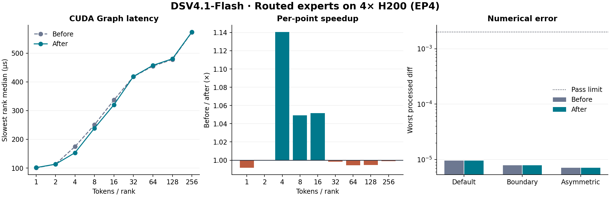

# H200 DSV4.1-Flash Routed experts 精度与性能

两组均通过 45/45 个算子精度用例，覆盖每组 180 个 rank-case。1–256 tokens/rank 九个 decode 点的平均加速为 **1.024×**，其中 4、8、16 tokens/rank 分别为 **1.141×、1.049×、1.052×**。



## 测试设置

- 硬件为 4 张 NVIDIA H200（SM90），卡间 NVLink，单机 EP4、每卡 1 rank。
- DSV4.1-Flash 算子形状为 hidden 5120、intermediate 2304、384 个 routed experts、top-k 6。输入与权重由脚本生成。
- 两组均使用 GC MoE 0.3.1、PyTorch 2.14.0+cu130、CUTLASS DSL 4.8.1、ptxas 13.2.78，GPU driver 590.44.01。此节点的 PyTorch 版本超出当前包声明的版本范围。
- 修改前以 `2cfe272` 调度为基线，两组均应用相同的 CUDA Graph 延迟实例化、`GC_MOE_PTXAS` 和测试脚本适配，以隔离调度变化。
- 节点提供 DeepGEMM 2.8.1 的量化工具，未提供 SM90 MegaMoE 入口。报告中的计时均来自 GC MoE。

调度变化将 SM90 小批量流水线的范围从 1–2 扩至 1–16 tokens/rank。融合路径在该范围内根据 shared tile 数和实际 compute SM 数设置 shared launch grid。1、2 tokens/rank 也使用新的 shared grid。测试日期为 2026-11-06。

## CUDA Graph decode 性能

每个点使用 10 个预热窗口、30 个计时窗口，每个窗口 100 次算子调用。表中延迟为各 rank 的 CUDA Event 中位数的最大值。加速比为修改前延迟除以修改后延迟，平均值对九个点等权。

| Tokens/rank | Total tokens | 修改前 (µs) | 修改后 (µs) | 加速比 |
| ---: | ---: | ---: | ---: | ---: |
| 1 | 4 | 100.69 | 101.54 | 0.992× |
| 2 | 8 | 113.34 | 113.37 | 1.000× |
| 4 | 16 | 174.83 | 153.29 | 1.141× |
| 8 | 32 | 250.59 | 238.86 | 1.049× |
| 16 | 64 | 337.09 | 320.50 | 1.052× |
| 32 | 128 | 418.30 | 419.02 | 0.998× |
| 64 | 256 | 455.12 | 457.72 | 0.994× |
| 128 | 512 | 478.05 | 480.52 | 0.995× |
| 256 | 1024 | 573.30 | 573.82 | 0.999× |

该路径调度未变化的测点最大绝对延迟变化为 0.8%。本表每组运行一次完整 sweep。

## 算子精度

余弦相似度以独立 BF16 reference 为准。processed diff 使用独立的量化语义参考。通过阈值为 cosine ≥ 0.97、processed diff ≤ 0.002。两组的 receive stats 均精确匹配。

| 用例组 | 用例数 | Rank-case | 修改前最小 cosine | 修改后最小 cosine | 修改前最大 processed diff | 修改后最大 processed diff |
| --- | ---: | ---: | ---: | ---: | ---: | ---: |
| default | 9 | 36 | 0.977813482 | 0.977813482 | 9.6108324e-06 | 9.6108324e-06 |
| boundary | 23 | 92 | 0.977955759 | 0.977955759 | 7.860846e-06 | 7.860846e-06 |
| asymmetric | 13 | 52 | 0.977813482 | 0.977813482 | 7.0985857e-06 | 7.0985857e-06 |

CUDA Graph replay 与首次 eager 输出的最大 processed diff，修改前为 0，修改后为 0。

## 复现

在两份源码中分别运行，设置各自的结果目录。所选 Python 环境需能导入 GC MoE 和 DeepGEMM 量化工具。修改前的源码使用 `2cfe272` 的 `gc_moe/jit_kernels/heuristics/sm90_gc_moe.py`，其余测试环境与修改后相同。

```bash
export CUDA_VISIBLE_DEVICES=0,3,4,5
export GC_MOE_PYTHON_BIN=/path/to/.venv/bin/python
export GC_MOE_PTXAS=/path/to/cuda-13.2/bin/ptxas
export GC_MOE_RESULT_DIR=/path/to/results
bash scripts/run_sm90.sh 4 both --gc-only
```
