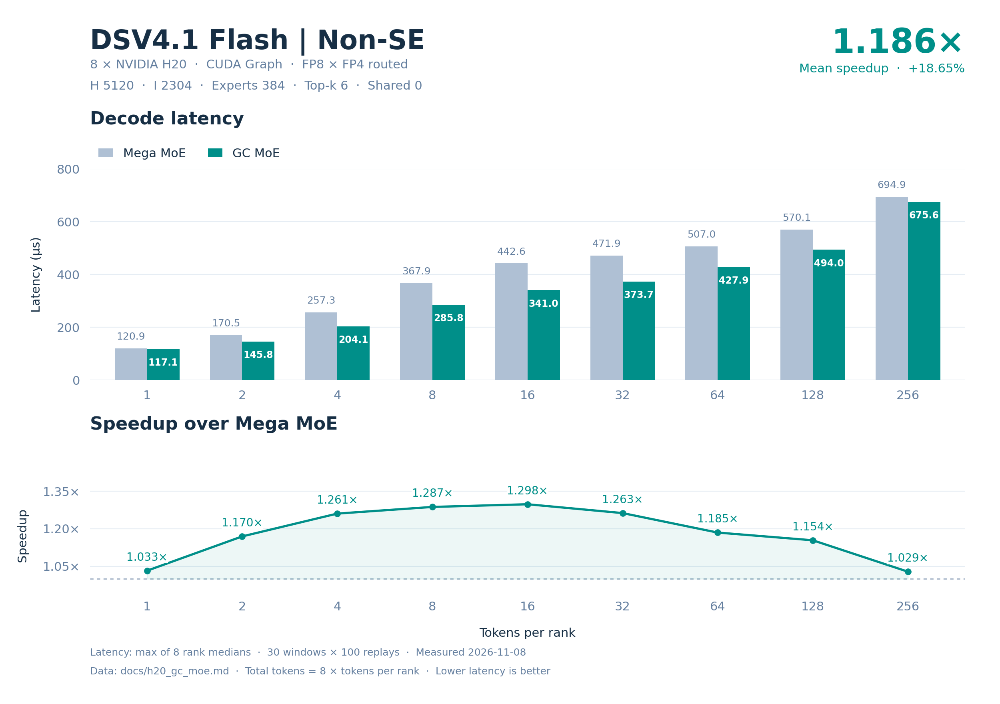

# H20 DSV4.1-Flash Routed experts 精度与性能

8 卡 **47/47 精度用例通过**（376 rank-case）；GC/BF16 最小 cosine **0.977039278**，GC 最大 processed diff **1.80467254e-05**。GC 相对 Mega 的九点 decode 平均加速 **1.186480×**，9/9 点更快。

## 配置与数据口径

| 配置 | 取值 |
| --- | --- |
| 模型 | DSV4.1-Flash；输入和权重为固定随机种子的合成数据 |
| 数据分布 | 输入 BF16 randn×0.5，seed=42+7919×rank；路由分数 FP32 randn，seed=1000+31×rank，top-k 后 softmax |
| 权重分布 | 量化前 BF16 randn×0.05；精度用全局权重 seed=7；性能用本地权重 seed=7+rank |
| 硬件 | 8 × NVIDIA H20，单卡 78 SM / 97871 MiB，SM90；GPU 间 NV18 互连 |
| 并行方式 | 单机 EP8，每卡 1 rank；每 rank 最多 256 tokens |
| Routed experts | hidden 5120，intermediate 2304，384 experts，top-k 6 |
| Shared experts | 0 |
| 数值格式 | Routed 输入 E4M3 FP8 / K128 FP32 scale；权重 FP4 E2M1 / K32 二次幂 scale，Humming 布局使用 8-bit 相对指数与 FP32 secondary scale；输出 BF16 |
| 激活 | SwiGLU；alpha=1，clamp=10，fast_math=True |
| 软件 | Python 3.10.9；PyTorch 2.11.0+cu130；DeepGEMM 2.8.2；GC MoE 0.4.2；CUTLASS DSL 4.8.1 |
| CUDA | PyTorch CUDA 13.0；ptxas 13.2.78；CUDA Python/bindings 13.2.0；驱动 580.82.07 |
| 数据日期 | 2026-11-08 |

Decode 点为每 rank 1、2、4、8、16、32、64、128、256 tokens。延迟来自 CUDA Graph replay：10 个预热窗口、30 个计时窗口，每窗口 100 次调用，窗口间刷新 L2。单次延迟先在每个 rank 上取 30 个窗口的中位数，再取 8 个 rank 中的最大值，单位 µs。输入准备和权重转换不计入算子延迟。

加速比使用未舍入的“对照算子延迟 / GC 算子延迟”；decode 平均加速为九个逐点加速比的等权算术平均，不是平均延迟之比。表内延迟保留六位小数，加速比保留六位小数。

## Decode 延迟与逐点加速

| Tokens/rank | Total tokens | Mega (µs) | GC (µs) | Mega/GC |
| --- | --- | --- | --- | --- |
| 1 | 8 | 120.944481 | 117.130880 | 1.032558× |
| 2 | 16 | 170.468159 | 145.755043 | 1.169552× |
| 4 | 32 | 257.347994 | 204.130716 | 1.260702× |
| 8 | 64 | 367.920151 | 285.816631 | 1.287259× |
| 16 | 128 | 442.646885 | 341.021595 | 1.298003× |
| 32 | 256 | 471.864319 | 373.687038 | 1.262726× |
| 64 | 512 | 506.958561 | 427.871361 | 1.184839× |
| 128 | 1024 | 570.149288 | 494.040165 | 1.154055× |
| 256 | 2048 | 694.897614 | 675.558395 | 1.028627× |

## 模型估算的有效吞吐

以下三张表均为全 8 卡合计的模型估算/有效吞吐，分母使用各算子的上述端到端延迟。它们不是硬件计数器测得的实际 HBM 流量、NVLink 流量或 Tensor Core 利用率，也不能据此判断是否达到硬件峰值。单卡平均值等于表中合计值除以 8。GB/s 使用十进制 10⁹ byte/s，TFLOPS 使用 10¹² FLOP/s。

HBM 分子是本次路由中每个活跃 expert 的权重及 scale 存储量之和；shared 分支另计每个活跃 rank 的 shared 权重及 scale。使用基准中审计的公共存储口径，排除激活、输出、中间量、元数据、重复 CTA 装载及缓存命中影响。该值表示权重工作集的有效带宽，可能高于实际 HBM 带宽。

NVLink 分子是远程 routed assignment 的单向有用载荷：每个 assignment 为 FP8 输入 H byte、K128 FP32 scale H/32 byte 和 BF16 返回 2H byte，共 3H+H/32 byte。逐 assignment 计数，不按目标去重，不重复累加 TX+RX；不含路由、权重及控制元数据、屏障和协议开销。各算子共用该逻辑载荷模型，shared experts 在本地执行。

计算分子只含两层矩阵乘：routed 为 6×H×I×routed assignments FLOP；shared 另加 6×H×I_shared×global tokens FLOP。不含 padding、SwiGLU、量化/反量化、加法和重复计算。

### HBM 权重与 scale 工作集有效带宽

| Tokens/rank | Total tokens | Mega (GB/s) | GC (GB/s) |
| --- | --- | --- | --- |
| 1 | 8 | 7461.531914 | 7704.467868 |
| 2 | 16 | 9705.372759 | 11350.941893 |
| 4 | 32 | 11177.468691 | 14091.456670 |
| 8 | 64 | 12826.051083 | 16510.455064 |
| 16 | 128 | 14313.482353 | 18578.935964 |
| 32 | 256 | 14981.093856 | 18917.015901 |
| 64 | 512 | 14240.707995 | 16872.942416 |
| 128 | 1024 | 12662.383312 | 14613.080766 |
| 256 | 2048 | 10389.226688 | 10686.639203 |

### NVLink 单向有用载荷有效带宽

| Tokens/rank | Total tokens | Mega (GB/s) | GC (GB/s) |
| --- | --- | --- | --- |
| 1 | 8 | 5.132934 | 5.300054 |
| 2 | 16 | 7.374515 | 8.624882 |
| 4 | 32 | 9.890421 | 12.468873 |
| 8 | 64 | 14.089144 | 18.136383 |
| 16 | 128 | 23.526473 | 30.537421 |
| 32 | 256 | 44.764393 | 56.525161 |
| 64 | 512 | 81.984137 | 97.137981 |
| 128 | 1024 | 146.911417 | 169.543786 |
| 256 | 2048 | 239.757911 | 246.621463 |

### 有效计算吞吐

| Tokens/rank | Total tokens | Mega (TFLOPS) | GC (TFLOPS) |
| --- | --- | --- | --- |
| 1 | 8 | 28.090461 | 29.005043 |
| 2 | 16 | 39.859482 | 46.617752 |
| 4 | 32 | 52.806104 | 66.572759 |
| 8 | 64 | 73.872252 | 95.092752 |
| 16 | 128 | 122.802581 | 159.398058 |
| 32 | 256 | 230.397501 | 290.928902 |
| 64 | 512 | 428.896435 | 508.173108 |
| 128 | 1024 | 762.722058 | 880.222843 |
| 256 | 2048 | 1251.595718 | 1287.425163 |

### 吞吐模型的分子

Routed 使用两算子字节数一致的变换后 tensor 存储，每个 expert 为 18800648 byte，包含两层 packed payload、相对指数和 FP32 secondary scale。

| Tokens/rank | 活跃 routed experts | 远程 assignments | 权重/scale 工作集 (byte) | NVLink 有用载荷 (byte) | 矩阵乘 FLOP |
| --- | --- | --- | --- | --- | --- |
| 1 | 48 | 40 | 902431104 | 620800 | 3397386240 |
| 2 | 88 | 81 | 1654457024 | 1257120 | 6794772480 |
| 4 | 153 | 164 | 2876499144 | 2545280 | 13589544960 |
| 8 | 251 | 334 | 4718962648 | 5183680 | 27179089920 |
| 16 | 337 | 671 | 6335818376 | 10413920 | 54358179840 |
| 32 | 376 | 1361 | 7069043648 | 21122720 | 108716359680 |
| 64 | 384 | 2678 | 7219448832 | 41562560 | 217432719360 |
| 128 | 384 | 5397 | 7219448832 | 83761440 | 434865438720 |
| 256 | 384 | 10735 | 7219448832 | 166607200 | 869730877440 |

## 每个 rank 的延迟中位数

下表为每个 rank 的窗口中位数，单位 µs；各行最大值即对应算子的最终延迟。

### Mega

| Tokens/rank | rank 0 | rank 1 | rank 2 | rank 3 | rank 4 | rank 5 | rank 6 | rank 7 |
| --- | --- | --- | --- | --- | --- | --- | --- | --- |
| 1 | 120.832639 | 120.863199 | 120.792317 | 120.432796 | 120.711203 | 120.395041 | 120.944481 | 120.825119 |
| 2 | 170.218554 | 170.292320 | 170.310087 | 170.196314 | 170.452957 | 170.468159 | 170.369759 | 170.096636 |
| 4 | 257.023516 | 256.791201 | 257.141285 | 257.219677 | 257.245922 | 257.347994 | 256.831999 | 257.044315 |
| 8 | 367.920151 | 367.769909 | 367.728157 | 367.655506 | 367.276001 | 367.702866 | 367.531834 | 367.501755 |
| 16 | 442.646885 | 442.427197 | 442.617435 | 442.630730 | 442.595367 | 442.272491 | 442.551365 | 442.534256 |
| 32 | 471.831207 | 471.850414 | 471.812477 | 471.857109 | 471.710243 | 471.681442 | 471.864319 | 471.742096 |
| 64 | 506.424465 | 506.958561 | 506.923027 | 506.818562 | 506.211052 | 506.945286 | 506.812782 | 506.547203 |
| 128 | 569.656792 | 570.149288 | 570.029755 | 570.052147 | 569.725933 | 569.840469 | 569.657269 | 569.801769 |
| 256 | 694.624329 | 694.507332 | 694.534721 | 694.585266 | 694.585762 | 694.897614 | 694.351845 | 694.518890 |

### GC

| Tokens/rank | rank 0 | rank 1 | rank 2 | rank 3 | rank 4 | rank 5 | rank 6 | rank 7 |
| --- | --- | --- | --- | --- | --- | --- | --- | --- |
| 1 | 116.918721 | 116.768003 | 117.130880 | 116.964159 | 116.921439 | 116.330242 | 116.859198 | 116.913118 |
| 2 | 145.708799 | 145.686722 | 145.635676 | 145.755043 | 145.566082 | 145.725441 | 145.635524 | 145.739360 |
| 4 | 203.888321 | 204.047518 | 203.799839 | 203.801918 | 203.866558 | 203.832960 | 204.130716 | 203.832798 |
| 8 | 285.498724 | 285.647039 | 285.718079 | 285.271196 | 285.292482 | 285.816631 | 285.582876 | 285.748796 |
| 16 | 340.842724 | 340.806389 | 341.021595 | 340.851669 | 340.800476 | 340.866241 | 340.864639 | 340.739365 |
| 32 | 373.578568 | 373.280964 | 373.687038 | 373.511677 | 373.612003 | 373.183041 | 373.356152 | 373.582706 |
| 64 | 427.588158 | 427.871361 | 427.591515 | 427.654400 | 427.539043 | 427.763519 | 427.775841 | 427.302723 |
| 128 | 493.901119 | 493.944321 | 493.765907 | 493.769913 | 494.040165 | 493.598881 | 493.753605 | 493.771515 |
| 256 | 675.345764 | 675.485954 | 675.468178 | 675.451851 | 675.274239 | 675.297279 | 675.558395 | 675.398560 |

## 精度

GC/BF16、Mega/BF16、GC/Mega 的 cosine 阈值均为 ≥0.97。独立 BF16 参考使用原始权重；processed 参考独立建模 Humming FP4 指数裁剪/舍入、FP8 中间量量化和 BF16 输出边界。processed diff = 1−2〈x,y〉/(‖x‖²+‖y‖²)，零分母记为 0，阈值为 ≤0.002。GC eager/graph 重复差异使用同一 diff 阈值。

下表 cosine 为各 rank 的最小值，diff 为各 rank 的最大值；每个用例覆盖全部 8 rank。全部输出须有限，receive stats 须精确匹配。最大绝对误差和 relative L2 均相对 processed 参考；relative L2 = ‖实际−参考‖₂ / max(‖参考‖₂, 10⁻¹²)，空输出记为 0。

| 用例组 | 通过 | Rank-case | GC/BF16 cosine | Mega/BF16 cosine | GC/Mega cosine | GC processed diff | Mega processed diff | GC 重复 diff |
| --- | --- | --- | --- | --- | --- | --- | --- | --- |
| default | 9/9 | 72 | 0.977039278 | 0.977039278 | 0.999999762 | 1.80467254e-05 | 1.80467254e-05 | 0 |
| boundary | 23/23 | 184 | 0.977671564 | 0.977671564 | 0.999999762 | 9.94878756e-06 | 9.94923451e-06 | 0 |
| asymmetric | 15/15 | 120 | 0.977837086 | 0.977837086 | 0.999999762 | 1.80467254e-05 | 1.80467254e-05 | 0 |

| 用例组 | 算子 | 最大绝对误差 | 最大 relative L2 |
| --- | --- | --- | --- |
| default | GC | 0.109375 | 0.00600836286 |
| default | Mega | 0.109375 | 0.00600836286 |
| boundary | GC | 0.109375 | 0.00446072593 |
| boundary | Mega | 0.109375 | 0.00446082652 |
| asymmetric | GC | 0.109375 | 0.00600836286 |
| asymmetric | Mega | 0.109375 | 0.00600836286 |

### 全部精度用例

| 组 | Tokens/rank 或 rank 向量 | Total tokens | GC/BF16 cosine | Mega/BF16 cosine | GC/Mega cosine | GC processed diff | Mega processed diff | GC 重复 diff | 结果 |
| --- | --- | --- | --- | --- | --- | --- | --- | --- | --- |
| default | T=1 | 8 | 0.977039278 | 0.977039278 | 0.999999821 | 1.80467254e-05 | 1.80467254e-05 | 0 | PASS |
| default | T=2 | 16 | 0.977164805 | 0.977164805 | 0.99999994 | 1.27117295e-05 | 1.27117295e-05 | 0 | PASS |
| default | T=4 | 32 | 0.977627277 | 0.977627277 | 0.99999994 | 9.36732865e-06 | 9.36765281e-06 | 0 | PASS |
| default | T=8 | 64 | 0.977984667 | 0.977984667 | 0.99999994 | 6.6291507e-06 | 6.6293165e-06 | 0 | PASS |
| default | T=16 | 128 | 0.977881014 | 0.977881014 | 0.999999762 | 5.90062843e-06 | 5.90064364e-06 | 0 | PASS |
| default | T=32 | 256 | 0.978097558 | 0.978097379 | 0.99999994 | 6.06899285e-06 | 6.06899289e-06 | 0 | PASS |
| default | T=64 | 512 | 0.978141844 | 0.978141904 | 0.99999994 | 5.8520139e-06 | 5.85281434e-06 | 0 | PASS |
| default | T=128 | 1024 | 0.978164554 | 0.978164732 | 0.999999821 | 5.45608932e-06 | 5.44951653e-06 | 0 | PASS |
| default | T=256 | 2048 | 0.978224814 | 0.978224814 | 0.99999994 | 5.50016411e-06 | 5.50016147e-06 | 0 | PASS |
| boundary | T=0 | 0 | 1 | 1 | 1 | 0 | 0 | 0 | PASS |
| boundary | T=3 | 24 | 0.977767229 | 0.977767229 | 0.999999881 | 9.94878756e-06 | 9.94923451e-06 | 0 | PASS |
| boundary | T=5 | 40 | 0.977671564 | 0.977671564 | 0.999999881 | 8.71040727e-06 | 8.71067053e-06 | 0 | PASS |
| boundary | T=7 | 56 | 0.977847695 | 0.977847755 | 0.999999881 | 7.21365313e-06 | 7.21384167e-06 | 0 | PASS |
| boundary | T=9 | 72 | 0.977902651 | 0.977902651 | 0.99999994 | 6.36858588e-06 | 6.36873445e-06 | 0 | PASS |
| boundary | T=15 | 120 | 0.97793746 | 0.97793746 | 0.999999821 | 5.96073199e-06 | 5.96081952e-06 | 0 | PASS |
| boundary | T=17 | 136 | 0.977833927 | 0.977833927 | 0.99999994 | 5.78875947e-06 | 5.78877375e-06 | 0 | PASS |
| boundary | T=31 | 248 | 0.978041232 | 0.978041351 | 0.99999994 | 5.99550935e-06 | 5.99550939e-06 | 0 | PASS |
| boundary | T=33 | 264 | 0.978111684 | 0.978111684 | 0.999999821 | 5.99006293e-06 | 5.99006296e-06 | 0 | PASS |
| boundary | T=63 | 504 | 0.978150845 | 0.978150845 | 0.999999762 | 5.91209317e-06 | 5.91290523e-06 | 0 | PASS |
| boundary | T=65 | 520 | 0.978165388 | 0.978165388 | 0.999999762 | 5.81960326e-06 | 5.82038741e-06 | 0 | PASS |
| boundary | T=95 | 760 | 0.97817111 | 0.97817111 | 0.999999881 | 5.66063519e-06 | 5.66122389e-06 | 0 | PASS |
| boundary | T=96 | 768 | 0.978152514 | 0.978152514 | 0.999999881 | 5.61245185e-06 | 5.61243424e-06 | 0 | PASS |
| boundary | T=97 | 776 | 0.978148878 | 0.978148878 | 0.999999881 | 5.62558627e-06 | 5.62616051e-06 | 0 | PASS |
| boundary | T=127 | 1016 | 0.978159606 | 0.978159606 | 0.99999994 | 5.48521537e-06 | 5.47858256e-06 | 0 | PASS |
| boundary | T=129 | 1032 | 0.978152454 | 0.978152454 | 0.99999994 | 5.47798756e-06 | 5.47146305e-06 | 0 | PASS |
| boundary | T=191 | 1528 | 0.978163123 | 0.978163242 | 0.999999881 | 5.53192387e-06 | 5.53191901e-06 | 0 | PASS |
| boundary | T=192 | 1536 | 0.97816515 | 0.97816515 | 0.999999881 | 5.52494138e-06 | 5.52493654e-06 | 0 | PASS |
| boundary | T=193 | 1544 | 0.978162766 | 0.978162885 | 0.999999881 | 5.52813415e-06 | 5.52813949e-06 | 0 | PASS |
| boundary | T=239 | 1912 | 0.978201509 | 0.978201509 | 0.99999994 | 5.52259768e-06 | 5.52259857e-06 | 0 | PASS |
| boundary | T=240 | 1920 | 0.978205144 | 0.978205144 | 0.999999821 | 5.52587352e-06 | 5.52587441e-06 | 0 | PASS |
| boundary | T=241 | 1928 | 0.978204966 | 0.978204966 | 0.999999821 | 5.5267766e-06 | 5.52677749e-06 | 0 | PASS |
| boundary | T=255 | 2040 | 0.978229821 | 0.978229821 | 0.99999994 | 5.47700436e-06 | 5.47700171e-06 | 0 | PASS |
| asymmetric | T=0 | 0 | 1 | 1 | 1 | 0 | 0 | 0 | PASS |
| asymmetric | [256,0,256,0,256,0,256,0] | 1024 | 0.978224814 | 0.978224814 | 0.99999994 | 5.37456661e-06 | 5.37133272e-06 | 0 | PASS |
| asymmetric | [1,0,1,0,1,0,1,0] | 4 | 0.977889717 | 0.977889717 | 1 | 1.80467254e-05 | 1.80467254e-05 | 0 | PASS |
| asymmetric | [1,2,4,8,16,32,64,128] | 255 | 0.977881014 | 0.977881014 | 0.999999762 | 9.36732865e-06 | 9.36765281e-06 | 0 | PASS |
| asymmetric | [256,0,0,0,0,0,0,0] | 256 | 0.978350639 | 0.978350639 | 1 | 5.05721853e-06 | 5.05719481e-06 | 0 | PASS |
| asymmetric | [256,0,256,256,256,256,256,256] | 1792 | 0.978224814 | 0.978224814 | 0.99999994 | 5.50016411e-06 | 5.50016147e-06 | 0 | PASS |
| asymmetric | [256,256,0,256,256,256,256,256] | 1792 | 0.978224814 | 0.978224814 | 0.99999994 | 5.50016411e-06 | 5.50016147e-06 | 0 | PASS |
| asymmetric | [256,256,256,0,256,256,256,256] | 1792 | 0.978224814 | 0.978224814 | 0.99999994 | 5.50016411e-06 | 5.50016147e-06 | 0 | PASS |
| asymmetric | [0,0,0,0,0,256,0,0] | 256 | 0.978471279 | 0.978471279 | 0.99999994 | 5.50016411e-06 | 5.50016147e-06 | 0 | PASS |
| asymmetric | [0,0,0,0,0,0,256,0] | 256 | 0.978387535 | 0.978387475 | 0.99999994 | 5.24725677e-06 | 5.24747198e-06 | 0 | PASS |
| asymmetric | [256,256,256,256,256,256,256,0] | 1792 | 0.978224814 | 0.978224814 | 0.99999994 | 5.50016411e-06 | 5.50016147e-06 | 0 | PASS |
| asymmetric | [0,1,2,3,4,5,7,8] | 30 | 0.977837086 | 0.977837086 | 0.99999994 | 1.27117295e-05 | 1.27117295e-05 | 0 | PASS |
| asymmetric | [9,15,16,17,31,32,33,63] | 216 | 0.977902651 | 0.977902651 | 0.999999821 | 5.78039521e-06 | 5.78047736e-06 | 0 | PASS |
| asymmetric | [64,65,95,96,97,127,128,129] | 801 | 0.978148878 | 0.978148878 | 1 | 5.55191793e-06 | 5.59510177e-06 | 0 | PASS |
| asymmetric | [191,192,193,239,240,241,255,256] | 1807 | 0.978205144 | 0.978205144 | 1 | 5.5267766e-06 | 5.52677749e-06 | 0 | PASS |
