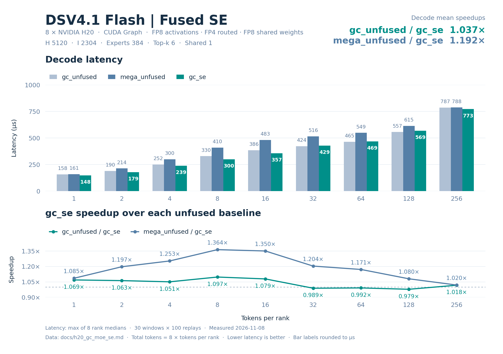

# H20 DSV4.1-Flash 融合 shared expert 精度与性能

8 卡 **47/47 精度用例通过**（376 rank-case）；三种算子相对独立参考的最小 cosine **0.999982774**，最大 processed diff **1.71812485e-05**。gc_se 相对 gc_unfused 的九点 decode 平均加速 **1.037360×**（6/9 点更快），相对 mega_unfused 为 **1.191610×**（9/9 点更快）。

## 配置与数据口径

| 配置 | 取值 |
| --- | --- |
| 模型 | DSV4.1-Flash；输入和权重为固定随机种子的合成数据 |
| 数据分布 | 输入 BF16 randn×0.5，seed=42+7919×rank；路由分数 FP32 randn，seed=1000+31×rank，top-k 后 softmax |
| 权重分布 | 量化前 BF16 randn×0.05；routed 本地权重 seed=7+rank，shared 权重 seed=11 |
| 硬件 | 8 × NVIDIA H20，单卡 78 SM / 97871 MiB，SM90；GPU 间 NV18 互连 |
| 并行方式 | 单机 EP8，每卡 1 rank；每 rank 最多 256 tokens |
| Routed experts | hidden 5120，intermediate 2304，384 experts，top-k 6 |
| Shared experts | 1；shared FP8 权重 N32/K32，激活逐 token K32 UE8M0 scale |
| 数值格式 | Routed 输入 E4M3 FP8 / K128 FP32 scale；权重 FP4 E2M1 / K32 二次幂 scale，Humming 布局使用 8-bit 相对指数与 FP32 secondary scale；输出 BF16 |
| 激活 | SwiGLU；alpha=1，clamp=10，fast_math=True |
| 软件 | Python 3.10.9；PyTorch 2.11.0+cu130；DeepGEMM 2.8.2；GC MoE 0.4.2；CUTLASS DSL 4.8.1 |
| CUDA | PyTorch CUDA 13.0；ptxas 13.2.78；CUDA Python/bindings 13.2.0；驱动 580.82.07 |
| 数据日期 | 2026-11-08 |

Green Context：每卡 6 个 dispatch SM、72 个 compute SM。

Decode 点为每 rank 1、2、4、8、16、32、64、128、256 tokens。延迟来自 CUDA Graph replay：10 个预热窗口、30 个计时窗口，每窗口 100 次调用，窗口间刷新 L2。单次延迟先在每个 rank 上取 30 个窗口的中位数，再取 8 个 rank 中的最大值，单位 µs。输入准备和权重转换不计入算子延迟。

加速比使用未舍入的“对照算子延迟 / GC 算子延迟”；decode 平均加速为九个逐点加速比的等权算术平均，不是平均延迟之比。表内延迟保留六位小数，加速比保留六位小数。

## gc_se 相对 gc_unfused 的逐点加速

| Tokens/rank | Total tokens | gc_se (µs) | gc_unfused (µs) | gc_unfused/gc_se |
| --- | --- | --- | --- | --- |
| 1 | 8 | 148.090081 | 158.339357 | 1.069210× |
| 2 | 16 | 178.806076 | 190.010080 | 1.062660× |
| 4 | 32 | 239.338713 | 251.537762 | 1.050970× |
| 8 | 64 | 300.391035 | 329.634724 | 1.097352× |
| 16 | 128 | 357.463837 | 385.757446 | 1.079151× |
| 32 | 256 | 428.682404 | 423.878880 | 0.988795× |
| 64 | 512 | 469.031677 | 465.096149 | 0.991609× |
| 128 | 1024 | 568.990707 | 556.805439 | 0.978584× |
| 256 | 2048 | 772.868805 | 786.710052 | 1.017909× |

九点 decode 平均加速：**1.037360×**；gc_se 在 6/9 个点更快。

## gc_se 相对 mega_unfused 的逐点加速

| Tokens/rank | Total tokens | gc_se (µs) | mega_unfused (µs) | mega_unfused/gc_se |
| --- | --- | --- | --- | --- |
| 1 | 8 | 148.090081 | 160.744324 | 1.085450× |
| 2 | 16 | 178.806076 | 214.081764 | 1.197285× |
| 4 | 32 | 239.338713 | 299.981604 | 1.253377× |
| 8 | 64 | 300.391035 | 409.597588 | 1.363548× |
| 16 | 128 | 357.463837 | 482.678719 | 1.350287× |
| 32 | 256 | 428.682404 | 516.017914 | 1.203730× |
| 64 | 512 | 469.031677 | 549.172325 | 1.170864× |
| 128 | 1024 | 568.990707 | 614.692955 | 1.080322× |
| 256 | 2048 | 772.868805 | 788.038864 | 1.019628× |

九点 decode 平均加速：**1.191610×**；gc_se 在 9/9 个点更快。

## 模型估算的有效吞吐

以下三张表均为全 8 卡合计的模型估算/有效吞吐，分母使用各算子的上述端到端延迟。它们不是硬件计数器测得的实际 HBM 流量、NVLink 流量或 Tensor Core 利用率，也不能据此判断是否达到硬件峰值。单卡平均值等于表中合计值除以 8。GB/s 使用十进制 10⁹ byte/s，TFLOPS 使用 10¹² FLOP/s。

HBM 分子是本次路由中每个活跃 expert 的权重及 scale 存储量之和；shared 分支另计每个活跃 rank 的 shared 权重及 scale。使用基准中审计的公共存储口径，排除激活、输出、中间量、元数据、重复 CTA 装载及缓存命中影响。该值表示权重工作集的有效带宽，可能高于实际 HBM 带宽。

NVLink 分子是远程 routed assignment 的单向有用载荷：每个 assignment 为 FP8 输入 H byte、K128 FP32 scale H/32 byte 和 BF16 返回 2H byte，共 3H+H/32 byte。逐 assignment 计数，不按目标去重，不重复累加 TX+RX；不含路由、权重及控制元数据、屏障和协议开销。各算子共用该逻辑载荷模型，shared experts 在本地执行。

计算分子只含两层矩阵乘：routed 为 6×H×I×routed assignments FLOP；shared 另加 6×H×I_shared×global tokens FLOP。不含 padding、SwiGLU、量化/反量化、加法和重复计算。

### HBM 权重与 scale 工作集有效带宽

| Tokens/rank | Total tokens | gc_unfused (GB/s) | mega_unfused (GB/s) | gc_se (GB/s) |
| --- | --- | --- | --- | --- |
| 1 | 8 | 7494.362511 | 7382.236066 | 8013.045400 |
| 2 | 16 | 10203.029547 | 9055.785163 | 10842.352267 |
| 4 | 32 | 12565.590800 | 10536.381384 | 13206.056590 |
| 8 | 64 | 15177.964361 | 12214.876844 | 16655.570585 |
| 16 | 128 | 17161.145895 | 13715.209644 | 18519.467249 |
| 32 | 256 | 17347.561869 | 14250.019023 | 17153.176867 |
| 64 | 512 | 16133.589325 | 13663.598708 | 15998.216402 |
| 128 | 1024 | 13476.287670 | 12207.184434 | 13187.685097 |
| 256 | 2048 | 9538.037868 | 9521.954581 | 9708.853850 |

### NVLink 单向有用载荷有效带宽

| Tokens/rank | Total tokens | gc_unfused (GB/s) | mega_unfused (GB/s) | gc_se (GB/s) |
| --- | --- | --- | --- | --- |
| 1 | 8 | 3.920693 | 3.862034 | 4.192043 |
| 2 | 16 | 6.616070 | 5.872149 | 7.030634 |
| 4 | 32 | 10.118878 | 8.484787 | 10.634636 |
| 8 | 64 | 15.725528 | 12.655543 | 17.256440 |
| 16 | 128 | 26.996031 | 21.575262 | 29.132793 |
| 32 | 256 | 49.831971 | 40.934083 | 49.273588 |
| 64 | 512 | 89.363372 | 75.682182 | 88.613546 |
| 128 | 1024 | 150.432151 | 136.265495 | 147.210559 |
| 256 | 2048 | 211.777134 | 211.420030 | 215.569834 |

### 有效计算吞吐

| Tokens/rank | Total tokens | gc_unfused (TFLOPS) | mega_unfused (TFLOPS) | gc_se (TFLOPS) |
| --- | --- | --- | --- | --- |
| 1 | 8 | 25.032420 | 24.657899 | 26.764907 |
| 2 | 16 | 41.720074 | 37.029004 | 44.334257 |
| 4 | 32 | 63.030175 | 52.851471 | 66.242811 |
| 8 | 64 | 96.194169 | 77.414856 | 105.558870 |
| 16 | 128 | 164.398321 | 131.387347 | 177.410608 |
| 32 | 256 | 299.226404 | 245.797190 | 295.873476 |
| 64 | 512 | 545.417343 | 461.916040 | 540.840882 |
| 128 | 1024 | 911.167486 | 825.360056 | 891.654302 |
| 256 | 2048 | 1289.783981 | 1287.609114 | 1312.882623 |

### 吞吐模型的分子

Routed 使用两算子字节数一致的变换后 tensor 存储，每个 expert 为 18800648 byte，包含两层 packed payload、相对指数和 FP32 secondary scale。

Shared 使用共同的原始量化输入存储，每个活跃 rank 为 35527680 byte，包含 FP8 payload 与 N32/K32 scale。融合与非融合布局的 scale 字节数不同，故这里不使用各自变换后的 scale 存储量；该口径用于比较同一逻辑工作集。

| Tokens/rank | 活跃 routed experts | 远程 assignments | 权重/scale 工作集 (byte) | NVLink 有用载荷 (byte) | 矩阵乘 FLOP |
| --- | --- | --- | --- | --- | --- |
| 1 | 48 | 40 | 1186652544 | 620800 | 3963617280 |
| 2 | 88 | 81 | 1938678464 | 1257120 | 7927234560 |
| 4 | 153 | 164 | 3160720584 | 2545280 | 15854469120 |
| 8 | 251 | 334 | 5003184088 | 5183680 | 31708938240 |
| 16 | 337 | 671 | 6620039816 | 10413920 | 63417876480 |
| 32 | 376 | 1361 | 7353265088 | 21122720 | 126835752960 |
| 64 | 384 | 2678 | 7503670272 | 41562560 | 253671505920 |
| 128 | 384 | 5397 | 7503670272 | 83761440 | 507343011840 |
| 256 | 384 | 10735 | 7503670272 | 166607200 | 1014686023680 |

## 每个 rank 的延迟中位数

下表为每个 rank 的窗口中位数，单位 µs；各行最大值即对应算子的最终延迟。

### gc_unfused

| Tokens/rank | rank 0 | rank 1 | rank 2 | rank 3 | rank 4 | rank 5 | rank 6 | rank 7 |
| --- | --- | --- | --- | --- | --- | --- | --- | --- |
| 1 | 158.183360 | 158.339357 | 158.175201 | 158.248801 | 158.298721 | 158.312001 | 158.068318 | 158.304319 |
| 2 | 189.828959 | 189.725447 | 190.010080 | 189.710407 | 189.796963 | 189.897604 | 189.829760 | 189.951515 |
| 4 | 250.933924 | 251.115675 | 250.799208 | 251.228638 | 250.552645 | 251.223049 | 251.161280 | 251.537762 |
| 8 | 329.301128 | 329.364815 | 329.371376 | 329.471836 | 329.167843 | 329.455853 | 329.634724 | 329.303207 |
| 16 | 384.965916 | 385.663033 | 385.186386 | 385.391216 | 385.534573 | 385.757446 | 385.551529 | 385.216312 |
| 32 | 423.627682 | 423.574562 | 423.878880 | 423.781452 | 423.669109 | 423.845596 | 423.356495 | 423.651829 |
| 64 | 465.096149 | 465.074558 | 464.835358 | 464.315357 | 464.671192 | 464.850559 | 464.615993 | 465.028782 |
| 128 | 556.805439 | 556.607685 | 556.647205 | 556.559525 | 556.582394 | 556.551208 | 556.689606 | 556.466560 |
| 256 | 786.666260 | 786.710052 | 786.582108 | 786.255531 | 786.606216 | 786.607208 | 786.523209 | 786.395035 |

### mega_unfused

| Tokens/rank | rank 0 | rank 1 | rank 2 | rank 3 | rank 4 | rank 5 | rank 6 | rank 7 |
| --- | --- | --- | --- | --- | --- | --- | --- | --- |
| 1 | 160.169916 | 160.729284 | 160.744324 | 160.400162 | 160.162249 | 160.387840 | 160.361595 | 160.674725 |
| 2 | 214.081764 | 213.903351 | 213.996801 | 213.973284 | 213.902884 | 213.892488 | 213.789921 | 213.329601 |
| 4 | 299.853287 | 299.851046 | 299.889765 | 299.981604 | 299.926558 | 299.760323 | 299.870081 | 299.797602 |
| 8 | 409.491348 | 409.479351 | 409.085121 | 409.253445 | 409.199352 | 409.597588 | 409.574871 | 409.162407 |
| 16 | 482.545261 | 482.271042 | 482.524319 | 482.678719 | 482.410393 | 482.548313 | 482.412167 | 482.654724 |
| 32 | 515.898075 | 515.897770 | 516.017914 | 515.784473 | 515.764008 | 515.539856 | 515.570889 | 515.619202 |
| 64 | 549.054546 | 549.053936 | 549.136467 | 548.712482 | 549.065609 | 549.015675 | 549.172325 | 548.299046 |
| 128 | 614.692955 | 614.495049 | 614.569130 | 614.414387 | 614.450722 | 614.323502 | 614.371681 | 614.305115 |
| 256 | 788.038864 | 787.728958 | 787.708778 | 787.617149 | 787.881584 | 787.641602 | 787.739029 | 787.707176 |

### gc_se

| Tokens/rank | rank 0 | rank 1 | rank 2 | rank 3 | rank 4 | rank 5 | rank 6 | rank 7 |
| --- | --- | --- | --- | --- | --- | --- | --- | --- |
| 1 | 147.702084 | 147.721601 | 147.771997 | 148.090081 | 147.852159 | 147.757444 | 147.837119 | 148.057604 |
| 2 | 178.738241 | 178.254404 | 178.687038 | 178.514557 | 178.404322 | 178.501759 | 178.572006 | 178.806076 |
| 4 | 239.338713 | 239.235525 | 238.743362 | 238.864803 | 239.235516 | 239.259367 | 239.223680 | 239.229755 |
| 8 | 300.391035 | 300.161448 | 300.111685 | 300.143843 | 299.735832 | 300.175676 | 300.121431 | 300.306406 |
| 16 | 357.463837 | 357.330246 | 357.016964 | 356.896954 | 357.042255 | 357.296963 | 356.499519 | 357.415028 |
| 32 | 428.268490 | 428.682404 | 428.639526 | 428.586235 | 428.644962 | 428.288479 | 427.999992 | 428.576641 |
| 64 | 469.031677 | 468.659363 | 468.785439 | 468.819523 | 468.967838 | 468.824806 | 468.553600 | 468.991528 |
| 128 | 568.938732 | 568.707695 | 568.644638 | 568.800945 | 568.576317 | 568.745289 | 568.990707 | 568.895664 |
| 256 | 772.813911 | 772.752342 | 772.722893 | 772.801628 | 772.868805 | 772.837601 | 772.749939 | 772.657928 |

## 精度

cosine 阈值为 ≥0.99，processed diff 阈值为 ≤0.002。独立 FP32 参考保留 routed FP4 指数裁剪/舍入、FP8 中间量量化、shared GEMM1 的 BF16 舍入、shared K32 FP8 再量化、GEMM2 BF16 舍入及最终 BF16 相加边界。processed diff = 1−2〈x,y〉/(‖x‖²+‖y‖²)，零分母记为 0。

gc_unfused 为 GC routed + 两次独立 DeepGEMM shared GEMM + BF16 相加；mega_unfused 以 Mega routed 替代 GC routed；gc_se 融合 routed 与 shared。下列 cosine 取全部 rank/重复输出的最小值，diff 取最大值。两算子之间的 relative L2 以表内右侧对照为参考，定义为 ‖gc_se−对照‖₂ / max(‖对照‖₂, 10⁻¹²)，空输出记为 0。

| 用例组 | 通过 | Rank-case |
| --- | --- | --- |
| default | 9/9 | 72 |
| boundary | 23/23 | 184 |
| asymmetric | 15/15 | 120 |

| 用例组 | 比较 | 最小 cosine | 最大 processed diff |
| --- | --- | --- | --- |
| default | gc_unfused/independent | 0.999982774 | 1.71803791e-05 |
| default | mega_unfused/independent | 0.999982774 | 1.71812485e-05 |
| default | gc_se/independent | 0.999982774 | 1.71803791e-05 |
| default | gc_se/gc_unfused | 0.999999821 | 0 |
| default | gc_se/mega_unfused | 0.999999821 | 1.49606016e-09 |
| boundary | gc_unfused/independent | 0.999986351 | 1.37332019e-05 |
| boundary | mega_unfused/independent | 0.999986351 | 1.37332019e-05 |
| boundary | gc_se/independent | 0.999986351 | 1.37332019e-05 |
| boundary | gc_se/gc_unfused | 0.999999702 | 0 |
| boundary | gc_se/mega_unfused | 0.999999702 | 1.68642056e-09 |
| asymmetric | gc_unfused/independent | 0.999982774 | 1.71803791e-05 |
| asymmetric | mega_unfused/independent | 0.999982774 | 1.71812485e-05 |
| asymmetric | gc_se/independent | 0.999982774 | 1.71803791e-05 |
| asymmetric | gc_se/gc_unfused | 0.999999821 | 0 |
| asymmetric | gc_se/mega_unfused | 0.999999821 | 1.68642056e-09 |

| 用例组 | 比较 | 最大绝对误差 | 最大 relative L2 |
| --- | --- | --- | --- |
| default | gc_se/gc_unfused | 0 | 0 |
| default | gc_se/mega_unfused | 0.0625 | 5.47002928e-05 |
| boundary | gc_se/gc_unfused | 0 | 0 |
| boundary | gc_se/mega_unfused | 0.0625 | 5.80761807e-05 |
| asymmetric | gc_se/gc_unfused | 0 | 0 |
| asymmetric | gc_se/mega_unfused | 0.0625 | 5.80761807e-05 |

### Shared 与一致性指标

shared_diff、standalone_shared_diff、shared_gc_unfused_diff 分别表示融合 shared 对独立参考、独立 shared 对参考、两种 shared 输出之间的 diff。下表仅统计实际出现该字段的用例与 rank；未出现的字段标为未覆盖，不参与数值或布尔聚合。

| 用例组 | 指标 | 实际覆盖用例（本组） | Rank-case 覆盖 | 最大 diff / 结果 |
| --- | --- | --- | --- | --- |
| default | shared_diff | 全部用例 (9/9) | 72/72 | 1.64508212e-05 |
| default | standalone_shared_diff | 全部用例 (9/9) | 72/72 | 1.64508212e-05 |
| default | shared_gc_unfused_diff | 全部用例 (9/9) | 72/72 | 0 |
| default | changing_input_diff | T=1 (1/9) | 8/72 | 6.18343259e-06 |
| default | half_changing_input_diff | T=1 (1/9) | 8/72 | 6.18343259e-06 |
| default | finite | 全部用例 (9/9) | 72/72 | 72/72 PASS |
| default | recv_stats_exact | 全部用例 (9/9) | 72/72 | 72/72 PASS |
| default | repeats_exact | 全部用例 (9/9) | 72/72 | 72/72 PASS |
| default | epoch_wrap_ok | T=1 (1/9) | 8/72 | 8/8 PASS |
| default | half_epoch_wrap_ok | T=1 (1/9) | 8/72 | 8/8 PASS |
| boundary | shared_diff | 全部用例 (23/23) | 184/184 | 1.3351897e-05 |
| boundary | standalone_shared_diff | 全部用例 (23/23) | 184/184 | 1.3351897e-05 |
| boundary | shared_gc_unfused_diff | 全部用例 (23/23) | 184/184 | 0 |
| boundary | changing_input_diff | T=0 (1/23) | 8/184 | 0 |
| boundary | half_changing_input_diff | T=0 (1/23) | 8/184 | 0 |
| boundary | finite | 全部用例 (23/23) | 184/184 | 184/184 PASS |
| boundary | recv_stats_exact | 全部用例 (23/23) | 184/184 | 184/184 PASS |
| boundary | repeats_exact | 全部用例 (23/23) | 184/184 | 184/184 PASS |
| boundary | epoch_wrap_ok | T=0 (1/23) | 8/184 | 8/8 PASS |
| boundary | half_epoch_wrap_ok | T=0 (1/23) | 8/184 | 8/8 PASS |
| asymmetric | shared_diff | 全部用例 (15/15) | 120/120 | 1.64508212e-05 |
| asymmetric | standalone_shared_diff | 全部用例 (15/15) | 120/120 | 1.64508212e-05 |
| asymmetric | shared_gc_unfused_diff | 全部用例 (15/15) | 120/120 | 0 |
| asymmetric | changing_input_diff | T=0 (1/15) | 8/120 | 0 |
| asymmetric | half_changing_input_diff | T=0 (1/15) | 8/120 | 0 |
| asymmetric | finite | 全部用例 (15/15) | 120/120 | 120/120 PASS |
| asymmetric | recv_stats_exact | 全部用例 (15/15) | 120/120 | 120/120 PASS |
| asymmetric | repeats_exact | 全部用例 (15/15) | 120/120 | 120/120 PASS |
| asymmetric | epoch_wrap_ok | T=0 (1/15) | 8/120 | 8/8 PASS |
| asymmetric | half_epoch_wrap_ok | T=0 (1/15) | 8/120 | 8/8 PASS |

### 全部精度用例

| 组 | Tokens/rank 或 rank 向量 | Total tokens | gc_unfused cosine | gc_unfused diff | mega_unfused cosine | mega_unfused diff | gc_se cosine | gc_se diff | gc_se/gc_unfused diff | gc_se/mega_unfused diff | 结果 |
| --- | --- | --- | --- | --- | --- | --- | --- | --- | --- | --- | --- |
| default | T=1 | 8 | 0.999982774 | 1.71803791e-05 | 0.999982774 | 1.71812485e-05 | 0.999982774 | 1.71803791e-05 | 0 | 9.20545862e-10 | PASS |
| default | T=2 | 16 | 0.99998951 | 1.04567176e-05 | 0.99998951 | 1.04567176e-05 | 0.99998951 | 1.04567176e-05 | 0 | 4.32997527e-10 | PASS |
| default | T=4 | 32 | 0.999983788 | 1.63710067e-05 | 0.999983788 | 1.63710067e-05 | 0.999983788 | 1.63710067e-05 | 0 | 2.12989071e-10 | PASS |
| default | T=8 | 64 | 0.999988556 | 1.15199605e-05 | 0.999988556 | 1.15200667e-05 | 0.999988556 | 1.15199605e-05 | 0 | 1.49606016e-09 | PASS |
| default | T=16 | 128 | 0.99999249 | 7.65246687e-06 | 0.99999249 | 7.65246687e-06 | 0.99999249 | 7.65246687e-06 | 0 | 7.84183607e-10 | PASS |
| default | T=32 | 256 | 0.999991715 | 8.31308204e-06 | 0.999991655 | 8.31270939e-06 | 0.999991715 | 8.31308204e-06 | 0 | 4.235583e-10 | PASS |
| default | T=64 | 512 | 0.999992251 | 7.65474129e-06 | 0.999992311 | 7.65450017e-06 | 0.999992251 | 7.65474129e-06 | 0 | 1.40912981e-09 | PASS |
| default | T=128 | 1024 | 0.999993443 | 6.50874869e-06 | 0.999993443 | 6.50872908e-06 | 0.999993443 | 6.50874869e-06 | 0 | 7.33636707e-10 | PASS |
| default | T=256 | 2048 | 0.999993205 | 6.79312935e-06 | 0.999993265 | 6.79309046e-06 | 0.999993205 | 6.79312935e-06 | 0 | 1.1014698e-09 | PASS |
| boundary | T=0 | 0 | 1 | 0 | 1 | 0 | 1 | 0 | 0 | 0 | PASS |
| boundary | T=3 | 24 | 0.999990761 | 9.38134486e-06 | 0.999990761 | 9.38134486e-06 | 0.999990761 | 9.38134486e-06 | 0 | 2.81298873e-10 | PASS |
| boundary | T=5 | 40 | 0.999986351 | 1.37332019e-05 | 0.999986351 | 1.37332019e-05 | 0.999986351 | 1.37332019e-05 | 0 | 1.70361392e-10 | PASS |
| boundary | T=7 | 56 | 0.999987245 | 1.27437238e-05 | 0.999987245 | 1.27438468e-05 | 0.999987245 | 1.27437238e-05 | 0 | 1.68642056e-09 | PASS |
| boundary | T=9 | 72 | 0.999989271 | 1.07673575e-05 | 0.999989271 | 1.07674509e-05 | 0.999989271 | 1.07673575e-05 | 0 | 1.34768241e-09 | PASS |
| boundary | T=15 | 120 | 0.999992073 | 7.97938929e-06 | 0.999991953 | 7.97943006e-06 | 0.999992073 | 7.97938929e-06 | 0 | 8.41532954e-10 | PASS |
| boundary | T=17 | 136 | 0.99999243 | 7.55664751e-06 | 0.99999243 | 7.55668355e-06 | 0.99999243 | 7.55664751e-06 | 0 | 7.28891836e-10 | PASS |
| boundary | T=31 | 248 | 0.999991834 | 8.3126007e-06 | 0.999991834 | 8.31221859e-06 | 0.999991834 | 8.3126007e-06 | 0 | 4.34308034e-10 | PASS |
| boundary | T=33 | 264 | 0.999991834 | 8.17234444e-06 | 0.999991834 | 8.17198408e-06 | 0.999991834 | 8.17234444e-06 | 0 | 4.09571932e-10 | PASS |
| boundary | T=63 | 504 | 0.999992132 | 7.72541955e-06 | 0.999992192 | 7.72517463e-06 | 0.999992132 | 7.72541955e-06 | 0 | 1.42753653e-09 | PASS |
| boundary | T=65 | 520 | 0.999992251 | 7.77224193e-06 | 0.999992251 | 7.77200498e-06 | 0.999992251 | 7.77224193e-06 | 0 | 1.38813638e-09 | PASS |
| boundary | T=95 | 760 | 0.999993443 | 6.532577e-06 | 0.999993443 | 6.5325482e-06 | 0.999993443 | 6.532577e-06 | 0 | 9.52564583e-10 | PASS |
| boundary | T=96 | 768 | 0.999993443 | 6.50093932e-06 | 0.999993443 | 6.50091083e-06 | 0.999993443 | 6.50093932e-06 | 0 | 9.42391165e-10 | PASS |
| boundary | T=97 | 776 | 0.999993503 | 6.4689316e-06 | 0.999993563 | 6.46888462e-06 | 0.999993503 | 6.4689316e-06 | 0 | 9.31467348e-10 | PASS |
| boundary | T=127 | 1016 | 0.999993443 | 6.52545749e-06 | 0.999993443 | 6.52543772e-06 | 0.999993443 | 6.52545749e-06 | 0 | 7.39181272e-10 | PASS |
| boundary | T=129 | 1032 | 0.999993622 | 6.51864068e-06 | 0.999993563 | 6.5186212e-06 | 0.999993622 | 6.51864068e-06 | 0 | 7.28541005e-10 | PASS |
| boundary | T=191 | 1528 | 0.999993324 | 6.70997622e-06 | 0.999993324 | 6.70994632e-06 | 0.999993324 | 6.70997622e-06 | 0 | 4.91508945e-10 | PASS |
| boundary | T=192 | 1536 | 0.999993384 | 6.6867546e-06 | 0.999993384 | 6.68672486e-06 | 0.999993384 | 6.6867546e-06 | 0 | 4.88824647e-10 | PASS |
| boundary | T=193 | 1544 | 0.999993265 | 6.72104273e-06 | 0.999993265 | 6.72101315e-06 | 0.999993265 | 6.72104273e-06 | 0 | 4.8621096e-10 | PASS |
| boundary | T=239 | 1912 | 0.999992907 | 6.99722787e-06 | 0.999992907 | 6.99718624e-06 | 0.999992907 | 6.99722787e-06 | 0 | 3.94725586e-10 | PASS |
| boundary | T=240 | 1920 | 0.999992967 | 6.99511754e-06 | 0.999993145 | 6.99507608e-06 | 0.999992967 | 6.99511754e-06 | 0 | 3.93218791e-10 | PASS |
| boundary | T=241 | 1928 | 0.999993086 | 6.97323299e-06 | 0.999993086 | 6.9731917e-06 | 0.999993086 | 6.97323299e-06 | 0 | 3.91703003e-10 | PASS |
| boundary | T=255 | 2040 | 0.999993145 | 6.79828114e-06 | 0.999993145 | 6.79824208e-06 | 0.999993145 | 6.79828114e-06 | 0 | 1.1055683e-09 | PASS |
| asymmetric | T=0 | 0 | 1 | 0 | 1 | 0 | 1 | 0 | 0 | 0 | PASS |
| asymmetric | [256,0,256,0,256,0,256,0] | 1024 | 0.999993205 | 6.80017972e-06 | 0.999993205 | 6.80014083e-06 | 0.999993205 | 6.80017972e-06 | 0 | 2.84549273e-10 | PASS |
| asymmetric | [1,0,1,0,1,0,1,0] | 4 | 0.999982774 | 1.71803791e-05 | 0.999982774 | 1.71812485e-05 | 0.999982774 | 1.71803791e-05 | 0 | 8.73188744e-10 | PASS |
| asymmetric | [1,2,4,8,16,32,64,128] | 255 | 0.999982774 | 1.71803791e-05 | 0.999982774 | 1.71812485e-05 | 0.999982774 | 1.71803791e-05 | 0 | 8.73188744e-10 | PASS |
| asymmetric | [256,0,0,0,0,0,0,0] | 256 | 0.999993265 | 6.79619701e-06 | 0.999993384 | 6.79615654e-06 | 0.999993265 | 6.79619701e-06 | 0 | 1.06703424e-10 | PASS |
| asymmetric | [256,0,256,256,256,256,256,256] | 1792 | 0.999993265 | 6.79218317e-06 | 0.999993384 | 6.79214427e-06 | 0.999993265 | 6.79218317e-06 | 0 | 1.1014698e-09 | PASS |
| asymmetric | [256,256,0,256,256,256,256,256] | 1792 | 0.999993265 | 6.79226278e-06 | 0.999993384 | 6.79222388e-06 | 0.999993265 | 6.79226278e-06 | 0 | 1.1014698e-09 | PASS |
| asymmetric | [256,256,256,0,256,256,256,256] | 1792 | 0.999993086 | 6.79285309e-06 | 0.999993205 | 6.7928142e-06 | 0.999993086 | 6.79285309e-06 | 0 | 1.1014698e-09 | PASS |
| asymmetric | [0,0,0,0,0,256,0,0] | 256 | 0.99999404 | 5.92388196e-06 | 0.99999404 | 5.92424346e-06 | 0.99999404 | 5.92388196e-06 | 0 | 1.1014698e-09 | PASS |
| asymmetric | [0,0,0,0,0,0,256,0] | 256 | 0.999994278 | 5.70346111e-06 | 0.999994278 | 5.70342927e-06 | 0.999994278 | 5.70346111e-06 | 0 | 9.56494883e-11 | PASS |
| asymmetric | [256,256,256,256,256,256,256,0] | 1792 | 0.999993265 | 6.7940023e-06 | 0.999993384 | 6.7939634e-06 | 0.999993265 | 6.7940023e-06 | 0 | 1.1014698e-09 | PASS |
| asymmetric | [0,1,2,3,4,5,7,8] | 30 | 0.999993503 | 6.53871184e-06 | 0.999993503 | 6.53871184e-06 | 0.999993503 | 6.53871184e-06 | 0 | 1.68642056e-09 | PASS |
| asymmetric | [9,15,16,17,31,32,33,63] | 216 | 0.999989271 | 1.07671885e-05 | 0.999989271 | 1.07672819e-05 | 0.999989271 | 1.07671885e-05 | 0 | 4.09571932e-10 | PASS |
| asymmetric | [64,65,95,96,97,127,128,129] | 801 | 0.999992967 | 7.05515795e-06 | 0.999992907 | 7.05506659e-06 | 0.999992967 | 7.05515795e-06 | 0 | 9.42391165e-10 | PASS |
| asymmetric | [191,192,193,239,240,241,255,256] | 1807 | 0.999993324 | 6.70167406e-06 | 0.999993324 | 6.70164416e-06 | 0.999993324 | 6.70167406e-06 | 0 | 6.02998984e-10 | PASS |
