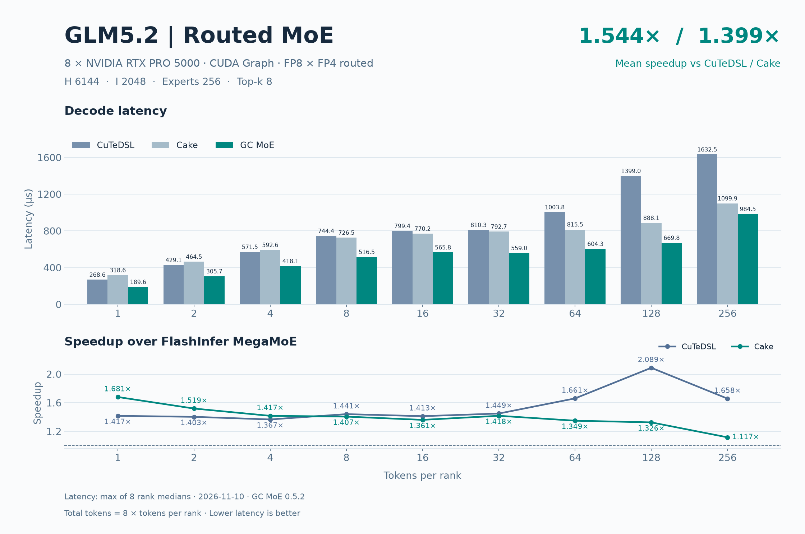
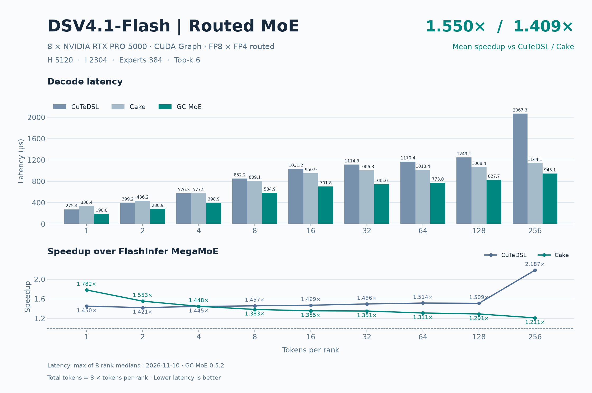

# RTX PRO 5000 八卡 GC MoE 精度与 decode 性能

两个模型的 default、boundary、asymmetric 用例中，GC MoE 通过 94/94 个用例和 752/752 个 rank 检查。Cake 通过 90/90 个用例和 720/720 个 rank 检查。

相对 CuTeDSL，18/18 点延迟更低，平均加速 **1.547×**。相对 Cake，18/18 点延迟更低，平均加速 **1.404×**。

| 模型 | 基线 | decode 点数 | 平均加速比 | 平均延迟下降 |
| --- | --- | ---: | ---: | ---: |
| GLM5.2 | CuTeDSL | 9 | 1.544× | 34.16% |
| GLM5.2 | Cake | 9 | 1.399× | 27.78% |
| DSV4.1-Flash | CuTeDSL | 9 | 1.550× | 34.43% |
| DSV4.1-Flash | Cake | 9 | 1.409× | 28.21% |
| 全部模型等权 | CuTeDSL | 18 | 1.547× | 34.30% |
| 全部模型等权 | Cake | 18 | 1.404× | 28.00% |

平均加速比和平均延迟下降分别按逐点 `基线延迟 / GC 延迟` 和 `1 − GC 延迟 / 基线延迟` 等权计算。

## 模型与数据口径

2026-11-10，GC MoE 0.5.2，FlashInfer 0.7.3，8 × NVIDIA RTX PRO 5000 72GB Blackwell（SM120），ptxas 13.2.78。
FP8 激活、FP4 routed 权重。

基线为 FlashInfer CuTe DSL W4A8 MegaMoE 和 Cake MegaMoE（`all_lsa`）。

各算子使用同一组预量化输入、权重和路由。SwiGLU clamp=10，每 rank 容量 256。GC MoE 使用默认 Green Context。输入准备完成后，CUDA Graph 预热 10 个窗口，计时 30 个窗口，每窗口回放 100 次。延迟取 8 个 rank 各自中位数的最大值，单位 µs。

| 模型 | H | I | routed experts | top-k |
| --- | ---: | ---: | ---: | ---: |
| GLM5.2 | 6144 | 2048 | 256 | 8 |
| DSV4.1-Flash | 5120 | 2304 | 384 | 6 |

## 精度

GC MoE 与 FlashInfer Cake 使用相同的激活、路由、量化权重和 SwiGLU 配置。每个模型覆盖 9 个 default、23 个 boundary、15 个 asymmetric 用例。全组 token 为零时仅检查 GC MoE，Cake 按空批次约定跳过。表中 cosine 取各 rank 的最小值，绝对差取各 rank 的最大值。

独立参考为量化前的 BF16 dense MoE，主 cosine 阈值为 0.97。量化后的 Torch 参考和 GC/Cake 的 cosine 阈值也为 0.97。

| 模型 | 类别 | 算子 | case 通过 | rank 检查通过 | 最小参考 cosine | 阈值 | finite |
| --- | --- | --- | ---: | ---: | ---: | ---: | ---: |
| GLM5.2 | default | GC MoE | 9/9 | 72/72 | 0.976099372 | 0.97 | 全部通过 |
| GLM5.2 | default | Cake | 9/9 | 72/72 | 0.976099372 | 0.97 | 全部通过 |
| GLM5.2 | boundary | GC MoE | 23/23 | 184/184 | 0.977220476 | 0.97 | 全部通过 |
| GLM5.2 | boundary | Cake | 22/22 | 176/176 | 0.977220476 | 0.97 | 全部通过 |
| GLM5.2 | asymmetric | GC MoE | 15/15 | 120/120 | 0.976380467 | 0.97 | 全部通过 |
| GLM5.2 | asymmetric | Cake | 14/14 | 112/112 | 0.976380467 | 0.97 | 全部通过 |
| DSV4.1-Flash | default | GC MoE | 9/9 | 72/72 | 0.976987720 | 0.97 | 全部通过 |
| DSV4.1-Flash | default | Cake | 9/9 | 72/72 | 0.976987720 | 0.97 | 全部通过 |
| DSV4.1-Flash | boundary | GC MoE | 23/23 | 184/184 | 0.977518559 | 0.97 | 全部通过 |
| DSV4.1-Flash | boundary | Cake | 22/22 | 176/176 | 0.977518559 | 0.97 | 全部通过 |
| DSV4.1-Flash | asymmetric | GC MoE | 15/15 | 120/120 | 0.976987720 | 0.97 | 全部通过 |
| DSV4.1-Flash | asymmetric | Cake | 14/14 | 112/112 | 0.976987720 | 0.97 | 全部通过 |

| 模型 | 类别 | 最小 GC/Cake cosine | 最大 \|GC−Cake\| |
| --- | --- | ---: | ---: |
| GLM5.2 | default | 0.999999762 | 0.000000 |
| GLM5.2 | boundary | 0.999999821 | 0.000000 |
| GLM5.2 | asymmetric | 0.999999821 | 0.000000 |
| DSV4.1-Flash | default | 0.999999821 | 0.000000 |
| DSV4.1-Flash | boundary | 0.999999762 | 0.000000 |
| DSV4.1-Flash | asymmetric | 0.999999762 | 0.000000 |

### GLM5.2：default 逐组精度

| T/rank 或各 rank token 向量 | 最小 Cake/ref cosine | 最小 GC/ref cosine | 最小 GC/Cake cosine | 最大 \|GC−Cake\| | 结果 |
| --- | ---: | ---: | ---: | ---: | ---: |
| 1 | 0.976099372 | 0.976099372 | 0.999999821 | 0.000000 | 通过 |
| 2 | 0.976625621 | 0.976625621 | 0.999999762 | 0.000000 | 通过 |
| 4 | 0.977438390 | 0.977438390 | 0.999999881 | 0.000000 | 通过 |
| 8 | 0.977858126 | 0.977858126 | 0.999999881 | 0.000000 | 通过 |
| 16 | 0.977967083 | 0.977967083 | 1.000000000 | 0.000000 | 通过 |
| 32 | 0.978031278 | 0.978031278 | 0.999999881 | 0.000000 | 通过 |
| 64 | 0.978069365 | 0.978069365 | 0.999999881 | 0.000000 | 通过 |
| 128 | 0.978055120 | 0.978055120 | 0.999999940 | 0.000000 | 通过 |
| 256 | 0.978063464 | 0.978063464 | 0.999999940 | 0.000000 | 通过 |

### GLM5.2：boundary 逐组精度

| T/rank 或各 rank token 向量 | 最小 Cake/ref cosine | 最小 GC/ref cosine | 最小 GC/Cake cosine | 最大 \|GC−Cake\| | 结果 |
| --- | ---: | ---: | ---: | ---: | ---: |
| 0 | — | 1.000000000 | — | — | GC 通过，Cake 跳过 |
| 3 | 0.977220476 | 0.977220476 | 0.999999881 | 0.000000 | 通过 |
| 5 | 0.977565467 | 0.977565467 | 0.999999821 | 0.000000 | 通过 |
| 7 | 0.977828503 | 0.977828503 | 0.999999821 | 0.000000 | 通过 |
| 9 | 0.977763057 | 0.977763057 | 0.999999940 | 0.000000 | 通过 |
| 15 | 0.977925479 | 0.977925479 | 1.000000000 | 0.000000 | 通过 |
| 17 | 0.977985084 | 0.977985084 | 0.999999940 | 0.000000 | 通过 |
| 31 | 0.978057325 | 0.978057325 | 0.999999940 | 0.000000 | 通过 |
| 33 | 0.978026569 | 0.978026569 | 0.999999821 | 0.000000 | 通过 |
| 63 | 0.978085399 | 0.978085399 | 0.999999881 | 0.000000 | 通过 |
| 65 | 0.978067279 | 0.978067279 | 0.999999940 | 0.000000 | 通过 |
| 95 | 0.978044987 | 0.978044987 | 0.999999821 | 0.000000 | 通过 |
| 96 | 0.978042364 | 0.978042364 | 0.999999821 | 0.000000 | 通过 |
| 97 | 0.978044748 | 0.978044748 | 0.999999821 | 0.000000 | 通过 |
| 127 | 0.978067875 | 0.978067875 | 0.999999881 | 0.000000 | 通过 |
| 129 | 0.978060305 | 0.978060305 | 0.999999881 | 0.000000 | 通过 |
| 191 | 0.978048682 | 0.978048682 | 0.999999881 | 0.000000 | 通过 |
| 192 | 0.978042006 | 0.978042006 | 0.999999821 | 0.000000 | 通过 |
| 193 | 0.978036880 | 0.978036880 | 0.999999940 | 0.000000 | 通过 |
| 239 | 0.978040040 | 0.978040040 | 0.999999881 | 0.000000 | 通过 |
| 240 | 0.978040040 | 0.978040040 | 0.999999881 | 0.000000 | 通过 |
| 241 | 0.978039920 | 0.978039920 | 0.999999940 | 0.000000 | 通过 |
| 255 | 0.978067696 | 0.978067696 | 0.999999881 | 0.000000 | 通过 |

### GLM5.2：asymmetric 逐组精度

| T/rank 或各 rank token 向量 | 最小 Cake/ref cosine | 最小 GC/ref cosine | 最小 GC/Cake cosine | 最大 \|GC−Cake\| | 结果 |
| --- | ---: | ---: | ---: | ---: | ---: |
| [0, 0, 0, 0, 0, 0, 0, 0] | — | 1.000000000 | — | — | GC 通过，Cake 跳过 |
| [256, 0, 256, 0, 256, 0, 256, 0] | 0.978160143 | 0.978160143 | 1.000000000 | 0.000000 | 通过 |
| [1, 0, 1, 0, 1, 0, 1, 0] | 0.976380467 | 0.976380467 | 0.999999940 | 0.000000 | 通过 |
| [1, 2, 4, 8, 16, 32, 64, 128] | 0.977854609 | 0.977854609 | 0.999999881 | 0.000000 | 通过 |
| [256, 0, 0, 0, 0, 0, 0, 0] | 0.978160143 | 0.978160143 | 1.000000000 | 0.000000 | 通过 |
| [256, 0, 256, 256, 256, 256, 256, 256] | 0.978063464 | 0.978063464 | 0.999999940 | 0.000000 | 通过 |
| [256, 256, 0, 256, 256, 256, 256, 256] | 0.978063464 | 0.978063464 | 0.999999940 | 0.000000 | 通过 |
| [256, 256, 256, 0, 256, 256, 256, 256] | 0.978063464 | 0.978063464 | 0.999999940 | 0.000000 | 通过 |
| [0, 0, 0, 0, 0, 256, 0, 0] | 0.978243351 | 0.978243351 | 1.000000000 | 0.000000 | 通过 |
| [0, 0, 0, 0, 0, 0, 256, 0] | 0.978195488 | 0.978195488 | 1.000000000 | 0.000000 | 通过 |
| [256, 256, 256, 256, 256, 256, 256, 0] | 0.978151083 | 0.978151083 | 1.000000000 | 0.000000 | 通过 |
| [0, 1, 2, 3, 4, 5, 7, 8] | 0.977220476 | 0.977220476 | 0.999999821 | 0.000000 | 通过 |
| [9, 15, 16, 17, 31, 32, 33, 63] | 0.978030145 | 0.978030145 | 0.999999881 | 0.000000 | 通过 |
| [64, 65, 95, 96, 97, 127, 128, 129] | 0.978060305 | 0.978060305 | 0.999999940 | 0.000000 | 通过 |
| [191, 192, 193, 239, 240, 241, 255, 256] | 0.978063464 | 0.978063464 | 0.999999881 | 0.000000 | 通过 |

### DSV4.1-Flash：default 逐组精度

| T/rank 或各 rank token 向量 | 最小 Cake/ref cosine | 最小 GC/ref cosine | 最小 GC/Cake cosine | 最大 \|GC−Cake\| | 结果 |
| --- | ---: | ---: | ---: | ---: | ---: |
| 1 | 0.977325439 | 0.977325439 | 0.999999881 | 0.000000 | 通过 |
| 2 | 0.976987720 | 0.976987720 | 1.000000000 | 0.000000 | 通过 |
| 4 | 0.977668047 | 0.977668047 | 0.999999940 | 0.000000 | 通过 |
| 8 | 0.977474570 | 0.977474570 | 0.999999821 | 0.000000 | 通过 |
| 16 | 0.977720499 | 0.977720499 | 0.999999821 | 0.000000 | 通过 |
| 32 | 0.977930307 | 0.977930307 | 0.999999821 | 0.000000 | 通过 |
| 64 | 0.977922738 | 0.977922738 | 0.999999821 | 0.000000 | 通过 |
| 128 | 0.978072047 | 0.978072047 | 0.999999940 | 0.000000 | 通过 |
| 256 | 0.978143632 | 0.978143632 | 0.999999940 | 0.000000 | 通过 |

### DSV4.1-Flash：boundary 逐组精度

| T/rank 或各 rank token 向量 | 最小 Cake/ref cosine | 最小 GC/ref cosine | 最小 GC/Cake cosine | 最大 \|GC−Cake\| | 结果 |
| --- | ---: | ---: | ---: | ---: | ---: |
| 0 | — | 1.000000000 | — | — | GC 通过，Cake 跳过 |
| 3 | 0.977569938 | 0.977569938 | 0.999999881 | 0.000000 | 通过 |
| 5 | 0.977613807 | 0.977613807 | 0.999999881 | 0.000000 | 通过 |
| 7 | 0.977589130 | 0.977589130 | 0.999999881 | 0.000000 | 通过 |
| 9 | 0.977518559 | 0.977518559 | 0.999999940 | 0.000000 | 通过 |
| 15 | 0.977722228 | 0.977722228 | 0.999999821 | 0.000000 | 通过 |
| 17 | 0.977795720 | 0.977795720 | 0.999999821 | 0.000000 | 通过 |
| 31 | 0.977987707 | 0.977987707 | 0.999999940 | 0.000000 | 通过 |
| 33 | 0.977902114 | 0.977902114 | 0.999999821 | 0.000000 | 通过 |
| 63 | 0.977912664 | 0.977912664 | 0.999999940 | 0.000000 | 通过 |
| 65 | 0.977942824 | 0.977942824 | 0.999999940 | 0.000000 | 通过 |
| 95 | 0.978047550 | 0.978047550 | 0.999999881 | 0.000000 | 通过 |
| 96 | 0.978059292 | 0.978059292 | 0.999999881 | 0.000000 | 通过 |
| 97 | 0.978065550 | 0.978065550 | 0.999999881 | 0.000000 | 通过 |
| 127 | 0.978071451 | 0.978071451 | 0.999999940 | 0.000000 | 通过 |
| 129 | 0.978075266 | 0.978075266 | 0.999999940 | 0.000000 | 通过 |
| 191 | 0.978101015 | 0.978101015 | 0.999999881 | 0.000000 | 通过 |
| 192 | 0.978107750 | 0.978107750 | 0.999999762 | 0.000000 | 通过 |
| 193 | 0.978106916 | 0.978106916 | 0.999999881 | 0.000000 | 通过 |
| 239 | 0.978134751 | 0.978134751 | 0.999999821 | 0.000000 | 通过 |
| 240 | 0.978134990 | 0.978134990 | 0.999999821 | 0.000000 | 通过 |
| 241 | 0.978131652 | 0.978131652 | 0.999999940 | 0.000000 | 通过 |
| 255 | 0.978138268 | 0.978138268 | 0.999999940 | 0.000000 | 通过 |

### DSV4.1-Flash：asymmetric 逐组精度

| T/rank 或各 rank token 向量 | 最小 Cake/ref cosine | 最小 GC/ref cosine | 最小 GC/Cake cosine | 最大 \|GC−Cake\| | 结果 |
| --- | ---: | ---: | ---: | ---: | ---: |
| [0, 0, 0, 0, 0, 0, 0, 0] | — | 1.000000000 | — | — | GC 通过，Cake 跳过 |
| [256, 0, 256, 0, 256, 0, 256, 0] | 0.978153408 | 0.978153408 | 0.999999940 | 0.000000 | 通过 |
| [1, 0, 1, 0, 1, 0, 1, 0] | 0.977325439 | 0.977325439 | 0.999999881 | 0.000000 | 通过 |
| [1, 2, 4, 8, 16, 32, 64, 128] | 0.976987720 | 0.976987720 | 1.000000000 | 0.000000 | 通过 |
| [256, 0, 0, 0, 0, 0, 0, 0] | 0.978197873 | 0.978197873 | 1.000000000 | 0.000000 | 通过 |
| [256, 0, 256, 256, 256, 256, 256, 256] | 0.978143632 | 0.978143632 | 0.999999940 | 0.000000 | 通过 |
| [256, 256, 0, 256, 256, 256, 256, 256] | 0.978143632 | 0.978143632 | 0.999999940 | 0.000000 | 通过 |
| [256, 256, 256, 0, 256, 256, 256, 256] | 0.978143632 | 0.978143632 | 0.999999940 | 0.000000 | 通过 |
| [0, 0, 0, 0, 0, 256, 0, 0] | 0.978143632 | 0.978143632 | 1.000000000 | 0.000000 | 通过 |
| [0, 0, 0, 0, 0, 0, 256, 0] | 0.978219867 | 0.978219867 | 1.000000000 | 0.000000 | 通过 |
| [256, 256, 256, 256, 256, 256, 256, 0] | 0.978143632 | 0.978143632 | 0.999999940 | 0.000000 | 通过 |
| [0, 1, 2, 3, 4, 5, 7, 8] | 0.977589130 | 0.977589130 | 0.999999881 | 0.000000 | 通过 |
| [9, 15, 16, 17, 31, 32, 33, 63] | 0.977964342 | 0.977964342 | 0.999999940 | 0.000000 | 通过 |
| [64, 65, 95, 96, 97, 127, 128, 129] | 0.978021622 | 0.978021622 | 0.999999881 | 0.000000 | 通过 |
| [191, 192, 193, 239, 240, 241, 255, 256] | 0.978130519 | 0.978130519 | 0.999999762 | 0.000000 | 通过 |

## GLM5.2 decode 性能

| T/rank | 总 token | CuTeDSL µs | Cake µs | GC µs | CuTeDSL / GC | Cake / GC | 较 CuTeDSL 延迟下降 | 较 Cake 延迟下降 |
| --- | ---: | ---: | ---: | ---: | ---: | ---: | ---: | ---: |
| 1 | 8 | 268.65 | 318.58 | 189.57 | 1.417× | 1.681× | 29.43% | 40.50% |
| 2 | 16 | 429.06 | 464.50 | 305.73 | 1.403× | 1.519× | 28.75% | 34.18% |
| 4 | 32 | 571.51 | 592.57 | 418.12 | 1.367× | 1.417× | 26.84% | 29.44% |
| 8 | 64 | 744.36 | 726.48 | 516.51 | 1.441× | 1.407× | 30.61% | 28.90% |
| 16 | 128 | 799.39 | 770.17 | 565.84 | 1.413× | 1.361× | 29.22% | 26.53% |
| 32 | 256 | 810.26 | 792.67 | 559.00 | 1.449× | 1.418× | 31.01% | 29.48% |
| 64 | 512 | 1003.78 | 815.50 | 604.31 | 1.661× | 1.349× | 39.80% | 25.90% |
| 128 | 1024 | 1399.02 | 888.11 | 669.83 | 2.089× | 1.326× | 52.12% | 24.58% |
| 256 | 2048 | 1632.51 | 1099.85 | 984.47 | 1.658× | 1.117× | 39.70% | 10.49% |

## DSV4.1-Flash decode 性能

| T/rank | 总 token | CuTeDSL µs | Cake µs | GC µs | CuTeDSL / GC | Cake / GC | 较 CuTeDSL 延迟下降 | 较 Cake 延迟下降 |
| --- | ---: | ---: | ---: | ---: | ---: | ---: | ---: | ---: |
| 1 | 8 | 275.41 | 338.45 | 189.95 | 1.450× | 1.782× | 31.03% | 43.88% |
| 2 | 16 | 399.19 | 436.21 | 280.92 | 1.421× | 1.553× | 29.63% | 35.60% |
| 4 | 32 | 576.25 | 577.53 | 398.89 | 1.445× | 1.448× | 30.78% | 30.93% |
| 8 | 64 | 852.22 | 809.06 | 584.86 | 1.457× | 1.383× | 31.37% | 27.71% |
| 16 | 128 | 1031.18 | 950.95 | 701.82 | 1.469× | 1.355× | 31.94% | 26.20% |
| 32 | 256 | 1114.26 | 1006.34 | 744.99 | 1.496× | 1.351× | 33.14% | 25.97% |
| 64 | 512 | 1170.44 | 1013.41 | 773.03 | 1.514× | 1.311× | 33.95% | 23.72% |
| 128 | 1024 | 1249.06 | 1068.42 | 827.71 | 1.509× | 1.291× | 33.73% | 22.53% |
| 256 | 2048 | 2067.25 | 1144.07 | 945.06 | 2.187× | 1.211× | 54.28% | 17.40% |

## 有效显存带宽

每个命中的 routed expert 的 FP4 权重和 scale 各计一次，SE 加上非空 rank 的本地 FP8 shared 权重和 scale。以各算子共用的量化权重工作集估算，不计激活、中间结果、输出和重复访存。单位 GB/s。

### GLM5.2

| T/rank | CuTeDSL 八卡合计 | Cake 八卡合计 | GC 八卡合计 | CuTeDSL 每 GPU 均值 | Cake 每 GPU 均值 | GC 每 GPU 均值 |
| --- | ---: | ---: | ---: | ---: | ---: | ---: |
| 1 | 4404.26 | 3713.91 | 6241.36 | 550.53 | 464.24 | 780.17 |
| 2 | 5001.06 | 4619.52 | 7018.58 | 625.13 | 577.44 | 877.32 |
| 4 | 5789.76 | 5584.03 | 7913.88 | 723.72 | 698.00 | 989.24 |
| 8 | 6115.65 | 6266.17 | 8813.57 | 764.46 | 783.27 | 1101.70 |
| 16 | 6346.93 | 6587.72 | 8966.59 | 793.37 | 823.47 | 1120.82 |
| 32 | 6336.03 | 6476.64 | 9183.97 | 792.00 | 809.58 | 1148.00 |
| 64 | 5114.49 | 6295.32 | 8495.37 | 639.31 | 786.92 | 1061.92 |
| 128 | 3669.58 | 5780.65 | 7664.42 | 458.70 | 722.58 | 958.05 |
| 256 | 3144.74 | 4667.74 | 5214.80 | 393.09 | 583.47 | 651.85 |

### DSV4.1-Flash

| T/rank | CuTeDSL 八卡合计 | Cake 八卡合计 | GC 八卡合计 | CuTeDSL 每 GPU 均值 | Cake 每 GPU 均值 | GC 每 GPU 均值 |
| --- | ---: | ---: | ---: | ---: | ---: | ---: |
| 1 | 3276.68 | 2666.39 | 4750.86 | 409.58 | 333.30 | 593.86 |
| 2 | 4144.49 | 3792.79 | 5889.43 | 518.06 | 474.10 | 736.18 |
| 4 | 4991.75 | 4980.71 | 7211.32 | 623.97 | 622.59 | 901.42 |
| 8 | 5537.26 | 5832.65 | 8068.46 | 692.16 | 729.08 | 1008.56 |
| 16 | 6144.21 | 6662.62 | 9027.66 | 768.03 | 832.83 | 1128.46 |
| 32 | 6344.15 | 7024.49 | 9488.82 | 793.02 | 878.06 | 1186.10 |
| 64 | 6168.13 | 7123.91 | 9339.12 | 771.02 | 890.49 | 1167.39 |
| 128 | 5779.92 | 6757.11 | 8722.19 | 722.49 | 844.64 | 1090.27 |
| 256 | 3492.29 | 6310.31 | 7639.15 | 436.54 | 788.79 | 954.89 |

## 有效卡间载荷带宽

按远程路由数 × `(H + H/32 + 2H)` 估算，包含 FP8 激活、packed scale 和 BF16 返回。RTX PRO 5000 测试使用 PCIe 卡间互联。单位 GB/s，不计本地路由、控制流量及 TX/RX 重复计数。

### GLM5.2

| T/rank | CuTeDSL 八卡合计 | Cake 八卡合计 | GC 八卡合计 | CuTeDSL 每 GPU 均值 | Cake 每 GPU 均值 | GC 每 GPU 均值 |
| --- | ---: | ---: | ---: | ---: | ---: | ---: |
| 1 | 3.95 | 3.33 | 5.60 | 0.49 | 0.42 | 0.70 |
| 2 | 4.73 | 4.37 | 6.64 | 0.59 | 0.55 | 0.83 |
| 4 | 7.14 | 6.88 | 9.75 | 0.89 | 0.86 | 1.22 |
| 8 | 11.26 | 11.54 | 16.23 | 1.41 | 1.44 | 2.03 |
| 16 | 21.34 | 22.15 | 30.15 | 2.67 | 2.77 | 3.77 |
| 32 | 41.26 | 42.17 | 59.80 | 5.16 | 5.27 | 7.48 |
| 64 | 66.48 | 81.83 | 110.42 | 8.31 | 10.23 | 13.80 |
| 128 | 95.75 | 150.84 | 200.00 | 11.97 | 18.86 | 25.00 |
| 256 | 163.95 | 243.35 | 271.87 | 20.49 | 30.42 | 33.98 |

### DSV4.1-Flash

| T/rank | CuTeDSL 八卡合计 | Cake 八卡合计 | GC 八卡合计 | CuTeDSL 每 GPU 均值 | Cake 每 GPU 均值 | GC 每 GPU 均值 |
| --- | ---: | ---: | ---: | ---: | ---: | ---: |
| 1 | 2.25 | 1.83 | 3.27 | 0.28 | 0.23 | 0.41 |
| 2 | 3.15 | 2.88 | 4.48 | 0.39 | 0.36 | 0.56 |
| 4 | 4.42 | 4.41 | 6.38 | 0.55 | 0.55 | 0.80 |
| 8 | 6.08 | 6.41 | 8.86 | 0.76 | 0.80 | 1.11 |
| 16 | 10.10 | 10.95 | 14.84 | 1.26 | 1.37 | 1.85 |
| 32 | 18.96 | 20.99 | 28.35 | 2.37 | 2.62 | 3.54 |
| 64 | 35.51 | 41.01 | 53.77 | 4.44 | 5.13 | 6.72 |
| 128 | 67.06 | 78.40 | 101.20 | 8.38 | 9.80 | 12.65 |
| 256 | 80.59 | 145.63 | 176.29 | 10.07 | 18.20 | 22.04 |

## 有效矩阵计算吞吐

有效 FLOP 为 `6 × routed_assignments × H × I`，SE 加上 `6 × global_tokens × H × shared_I`。不计 padding、激活函数和量化。单位 TFLOPS。

### GLM5.2

| T/rank | CuTeDSL 八卡合计 | Cake 八卡合计 | GC 八卡合计 | CuTeDSL 每 GPU 均值 | Cake 每 GPU 均值 | GC 每 GPU 均值 |
| --- | ---: | ---: | ---: | ---: | ---: | ---: |
| 1 | 17.99 | 15.17 | 25.49 | 2.25 | 1.90 | 3.19 |
| 2 | 22.52 | 20.80 | 31.61 | 2.82 | 2.60 | 3.95 |
| 4 | 33.82 | 32.62 | 46.22 | 4.23 | 4.08 | 5.78 |
| 8 | 51.93 | 53.21 | 74.84 | 6.49 | 6.65 | 9.35 |
| 16 | 96.71 | 100.38 | 136.63 | 12.09 | 12.55 | 17.08 |
| 32 | 190.83 | 195.06 | 276.60 | 23.85 | 24.38 | 34.57 |
| 64 | 308.07 | 379.20 | 511.72 | 38.51 | 47.40 | 63.97 |
| 128 | 442.08 | 696.40 | 923.34 | 55.26 | 87.05 | 115.42 |
| 256 | 757.70 | 1124.65 | 1256.46 | 94.71 | 140.58 | 157.06 |

### DSV4.1-Flash

| T/rank | CuTeDSL 八卡合计 | Cake 八卡合计 | GC 八卡合计 | CuTeDSL 每 GPU 均值 | Cake 每 GPU 均值 | GC 每 GPU 均值 |
| --- | ---: | ---: | ---: | ---: | ---: | ---: |
| 1 | 12.34 | 10.04 | 17.89 | 1.54 | 1.25 | 2.24 |
| 2 | 17.02 | 15.58 | 24.19 | 2.13 | 1.95 | 3.02 |
| 4 | 23.58 | 23.53 | 34.07 | 2.95 | 2.94 | 4.26 |
| 8 | 31.89 | 33.59 | 46.47 | 3.99 | 4.20 | 5.81 |
| 16 | 52.71 | 57.16 | 77.45 | 6.59 | 7.15 | 9.68 |
| 32 | 97.57 | 108.03 | 145.93 | 12.20 | 13.50 | 18.24 |
| 64 | 185.77 | 214.56 | 281.27 | 23.22 | 26.82 | 35.16 |
| 128 | 348.16 | 407.02 | 525.38 | 43.52 | 50.88 | 65.67 |
| 256 | 420.72 | 760.21 | 920.29 | 52.59 | 95.03 | 115.04 |

三项指标均使用各算子各自的延迟。每 GPU 均值为八卡合计除以 8。
