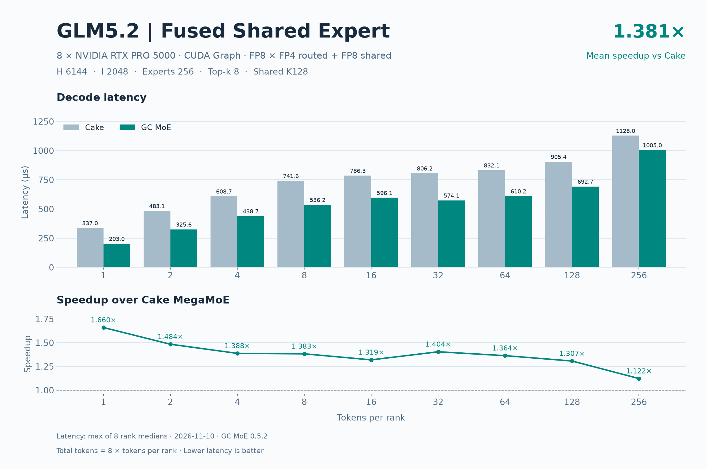
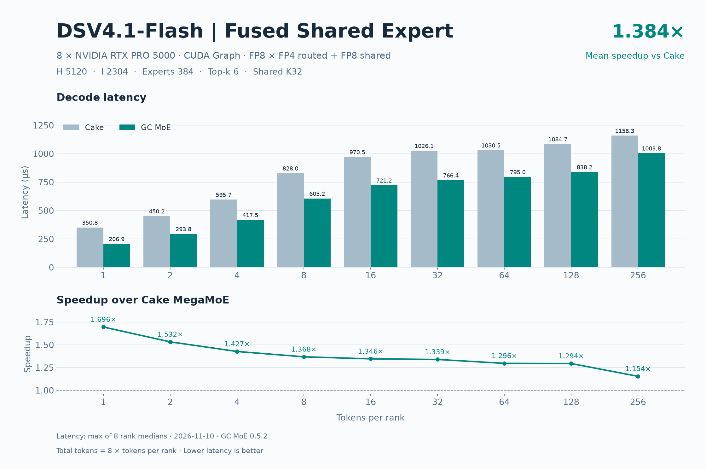

# RTX PRO 5000 八卡 GC MoE SE 精度与 decode 性能

两个模型的 default、boundary、asymmetric 用例中，GC MoE 通过 94/94 个用例和 752/752 个 rank 检查。Cake 通过 90/90 个用例和 720/720 个 rank 检查。

相对 Cake，18/18 点延迟更低，平均加速 **1.382×**。

| 模型 | 基线 | decode 点数 | 平均加速比 | 平均延迟下降 |
| --- | --- | ---: | ---: | ---: |
| GLM5.2 | Cake | 9 | 1.381× | 26.89% |
| DSV4.1-Flash | Cake | 9 | 1.384× | 26.94% |
| 全部模型等权 | Cake | 18 | 1.382× | 26.92% |

平均加速比和平均延迟下降分别按逐点 `基线延迟 / GC 延迟` 和 `1 − GC 延迟 / 基线延迟` 等权计算。

## 模型与数据口径

2026-11-10，GC MoE 0.5.2，FlashInfer 0.7.3，8 × NVIDIA RTX PRO 5000 72GB Blackwell（SM120），ptxas 13.2.78。
FP8 激活、FP4 routed 权重、FP8 shared 权重。

GC 和 FlashInfer Cake MegaMoE（`all_lsa`）均融合一个 shared expert。

各算子使用同一组预量化输入、权重和路由。SwiGLU clamp=10，每 rank 容量 256。GC MoE 使用默认 Green Context。输入准备完成后，CUDA Graph 预热 10 个窗口，计时 30 个窗口，每窗口回放 100 次。延迟取 8 个 rank 各自中位数的最大值，单位 µs。

| 模型 | H | I | routed experts | top-k | shared experts | shared weight K group |
| --- | ---: | ---: | ---: | ---: | ---: | ---: |
| GLM5.2 | 6144 | 2048 | 256 | 8 | 1 | 128 |
| DSV4.1-Flash | 5120 | 2304 | 384 | 6 | 1 | 32 |

## 精度

GC MoE 与 FlashInfer Cake 使用相同的激活、路由、量化权重和 SwiGLU 配置。每个模型覆盖 9 个 default、23 个 boundary、15 个 asymmetric 用例。全组 token 为零时仅检查 GC MoE，Cake 按空批次约定跳过。表中 cosine 取各 rank 的最小值，绝对差取各 rank 的最大值。

独立参考为解量化后的 Torch routed 与 shared 分支，参考、GC/Cake 和 shared residual 的 cosine 阈值均为 0.99。Shared residual 用融合输出减去独立 routed 分支，再与独立 shared 分支比较。GC MoE 的 shared 分支输出另按 0.99999 验收。

| 模型 | 类别 | 算子 | case 通过 | rank 检查通过 | 最小参考 cosine | 阈值 | finite |
| --- | --- | --- | ---: | ---: | ---: | ---: | ---: |
| GLM5.2 | default | GC MoE | 9/9 | 72/72 | 0.999999642 | 0.99 | 全部通过 |
| GLM5.2 | default | Cake | 9/9 | 72/72 | 0.999999642 | 0.99 | 全部通过 |
| GLM5.2 | boundary | GC MoE | 23/23 | 184/184 | 0.999999523 | 0.99 | 全部通过 |
| GLM5.2 | boundary | Cake | 22/22 | 176/176 | 0.999999523 | 0.99 | 全部通过 |
| GLM5.2 | asymmetric | GC MoE | 15/15 | 120/120 | 0.999999702 | 0.99 | 全部通过 |
| GLM5.2 | asymmetric | Cake | 14/14 | 112/112 | 0.999999702 | 0.99 | 全部通过 |
| DSV4.1-Flash | default | GC MoE | 9/9 | 72/72 | 0.999999583 | 0.99 | 全部通过 |
| DSV4.1-Flash | default | Cake | 9/9 | 72/72 | 0.999999583 | 0.99 | 全部通过 |
| DSV4.1-Flash | boundary | GC MoE | 23/23 | 184/184 | 0.999999583 | 0.99 | 全部通过 |
| DSV4.1-Flash | boundary | Cake | 22/22 | 176/176 | 0.999999583 | 0.99 | 全部通过 |
| DSV4.1-Flash | asymmetric | GC MoE | 15/15 | 120/120 | 0.999999583 | 0.99 | 全部通过 |
| DSV4.1-Flash | asymmetric | Cake | 14/14 | 112/112 | 0.999999583 | 0.99 | 全部通过 |

| 模型 | 类别 | 最小 GC/Cake cosine | 最大 \|GC−Cake\| | 最小 Cake shared residual cosine | 最小 GC shared residual cosine |
| --- | --- | ---: | ---: | ---: | ---: |
| GLM5.2 | default | 0.999999821 | 0.000000 | 0.999998093 | 0.999998093 |
| GLM5.2 | boundary | 0.999999821 | 0.000000 | 0.999997854 | 0.999997854 |
| GLM5.2 | asymmetric | 0.999999821 | 0.000000 | 0.999998212 | 0.999998212 |
| DSV4.1-Flash | default | 0.999999821 | 0.000000 | 0.999997914 | 0.999997914 |
| DSV4.1-Flash | boundary | 0.999999762 | 0.000000 | 0.999997973 | 0.999997973 |
| DSV4.1-Flash | asymmetric | 0.999999762 | 0.000000 | 0.999997914 | 0.999997914 |

### GLM5.2：default 逐组精度

| T/rank 或各 rank token 向量 | 最小 Cake/ref cosine | 最小 GC/ref cosine | 最小 GC/Cake cosine | 最大 \|GC−Cake\| | 结果 |
| --- | ---: | ---: | ---: | ---: | ---: |
| 1 | 0.999999821 | 0.999999821 | 0.999999821 | 0.000000 | 通过 |
| 2 | 0.999999881 | 0.999999881 | 0.999999881 | 0.000000 | 通过 |
| 4 | 0.999999940 | 0.999999940 | 0.999999940 | 0.000000 | 通过 |
| 8 | 0.999999881 | 0.999999881 | 0.999999821 | 0.000000 | 通过 |
| 16 | 1.000000000 | 1.000000000 | 0.999999940 | 0.000000 | 通过 |
| 32 | 0.999999881 | 0.999999881 | 0.999999940 | 0.000000 | 通过 |
| 64 | 0.999999881 | 0.999999881 | 1.000000000 | 0.000000 | 通过 |
| 128 | 0.999999642 | 0.999999642 | 0.999999881 | 0.000000 | 通过 |
| 256 | 0.999999881 | 0.999999881 | 0.999999881 | 0.000000 | 通过 |

### GLM5.2：boundary 逐组精度

| T/rank 或各 rank token 向量 | 最小 Cake/ref cosine | 最小 GC/ref cosine | 最小 GC/Cake cosine | 最大 \|GC−Cake\| | 结果 |
| --- | ---: | ---: | ---: | ---: | ---: |
| 0 | — | 1.000000000 | — | — | GC 通过，Cake 跳过 |
| 3 | 0.999999821 | 0.999999821 | 0.999999821 | 0.000000 | 通过 |
| 5 | 0.999999881 | 0.999999881 | 0.999999821 | 0.000000 | 通过 |
| 7 | 0.999999940 | 0.999999940 | 0.999999940 | 0.000000 | 通过 |
| 9 | 0.999999881 | 0.999999881 | 0.999999881 | 0.000000 | 通过 |
| 15 | 0.999999940 | 0.999999940 | 1.000000000 | 0.000000 | 通过 |
| 17 | 1.000000000 | 1.000000000 | 0.999999940 | 0.000000 | 通过 |
| 31 | 0.999999881 | 0.999999881 | 0.999999940 | 0.000000 | 通过 |
| 33 | 0.999999940 | 0.999999940 | 0.999999940 | 0.000000 | 通过 |
| 63 | 0.999999881 | 0.999999881 | 0.999999940 | 0.000000 | 通过 |
| 65 | 0.999999881 | 0.999999881 | 0.999999881 | 0.000000 | 通过 |
| 95 | 0.999999523 | 0.999999523 | 0.999999821 | 0.000000 | 通过 |
| 96 | 0.999999642 | 0.999999642 | 0.999999881 | 0.000000 | 通过 |
| 97 | 0.999999642 | 0.999999642 | 0.999999881 | 0.000000 | 通过 |
| 127 | 0.999999702 | 0.999999702 | 0.999999940 | 0.000000 | 通过 |
| 129 | 0.999999821 | 0.999999821 | 0.999999881 | 0.000000 | 通过 |
| 191 | 0.999999642 | 0.999999642 | 0.999999821 | 0.000000 | 通过 |
| 192 | 0.999999821 | 0.999999821 | 0.999999821 | 0.000000 | 通过 |
| 193 | 0.999999702 | 0.999999702 | 0.999999821 | 0.000000 | 通过 |
| 239 | 0.999999881 | 0.999999881 | 0.999999940 | 0.000000 | 通过 |
| 240 | 0.999999881 | 0.999999881 | 0.999999881 | 0.000000 | 通过 |
| 241 | 0.999999881 | 0.999999881 | 0.999999940 | 0.000000 | 通过 |
| 255 | 0.999999821 | 0.999999821 | 0.999999881 | 0.000000 | 通过 |

### GLM5.2：asymmetric 逐组精度

| T/rank 或各 rank token 向量 | 最小 Cake/ref cosine | 最小 GC/ref cosine | 最小 GC/Cake cosine | 最大 \|GC−Cake\| | 结果 |
| --- | ---: | ---: | ---: | ---: | ---: |
| [0, 0, 0, 0, 0, 0, 0, 0] | — | 1.000000000 | — | — | GC 通过，Cake 跳过 |
| [256, 0, 256, 0, 256, 0, 256, 0] | 0.999999940 | 0.999999940 | 0.999999881 | 0.000000 | 通过 |
| [1, 0, 1, 0, 1, 0, 1, 0] | 0.999999881 | 0.999999881 | 0.999999881 | 0.000000 | 通过 |
| [1, 2, 4, 8, 16, 32, 64, 128] | 0.999999940 | 0.999999940 | 0.999999940 | 0.000000 | 通过 |
| [256, 0, 0, 0, 0, 0, 0, 0] | 0.999999881 | 0.999999881 | 0.999999881 | 0.000000 | 通过 |
| [256, 0, 256, 256, 256, 256, 256, 256] | 0.999999881 | 0.999999881 | 0.999999881 | 0.000000 | 通过 |
| [256, 256, 0, 256, 256, 256, 256, 256] | 0.999999881 | 0.999999881 | 0.999999881 | 0.000000 | 通过 |
| [256, 256, 256, 0, 256, 256, 256, 256] | 0.999999881 | 0.999999881 | 0.999999881 | 0.000000 | 通过 |
| [0, 0, 0, 0, 0, 256, 0, 0] | 0.999999881 | 0.999999881 | 1.000000000 | 0.000000 | 通过 |
| [0, 0, 0, 0, 0, 0, 256, 0] | 0.999999940 | 0.999999940 | 0.999999940 | 0.000000 | 通过 |
| [256, 256, 256, 256, 256, 256, 256, 0] | 0.999999881 | 0.999999881 | 0.999999881 | 0.000000 | 通过 |
| [0, 1, 2, 3, 4, 5, 7, 8] | 0.999999821 | 0.999999821 | 0.999999821 | 0.000000 | 通过 |
| [9, 15, 16, 17, 31, 32, 33, 63] | 1.000000000 | 1.000000000 | 0.999999940 | 0.000000 | 通过 |
| [64, 65, 95, 96, 97, 127, 128, 129] | 0.999999702 | 0.999999702 | 0.999999821 | 0.000000 | 通过 |
| [191, 192, 193, 239, 240, 241, 255, 256] | 0.999999881 | 0.999999881 | 0.999999940 | 0.000000 | 通过 |

### DSV4.1-Flash：default 逐组精度

| T/rank 或各 rank token 向量 | 最小 Cake/ref cosine | 最小 GC/ref cosine | 最小 GC/Cake cosine | 最大 \|GC−Cake\| | 结果 |
| --- | ---: | ---: | ---: | ---: | ---: |
| 1 | 0.999999702 | 0.999999702 | 1.000000000 | 0.000000 | 通过 |
| 2 | 0.999999702 | 0.999999702 | 0.999999881 | 0.000000 | 通过 |
| 4 | 0.999999881 | 0.999999881 | 0.999999881 | 0.000000 | 通过 |
| 8 | 0.999999881 | 0.999999881 | 0.999999881 | 0.000000 | 通过 |
| 16 | 0.999999881 | 0.999999881 | 0.999999881 | 0.000000 | 通过 |
| 32 | 0.999999881 | 0.999999881 | 0.999999881 | 0.000000 | 通过 |
| 64 | 0.999999881 | 0.999999881 | 0.999999821 | 0.000000 | 通过 |
| 128 | 0.999999583 | 0.999999583 | 0.999999881 | 0.000000 | 通过 |
| 256 | 0.999999702 | 0.999999702 | 0.999999881 | 0.000000 | 通过 |

### DSV4.1-Flash：boundary 逐组精度

| T/rank 或各 rank token 向量 | 最小 Cake/ref cosine | 最小 GC/ref cosine | 最小 GC/Cake cosine | 最大 \|GC−Cake\| | 结果 |
| --- | ---: | ---: | ---: | ---: | ---: |
| 0 | — | 1.000000000 | — | — | GC 通过，Cake 跳过 |
| 3 | 0.999999940 | 0.999999940 | 0.999999940 | 0.000000 | 通过 |
| 5 | 0.999999821 | 0.999999821 | 0.999999940 | 0.000000 | 通过 |
| 7 | 0.999999881 | 0.999999881 | 1.000000000 | 0.000000 | 通过 |
| 9 | 0.999999881 | 0.999999881 | 0.999999821 | 0.000000 | 通过 |
| 15 | 0.999999881 | 0.999999881 | 1.000000000 | 0.000000 | 通过 |
| 17 | 1.000000000 | 1.000000000 | 1.000000000 | 0.000000 | 通过 |
| 31 | 0.999999881 | 0.999999881 | 0.999999881 | 0.000000 | 通过 |
| 33 | 0.999999881 | 0.999999881 | 0.999999821 | 0.000000 | 通过 |
| 63 | 1.000000000 | 1.000000000 | 0.999999881 | 0.000000 | 通过 |
| 65 | 0.999999881 | 0.999999881 | 0.999999881 | 0.000000 | 通过 |
| 95 | 0.999999881 | 0.999999881 | 0.999999940 | 0.000000 | 通过 |
| 96 | 0.999999940 | 0.999999940 | 0.999999940 | 0.000000 | 通过 |
| 97 | 0.999999881 | 0.999999881 | 0.999999881 | 0.000000 | 通过 |
| 127 | 0.999999702 | 0.999999702 | 1.000000000 | 0.000000 | 通过 |
| 129 | 0.999999583 | 0.999999583 | 0.999999881 | 0.000000 | 通过 |
| 191 | 0.999999702 | 0.999999702 | 0.999999881 | 0.000000 | 通过 |
| 192 | 0.999999702 | 0.999999702 | 0.999999940 | 0.000000 | 通过 |
| 193 | 0.999999821 | 0.999999821 | 0.999999940 | 0.000000 | 通过 |
| 239 | 0.999999881 | 0.999999881 | 0.999999762 | 0.000000 | 通过 |
| 240 | 0.999999881 | 0.999999881 | 0.999999762 | 0.000000 | 通过 |
| 241 | 0.999999881 | 0.999999881 | 0.999999881 | 0.000000 | 通过 |
| 255 | 0.999999702 | 0.999999702 | 1.000000000 | 0.000000 | 通过 |

### DSV4.1-Flash：asymmetric 逐组精度

| T/rank 或各 rank token 向量 | 最小 Cake/ref cosine | 最小 GC/ref cosine | 最小 GC/Cake cosine | 最大 \|GC−Cake\| | 结果 |
| --- | ---: | ---: | ---: | ---: | ---: |
| [0, 0, 0, 0, 0, 0, 0, 0] | — | 1.000000000 | — | — | GC 通过，Cake 跳过 |
| [256, 0, 256, 0, 256, 0, 256, 0] | 0.999999881 | 0.999999881 | 0.999999881 | 0.000000 | 通过 |
| [1, 0, 1, 0, 1, 0, 1, 0] | 0.999999702 | 0.999999702 | 1.000000000 | 0.000000 | 通过 |
| [1, 2, 4, 8, 16, 32, 64, 128] | 0.999999881 | 0.999999881 | 0.999999881 | 0.000000 | 通过 |
| [256, 0, 0, 0, 0, 0, 0, 0] | 1.000000000 | 1.000000000 | 1.000000000 | 0.000000 | 通过 |
| [256, 0, 256, 256, 256, 256, 256, 256] | 0.999999702 | 0.999999702 | 0.999999881 | 0.000000 | 通过 |
| [256, 256, 0, 256, 256, 256, 256, 256] | 0.999999702 | 0.999999702 | 0.999999881 | 0.000000 | 通过 |
| [256, 256, 256, 0, 256, 256, 256, 256] | 0.999999702 | 0.999999702 | 0.999999881 | 0.000000 | 通过 |
| [0, 0, 0, 0, 0, 256, 0, 0] | 0.999999702 | 0.999999702 | 1.000000000 | 0.000000 | 通过 |
| [0, 0, 0, 0, 0, 0, 256, 0] | 0.999999881 | 0.999999881 | 1.000000000 | 0.000000 | 通过 |
| [256, 256, 256, 256, 256, 256, 256, 0] | 0.999999702 | 0.999999702 | 0.999999881 | 0.000000 | 通过 |
| [0, 1, 2, 3, 4, 5, 7, 8] | 0.999999881 | 0.999999881 | 0.999999940 | 0.000000 | 通过 |
| [9, 15, 16, 17, 31, 32, 33, 63] | 0.999999881 | 0.999999881 | 0.999999881 | 0.000000 | 通过 |
| [64, 65, 95, 96, 97, 127, 128, 129] | 0.999999583 | 0.999999583 | 0.999999821 | 0.000000 | 通过 |
| [191, 192, 193, 239, 240, 241, 255, 256] | 0.999999702 | 0.999999702 | 0.999999762 | 0.000000 | 通过 |

## GLM5.2 decode 性能

| T/rank | 总 token | Cake µs | GC µs | Cake / GC | 较 Cake 延迟下降 |
| --- | ---: | ---: | ---: | ---: | ---: |
| 1 | 8 | 336.96 | 203.01 | 1.660× | 39.75% |
| 2 | 16 | 483.15 | 325.64 | 1.484× | 32.60% |
| 4 | 32 | 608.75 | 438.70 | 1.388× | 27.93% |
| 8 | 64 | 741.57 | 536.25 | 1.383× | 27.69% |
| 16 | 128 | 786.32 | 596.12 | 1.319× | 24.19% |
| 32 | 256 | 806.24 | 574.12 | 1.404× | 28.79% |
| 64 | 512 | 832.06 | 610.24 | 1.364× | 26.66% |
| 128 | 1024 | 905.45 | 692.70 | 1.307× | 23.50% |
| 256 | 2048 | 1128.05 | 1005.03 | 1.122× | 10.90% |

## DSV4.1-Flash decode 性能

| T/rank | 总 token | Cake µs | GC µs | Cake / GC | 较 Cake 延迟下降 |
| --- | ---: | ---: | ---: | ---: | ---: |
| 1 | 8 | 350.76 | 206.86 | 1.696× | 41.03% |
| 2 | 16 | 450.21 | 293.79 | 1.532× | 34.74% |
| 4 | 32 | 595.69 | 417.55 | 1.427× | 29.91% |
| 8 | 64 | 827.96 | 605.19 | 1.368× | 26.91% |
| 16 | 128 | 970.54 | 721.18 | 1.346× | 25.69% |
| 32 | 256 | 1026.14 | 766.41 | 1.339× | 25.31% |
| 64 | 512 | 1030.53 | 794.99 | 1.296× | 22.86% |
| 128 | 1024 | 1084.72 | 838.24 | 1.294× | 22.72% |
| 256 | 2048 | 1158.30 | 1003.82 | 1.154× | 13.34% |

## 有效显存带宽

每个命中的 routed expert 的 FP4 权重和 scale 各计一次，SE 加上非空 rank 的本地 FP8 shared 权重和 scale。以各算子共用的量化权重工作集估算，不计激活、中间结果、输出和重复访存。单位 GB/s。

### GLM5.2

| T/rank | Cake 八卡合计 | GC 八卡合计 | Cake 每 GPU 均值 | GC 每 GPU 均值 |
| --- | ---: | ---: | ---: | ---: |
| 1 | 4414.59 | 7327.52 | 551.82 | 915.94 |
| 2 | 5071.21 | 7524.15 | 633.90 | 940.52 |
| 4 | 5935.57 | 8236.23 | 741.95 | 1029.53 |
| 8 | 6549.11 | 9056.63 | 818.64 | 1132.08 |
| 16 | 6839.46 | 9021.67 | 854.93 | 1127.71 |
| 32 | 6745.09 | 9472.27 | 843.14 | 1184.03 |
| 64 | 6535.80 | 8911.58 | 816.97 | 1113.95 |
| 128 | 6006.06 | 7850.68 | 750.76 | 981.34 |
| 256 | 4820.89 | 5410.95 | 602.61 | 676.37 |

### DSV4.1-Flash

| T/rank | Cake 八卡合计 | GC 八卡合计 | Cake 每 GPU 均值 | GC 每 GPU 均值 |
| --- | ---: | ---: | ---: | ---: |
| 1 | 3405.12 | 5773.99 | 425.64 | 721.75 |
| 2 | 4323.35 | 6625.26 | 540.42 | 828.16 |
| 4 | 5318.93 | 7588.25 | 664.87 | 948.53 |
| 8 | 6052.15 | 8279.96 | 756.52 | 1034.99 |
| 16 | 6828.94 | 9190.20 | 853.62 | 1148.78 |
| 32 | 7173.46 | 9604.57 | 896.68 | 1200.57 |
| 64 | 7288.85 | 9448.48 | 911.11 | 1181.06 |
| 128 | 6924.71 | 8960.92 | 865.59 | 1120.12 |
| 256 | 6484.86 | 7482.85 | 810.61 | 935.36 |

## 有效卡间载荷带宽

按远程路由数 × `(H + H/32 + 2H)` 估算，包含 FP8 激活、packed scale 和 BF16 返回。RTX PRO 5000 测试使用 PCIe 卡间互联。单位 GB/s，不计本地路由、控制流量及 TX/RX 重复计数。

### GLM5.2

| T/rank | Cake 八卡合计 | GC 八卡合计 | Cake 每 GPU 均值 | GC 每 GPU 均值 |
| --- | ---: | ---: | ---: | ---: |
| 1 | 3.15 | 5.23 | 0.39 | 0.65 |
| 2 | 4.20 | 6.23 | 0.53 | 0.78 |
| 4 | 6.70 | 9.30 | 0.84 | 1.16 |
| 8 | 11.30 | 15.63 | 1.41 | 1.95 |
| 16 | 21.70 | 28.62 | 2.71 | 3.58 |
| 32 | 41.46 | 58.23 | 5.18 | 7.28 |
| 64 | 80.20 | 109.35 | 10.02 | 13.67 |
| 128 | 147.95 | 193.39 | 18.49 | 24.17 |
| 256 | 237.26 | 266.31 | 29.66 | 33.29 |

### DSV4.1-Flash

| T/rank | Cake 八卡合计 | GC 八卡合计 | Cake 每 GPU 均值 | GC 每 GPU 均值 |
| --- | ---: | ---: | ---: | ---: |
| 1 | 1.77 | 3.00 | 0.22 | 0.38 |
| 2 | 2.79 | 4.28 | 0.35 | 0.53 |
| 4 | 4.27 | 6.10 | 0.53 | 0.76 |
| 8 | 6.26 | 8.57 | 0.78 | 1.07 |
| 16 | 10.73 | 14.44 | 1.34 | 1.81 |
| 32 | 20.58 | 27.56 | 2.57 | 3.45 |
| 64 | 40.33 | 52.28 | 5.04 | 6.54 |
| 128 | 77.22 | 99.93 | 9.65 | 12.49 |
| 256 | 143.84 | 165.97 | 17.98 | 20.75 |

## 有效矩阵计算吞吐

有效 FLOP 为 `6 × routed_assignments × H × I`，SE 加上 `6 × global_tokens × H × shared_I`。不计 padding、激活函数和量化。单位 TFLOPS。

### GLM5.2

| T/rank | Cake 八卡合计 | GC 八卡合计 | Cake 每 GPU 均值 | GC 每 GPU 均值 |
| --- | ---: | ---: | ---: | ---: |
| 1 | 16.13 | 26.78 | 2.02 | 3.35 |
| 2 | 22.50 | 33.39 | 2.81 | 4.17 |
| 4 | 35.72 | 49.56 | 4.46 | 6.20 |
| 8 | 58.64 | 81.09 | 7.33 | 10.14 |
| 16 | 110.61 | 145.90 | 13.83 | 18.24 |
| 32 | 215.75 | 302.98 | 26.97 | 37.87 |
| 64 | 418.11 | 570.09 | 52.26 | 71.26 |
| 128 | 768.44 | 1004.45 | 96.06 | 125.56 |
| 256 | 1233.61 | 1384.60 | 154.20 | 173.08 |

### DSV4.1-Flash

| T/rank | Cake 八卡合计 | GC 八卡合计 | Cake 每 GPU 均值 | GC 每 GPU 均值 |
| --- | ---: | ---: | ---: | ---: |
| 1 | 11.30 | 19.16 | 1.41 | 2.40 |
| 2 | 17.61 | 26.98 | 2.20 | 3.37 |
| 4 | 26.62 | 37.97 | 3.33 | 4.75 |
| 8 | 38.30 | 52.40 | 4.79 | 6.55 |
| 16 | 65.34 | 87.94 | 8.17 | 10.99 |
| 32 | 123.60 | 165.49 | 15.45 | 20.69 |
| 64 | 246.16 | 319.09 | 30.77 | 39.89 |
| 128 | 467.72 | 605.25 | 58.46 | 75.66 |
| 256 | 876.01 | 1010.83 | 109.50 | 126.35 |

三项指标均使用各算子各自的延迟。每 GPU 均值为八卡合计除以 8。
