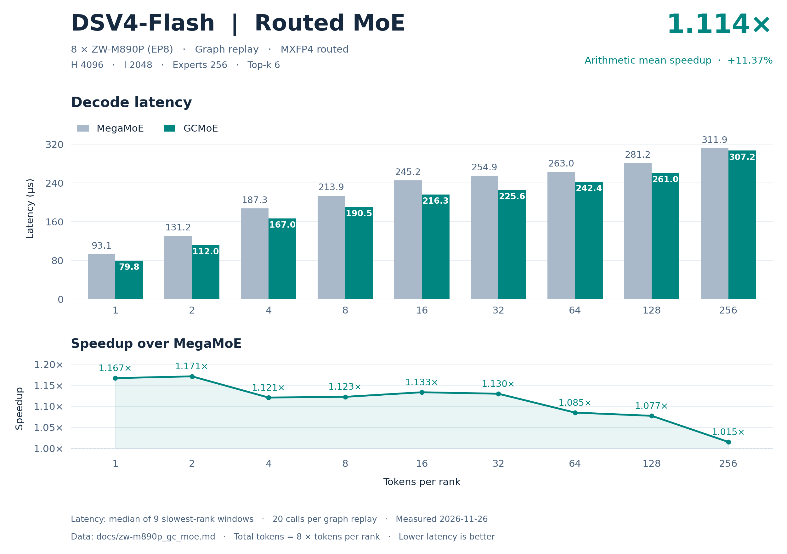
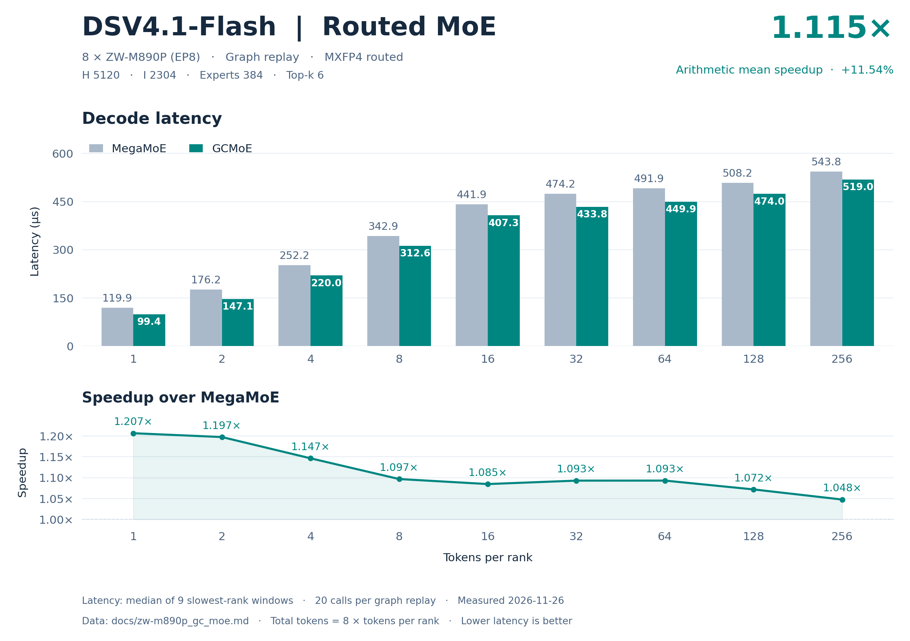

# ZW-M890P 八卡 GC MoE 精度与 decode 性能

两个模型的 default、boundary、asymmetric 全部通过，共 214/214 个 case、1712/1712 项 rank 检查。对独立参考的最大绝对误差为 **0**。

18 个 decode 点中 18/18 点 GC 延迟低于 DeepGEMM MegaMoE。逐点等权平均加速 **1.114551×**，平均加速收益 **11.4551%**，单点范围 1.015405×–1.206555×。

| 模型 | decode 点数 | 平均 Mega / GC | 平均加速收益 | 平均延迟下降 |
| --- | --- | --- | --- | --- |
| dsv4-flash | 9 | 1.113717× | 11.3717% | 10.0541% |
| dsv4.1-flash | 9 | 1.115385× | 11.5385% | 10.1525% |
| 全部模型等权 | 18 | 1.114551× | 11.4551% | 10.1033% |

平均加速比为 `mean(Mega_us / GC_us)`，每模型 9 点等权，总计 18 点等权。平均延迟下降为 `mean(1 − GC_us / Mega_us)`。

## 模型与数据口径

2026-11-26，GC MoE 0.7.0，8 × ZW-M890P（EP8），Sail SDK `2.2.0-663c22`，Sail PyTorch `2.10.0`，graph replay。基线使用 DeepGEMM-for-sail `1.1.0.dev23+v1.1.0.ppu2.2.0.gfce444f0`。[DeepGEMM-for-sail 版本](https://github.com/t-head/DeepGEMM-for-sail/commit/fce444f08616fec5ca7cc7745c86a820899c56aa)

| 模型 | H | I | routed experts | top-k |
| --- | --- | --- | --- | --- |
| dsv4-flash | 4096 | 2048 | 256 | 6 |
| dsv4.1-flash | 5120 | 2304 | 384 | 6 |

Routed 使用 MXFP4 激活和权重、K32 UE8M0 scale 和 BF16 输出。SwiGLU clamp=10，每 rank 容量 256，总 token=8T。

延迟单位为 µs。预热 20 次，每个计时窗口重放含 20 次调用的 graph，取 8 个 rank 中最大的单次平均延迟，再对 9 个窗口取中位数。Mega 计时包含 `mega_moe_pre_dispatch`。GC 从 workspace 输入就绪后计时。

## 精度

独立参考使用 DeepGEMM masked MXFP4 grouped GEMM。GC 按 BF16 逐元素相等验收。default 使用 eager，boundary 和 asymmetric 在 side stream 上以 graph replay 验证两轮交替输入和路由掩码。MegaMoE 通过计数按输出有限性统计，全局空批仅计 GC。表中 cosine 取各 rank 最小值，绝对差取各 rank 最大值。

| 模型 | 类别 | 算子 | case 通过 | rank 检查通过 | 最小参考 cosine | 阈值 | finite |
| --- | --- | --- | --- | --- | --- | --- | --- |
| dsv4-flash | default | MegaMoE | 9/9 | 72/72 | 0.960197739 | — | 全部通过 |
| dsv4-flash | default | GCMoE | 9/9 | 72/72 | 1.000000000 | 绝对误差 0 | 全部通过 |
| dsv4-flash | boundary | MegaMoE | 92/92 | 736/736 | 0.958419479 | — | 全部通过 |
| dsv4-flash | boundary | GCMoE | 94/94 | 752/752 | 1.000000000 | 绝对误差 0 | 全部通过 |
| dsv4-flash | asymmetric | MegaMoE | 4/4 | 32/32 | 0.959828346 | — | 全部通过 |
| dsv4-flash | asymmetric | GCMoE | 4/4 | 32/32 | 1.000000000 | 绝对误差 0 | 全部通过 |
| dsv4.1-flash | default | MegaMoE | 9/9 | 72/72 | 0.958343234 | — | 全部通过 |
| dsv4.1-flash | default | GCMoE | 9/9 | 72/72 | 1.000000000 | 绝对误差 0 | 全部通过 |
| dsv4.1-flash | boundary | MegaMoE | 92/92 | 736/736 | 0.958868609 | — | 全部通过 |
| dsv4.1-flash | boundary | GCMoE | 94/94 | 752/752 | 1.000000000 | 绝对误差 0 | 全部通过 |
| dsv4.1-flash | asymmetric | MegaMoE | 4/4 | 32/32 | 0.958868609 | — | 全部通过 |
| dsv4.1-flash | asymmetric | GCMoE | 4/4 | 32/32 | 1.000000000 | 绝对误差 0 | 全部通过 |

| 模型 | 类别 | 最小 GC/Mega cosine | 最大 \|GC−Mega\| |
| --- | --- | --- | --- |
| dsv4-flash | default | 0.960197739 | 0.006477 |
| dsv4-flash | boundary | 0.958419479 | 0.006477 |
| dsv4-flash | asymmetric | 0.959828346 | 0.005424 |
| dsv4.1-flash | default | 0.958343234 | 0.008179 |
| dsv4.1-flash | boundary | 0.958868609 | 0.007904 |
| dsv4.1-flash | asymmetric | 0.958868609 | 0.006531 |

### dsv4-flash：default 逐组精度

| T/rank 或各 rank token 向量 | 最小 Mega/ref cosine | 最小 GC/ref cosine | 最小 GC/Mega cosine | 最大 \|GC−Mega\| | 结果 |
| --- | --- | --- | --- | --- | --- |
| 1 | 0.960210072 | 1.000000000 | 0.960210072 | 0.004059 | 通过 |
| 2 | 0.960197739 | 1.000000000 | 0.960197739 | 0.004059 | 通过 |
| 4 | 0.961044241 | 1.000000000 | 0.961044241 | 0.004387 | 通过 |
| 8 | 0.961285954 | 1.000000000 | 0.961285954 | 0.004612 | 通过 |
| 16 | 0.962205658 | 1.000000000 | 0.962205658 | 0.004677 | 通过 |
| 32 | 0.962605629 | 1.000000000 | 0.962605629 | 0.004959 | 通过 |
| 64 | 0.962740425 | 1.000000000 | 0.962740425 | 0.005363 | 通过 |
| 128 | 0.962783430 | 1.000000000 | 0.962783430 | 0.006477 | 通过 |
| 256 | 0.962772070 | 1.000000000 | 0.962772070 | 0.006477 | 通过 |

### dsv4-flash：boundary 逐组精度

| T/rank 或各 rank token 向量 | 最小 Mega/ref cosine | 最小 GC/ref cosine | 最小 GC/Mega cosine | 最大 \|GC−Mega\| | 结果 |
| --- | --- | --- | --- | --- | --- |
| 0 | — | 1.000000000 | — | — | 通过 |
| 1 | 0.958419479 | 1.000000000 | 0.958419479 | 0.004074 | 通过 |
| 7 | 0.960533303 | 1.000000000 | 0.960533303 | 0.005173 | 通过 |
| 8 | 0.960835640 | 1.000000000 | 0.960835640 | 0.005173 | 通过 |
| 15 | 0.961610982 | 1.000000000 | 0.961610982 | 0.005173 | 通过 |
| 16 | 0.961731821 | 1.000000000 | 0.961731821 | 0.005173 | 通过 |
| 17 | 0.961880965 | 1.000000000 | 0.961880965 | 0.005173 | 通过 |
| 21 | 0.961868423 | 1.000000000 | 0.961868423 | 0.005173 | 通过 |
| 22 | 0.961786541 | 1.000000000 | 0.961786541 | 0.005173 | 通过 |
| 31 | 0.962227777 | 1.000000000 | 0.962227777 | 0.005173 | 通过 |
| 32 | 0.962193392 | 1.000000000 | 0.962193392 | 0.005173 | 通过 |
| 33 | 0.962207382 | 1.000000000 | 0.962207382 | 0.005173 | 通过 |
| 42 | 0.962627388 | 1.000000000 | 0.962627388 | 0.005188 | 通过 |
| 43 | 0.962586807 | 1.000000000 | 0.962586807 | 0.005188 | 通过 |
| 63 | 0.962336220 | 1.000000000 | 0.962336220 | 0.005188 | 通过 |
| 64 | 0.962370047 | 1.000000000 | 0.962370047 | 0.005188 | 通过 |
| 65 | 0.962340361 | 1.000000000 | 0.962340361 | 0.005188 | 通过 |
| 71 | 0.962456332 | 1.000000000 | 0.962456332 | 0.006477 | 通过 |
| 72 | 0.962425821 | 1.000000000 | 0.962425821 | 0.006477 | 通过 |
| 73 | 0.962386116 | 1.000000000 | 0.962386116 | 0.006477 | 通过 |
| 85 | 0.962401289 | 1.000000000 | 0.962401289 | 0.006477 | 通过 |
| 86 | 0.962428575 | 1.000000000 | 0.962428575 | 0.006477 | 通过 |
| 87 | 0.962418020 | 1.000000000 | 0.962418020 | 0.006477 | 通过 |
| 106 | 0.962501421 | 1.000000000 | 0.962501421 | 0.006477 | 通过 |
| 107 | 0.962536872 | 1.000000000 | 0.962536872 | 0.006477 | 通过 |
| 108 | 0.962534935 | 1.000000000 | 0.962534935 | 0.006477 | 通过 |
| 127 | 0.962588206 | 1.000000000 | 0.962588206 | 0.006477 | 通过 |
| 128 | 0.962581772 | 1.000000000 | 0.962581772 | 0.006477 | 通过 |
| 129 | 0.962600169 | 1.000000000 | 0.962600169 | 0.006477 | 通过 |
| 154 | 0.962718463 | 1.000000000 | 0.962718463 | 0.006477 | 通过 |
| 155 | 0.962733853 | 1.000000000 | 0.962733853 | 0.006477 | 通过 |
| 156 | 0.962742947 | 1.000000000 | 0.962742947 | 0.006477 | 通过 |
| 169 | 0.962741445 | 1.000000000 | 0.962741445 | 0.006477 | 通过 |
| 170 | 0.962703195 | 1.000000000 | 0.962703195 | 0.006477 | 通过 |
| 171 | 0.962708867 | 1.000000000 | 0.962708867 | 0.006477 | 通过 |
| 172 | 0.962698374 | 1.000000000 | 0.962698374 | 0.006477 | 通过 |
| 218 | 0.962723461 | 1.000000000 | 0.962723461 | 0.006477 | 通过 |
| 219 | 0.962754580 | 1.000000000 | 0.962754580 | 0.006477 | 通过 |
| 220 | 0.962748921 | 1.000000000 | 0.962748921 | 0.006477 | 通过 |
| 231 | 0.962747585 | 1.000000000 | 0.962747585 | 0.006477 | 通过 |
| 232 | 0.962744307 | 1.000000000 | 0.962744307 | 0.006477 | 通过 |
| 233 | 0.962767912 | 1.000000000 | 0.962767912 | 0.006477 | 通过 |
| 245 | 0.962734901 | 1.000000000 | 0.962734901 | 0.006477 | 通过 |
| 246 | 0.962739850 | 1.000000000 | 0.962739850 | 0.006477 | 通过 |
| 247 | 0.962744918 | 1.000000000 | 0.962744918 | 0.006477 | 通过 |
| 255 | 0.962754333 | 1.000000000 | 0.962754333 | 0.006477 | 通过 |
| 256 | 0.962760093 | 1.000000000 | 0.962760093 | 0.006477 | 通过 |

### dsv4-flash：asymmetric 逐组精度

| T/rank 或各 rank token 向量 | 最小 Mega/ref cosine | 最小 GC/ref cosine | 最小 GC/Mega cosine | 最大 \|GC−Mega\| | 结果 |
| --- | --- | --- | --- | --- | --- |
| [1, 2, 3, 4, 5, 6, 7, 8] | 0.959828346 | 1.000000000 | 0.959828346 | 0.005173 | 通过 |
| [256, 0, 0, 0, 0, 0, 0, 0] | 0.963260160 | 1.000000000 | 0.963260160 | 0.005424 | 通过 |

### dsv4.1-flash：default 逐组精度

| T/rank 或各 rank token 向量 | 最小 Mega/ref cosine | 最小 GC/ref cosine | 最小 GC/Mega cosine | 最大 \|GC−Mega\| | 结果 |
| --- | --- | --- | --- | --- | --- |
| 1 | 0.958343234 | 1.000000000 | 0.958343234 | 0.005772 | 通过 |
| 2 | 0.961021409 | 1.000000000 | 0.961021409 | 0.006428 | 通过 |
| 4 | 0.961320674 | 1.000000000 | 0.961320674 | 0.006428 | 通过 |
| 8 | 0.961891451 | 1.000000000 | 0.961891451 | 0.006428 | 通过 |
| 16 | 0.962294950 | 1.000000000 | 0.962294950 | 0.006428 | 通过 |
| 32 | 0.962449113 | 1.000000000 | 0.962449113 | 0.006500 | 通过 |
| 64 | 0.962573900 | 1.000000000 | 0.962573900 | 0.008179 | 通过 |
| 128 | 0.962647752 | 1.000000000 | 0.962647752 | 0.008179 | 通过 |
| 256 | 0.962764648 | 1.000000000 | 0.962764648 | 0.008179 | 通过 |

### dsv4.1-flash：boundary 逐组精度

| T/rank 或各 rank token 向量 | 最小 Mega/ref cosine | 最小 GC/ref cosine | 最小 GC/Mega cosine | 最大 \|GC−Mega\| | 结果 |
| --- | --- | --- | --- | --- | --- |
| 0 | — | 1.000000000 | — | — | 通过 |
| 1 | 0.958868609 | 1.000000000 | 0.958868609 | 0.005043 | 通过 |
| 7 | 0.961751659 | 1.000000000 | 0.961751659 | 0.006428 | 通过 |
| 8 | 0.962194303 | 1.000000000 | 0.962194303 | 0.006428 | 通过 |
| 15 | 0.962502980 | 1.000000000 | 0.962502980 | 0.006428 | 通过 |
| 16 | 0.962360680 | 1.000000000 | 0.962360680 | 0.006428 | 通过 |
| 17 | 0.962449460 | 1.000000000 | 0.962449460 | 0.006428 | 通过 |
| 21 | 0.962310123 | 1.000000000 | 0.962310123 | 0.006428 | 通过 |
| 22 | 0.962474041 | 1.000000000 | 0.962474041 | 0.006428 | 通过 |
| 31 | 0.962469779 | 1.000000000 | 0.962469779 | 0.006428 | 通过 |
| 32 | 0.962446124 | 1.000000000 | 0.962446124 | 0.006428 | 通过 |
| 33 | 0.962478619 | 1.000000000 | 0.962478619 | 0.006428 | 通过 |
| 42 | 0.962325309 | 1.000000000 | 0.962325309 | 0.006428 | 通过 |
| 43 | 0.962299709 | 1.000000000 | 0.962299709 | 0.006428 | 通过 |
| 63 | 0.962464690 | 1.000000000 | 0.962464690 | 0.007904 | 通过 |
| 64 | 0.962474437 | 1.000000000 | 0.962474437 | 0.007904 | 通过 |
| 65 | 0.962518152 | 1.000000000 | 0.962518152 | 0.007904 | 通过 |
| 71 | 0.962657144 | 1.000000000 | 0.962657144 | 0.007904 | 通过 |
| 72 | 0.962559121 | 1.000000000 | 0.962559121 | 0.007904 | 通过 |
| 73 | 0.962563788 | 1.000000000 | 0.962563788 | 0.007904 | 通过 |
| 85 | 0.962538811 | 1.000000000 | 0.962538811 | 0.007904 | 通过 |
| 86 | 0.962545534 | 1.000000000 | 0.962545534 | 0.007904 | 通过 |
| 87 | 0.962543178 | 1.000000000 | 0.962543178 | 0.007904 | 通过 |
| 106 | 0.962616569 | 1.000000000 | 0.962616569 | 0.007904 | 通过 |
| 107 | 0.962630255 | 1.000000000 | 0.962630255 | 0.007904 | 通过 |
| 108 | 0.962528482 | 1.000000000 | 0.962528482 | 0.007904 | 通过 |
| 127 | 0.962546865 | 1.000000000 | 0.962546865 | 0.007904 | 通过 |
| 128 | 0.962553124 | 1.000000000 | 0.962553124 | 0.007904 | 通过 |
| 129 | 0.962540732 | 1.000000000 | 0.962540732 | 0.007904 | 通过 |
| 154 | 0.962625273 | 1.000000000 | 0.962625273 | 0.007904 | 通过 |
| 155 | 0.962598305 | 1.000000000 | 0.962598305 | 0.007904 | 通过 |
| 156 | 0.962607989 | 1.000000000 | 0.962607989 | 0.007904 | 通过 |
| 169 | 0.962673008 | 1.000000000 | 0.962673008 | 0.007904 | 通过 |
| 170 | 0.962697775 | 1.000000000 | 0.962697775 | 0.007904 | 通过 |
| 171 | 0.962717278 | 1.000000000 | 0.962717278 | 0.007904 | 通过 |
| 172 | 0.962727478 | 1.000000000 | 0.962727478 | 0.007904 | 通过 |
| 218 | 0.962673111 | 1.000000000 | 0.962673111 | 0.007904 | 通过 |
| 219 | 0.962675724 | 1.000000000 | 0.962675724 | 0.007904 | 通过 |
| 220 | 0.962671472 | 1.000000000 | 0.962671472 | 0.007904 | 通过 |
| 231 | 0.962749658 | 1.000000000 | 0.962749658 | 0.007904 | 通过 |
| 232 | 0.962752895 | 1.000000000 | 0.962752895 | 0.007904 | 通过 |
| 233 | 0.962743232 | 1.000000000 | 0.962743232 | 0.007904 | 通过 |
| 245 | 0.962721760 | 1.000000000 | 0.962721760 | 0.007904 | 通过 |
| 246 | 0.962722048 | 1.000000000 | 0.962722048 | 0.007904 | 通过 |
| 247 | 0.962732485 | 1.000000000 | 0.962732485 | 0.007904 | 通过 |
| 255 | 0.962723045 | 1.000000000 | 0.962723045 | 0.007904 | 通过 |
| 256 | 0.962734283 | 1.000000000 | 0.962734283 | 0.007904 | 通过 |

### dsv4.1-flash：asymmetric 逐组精度

| T/rank 或各 rank token 向量 | 最小 Mega/ref cosine | 最小 GC/ref cosine | 最小 GC/Mega cosine | 最大 \|GC−Mega\| | 结果 |
| --- | --- | --- | --- | --- | --- |
| [1, 2, 3, 4, 5, 6, 7, 8] | 0.958868609 | 1.000000000 | 0.958868609 | 0.006428 | 通过 |
| [256, 0, 0, 0, 0, 0, 0, 0] | 0.963084682 | 1.000000000 | 0.963084682 | 0.006531 | 通过 |

## dsv4-flash decode 性能

| T/rank | 总 token | Mega µs | GC µs | Mega / GC | 延迟下降 |
| --- | --- | --- | --- | --- | --- |
| 1 | 8 | 93.111002 | 79.780501 | 1.167090× | 14.3168% |
| 2 | 16 | 131.179500 | 111.991000 | 1.171340× | 14.6277% |
| 4 | 32 | 187.252498 | 167.048502 | 1.120947× | 10.7897% |
| 8 | 64 | 213.879991 | 190.518498 | 1.122621× | 10.9227% |
| 16 | 128 | 245.177507 | 216.302490 | 1.133494× | 11.7772% |
| 32 | 256 | 254.947495 | 225.627494 | 1.129949× | 11.5004% |
| 64 | 512 | 263.044500 | 242.410994 | 1.085118× | 7.8441% |
| 128 | 1024 | 281.206489 | 260.983491 | 1.077488× | 7.1915% |
| 256 | 2048 | 311.934996 | 307.202506 | 1.015405× | 1.5171% |

## dsv4.1-flash decode 性能

| T/rank | 总 token | Mega µs | GC µs | Mega / GC | 延迟下降 |
| --- | --- | --- | --- | --- | --- |
| 1 | 8 | 119.893003 | 99.368000 | 1.206555× | 17.1194% |
| 2 | 16 | 176.181996 | 147.134995 | 1.197417× | 16.4869% |
| 4 | 32 | 252.238488 | 220.003009 | 1.146523× | 12.7798% |
| 8 | 64 | 342.919493 | 312.627006 | 1.096897× | 8.8337% |
| 16 | 128 | 441.854477 | 407.279015 | 1.084894× | 7.8251% |
| 32 | 256 | 474.200487 | 433.813477 | 1.093098× | 8.5169% |
| 64 | 512 | 491.872978 | 449.943018 | 1.093189× | 8.5246% |
| 128 | 1024 | 508.183002 | 474.032497 | 1.072043× | 6.7201% |
| 256 | 2048 | 543.826008 | 518.993998 | 1.047846× | 4.5662% |

## 有效 HBM 带宽

以各命中 routed expert 的 MXFP4 权重和 K32 scale 工作集各计一次。每 expert 为 `3 × H × I × (1/2 + 1/32)` 字节。带宽按逻辑权重工作集估算，单位为十进制 GB/s。

### dsv4-flash

| T/rank | Mega 全8卡合计 | GC 全8卡合计 | Mega 每 PPU 均值 | GC 每 PPU 均值 |
| --- | --- | --- | --- | --- |
| 1 | 6461.325 | 7540.946 | 807.666 | 942.618 |
| 2 | 8153.313 | 9550.299 | 1019.164 | 1193.787 |
| 4 | 10209.830 | 11444.677 | 1276.229 | 1430.585 |
| 8 | 12626.742 | 14175.041 | 1578.343 | 1771.880 |
| 16 | 13087.018 | 14834.053 | 1635.877 | 1854.257 |
| 32 | 13372.097 | 15109.784 | 1671.512 | 1888.723 |
| 64 | 13011.304 | 14118.799 | 1626.413 | 1764.850 |
| 128 | 12170.957 | 13114.056 | 1521.370 | 1639.257 |
| 256 | 10972.004 | 11141.029 | 1371.501 | 1392.629 |

### dsv4.1-flash

| T/rank | Mega 全8卡合计 | GC 全8卡合计 | Mega 每 PPU 均值 | GC 每 PPU 均值 |
| --- | --- | --- | --- | --- |
| 1 | 7213.344 | 8703.299 | 901.668 | 1087.912 |
| 2 | 8536.918 | 10222.253 | 1067.115 | 1277.782 |
| 4 | 11329.347 | 12989.355 | 1416.168 | 1623.669 |
| 8 | 13596.657 | 14914.127 | 1699.582 | 1864.266 |
| 16 | 14168.948 | 15371.804 | 1771.119 | 1921.475 |
| 32 | 15065.871 | 16468.468 | 1883.234 | 2058.558 |
| 64 | 14677.460 | 16045.245 | 1834.682 | 2005.656 |
| 128 | 14206.390 | 15229.854 | 1775.799 | 1903.732 |
| 256 | 13275.286 | 13910.461 | 1659.411 | 1738.808 |

## 有效卡间载荷带宽

有效卡间载荷按 `remote_assignments × (H/2 + H/32 + 2H)` 字节估算，包含 MXFP4 激活、K32 scale 和 BF16 返回值。每份载荷计一次，单位为十进制 GB/s。

### dsv4-flash

| T/rank | Mega 全8卡合计 | GC 全8卡合计 | Mega 每 PPU 均值 | GC 每 PPU 均值 |
| --- | --- | --- | --- | --- |
| 1 | 4.899 | 5.718 | 0.612 | 0.715 |
| 2 | 7.192 | 8.425 | 0.899 | 1.053 |
| 4 | 9.800 | 10.986 | 1.225 | 1.373 |
| 8 | 16.870 | 18.938 | 2.109 | 2.367 |
| 16 | 29.305 | 33.217 | 3.663 | 4.152 |
| 32 | 56.202 | 63.505 | 7.025 | 7.938 |
| 64 | 107.880 | 117.062 | 13.485 | 14.633 |
| 128 | 200.055 | 215.557 | 25.007 | 26.945 |
| 256 | 360.330 | 365.881 | 45.041 | 45.735 |

### dsv4.1-flash

| T/rank | Mega 全8卡合计 | GC 全8卡合计 | Mega 每 PPU 均值 | GC 每 PPU 均值 |
| --- | --- | --- | --- | --- |
| 1 | 4.432 | 5.347 | 0.554 | 0.668 |
| 2 | 6.106 | 7.311 | 0.763 | 0.914 |
| 4 | 8.426 | 9.661 | 1.053 | 1.208 |
| 8 | 12.774 | 14.012 | 1.597 | 1.751 |
| 16 | 19.241 | 20.875 | 2.405 | 2.609 |
| 32 | 35.939 | 39.285 | 4.492 | 4.911 |
| 64 | 70.350 | 76.906 | 8.794 | 9.613 |
| 128 | 136.490 | 146.323 | 17.061 | 18.290 |
| 256 | 255.470 | 267.693 | 31.934 | 33.462 |

## 有效矩阵计算吞吐

有效 FLOP 为 `6 × routed_assignments × H × I`。只计有效矩阵乘加，单位为 TFLOPS（10¹² FLOP/s）。

### dsv4-flash

| T/rank | Mega 全8卡合计 | GC 全8卡合计 | Mega 每 PPU 均值 | GC 每 PPU 均值 |
| --- | --- | --- | --- | --- |
| 1 | 25.947 | 30.282 | 3.243 | 3.785 |
| 2 | 36.834 | 43.145 | 4.604 | 5.393 |
| 4 | 51.608 | 57.850 | 6.451 | 7.231 |
| 8 | 90.365 | 101.446 | 11.296 | 12.681 |
| 16 | 157.660 | 178.707 | 19.708 | 22.338 |
| 32 | 303.237 | 342.642 | 37.905 | 42.830 |
| 64 | 587.805 | 637.838 | 73.476 | 79.730 |
| 128 | 1099.682 | 1184.894 | 137.460 | 148.112 |
| 256 | 1982.706 | 2013.249 | 247.838 | 251.656 |

### dsv4.1-flash

| T/rank | Mega 全8卡合计 | GC 全8卡合计 | Mega 每 PPU 均值 | GC 每 PPU 均值 |
| --- | --- | --- | --- | --- |
| 1 | 28.337 | 34.190 | 3.542 | 4.274 |
| 2 | 38.567 | 46.181 | 4.821 | 5.773 |
| 4 | 53.876 | 61.770 | 6.734 | 7.721 |
| 8 | 79.258 | 86.938 | 9.907 | 10.867 |
| 16 | 123.023 | 133.467 | 15.378 | 16.683 |
| 32 | 229.262 | 250.606 | 28.658 | 31.326 |
| 64 | 442.051 | 483.245 | 55.256 | 60.406 |
| 128 | 855.726 | 917.375 | 106.966 | 114.672 |
| 256 | 1599.282 | 1675.801 | 199.910 | 209.475 |

三项指标使用各算子的同一 graph 延迟和相同有效工作量。全 8 卡合计为全工作量除以该延迟，每 PPU 均值为合计除以 8。
