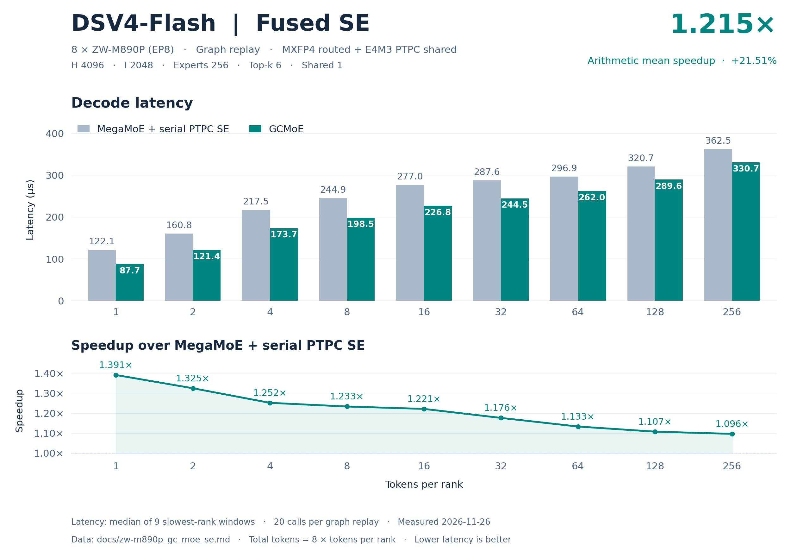
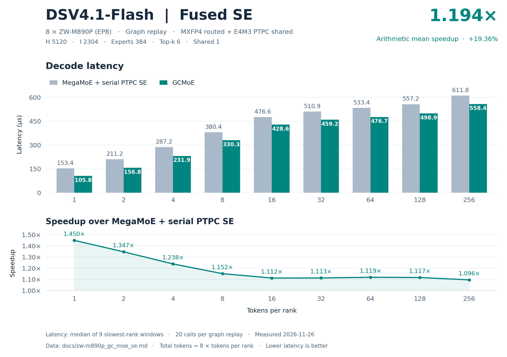

# ZW-M890P 八卡 GC MoE SE 精度与 decode 性能

两个模型的 default、boundary、asymmetric 全部通过，共 214/214 个 case、1712/1712 项 rank 检查。对独立参考的最大绝对误差为 **0**。

18 个 decode 点中 18/18 点 GC 延迟低于 DeepGEMM MegaMoE + 串行 PTPC SE。逐点等权平均加速 **1.204368×**，平均加速收益 **20.4368%**，单点范围 1.095625×–1.449670×。

| 模型 | decode 点数 | 平均 Mega / GC | 平均加速收益 | 平均延迟下降 |
| --- | --- | --- | --- | --- |
| dsv4-flash | 9 | 1.215102× | 21.5102% | 17.2253% |
| dsv4.1-flash | 9 | 1.193633× | 19.3633% | 15.4677% |
| 全部模型等权 | 18 | 1.204368× | 20.4368% | 16.3465% |

平均加速比为 `mean(Mega_us / GC_us)`，每模型 9 点等权，总计 18 点等权。平均延迟下降为 `mean(1 − GC_us / Mega_us)`。

## 模型与数据口径

2026-11-26，GC MoE 0.7.0，8 × ZW-M890P（EP8），Sail SDK `2.2.0-663c22`，Sail PyTorch `2.10.0`，graph replay。基线使用 DeepGEMM-for-sail `1.1.0.dev23+v1.1.0.ppu2.2.0.gfce444f0`。[DeepGEMM-for-sail 版本](https://github.com/t-head/DeepGEMM-for-sail/commit/fce444f08616fec5ca7cc7745c86a820899c56aa)

| 模型 | H | I | routed experts | top-k | shared experts | shared recipe |
| --- | --- | --- | --- | --- | --- | --- |
| dsv4-flash | 4096 | 2048 | 256 | 6 | 1 | PTPC |
| dsv4.1-flash | 5120 | 2304 | 384 | 6 | 1 | PTPC |

Routed 使用 MXFP4 激活和权重、K32 UE8M0 scale 和 BF16 输出。SE 使用 E4M3 激活和权重，FP32 per-token 激活 scale 和 per-channel 权重 scale。SwiGLU clamp=10，每 rank 容量 256，总 token=8T。

延迟单位为 µs。预热 20 次，每个计时窗口重放含 20 次调用的 graph，取 8 个 rank 中最大的单次平均延迟，再对 9 个窗口取中位数。Mega 计时包含 `mega_moe_pre_dispatch`、MegaMoE routed、串行 PTPC SE 和 BF16 输出相加。串行 PTPC SE 使用两次 DeepGEMM FP8 GEMM，中间由单个 HGGC kernel 完成 SwiGLU 和逐 token E4M3 量化。GC 从 workspace 输入就绪后计时。

## 精度

独立参考使用 DeepGEMM masked MXFP4 grouped GEMM 和 PTPC GEMM。GC 按 BF16 逐元素相等验收。default 使用 eager，boundary 和 asymmetric 在 side stream 上以 graph replay 验证两轮交替输入和路由掩码。MegaMoE 通过计数按输出有限性统计，全局空批仅计 GC。表中 cosine 取各 rank 最小值，绝对差取各 rank 最大值。Shared cosine 比较融合输出减去 routed 输出的残差和独立 shared 输出。

| 模型 | 类别 | 算子 | case 通过 | rank 检查通过 | 最小参考 cosine | 阈值 | finite |
| --- | --- | --- | --- | --- | --- | --- | --- |
| dsv4-flash | default | MegaMoE | 9/9 | 72/72 | 0.991340448 | — | 全部通过 |
| dsv4-flash | default | GCMoE | 9/9 | 72/72 | 1.000000000 | 绝对误差 0 | 全部通过 |
| dsv4-flash | boundary | MegaMoE | 92/92 | 736/736 | 0.992821535 | — | 全部通过 |
| dsv4-flash | boundary | GCMoE | 94/94 | 752/752 | 1.000000000 | 绝对误差 0 | 全部通过 |
| dsv4-flash | asymmetric | MegaMoE | 4/4 | 32/32 | 0.993737593 | — | 全部通过 |
| dsv4-flash | asymmetric | GCMoE | 4/4 | 32/32 | 1.000000000 | 绝对误差 0 | 全部通过 |
| dsv4.1-flash | default | MegaMoE | 9/9 | 72/72 | 0.991616042 | — | 全部通过 |
| dsv4.1-flash | default | GCMoE | 9/9 | 72/72 | 1.000000000 | 绝对误差 0 | 全部通过 |
| dsv4.1-flash | boundary | MegaMoE | 92/92 | 736/736 | 0.992234758 | — | 全部通过 |
| dsv4.1-flash | boundary | GCMoE | 94/94 | 752/752 | 1.000000000 | 绝对误差 0 | 全部通过 |
| dsv4.1-flash | asymmetric | MegaMoE | 4/4 | 32/32 | 0.993211208 | — | 全部通过 |
| dsv4.1-flash | asymmetric | GCMoE | 4/4 | 32/32 | 1.000000000 | 绝对误差 0 | 全部通过 |

| 模型 | 类别 | 最小 GC/Mega cosine | 最大 \|GC−Mega\| | 最小 Mega shared cosine | 最小 GC shared cosine |
| --- | --- | --- | --- | --- | --- |
| dsv4-flash | default | 0.991340448 | 0.006470 | 0.999997874 | 0.999997899 |
| dsv4-flash | boundary | 0.992821535 | 0.006470 | 0.999998019 | 0.999998057 |
| dsv4-flash | asymmetric | 0.993737593 | 0.005432 | 0.999998132 | 0.999998125 |
| dsv4.1-flash | default | 0.991616042 | 0.008163 | 0.999997903 | 0.999997861 |
| dsv4.1-flash | boundary | 0.992234758 | 0.007904 | 0.999997846 | 0.999997965 |
| dsv4.1-flash | asymmetric | 0.993211208 | 0.006531 | 0.999998120 | 0.999998116 |

### dsv4-flash：default 逐组精度

| T/rank 或各 rank token 向量 | 最小 Mega/ref cosine | 最小 GC/ref cosine | 最小 GC/Mega cosine | 最大 \|GC−Mega\| | 结果 |
| --- | --- | --- | --- | --- | --- |
| 1 | 0.991340448 | 1.000000000 | 0.991340448 | 0.004059 | 通过 |
| 2 | 0.992435038 | 1.000000000 | 0.992435038 | 0.004059 | 通过 |
| 4 | 0.992551033 | 1.000000000 | 0.992551033 | 0.004395 | 通过 |
| 8 | 0.992603680 | 1.000000000 | 0.992603680 | 0.004623 | 通过 |
| 16 | 0.992691870 | 1.000000000 | 0.992691870 | 0.004662 | 通过 |
| 32 | 0.993167390 | 1.000000000 | 0.993167390 | 0.004944 | 通过 |
| 64 | 0.993072326 | 1.000000000 | 0.993072326 | 0.005379 | 通过 |
| 128 | 0.993186935 | 1.000000000 | 0.993186935 | 0.006470 | 通过 |
| 256 | 0.993197917 | 1.000000000 | 0.993197917 | 0.006470 | 通过 |

### dsv4-flash：boundary 逐组精度

| T/rank 或各 rank token 向量 | 最小 Mega/ref cosine | 最小 GC/ref cosine | 最小 GC/Mega cosine | 最大 \|GC−Mega\| | 结果 |
| --- | --- | --- | --- | --- | --- |
| 0 | — | 1.000000000 | — | — | 通过 |
| 1 | 0.992821535 | 1.000000000 | 0.992821535 | 0.004074 | 通过 |
| 7 | 0.993691098 | 1.000000000 | 0.993691098 | 0.005249 | 通过 |
| 8 | 0.993574215 | 1.000000000 | 0.993574215 | 0.005249 | 通过 |
| 15 | 0.993786134 | 1.000000000 | 0.993786134 | 0.005249 | 通过 |
| 16 | 0.993852378 | 1.000000000 | 0.993852378 | 0.005249 | 通过 |
| 17 | 0.993970635 | 1.000000000 | 0.993970635 | 0.005249 | 通过 |
| 21 | 0.993946002 | 1.000000000 | 0.993946002 | 0.005249 | 通过 |
| 22 | 0.994041165 | 1.000000000 | 0.994041165 | 0.005249 | 通过 |
| 31 | 0.994202731 | 1.000000000 | 0.994202731 | 0.005249 | 通过 |
| 32 | 0.994163305 | 1.000000000 | 0.994163305 | 0.005249 | 通过 |
| 33 | 0.994043176 | 1.000000000 | 0.994043176 | 0.005249 | 通过 |
| 42 | 0.993997971 | 1.000000000 | 0.993997971 | 0.005249 | 通过 |
| 43 | 0.994091737 | 1.000000000 | 0.994091737 | 0.005249 | 通过 |
| 63 | 0.994020257 | 1.000000000 | 0.994020257 | 0.005249 | 通过 |
| 64 | 0.994053500 | 1.000000000 | 0.994053500 | 0.005249 | 通过 |
| 65 | 0.994026005 | 1.000000000 | 0.994026005 | 0.005249 | 通过 |
| 71 | 0.994037694 | 1.000000000 | 0.994037694 | 0.006470 | 通过 |
| 72 | 0.994029510 | 1.000000000 | 0.994029510 | 0.006470 | 通过 |
| 73 | 0.994074740 | 1.000000000 | 0.994074740 | 0.006470 | 通过 |
| 85 | 0.994233975 | 1.000000000 | 0.994233975 | 0.006470 | 通过 |
| 86 | 0.994233143 | 1.000000000 | 0.994233143 | 0.006470 | 通过 |
| 87 | 0.994250224 | 1.000000000 | 0.994250224 | 0.006470 | 通过 |
| 106 | 0.994263619 | 1.000000000 | 0.994263619 | 0.006470 | 通过 |
| 107 | 0.994287145 | 1.000000000 | 0.994287145 | 0.006470 | 通过 |
| 108 | 0.994291863 | 1.000000000 | 0.994291863 | 0.006470 | 通过 |
| 127 | 0.994393866 | 1.000000000 | 0.994393866 | 0.006470 | 通过 |
| 128 | 0.994382210 | 1.000000000 | 0.994382210 | 0.006470 | 通过 |
| 129 | 0.994395551 | 1.000000000 | 0.994395551 | 0.006470 | 通过 |
| 154 | 0.994405951 | 1.000000000 | 0.994405951 | 0.006470 | 通过 |
| 155 | 0.994402413 | 1.000000000 | 0.994402413 | 0.006470 | 通过 |
| 156 | 0.994417158 | 1.000000000 | 0.994417158 | 0.006470 | 通过 |
| 169 | 0.994389022 | 1.000000000 | 0.994389022 | 0.006470 | 通过 |
| 170 | 0.994390318 | 1.000000000 | 0.994390318 | 0.006470 | 通过 |
| 171 | 0.994389083 | 1.000000000 | 0.994389083 | 0.006470 | 通过 |
| 172 | 0.994404459 | 1.000000000 | 0.994404459 | 0.006470 | 通过 |
| 218 | 0.994449423 | 1.000000000 | 0.994449423 | 0.006470 | 通过 |
| 219 | 0.994453528 | 1.000000000 | 0.994453528 | 0.006470 | 通过 |
| 220 | 0.994442976 | 1.000000000 | 0.994442976 | 0.006470 | 通过 |
| 231 | 0.994445637 | 1.000000000 | 0.994445637 | 0.006470 | 通过 |
| 232 | 0.994446752 | 1.000000000 | 0.994446752 | 0.006470 | 通过 |
| 233 | 0.994437386 | 1.000000000 | 0.994437386 | 0.006470 | 通过 |
| 245 | 0.994435180 | 1.000000000 | 0.994435180 | 0.006470 | 通过 |
| 246 | 0.994434356 | 1.000000000 | 0.994434356 | 0.006470 | 通过 |
| 247 | 0.994440966 | 1.000000000 | 0.994440966 | 0.006470 | 通过 |
| 255 | 0.994440129 | 1.000000000 | 0.994440129 | 0.006470 | 通过 |
| 256 | 0.994452080 | 1.000000000 | 0.994452080 | 0.006470 | 通过 |

### dsv4-flash：asymmetric 逐组精度

| T/rank 或各 rank token 向量 | 最小 Mega/ref cosine | 最小 GC/ref cosine | 最小 GC/Mega cosine | 最大 \|GC−Mega\| | 结果 |
| --- | --- | --- | --- | --- | --- |
| [1, 2, 3, 4, 5, 6, 7, 8] | 0.993737593 | 1.000000000 | 0.993737593 | 0.005249 | 通过 |
| [256, 0, 0, 0, 0, 0, 0, 0] | 0.994522148 | 1.000000000 | 0.994522148 | 0.005432 | 通过 |

### dsv4.1-flash：default 逐组精度

| T/rank 或各 rank token 向量 | 最小 Mega/ref cosine | 最小 GC/ref cosine | 最小 GC/Mega cosine | 最大 \|GC−Mega\| | 结果 |
| --- | --- | --- | --- | --- | --- |
| 1 | 0.991616042 | 1.000000000 | 0.991616042 | 0.005787 | 通过 |
| 2 | 0.991677365 | 1.000000000 | 0.991677365 | 0.006424 | 通过 |
| 4 | 0.991806170 | 1.000000000 | 0.991806170 | 0.006424 | 通过 |
| 8 | 0.992550215 | 1.000000000 | 0.992550215 | 0.006424 | 通过 |
| 16 | 0.992885794 | 1.000000000 | 0.992885794 | 0.006424 | 通过 |
| 32 | 0.992957325 | 1.000000000 | 0.992957325 | 0.006470 | 通过 |
| 64 | 0.993091384 | 1.000000000 | 0.993091384 | 0.008163 | 通过 |
| 128 | 0.993223204 | 1.000000000 | 0.993223204 | 0.008163 | 通过 |
| 256 | 0.993269031 | 1.000000000 | 0.993269031 | 0.008163 | 通过 |

### dsv4.1-flash：boundary 逐组精度

| T/rank 或各 rank token 向量 | 最小 Mega/ref cosine | 最小 GC/ref cosine | 最小 GC/Mega cosine | 最大 \|GC−Mega\| | 结果 |
| --- | --- | --- | --- | --- | --- |
| 0 | — | 1.000000000 | — | — | 通过 |
| 1 | 0.992234758 | 1.000000000 | 0.992234758 | 0.005035 | 通过 |
| 7 | 0.993324626 | 1.000000000 | 0.993324626 | 0.006424 | 通过 |
| 8 | 0.993357979 | 1.000000000 | 0.993357979 | 0.006424 | 通过 |
| 15 | 0.993771417 | 1.000000000 | 0.993771417 | 0.006424 | 通过 |
| 16 | 0.993786046 | 1.000000000 | 0.993786046 | 0.006424 | 通过 |
| 17 | 0.993904285 | 1.000000000 | 0.993904285 | 0.006424 | 通过 |
| 21 | 0.993994970 | 1.000000000 | 0.993994970 | 0.006424 | 通过 |
| 22 | 0.993888823 | 1.000000000 | 0.993888823 | 0.006424 | 通过 |
| 31 | 0.994099275 | 1.000000000 | 0.994099275 | 0.006424 | 通过 |
| 32 | 0.994085223 | 1.000000000 | 0.994085223 | 0.006424 | 通过 |
| 33 | 0.994158317 | 1.000000000 | 0.994158317 | 0.006424 | 通过 |
| 42 | 0.994216035 | 1.000000000 | 0.994216035 | 0.006424 | 通过 |
| 43 | 0.994258130 | 1.000000000 | 0.994258130 | 0.006424 | 通过 |
| 63 | 0.994321889 | 1.000000000 | 0.994321889 | 0.007904 | 通过 |
| 64 | 0.994337453 | 1.000000000 | 0.994337453 | 0.007904 | 通过 |
| 65 | 0.994330467 | 1.000000000 | 0.994330467 | 0.007904 | 通过 |
| 71 | 0.994272235 | 1.000000000 | 0.994272235 | 0.007904 | 通过 |
| 72 | 0.994223032 | 1.000000000 | 0.994223032 | 0.007904 | 通过 |
| 73 | 0.994270173 | 1.000000000 | 0.994270173 | 0.007904 | 通过 |
| 85 | 0.994260251 | 1.000000000 | 0.994260251 | 0.007904 | 通过 |
| 86 | 0.994253420 | 1.000000000 | 0.994253420 | 0.007904 | 通过 |
| 87 | 0.994281823 | 1.000000000 | 0.994281823 | 0.007904 | 通过 |
| 106 | 0.994317383 | 1.000000000 | 0.994317383 | 0.007904 | 通过 |
| 107 | 0.994338365 | 1.000000000 | 0.994338365 | 0.007904 | 通过 |
| 108 | 0.994338834 | 1.000000000 | 0.994338834 | 0.007904 | 通过 |
| 127 | 0.994303775 | 1.000000000 | 0.994303775 | 0.007904 | 通过 |
| 128 | 0.994301376 | 1.000000000 | 0.994301376 | 0.007904 | 通过 |
| 129 | 0.994280241 | 1.000000000 | 0.994280241 | 0.007904 | 通过 |
| 154 | 0.994350623 | 1.000000000 | 0.994350623 | 0.007904 | 通过 |
| 155 | 0.994353352 | 1.000000000 | 0.994353352 | 0.007904 | 通过 |
| 156 | 0.994328476 | 1.000000000 | 0.994328476 | 0.007904 | 通过 |
| 169 | 0.994364245 | 1.000000000 | 0.994364245 | 0.007904 | 通过 |
| 170 | 0.994367977 | 1.000000000 | 0.994367977 | 0.007904 | 通过 |
| 171 | 0.994357494 | 1.000000000 | 0.994357494 | 0.007904 | 通过 |
| 172 | 0.994363010 | 1.000000000 | 0.994363010 | 0.007904 | 通过 |
| 218 | 0.994451459 | 1.000000000 | 0.994451459 | 0.007904 | 通过 |
| 219 | 0.994457640 | 1.000000000 | 0.994457640 | 0.007904 | 通过 |
| 220 | 0.994449883 | 1.000000000 | 0.994449883 | 0.007904 | 通过 |
| 231 | 0.994473922 | 1.000000000 | 0.994473922 | 0.007904 | 通过 |
| 232 | 0.994468262 | 1.000000000 | 0.994468262 | 0.007904 | 通过 |
| 233 | 0.994480807 | 1.000000000 | 0.994480807 | 0.007904 | 通过 |
| 245 | 0.994493472 | 1.000000000 | 0.994493472 | 0.007904 | 通过 |
| 246 | 0.994492539 | 1.000000000 | 0.994492539 | 0.007904 | 通过 |
| 247 | 0.994494526 | 1.000000000 | 0.994494526 | 0.007904 | 通过 |
| 255 | 0.994495138 | 1.000000000 | 0.994495138 | 0.007904 | 通过 |
| 256 | 0.994509447 | 1.000000000 | 0.994509447 | 0.007904 | 通过 |

### dsv4.1-flash：asymmetric 逐组精度

| T/rank 或各 rank token 向量 | 最小 Mega/ref cosine | 最小 GC/ref cosine | 最小 GC/Mega cosine | 最大 \|GC−Mega\| | 结果 |
| --- | --- | --- | --- | --- | --- |
| [1, 2, 3, 4, 5, 6, 7, 8] | 0.993211208 | 1.000000000 | 0.993211208 | 0.006424 | 通过 |
| [256, 0, 0, 0, 0, 0, 0, 0] | 0.994509447 | 1.000000000 | 0.994509447 | 0.006531 | 通过 |

## dsv4-flash decode 性能

| T/rank | 总 token | Mega µs | GC µs | Mega / GC | 延迟下降 |
| --- | --- | --- | --- | --- | --- |
| 1 | 8 | 122.069502 | 87.733001 | 1.391375× | 28.1286% |
| 2 | 16 | 160.819995 | 121.378005 | 1.324952× | 24.5256% |
| 4 | 32 | 217.490506 | 173.740494 | 1.251812× | 20.1158% |
| 8 | 64 | 244.885492 | 198.546505 | 1.233391× | 18.9227% |
| 16 | 128 | 277.031994 | 226.815510 | 1.221398× | 18.1266% |
| 32 | 256 | 287.646508 | 244.540501 | 1.176273× | 14.9858% |
| 64 | 512 | 296.862006 | 262.001991 | 1.133052× | 11.7428% |
| 128 | 1024 | 320.692492 | 289.597011 | 1.107375× | 9.6964% |
| 256 | 2048 | 362.488508 | 330.650496 | 1.096289× | 8.7832% |

## dsv4.1-flash decode 性能

| T/rank | 总 token | Mega µs | GC µs | Mega / GC | 延迟下降 |
| --- | --- | --- | --- | --- | --- |
| 1 | 8 | 153.411996 | 105.825496 | 1.449670× | 31.0188% |
| 2 | 16 | 211.213493 | 156.799996 | 1.347025× | 25.7623% |
| 4 | 32 | 287.151504 | 231.893492 | 1.238290× | 19.2435% |
| 8 | 64 | 380.416989 | 330.337000 | 1.151603× | 13.1645% |
| 16 | 128 | 476.595020 | 428.574514 | 1.112047× | 10.0757% |
| 32 | 256 | 510.899496 | 459.180021 | 1.112634× | 10.1232% |
| 64 | 512 | 533.421516 | 476.677990 | 1.119040× | 10.6377% |
| 128 | 1024 | 557.204008 | 498.943996 | 1.116767× | 10.4558% |
| 256 | 2048 | 611.801004 | 558.403492 | 1.095625× | 8.7279% |

## 有效 HBM 带宽

以各命中 routed expert 的 MXFP4 权重和 K32 scale 工作集各计一次。每 expert 为 `3 × H × I × (1/2 + 1/32)` 字节。每个非空 rank 另计本地 shared 权重和 FP32 scale，共 `3 × H × I + 4 × (2I + H)` 字节。带宽按逻辑权重工作集估算，单位为十进制 GB/s。

### dsv4-flash

| T/rank | Mega 全8卡合计 | GC 全8卡合计 | Mega 每 PPU 均值 | GC 每 PPU 均值 |
| --- | --- | --- | --- | --- |
| 1 | 6579.934 | 9155.155 | 822.492 | 1144.394 |
| 2 | 7904.093 | 10472.542 | 988.012 | 1309.068 |
| 4 | 9717.228 | 12164.147 | 1214.654 | 1520.518 |
| 8 | 11851.238 | 14617.211 | 1481.405 | 1827.151 |
| 16 | 12309.883 | 15035.265 | 1538.735 | 1879.408 |
| 32 | 12552.808 | 14765.536 | 1569.101 | 1845.692 |
| 64 | 12208.167 | 13832.493 | 1526.021 | 1729.062 |
| 128 | 11300.984 | 12514.428 | 1412.623 | 1564.303 |
| 256 | 9997.947 | 10960.639 | 1249.743 | 1370.080 |

### dsv4.1-flash

| T/rank | Mega 全8卡合计 | GC 全8卡合计 | Mega 每 PPU 均值 | GC 每 PPU 均值 |
| --- | --- | --- | --- | --- |
| 1 | 7484.788 | 10850.469 | 935.598 | 1356.309 |
| 2 | 8462.897 | 11399.733 | 1057.862 | 1424.967 |
| 4 | 10938.909 | 13545.547 | 1367.364 | 1693.193 |
| 8 | 13001.484 | 14972.545 | 1625.186 | 1871.568 |
| 16 | 13730.819 | 15269.317 | 1716.352 | 1908.665 |
| 32 | 14538.417 | 16175.943 | 1817.302 | 2021.993 |
| 64 | 14065.560 | 15739.918 | 1758.195 | 1967.490 |
| 128 | 13465.216 | 15037.504 | 1683.152 | 1879.688 |
| 256 | 12263.583 | 13436.292 | 1532.948 | 1679.537 |

## 有效卡间载荷带宽

有效卡间载荷按 `remote_assignments × (H/2 + H/32 + 2H)` 字节估算，包含 MXFP4 激活、K32 scale 和 BF16 返回值。每份载荷计一次，单位为十进制 GB/s。

### dsv4-flash

| T/rank | Mega 全8卡合计 | GC 全8卡合计 | Mega 每 PPU 均值 | GC 每 PPU 均值 |
| --- | --- | --- | --- | --- |
| 1 | 3.737 | 5.200 | 0.467 | 0.650 |
| 2 | 5.867 | 7.773 | 0.733 | 0.972 |
| 4 | 8.438 | 10.563 | 1.055 | 1.320 |
| 8 | 14.734 | 18.172 | 1.842 | 2.272 |
| 16 | 25.936 | 31.678 | 3.242 | 3.960 |
| 32 | 49.813 | 58.594 | 6.227 | 7.324 |
| 64 | 95.591 | 108.309 | 11.949 | 13.539 |
| 128 | 175.423 | 194.259 | 21.928 | 24.282 |
| 256 | 310.077 | 339.934 | 38.760 | 42.492 |

### dsv4.1-flash

| T/rank | Mega 全8卡合计 | GC 全8卡合计 | Mega 每 PPU 均值 | GC 每 PPU 均值 |
| --- | --- | --- | --- | --- |
| 1 | 3.464 | 5.021 | 0.433 | 0.628 |
| 2 | 5.093 | 6.860 | 0.637 | 0.858 |
| 4 | 7.402 | 9.166 | 0.925 | 1.146 |
| 8 | 11.515 | 13.261 | 1.439 | 1.658 |
| 16 | 17.839 | 19.837 | 2.230 | 2.480 |
| 32 | 33.358 | 37.115 | 4.170 | 4.639 |
| 64 | 64.870 | 72.592 | 8.109 | 9.074 |
| 128 | 124.482 | 139.017 | 15.560 | 17.377 |
| 256 | 227.086 | 248.801 | 28.386 | 31.100 |

## 有效矩阵计算吞吐

有效 FLOP 为 `6 × routed_assignments × H × I`。SE 另计 `6 × 总 token × H × I`。只计有效矩阵乘加，单位为 TFLOPS（10¹² FLOP/s）。

### dsv4-flash

| T/rank | Mega 全8卡合计 | GC 全8卡合计 | Mega 每 PPU 均值 | GC 每 PPU 均值 |
| --- | --- | --- | --- | --- |
| 1 | 23.090 | 32.127 | 2.886 | 4.016 |
| 2 | 35.053 | 46.443 | 4.382 | 5.805 |
| 4 | 51.838 | 64.892 | 6.480 | 8.111 |
| 8 | 92.078 | 113.568 | 11.510 | 14.196 |
| 16 | 162.787 | 198.827 | 20.348 | 24.853 |
| 32 | 313.560 | 368.832 | 39.195 | 46.104 |
| 64 | 607.651 | 688.501 | 75.956 | 86.063 |
| 128 | 1124.994 | 1245.791 | 140.624 | 155.724 |
| 256 | 1990.558 | 2182.227 | 248.820 | 272.778 |

### dsv4.1-flash

| T/rank | Mega 全8卡合计 | GC 全8卡合计 | Mega 每 PPU 均值 | GC 每 PPU 均值 |
| --- | --- | --- | --- | --- |
| 1 | 25.836 | 37.454 | 3.230 | 4.682 |
| 2 | 37.532 | 50.556 | 4.691 | 6.320 |
| 4 | 55.213 | 68.370 | 6.902 | 8.546 |
| 8 | 83.353 | 95.990 | 10.419 | 11.999 |
| 16 | 133.064 | 147.974 | 16.633 | 18.497 |
| 32 | 248.260 | 276.222 | 31.032 | 34.528 |
| 64 | 475.555 | 532.165 | 59.444 | 66.521 |
| 128 | 910.516 | 1016.834 | 113.814 | 127.104 |
| 256 | 1658.523 | 1817.120 | 207.315 | 227.140 |

三项指标使用各算子的同一 graph 延迟和相同有效工作量。全 8 卡合计为全工作量除以该延迟，每 PPU 均值为合计除以 8。
