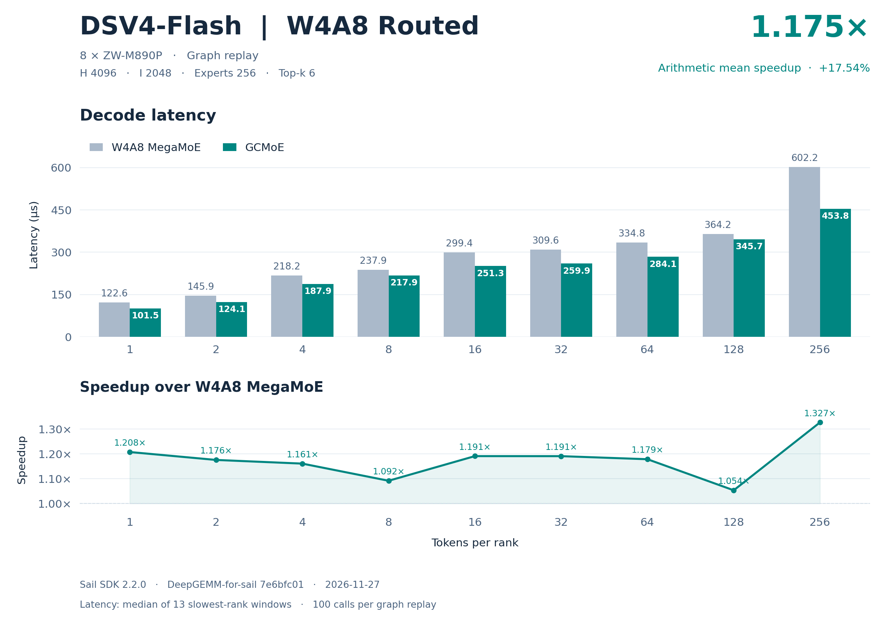
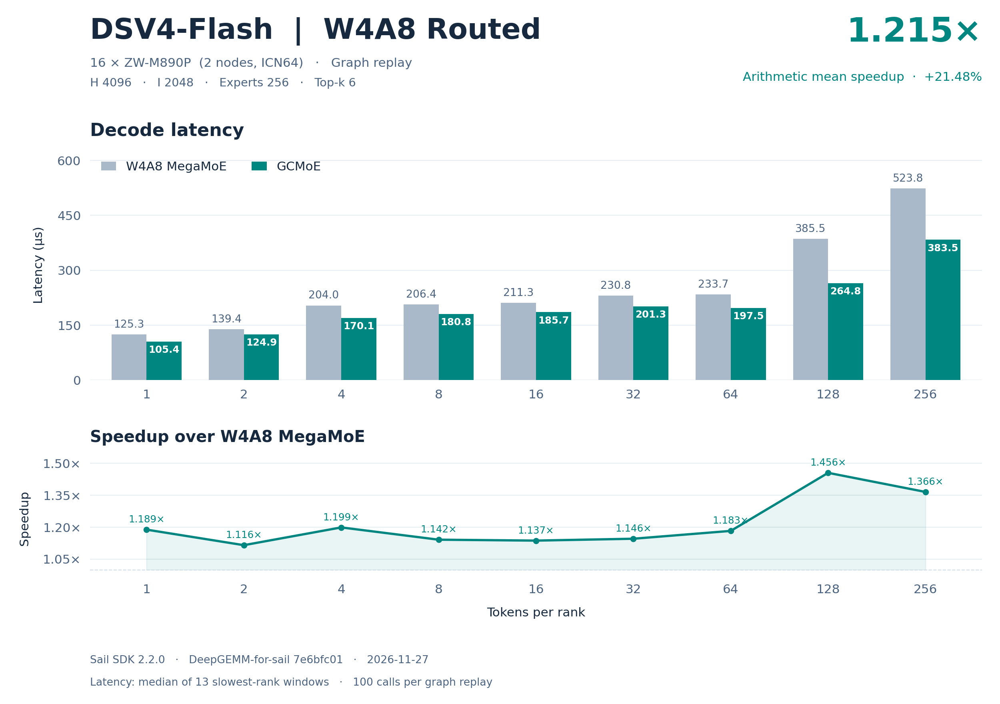
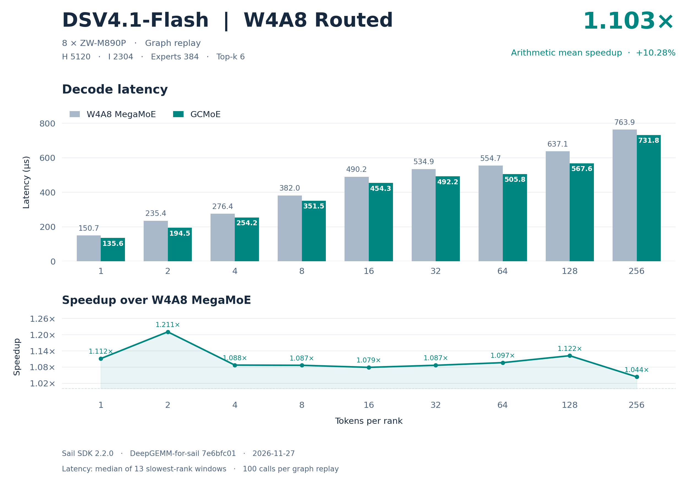
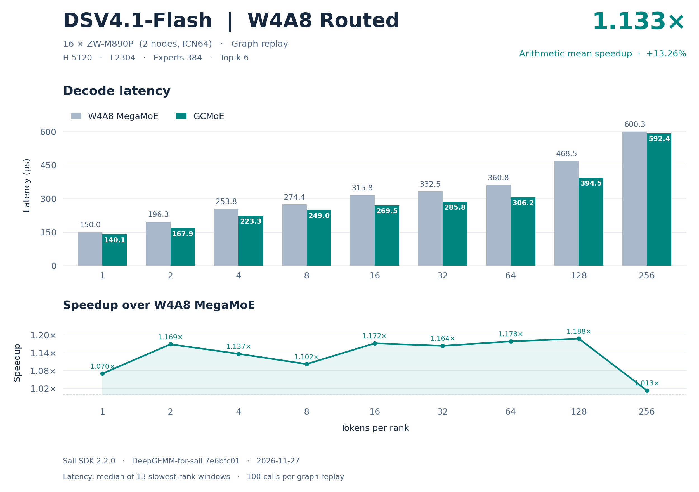

# ZW-M890P W4A8 GC MoE 精度与 decode 性能

EP8 和 EP16 共 128/128 个 case、1536/1536 项 rank 检查通过。对独立参考的最大绝对误差为 **0**。

36 个 decode 点中 36/36 点 GC 延迟低于 DeepGEMM MegaMoE。逐点等权平均加速 **1.156393×**，平均加速收益 **15.6393%**，单点范围 1.013427×–1.455552×。

| 模型 | EP | decode 点数 | 平均 Mega / GC | 平均加速收益 | 平均延迟下降 |
| --- | --- | --- | --- | --- | --- |
| dsv4-flash | EP8 | 9 | 1.175404× | 17.5404% | 14.6072% |
| dsv4-flash | EP16 | 9 | 1.214803× | 21.4803% | 17.0721% |
| dsv4.1-flash | EP8 | 9 | 1.102798× | 10.2798% | 9.1881% |
| dsv4.1-flash | EP16 | 9 | 1.132569× | 13.2569% | 11.4791% |
| 全部点等权 | — | 36 | 1.156393× | 15.6393% | 13.0866% |

平均加速比为 `mean(Mega_us / GC_us)`，每模型、每 EP 的九个 token 点等权。平均延迟下降为 `mean(1 − GC_us / Mega_us)`。

## 模型与数据口径

ZW-M890P，Sail SDK `2.2.0-663c22`。EP8 使用单机 8 卡，EP16 使用同一 ICN64 域内的两台 8 卡节点。

EP8 和 EP16 使用 2026-11-27 的 Sail PyTorch `2.11.0` 和 DeepGEMM-for-sail `1.1.0+v1.1.0.ppu2.2.0.g7e6bfc01`。[基线提交](https://github.com/t-head/DeepGEMM-for-sail/commit/7e6bfc01fcf3bf7b4bc2bc88f98c5ef0d5ed31a5)

| 模型 | H | I | routed experts | top-k |
| --- | --- | --- | --- | --- |
| dsv4-flash | 4096 | 2048 | 256 | 6 |
| dsv4.1-flash | 5120 | 2304 | 384 | 6 |

W4A8 routed 使用逐 token E4M3 激活和 FP32 scale、K32 MXFP4 E2M1 权重和 UE8M0 scale。SwiGLU 的 gate 和 up 使用 grouped GEMM 的 BF16 输出，激活结果通过逐 token E4M3 量化进入 W2。Combine 按 top-k 顺序加权累加 BF16 routed 输出，再舍入为 BF16。

MegaMoE 在 pre-dispatch 阶段将 BF16 激活量化为逐 token E4M3。投影内用 MXFP4 与单位矩阵相乘，反量化权重到 E5M2 后执行混合 FP8 MMA。W1 的 SwiGLU 输出再逐 token 量化，W2 将 BF16 结果写回源 rank。[DeepGEMM-for-sail W4A8 MegaMoE](https://github.com/t-head/DeepGEMM-for-sail/blob/7e6bfc01fcf3bf7b4bc2bc88f98c5ef0d5ed31a5/deep_gemm/include/deep_gemm/impls/sm89_fp8_fp4_mega_moe.cuh)

权重转换接受每 rank 的 `uint8[E_local, N, K/2]` 和 `uint8[E_local, N, K/32]`。W1 的 `(N, K)` 为 `(2I, H)`，gate 行在前，up 行在后。W2 的 `(N, K)` 为 `(H, I)`。偶数 K 元素在低 nibble。每个权重 bank 的 UE8M0 指数须介于 1 和 254，最大跨度为 26。转换按 bank 将指数平移到 114–140 范围，保留 FP4 存储并记录逆平移系数。投影在寄存器中将 FP4 解码为 E5M2，执行 E4M3 × E5M2 Tensor Cell MMA，按 FP32 累加。逆平移系数和逐 token scale 在投影 epilogue 中乘回。[DeepGEMM-for-sail 权重预处理](https://github.com/t-head/DeepGEMM-for-sail/blob/7e6bfc01fcf3bf7b4bc2bc88f98c5ef0d5ed31a5/csrc/jit_kernels/heuristics/common_preprocess.hpp) [W4A8 GEMM](https://github.com/t-head/DeepGEMM-for-sail/blob/7e6bfc01fcf3bf7b4bc2bc88f98c5ef0d5ed31a5/deep_gemm/include/deep_gemm/impls/w4fa8_gemm.cuh)

W4A4 和 W4A8 共用 MXFP4 输入格式和 `transform_weights_for_gc_moe_ppu` 入口。初始化时按 `routed_precision` 生成对应的 Tensor Cell packet，供 decode 直接读取。

预打包按 Tensor Cell 寄存器的消费顺序重排符号位和幅值，保留完整 E2M1 编码。warp N 为 64 时，从 CTA 共享内存中的 27 项幅值表读取 E5M2 幅值，再恢复各元素的符号位。大页使用 warp N 为 32 的算术展开，跨更多行复用反量化权重。

分块使用 EP、专家几何和公共 token 上界。长 K 的 M16 路径依据每 rank 的路由量上界和设备计算单元数选择 N tile 与 CTA 数。跨节点小批次在预估任务能覆盖设备时采用更宽的 N tile，以减少列块数。投影按专家页实际行数收窄 M。最后完成 W1 的列块负责页内的逐 token 量化，复用该页的 BF16 中间缓冲区，再发布给 W2。

```python
from gc_moe import (
    get_symm_buffer_for_gc_moe_ppu,
    ppu_fp8_fp4_gc_moe,
    transform_weights_for_gc_moe_ppu,
)

workspace = get_symm_buffer_for_gc_moe_ppu(
    group, experts, capacity, topk, hidden, intermediate, routed_precision="fp8_fp4",
)
fp8_fp4_w1, fp8_fp4_w2 = transform_weights_for_gc_moe_ppu(
    (gate_up, gate_up_sf), (down, down_sf), routed_precision=workspace.routed_precision,
)
workspace.x[:tokens].copy_(x_e4m3)
workspace.x_sf[:tokens].copy_(x_scale)
workspace.topk_idx[:tokens].copy_(expert_ids)
workspace.topk_weights[:tokens].copy_(expert_weights)
ppu_fp8_fp4_gc_moe(
    y, fp8_fp4_w1, fp8_fp4_w2, workspace, activation_clamp=10.0, num_tokens_bound=bound,
)
```

Workspace 继承大 EP 的 ICN 对等映射与校验。每次调用的 token 数可以按 rank 不同，各 rank 传相同的 token 上界并以相同顺序调用。EP 最大为 64，每个 rank 的容量最大为 256，专家总数须可以被 EP 整除。

SwiGLU clamp 为 10，每 rank 容量为 256，总 token 为 `EP × T/rank`。Mega 计时包含 `mega_moe_pre_dispatch`。GC 从 workspace 输入就绪后计时。

延迟单位为 µs。每个窗口取最慢 rank 的平均延迟，再对窗口取中位数。预热均为 20 次。每个 Graph 计时 100 次调用，共 13 个窗口。EP16 在 Graph 内先完成一次 decode，以对齐各 rank 的计时起点。

## 精度

独立参考使用 DeepGEMM 的 `m_grouped_gemm_fp8_fp4_bf16_nt_masked`。

Readiness 使用 Graph replay 验证两轮交替输入和路由掩码，覆盖空批、非整齐 token 数和不对称 token 向量。每个 case 调用两次，检查 BF16 输出逐元素相等、输出边界、专家计数及 workspace 输入。

| 模型 | EP | case 通过 | rank 检查通过 | 最大绝对误差 |
| --- | --- | --- | --- | --- |
| dsv4-flash | EP8 | 32/32 | 256/256 | 0 |
| dsv4-flash | EP16 | 32/32 | 512/512 | 0 |
| dsv4.1-flash | EP8 | 32/32 | 256/256 | 0 |
| dsv4.1-flash | EP16 | 32/32 | 512/512 | 0 |

### dsv4-flash EP8 逐组精度

| T/rank 或各 rank token 向量 | case 通过 | rank 检查通过 | 最大绝对误差 | 结果 |
| --- | --- | --- | --- | --- |
| 0 | 2/2 | 16/16 | 0 | 通过 |
| 1 | 2/2 | 16/16 | 0 | 通过 |
| 2 | 2/2 | 16/16 | 0 | 通过 |
| 9 | 2/2 | 16/16 | 0 | 通过 |
| 17 | 2/2 | 16/16 | 0 | 通过 |
| 31 | 2/2 | 16/16 | 0 | 通过 |
| 63 | 2/2 | 16/16 | 0 | 通过 |
| 64 | 2/2 | 16/16 | 0 | 通过 |
| 127 | 2/2 | 16/16 | 0 | 通过 |
| 128 | 2/2 | 16/16 | 0 | 通过 |
| 224 | 2/2 | 16/16 | 0 | 通过 |
| 255 | 2/2 | 16/16 | 0 | 通过 |
| 256 | 2/2 | 16/16 | 0 | 通过 |
| [1, 2, 3, 4, 5, 6, 7, 8] | 2/2 | 16/16 | 0 | 通过 |
| [256, 0, 0, 0, 0, 0, 0, 0] | 2/2 | 16/16 | 0 | 通过 |
| [8, 0, 0, 0, 0, 0, 0, 0] | 2/2 | 16/16 | 0 | 通过 |

### dsv4-flash EP16 逐组精度

| T/rank 或各 rank token 向量 | case 通过 | rank 检查通过 | 最大绝对误差 | 结果 |
| --- | --- | --- | --- | --- |
| 0 | 2/2 | 32/32 | 0 | 通过 |
| 1 | 2/2 | 32/32 | 0 | 通过 |
| 2 | 2/2 | 32/32 | 0 | 通过 |
| 9 | 2/2 | 32/32 | 0 | 通过 |
| 17 | 2/2 | 32/32 | 0 | 通过 |
| 31 | 2/2 | 32/32 | 0 | 通过 |
| 63 | 2/2 | 32/32 | 0 | 通过 |
| 64 | 2/2 | 32/32 | 0 | 通过 |
| 127 | 2/2 | 32/32 | 0 | 通过 |
| 128 | 2/2 | 32/32 | 0 | 通过 |
| 224 | 2/2 | 32/32 | 0 | 通过 |
| 255 | 2/2 | 32/32 | 0 | 通过 |
| 256 | 2/2 | 32/32 | 0 | 通过 |
| [1, 2, 3, 4, 5, 6, 7, 8, 9, 10, 11, 12, 13, 14, 15, 16] | 2/2 | 32/32 | 0 | 通过 |
| [256, 0, 0, 0, 0, 0, 0, 0, 0, 0, 0, 0, 0, 0, 0, 0] | 2/2 | 32/32 | 0 | 通过 |
| [8, 0, 0, 0, 0, 0, 0, 0, 0, 0, 0, 0, 0, 0, 0, 0] | 2/2 | 32/32 | 0 | 通过 |

### dsv4.1-flash EP8 逐组精度

| T/rank 或各 rank token 向量 | case 通过 | rank 检查通过 | 最大绝对误差 | 结果 |
| --- | --- | --- | --- | --- |
| 0 | 2/2 | 16/16 | 0 | 通过 |
| 1 | 2/2 | 16/16 | 0 | 通过 |
| 2 | 2/2 | 16/16 | 0 | 通过 |
| 9 | 2/2 | 16/16 | 0 | 通过 |
| 17 | 2/2 | 16/16 | 0 | 通过 |
| 31 | 2/2 | 16/16 | 0 | 通过 |
| 63 | 2/2 | 16/16 | 0 | 通过 |
| 64 | 2/2 | 16/16 | 0 | 通过 |
| 127 | 2/2 | 16/16 | 0 | 通过 |
| 128 | 2/2 | 16/16 | 0 | 通过 |
| 224 | 2/2 | 16/16 | 0 | 通过 |
| 255 | 2/2 | 16/16 | 0 | 通过 |
| 256 | 2/2 | 16/16 | 0 | 通过 |
| [1, 2, 3, 4, 5, 6, 7, 8] | 2/2 | 16/16 | 0 | 通过 |
| [256, 0, 0, 0, 0, 0, 0, 0] | 2/2 | 16/16 | 0 | 通过 |
| [8, 0, 0, 0, 0, 0, 0, 0] | 2/2 | 16/16 | 0 | 通过 |

### dsv4.1-flash EP16 逐组精度

| T/rank 或各 rank token 向量 | case 通过 | rank 检查通过 | 最大绝对误差 | 结果 |
| --- | --- | --- | --- | --- |
| 0 | 2/2 | 32/32 | 0 | 通过 |
| 1 | 2/2 | 32/32 | 0 | 通过 |
| 2 | 2/2 | 32/32 | 0 | 通过 |
| 9 | 2/2 | 32/32 | 0 | 通过 |
| 17 | 2/2 | 32/32 | 0 | 通过 |
| 31 | 2/2 | 32/32 | 0 | 通过 |
| 63 | 2/2 | 32/32 | 0 | 通过 |
| 64 | 2/2 | 32/32 | 0 | 通过 |
| 127 | 2/2 | 32/32 | 0 | 通过 |
| 128 | 2/2 | 32/32 | 0 | 通过 |
| 224 | 2/2 | 32/32 | 0 | 通过 |
| 255 | 2/2 | 32/32 | 0 | 通过 |
| 256 | 2/2 | 32/32 | 0 | 通过 |
| [1, 2, 3, 4, 5, 6, 7, 8, 9, 10, 11, 12, 13, 14, 15, 16] | 2/2 | 32/32 | 0 | 通过 |
| [256, 0, 0, 0, 0, 0, 0, 0, 0, 0, 0, 0, 0, 0, 0, 0] | 2/2 | 32/32 | 0 | 通过 |
| [8, 0, 0, 0, 0, 0, 0, 0, 0, 0, 0, 0, 0, 0, 0, 0] | 2/2 | 32/32 | 0 | 通过 |

## dsv4-flash decode 性能

### EP8

| T/rank | 总 token | Mega µs | GC µs | Mega / GC | 延迟下降 |
| --- | --- | --- | --- | --- | --- |
| 1 | 8 | 122.627697 | 101.535702 | 1.207730× | 17.2000% |
| 2 | 16 | 145.927696 | 124.101896 | 1.175870× | 14.9566% |
| 4 | 32 | 218.212109 | 187.938805 | 1.161081× | 13.8733% |
| 8 | 64 | 237.901592 | 217.851505 | 1.092036× | 8.4279% |
| 16 | 128 | 299.411697 | 251.339493 | 1.191264× | 16.0556% |
| 32 | 256 | 309.559402 | 259.892597 | 1.191105× | 16.0444% |
| 64 | 512 | 334.835815 | 284.062405 | 1.178740× | 15.1637% |
| 128 | 1024 | 364.214096 | 345.667686 | 1.053654× | 5.0922% |
| 256 | 2048 | 602.243500 | 453.785515 | 1.327155× | 24.6508% |



### EP16

| T/rank | 总 token | Mega µs | GC µs | Mega / GC | 延迟下降 |
| --- | --- | --- | --- | --- | --- |
| 1 | 16 | 125.335302 | 105.426702 | 1.188838× | 15.8843% |
| 2 | 32 | 139.384098 | 124.912205 | 1.115857× | 10.3827% |
| 4 | 64 | 204.029503 | 170.132694 | 1.199237× | 16.6137% |
| 8 | 128 | 206.406803 | 180.804100 | 1.141605× | 12.4040% |
| 16 | 256 | 211.252098 | 185.749702 | 1.137294× | 12.0720% |
| 32 | 512 | 230.755405 | 201.338100 | 1.146109× | 12.7483% |
| 64 | 1024 | 233.667603 | 197.537804 | 1.182901× | 15.4620% |
| 128 | 2048 | 385.490112 | 264.841194 | 1.455552× | 31.2975% |
| 256 | 4096 | 523.814087 | 383.511696 | 1.365836× | 26.7848% |



## dsv4.1-flash decode 性能

### EP8

| T/rank | 总 token | Mega µs | GC µs | Mega / GC | 延迟下降 |
| --- | --- | --- | --- | --- | --- |
| 1 | 8 | 150.718403 | 135.592604 | 1.111553× | 10.0358% |
| 2 | 16 | 235.443096 | 194.458199 | 1.210765× | 17.4076% |
| 4 | 32 | 276.448994 | 254.199905 | 1.087526× | 8.0482% |
| 8 | 64 | 381.999092 | 351.509094 | 1.086740× | 7.9817% |
| 16 | 128 | 490.227203 | 454.283409 | 1.079122× | 7.3321% |
| 32 | 256 | 534.899101 | 492.171783 | 1.086814× | 7.9879% |
| 64 | 512 | 554.650917 | 505.807190 | 1.096566× | 8.8062% |
| 128 | 1024 | 637.066116 | 567.645912 | 1.122295× | 10.8969% |
| 256 | 2048 | 763.862305 | 731.808167 | 1.043801× | 4.1963% |



### EP16

| T/rank | 总 token | Mega µs | GC µs | Mega / GC | 延迟下降 |
| --- | --- | --- | --- | --- | --- |
| 1 | 16 | 149.967499 | 140.116796 | 1.070304× | 6.5686% |
| 2 | 32 | 196.268005 | 167.925701 | 1.168779× | 14.4406% |
| 4 | 64 | 253.838997 | 223.303909 | 1.136742× | 12.0293% |
| 8 | 128 | 274.449596 | 249.009209 | 1.102166× | 9.2696% |
| 16 | 256 | 315.845299 | 269.491005 | 1.172007× | 14.6763% |
| 32 | 512 | 332.512589 | 285.766907 | 1.163580× | 14.0583% |
| 64 | 1024 | 360.844994 | 306.193008 | 1.178489× | 15.1456% |
| 128 | 2048 | 468.521805 | 394.502907 | 1.187626× | 15.7984% |
| 256 | 4096 | 600.319519 | 592.365685 | 1.013427× | 1.3249% |



## 有效 HBM 带宽

以各命中 routed expert 的 MXFP4 权重和 K32 scale 工作集各计一次。每 expert 为 `3 × H × I × (1/2 + 1/32)` 字节。带宽按逻辑权重工作集估算，单位为十进制 GB/s。

### dsv4-flash EP8

| T/rank | Mega 全8卡合计 | GC 全8卡合计 | Mega 每 PPU 均值 | GC 每 PPU 均值 |
| --- | --- | --- | --- | --- |
| 1 | 4906.073 | 5925.211 | 613.259 | 740.651 |
| 2 | 7329.298 | 8618.301 | 916.162 | 1077.288 |
| 4 | 8761.275 | 10172.546 | 1095.159 | 1271.568 |
| 8 | 11351.784 | 12396.552 | 1418.973 | 1549.569 |
| 16 | 10716.490 | 12766.169 | 1339.561 | 1595.771 |
| 32 | 11013.016 | 13117.660 | 1376.627 | 1639.707 |
| 64 | 10221.583 | 12048.592 | 1277.698 | 1506.074 |
| 128 | 9397.088 | 9901.279 | 1174.636 | 1237.660 |
| 256 | 5683.004 | 7542.224 | 710.375 | 942.778 |

### dsv4-flash EP16

| T/rank | Mega 全16卡合计 | GC 全16卡合计 | Mega 每 PPU 均值 | GC 每 PPU 均值 |
| --- | --- | --- | --- | --- |
| 1 | 8853.496 | 10525.375 | 553.343 | 657.836 |
| 2 | 14291.675 | 15947.459 | 893.230 | 996.716 |
| 4 | 13498.464 | 16187.864 | 843.654 | 1011.741 |
| 8 | 15804.324 | 18042.290 | 987.770 | 1127.643 |
| 16 | 16201.269 | 18425.613 | 1012.579 | 1151.601 |
| 32 | 14831.948 | 16999.028 | 926.997 | 1062.439 |
| 64 | 14647.097 | 17326.061 | 915.444 | 1082.879 |
| 128 | 8878.443 | 12923.035 | 554.903 | 807.690 |
| 256 | 6533.906 | 8924.244 | 408.369 | 557.765 |

### dsv4.1-flash EP8

| T/rank | Mega 全8卡合计 | GC 全8卡合计 | Mega 每 PPU 均值 | GC 每 PPU 均值 |
| --- | --- | --- | --- | --- |
| 1 | 5738.048 | 6378.146 | 717.256 | 797.268 |
| 2 | 6388.173 | 7734.573 | 798.522 | 966.822 |
| 4 | 10337.159 | 11241.929 | 1292.145 | 1405.241 |
| 8 | 12205.680 | 13264.404 | 1525.710 | 1658.051 |
| 16 | 12770.840 | 13781.294 | 1596.355 | 1722.662 |
| 32 | 13356.245 | 14515.751 | 1669.531 | 1814.469 |
| 64 | 13016.197 | 14273.118 | 1627.025 | 1784.140 |
| 128 | 11332.334 | 12718.220 | 1416.542 | 1589.778 |
| 256 | 9451.240 | 9865.216 | 1181.405 | 1233.152 |

### dsv4.1-flash EP16

| T/rank | Mega 全16卡合计 | GC 全16卡合计 | Mega 每 PPU 均值 | GC 每 PPU 均值 |
| --- | --- | --- | --- | --- |
| 1 | 10405.275 | 11136.803 | 650.330 | 696.050 |
| 2 | 13793.854 | 16121.964 | 862.116 | 1007.623 |
| 4 | 17627.521 | 20037.949 | 1101.720 | 1252.372 |
| 8 | 22263.498 | 24538.080 | 1391.469 | 1533.630 |
| 16 | 22440.864 | 26300.845 | 1402.554 | 1643.803 |
| 32 | 21711.797 | 25263.407 | 1356.987 | 1578.963 |
| 64 | 20007.055 | 23578.088 | 1250.441 | 1473.631 |
| 128 | 15408.986 | 18300.108 | 963.062 | 1143.757 |
| 256 | 12026.005 | 12187.481 | 751.625 | 761.718 |

## 有效卡间载荷带宽

有效卡间载荷按 `remote_assignments × (H + 4 + 2H)` 字节估算，包含E4M3 激活、逐 token FP32 scale和 BF16 返回值。每份载荷计一次，单位为十进制 GB/s。

### dsv4-flash EP8

| T/rank | Mega 全8卡合计 | GC 全8卡合计 | Mega 每 PPU 均值 | GC 每 PPU 均值 |
| --- | --- | --- | --- | --- |
| 1 | 4.410 | 5.327 | 0.551 | 0.666 |
| 2 | 7.665 | 9.013 | 0.958 | 1.127 |
| 4 | 9.971 | 11.577 | 1.246 | 1.447 |
| 8 | 17.981 | 19.635 | 2.248 | 2.454 |
| 16 | 28.450 | 33.892 | 3.556 | 4.236 |
| 32 | 54.877 | 65.364 | 6.860 | 8.170 |
| 64 | 100.477 | 118.436 | 12.560 | 14.804 |
| 128 | 183.124 | 192.949 | 22.891 | 24.119 |
| 256 | 221.269 | 293.658 | 27.659 | 36.707 |

### dsv4-flash EP16

| T/rank | Mega 全16卡合计 | GC 全16卡合计 | Mega 每 PPU 均值 | GC 每 PPU 均值 |
| --- | --- | --- | --- | --- |
| 1 | 8.532 | 10.144 | 0.533 | 0.634 |
| 2 | 15.962 | 17.811 | 0.998 | 1.113 |
| 4 | 21.809 | 26.154 | 1.363 | 1.635 |
| 8 | 43.175 | 49.289 | 2.698 | 3.081 |
| 16 | 84.487 | 96.086 | 5.280 | 6.005 |
| 32 | 154.745 | 177.355 | 9.672 | 11.085 |
| 64 | 304.528 | 360.227 | 19.033 | 22.514 |
| 128 | 368.769 | 536.763 | 23.048 | 33.548 |
| 256 | 540.946 | 738.844 | 33.809 | 46.178 |

### dsv4.1-flash EP8

| T/rank | Mega 全8卡合计 | GC 全8卡合计 | Mega 每 PPU 均值 | GC 每 PPU 均值 |
| --- | --- | --- | --- | --- |
| 1 | 4.179 | 4.646 | 0.522 | 0.581 |
| 2 | 5.416 | 6.558 | 0.677 | 0.820 |
| 4 | 9.115 | 9.912 | 1.139 | 1.239 |
| 8 | 13.594 | 14.774 | 1.699 | 1.847 |
| 16 | 20.559 | 22.186 | 2.570 | 2.773 |
| 32 | 37.771 | 41.050 | 4.721 | 5.131 |
| 64 | 73.960 | 81.102 | 9.245 | 10.138 |
| 128 | 129.073 | 144.858 | 16.134 | 18.107 |
| 256 | 215.617 | 225.062 | 26.952 | 28.133 |

### dsv4.1-flash EP16

| T/rank | Mega 全16卡合计 | GC 全16卡合计 | Mega 每 PPU 均值 | GC 每 PPU 均值 |
| --- | --- | --- | --- | --- |
| 1 | 9.425 | 10.088 | 0.589 | 0.630 |
| 2 | 14.091 | 16.469 | 0.881 | 1.029 |
| 4 | 21.608 | 24.563 | 1.350 | 1.535 |
| 8 | 40.306 | 44.424 | 2.519 | 2.777 |
| 16 | 69.999 | 82.039 | 4.375 | 5.127 |
| 32 | 133.442 | 155.271 | 8.340 | 9.704 |
| 64 | 244.737 | 288.420 | 15.296 | 18.026 |
| 128 | 376.097 | 446.663 | 23.506 | 27.916 |
| 256 | 588.947 | 596.855 | 36.809 | 37.303 |

## 有效矩阵计算吞吐

有效 FLOP 为 `6 × routed_assignments × H × I`。只计有效矩阵乘加，单位为 TFLOPS（10¹² FLOP/s）。

### dsv4-flash EP8

| T/rank | Mega 全8卡合计 | GC 全8卡合计 | Mega 每 PPU 均值 | GC 每 PPU 均值 |
| --- | --- | --- | --- | --- |
| 1 | 19.701 | 23.794 | 2.463 | 2.974 |
| 2 | 33.111 | 38.934 | 4.139 | 4.867 |
| 4 | 44.286 | 51.419 | 5.536 | 6.427 |
| 8 | 81.241 | 88.718 | 10.155 | 11.090 |
| 16 | 129.102 | 153.795 | 16.138 | 19.224 |
| 32 | 249.740 | 297.467 | 31.218 | 37.183 |
| 64 | 461.775 | 544.313 | 57.722 | 68.039 |
| 128 | 849.055 | 894.610 | 106.132 | 111.826 |
| 256 | 1026.952 | 1362.924 | 128.369 | 170.366 |

### dsv4-flash EP16

| T/rank | Mega 全16卡合计 | GC 全16卡合计 | Mega 每 PPU 均值 | GC 每 PPU 均值 |
| --- | --- | --- | --- | --- |
| 1 | 38.551 | 45.831 | 2.409 | 2.864 |
| 2 | 69.331 | 77.364 | 4.333 | 4.835 |
| 4 | 94.728 | 113.602 | 5.921 | 7.100 |
| 8 | 187.274 | 213.793 | 11.705 | 13.362 |
| 16 | 365.958 | 416.202 | 22.872 | 26.013 |
| 32 | 670.055 | 767.956 | 41.878 | 47.997 |
| 64 | 1323.408 | 1565.461 | 82.713 | 97.841 |
| 128 | 1604.387 | 2335.268 | 100.274 | 145.954 |
| 256 | 2361.431 | 3225.327 | 147.589 | 201.583 |

### dsv4.1-flash EP8

| T/rank | Mega 全8卡合计 | GC 全8卡合计 | Mega 每 PPU 均值 | GC 每 PPU 均值 |
| --- | --- | --- | --- | --- |
| 1 | 22.541 | 25.056 | 2.818 | 3.132 |
| 2 | 28.860 | 34.942 | 3.607 | 4.368 |
| 4 | 49.158 | 53.460 | 6.145 | 6.683 |
| 8 | 71.150 | 77.321 | 8.894 | 9.665 |
| 16 | 110.884 | 119.657 | 13.860 | 14.957 |
| 32 | 203.246 | 220.891 | 25.406 | 27.611 |
| 64 | 392.017 | 429.873 | 49.002 | 53.734 |
| 128 | 682.606 | 766.086 | 85.326 | 95.761 |
| 256 | 1138.596 | 1188.468 | 142.325 | 148.559 |

### dsv4.1-flash EP16

| T/rank | Mega 全16卡合计 | GC 全16卡合计 | Mega 每 PPU 均值 | GC 每 PPU 均值 |
| --- | --- | --- | --- | --- |
| 1 | 45.308 | 48.494 | 2.832 | 3.031 |
| 2 | 69.240 | 80.926 | 4.327 | 5.058 |
| 4 | 107.072 | 121.713 | 6.692 | 7.607 |
| 8 | 198.063 | 218.298 | 12.379 | 13.644 |
| 16 | 344.208 | 403.414 | 21.513 | 25.213 |
| 32 | 653.908 | 760.874 | 40.869 | 47.555 |
| 64 | 1205.131 | 1420.233 | 75.321 | 88.765 |
| 128 | 1856.330 | 2204.625 | 116.021 | 137.789 |
| 256 | 2897.560 | 2936.466 | 181.097 | 183.529 |

三项指标使用各算子的同一 Graph 延迟和相同逻辑工作量。全卡合计为全工作量除以该延迟，每 PPU 均值为合计除以 EP size。

## 复现

```bash
bash scripts/run_ppu.sh test --w4a8 --model dsv4-flash
bash scripts/run_ppu.sh readiness --w4a8 --model dsv4.1-flash \
  --tokens 0 1 2 9 17 31 63 64 127 128 224 255 256 --steps 2 --calls-per-case 2
bash scripts/run_ppu.sh bench --w4a8 --model dsv4.1-flash --warmup 20 --iters 100 --repeats 13
```

EP16 在两个节点设置相同的 `GC_MOE_NUM_NODES=2`、`GC_MOE_NUM_PPUS=8`、`MASTER_ADDR` 和 `MASTER_PORT`，给 `GC_MOE_NODE_RANK` 分别设为 `0` 和 `1`，并选择节点间可达的通信网卡。
