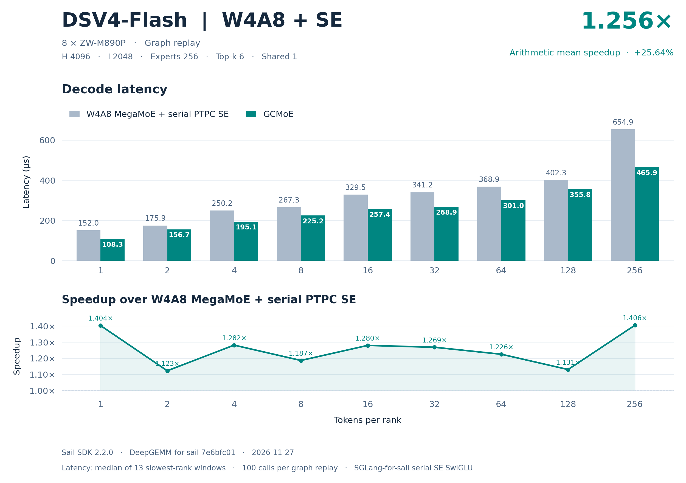
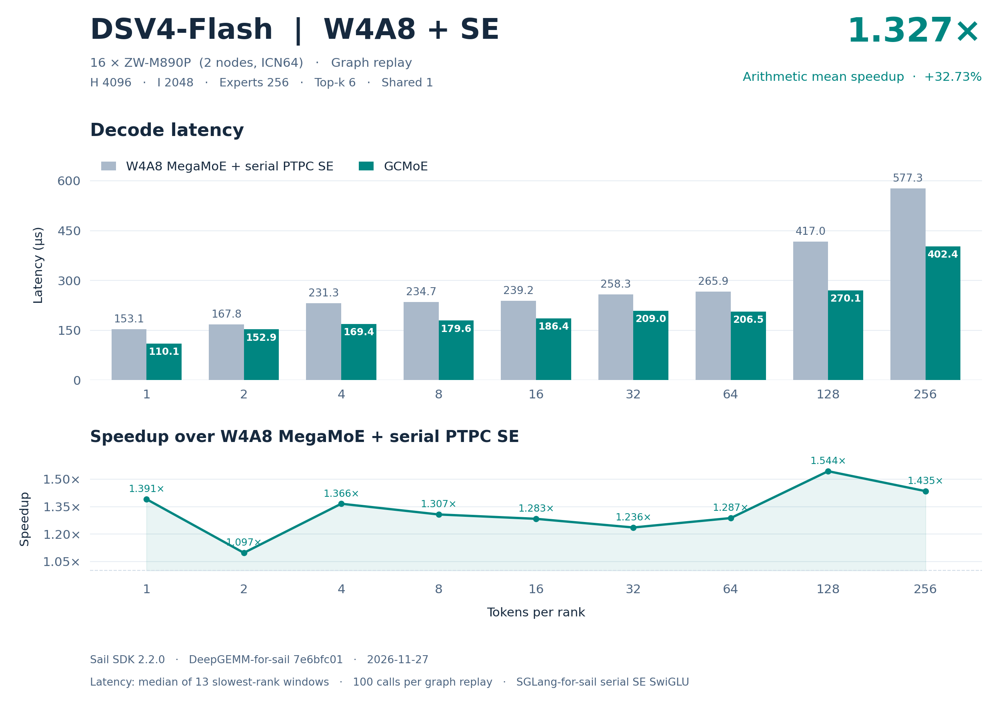
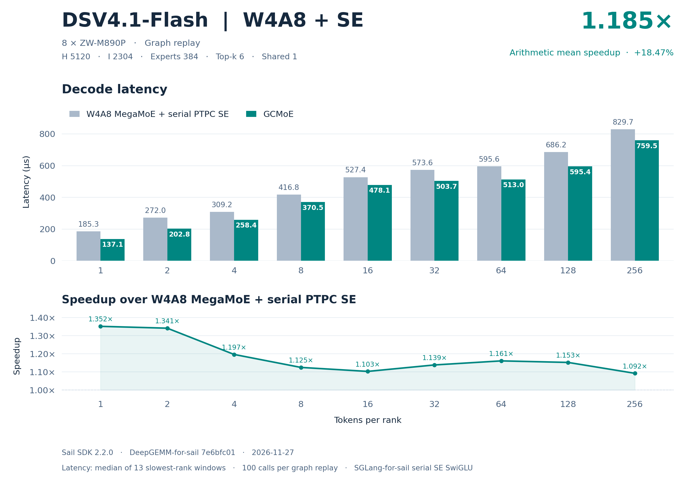
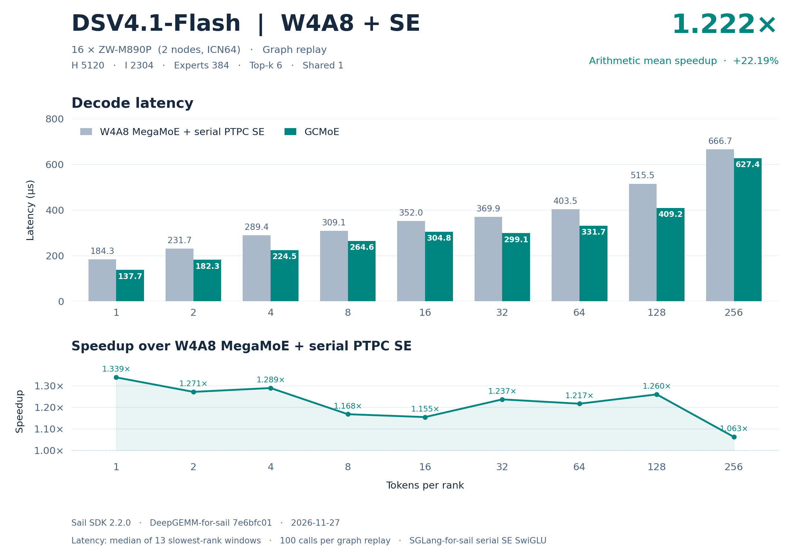

# ZW-M890P W4A8 GC MoE + W8A8 PTPC SE 精度与 decode 性能

EP8 和 EP16 共 120/120 个 case、1440/1440 项 rank 检查通过。对独立参考的最大绝对误差为 **0**。

36 个 decode 点中 36/36 点 GC 延迟低于 DeepGEMM MegaMoE + 串行 PTPC SE。逐点等权平均加速 **1.247575×**，平均加速收益 **24.7575%**，单点范围 1.062613×–1.543750×。

| 模型 | EP | decode 点数 | 平均 Mega / GC | 平均加速收益 | 平均延迟下降 |
| --- | --- | --- | --- | --- | --- |
| dsv4-flash | EP8 | 9 | 1.256370× | 25.6370% | 19.9335% |
| dsv4-flash | EP16 | 9 | 1.327250× | 32.7250% | 24.0226% |
| dsv4.1-flash | EP8 | 9 | 1.184744× | 18.4744% | 15.1242% |
| dsv4.1-flash | EP16 | 9 | 1.221936× | 22.1936% | 17.8113% |
| 全部点等权 | — | 36 | 1.247575× | 24.7575% | 19.2229% |

平均加速比为 `mean(Mega_us / GC_us)`，每模型、每 EP 的九个 token 点等权。平均延迟下降为 `mean(1 − GC_us / Mega_us)`。

## 模型与数据口径

ZW-M890P，Sail SDK `2.2.0-663c22`。EP8 使用单机 8 卡，EP16 使用同一 ICN64 域内的两台 8 卡节点。

EP8 和 EP16 使用 2026-11-27 的 Sail PyTorch `2.11.0` 和 DeepGEMM-for-sail `1.1.0+v1.1.0.ppu2.2.0.g7e6bfc01`。[基线提交](https://github.com/t-head/DeepGEMM-for-sail/commit/7e6bfc01fcf3bf7b4bc2bc88f98c5ef0d5ed31a5)

| 模型 | H | I | routed experts | top-k | shared experts | shared recipe |
| --- | --- | --- | --- | --- | --- | --- |
| dsv4-flash | 4096 | 2048 | 256 | 6 | 1 | PTPC |
| dsv4.1-flash | 5120 | 2304 | 384 | 6 | 1 | PTPC |

Shared expert 使用 E4M3 激活和权重、FP32 per-token 激活 scale 和 per-channel 权重 scale。创建 workspace 时指定 `routed_precision='fp8_fp4'`、`num_shared_experts=1` 和 `shared_fp8_fp8_ptpc=True`。用 `transform_weights_for_gc_moe_ppu` 分别打包两组权重。Routed 权重传入 workspace 的 `routed_precision`，E4M3 shared 权重省略该参数。将共享激活和 scale 写到 `shared_x` 与 `shared_x_sf`，再通过 `shared_l1_weights` 和 `shared_l2_weights` 将打包后的共享权重传给 `ppu_fp8_fp4_gc_moe`。Routed 的输入约束见 [W4A8 GC MoE](zw-m890p_w4a8_gc_moe.md)。

EP8 和 EP16 的 AIU 路径在独立设备 stream 上启动共享投影，与 dispatch 重叠。Combine 等待 routed 和 shared 结果，再执行 BF16 相加。

SwiGLU clamp 为 10，每 rank 容量为 256，总 token 为 `EP × T/rank`。Mega 计时包含 `mega_moe_pre_dispatch`。GC 从 workspace 输入就绪后计时。

基线在 MegaMoE 后执行串行 PTPC SE 和 BF16 输出相加。串行 SE 使用 SGLang-for-sail 的 DSv4 SwiGLU 与逐 token 量化。[SGLang-for-sail SwiGLU](https://github.com/t-head/sglang-for-sail/blob/e62cdd0084212b7cb535b7de645fc985df9c3dca/python/sglang/kernels/ops/elementwise/silu_mul_quant.py)

延迟单位为 µs。每个窗口取最慢 rank 的平均延迟，再对窗口取中位数。预热均为 20 次。每个 Graph 计时 100 次调用，共 13 个窗口。EP16 在 Graph 内先完成一次 decode，以对齐各 rank 的计时起点。

## 精度

独立参考使用 DeepGEMM 的 `m_grouped_gemm_fp8_fp4_bf16_nt_masked` 和 W8A8 PTPC SE。

Readiness 使用 Graph replay 验证两轮交替输入和路由掩码，覆盖空批、非整齐 token 数和不对称 token 向量。每个 case 调用两次，检查 BF16 输出逐元素相等、输出边界、专家计数及 workspace 输入。

| 模型 | EP | case 通过 | rank 检查通过 | 最大绝对误差 |
| --- | --- | --- | --- | --- |
| dsv4-flash | EP8 | 30/30 | 240/240 | 0 |
| dsv4-flash | EP16 | 30/30 | 480/480 | 0 |
| dsv4.1-flash | EP8 | 30/30 | 240/240 | 0 |
| dsv4.1-flash | EP16 | 30/30 | 480/480 | 0 |

### dsv4-flash EP8 逐组精度

| T/rank 或各 rank token 向量 | case 通过 | rank 检查通过 | 最大绝对误差 | 结果 |
| --- | --- | --- | --- | --- |
| 0 | 2/2 | 16/16 | 0 | 通过 |
| 1 | 2/2 | 16/16 | 0 | 通过 |
| 2 | 2/2 | 16/16 | 0 | 通过 |
| 9 | 2/2 | 16/16 | 0 | 通过 |
| 17 | 2/2 | 16/16 | 0 | 通过 |
| 31 | 2/2 | 16/16 | 0 | 通过 |
| 63 | 2/2 | 16/16 | 0 | 通过 |
| 64 | 2/2 | 16/16 | 0 | 通过 |
| 127 | 2/2 | 16/16 | 0 | 通过 |
| 128 | 2/2 | 16/16 | 0 | 通过 |
| 224 | 2/2 | 16/16 | 0 | 通过 |
| 255 | 2/2 | 16/16 | 0 | 通过 |
| 256 | 2/2 | 16/16 | 0 | 通过 |
| [1, 2, 3, 4, 5, 6, 7, 8] | 2/2 | 16/16 | 0 | 通过 |
| [256, 0, 0, 0, 0, 0, 0, 0] | 2/2 | 16/16 | 0 | 通过 |

### dsv4-flash EP16 逐组精度

| T/rank 或各 rank token 向量 | case 通过 | rank 检查通过 | 最大绝对误差 | 结果 |
| --- | --- | --- | --- | --- |
| 0 | 2/2 | 32/32 | 0 | 通过 |
| 1 | 2/2 | 32/32 | 0 | 通过 |
| 2 | 2/2 | 32/32 | 0 | 通过 |
| 9 | 2/2 | 32/32 | 0 | 通过 |
| 17 | 2/2 | 32/32 | 0 | 通过 |
| 31 | 2/2 | 32/32 | 0 | 通过 |
| 63 | 2/2 | 32/32 | 0 | 通过 |
| 64 | 2/2 | 32/32 | 0 | 通过 |
| 127 | 2/2 | 32/32 | 0 | 通过 |
| 128 | 2/2 | 32/32 | 0 | 通过 |
| 224 | 2/2 | 32/32 | 0 | 通过 |
| 255 | 2/2 | 32/32 | 0 | 通过 |
| 256 | 2/2 | 32/32 | 0 | 通过 |
| [1, 2, 3, 4, 5, 6, 7, 8, 9, 10, 11, 12, 13, 14, 15, 16] | 2/2 | 32/32 | 0 | 通过 |
| [256, 0, 0, 0, 0, 0, 0, 0, 0, 0, 0, 0, 0, 0, 0, 0] | 2/2 | 32/32 | 0 | 通过 |

### dsv4.1-flash EP8 逐组精度

| T/rank 或各 rank token 向量 | case 通过 | rank 检查通过 | 最大绝对误差 | 结果 |
| --- | --- | --- | --- | --- |
| 0 | 2/2 | 16/16 | 0 | 通过 |
| 1 | 2/2 | 16/16 | 0 | 通过 |
| 2 | 2/2 | 16/16 | 0 | 通过 |
| 9 | 2/2 | 16/16 | 0 | 通过 |
| 17 | 2/2 | 16/16 | 0 | 通过 |
| 31 | 2/2 | 16/16 | 0 | 通过 |
| 63 | 2/2 | 16/16 | 0 | 通过 |
| 64 | 2/2 | 16/16 | 0 | 通过 |
| 127 | 2/2 | 16/16 | 0 | 通过 |
| 128 | 2/2 | 16/16 | 0 | 通过 |
| 224 | 2/2 | 16/16 | 0 | 通过 |
| 255 | 2/2 | 16/16 | 0 | 通过 |
| 256 | 2/2 | 16/16 | 0 | 通过 |
| [1, 2, 3, 4, 5, 6, 7, 8] | 2/2 | 16/16 | 0 | 通过 |
| [256, 0, 0, 0, 0, 0, 0, 0] | 2/2 | 16/16 | 0 | 通过 |

### dsv4.1-flash EP16 逐组精度

| T/rank 或各 rank token 向量 | case 通过 | rank 检查通过 | 最大绝对误差 | 结果 |
| --- | --- | --- | --- | --- |
| 0 | 2/2 | 32/32 | 0 | 通过 |
| 1 | 2/2 | 32/32 | 0 | 通过 |
| 2 | 2/2 | 32/32 | 0 | 通过 |
| 9 | 2/2 | 32/32 | 0 | 通过 |
| 17 | 2/2 | 32/32 | 0 | 通过 |
| 31 | 2/2 | 32/32 | 0 | 通过 |
| 63 | 2/2 | 32/32 | 0 | 通过 |
| 64 | 2/2 | 32/32 | 0 | 通过 |
| 127 | 2/2 | 32/32 | 0 | 通过 |
| 128 | 2/2 | 32/32 | 0 | 通过 |
| 224 | 2/2 | 32/32 | 0 | 通过 |
| 255 | 2/2 | 32/32 | 0 | 通过 |
| 256 | 2/2 | 32/32 | 0 | 通过 |
| [1, 2, 3, 4, 5, 6, 7, 8, 9, 10, 11, 12, 13, 14, 15, 16] | 2/2 | 32/32 | 0 | 通过 |
| [256, 0, 0, 0, 0, 0, 0, 0, 0, 0, 0, 0, 0, 0, 0, 0] | 2/2 | 32/32 | 0 | 通过 |

## dsv4-flash decode 性能

### EP8

| T/rank | 总 token | Mega µs | GC µs | Mega / GC | 延迟下降 |
| --- | --- | --- | --- | --- | --- |
| 1 | 8 | 151.979399 | 108.261099 | 1.403823× | 28.7659% |
| 2 | 16 | 175.930996 | 156.650496 | 1.123080× | 10.9591% |
| 4 | 32 | 250.155907 | 195.103703 | 1.282169× | 22.0072% |
| 8 | 64 | 267.266598 | 225.175209 | 1.186927× | 15.7488% |
| 16 | 128 | 329.543190 | 257.370300 | 1.280424× | 21.9009% |
| 32 | 256 | 341.193390 | 268.885803 | 1.268916× | 21.1926% |
| 64 | 512 | 368.860016 | 300.953197 | 1.225639× | 18.4099% |
| 128 | 1024 | 402.270699 | 355.775414 | 1.130687× | 11.5582% |
| 256 | 2048 | 654.882431 | 465.889206 | 1.405661× | 28.8591% |



### EP16

| T/rank | 总 token | Mega µs | GC µs | Mega / GC | 延迟下降 |
| --- | --- | --- | --- | --- | --- |
| 1 | 16 | 153.106298 | 110.093699 | 1.390691× | 28.0933% |
| 2 | 32 | 167.778397 | 152.926598 | 1.097117× | 8.8520% |
| 4 | 64 | 231.279202 | 169.354000 | 1.365655× | 26.7751% |
| 8 | 128 | 234.684105 | 179.550400 | 1.307065× | 23.4927% |
| 16 | 256 | 239.211693 | 186.417408 | 1.283205× | 22.0701% |
| 32 | 512 | 258.336105 | 209.038391 | 1.235831× | 19.0828% |
| 64 | 1024 | 265.896492 | 206.548595 | 1.287331× | 22.3199% |
| 128 | 2048 | 417.009506 | 270.127602 | 1.543750× | 35.2227% |
| 256 | 4096 | 577.267418 | 402.386703 | 1.434609× | 30.2946% |



## dsv4.1-flash decode 性能

### EP8

| T/rank | 总 token | Mega µs | GC µs | Mega / GC | 延迟下降 |
| --- | --- | --- | --- | --- | --- |
| 1 | 8 | 185.297604 | 137.086496 | 1.351684× | 26.0182% |
| 2 | 16 | 272.003593 | 202.764606 | 1.341475× | 25.4552% |
| 4 | 32 | 309.237804 | 258.426895 | 1.196616× | 16.4310% |
| 8 | 64 | 416.838417 | 370.497208 | 1.125078× | 11.1173% |
| 16 | 128 | 527.404594 | 478.138199 | 1.103038× | 9.3413% |
| 32 | 256 | 573.574905 | 503.710518 | 1.138699× | 12.1805% |
| 64 | 512 | 595.606613 | 512.982216 | 1.161067× | 13.8723% |
| 128 | 1024 | 686.219635 | 595.384102 | 1.152566× | 13.2371% |
| 256 | 2048 | 829.717407 | 759.485703 | 1.092473× | 8.4645% |



### EP16

| T/rank | 总 token | Mega µs | GC µs | Mega / GC | 延迟下降 |
| --- | --- | --- | --- | --- | --- |
| 1 | 16 | 184.333305 | 137.711802 | 1.338544× | 25.2920% |
| 2 | 32 | 231.729393 | 182.266197 | 1.271379× | 21.3452% |
| 4 | 64 | 289.373894 | 224.460793 | 1.289196× | 22.4323% |
| 8 | 128 | 309.113197 | 264.648800 | 1.168013× | 14.3845% |
| 16 | 256 | 351.999283 | 304.845905 | 1.154679× | 13.3959% |
| 32 | 512 | 369.918098 | 299.128494 | 1.236653× | 19.1366% |
| 64 | 1024 | 403.530884 | 331.688385 | 1.216596× | 17.8035% |
| 128 | 2048 | 515.514183 | 409.220085 | 1.259748× | 20.6190% |
| 256 | 4096 | 666.695175 | 627.410812 | 1.062613× | 5.8924% |



## 有效 HBM 带宽

以各命中 routed expert 的 MXFP4 权重和 K32 scale 工作集各计一次。每 expert 为 `3 × H × I × (1/2 + 1/32)` 字节。每个非空 rank 另计本地 shared 权重和 FP32 scale，共 `3 × H × I + 4 × (2I + H)` 字节。带宽按逻辑权重工作集估算，单位为十进制 GB/s。

### dsv4-flash EP8

| T/rank | Mega 全8卡合计 | GC 全8卡合计 | Mega 每 PPU 均值 | GC 每 PPU 均值 |
| --- | --- | --- | --- | --- |
| 1 | 5284.987 | 7419.186 | 660.623 | 927.398 |
| 2 | 7225.198 | 8114.473 | 903.150 | 1014.309 |
| 4 | 8448.351 | 10832.213 | 1056.044 | 1354.027 |
| 8 | 10858.806 | 12888.613 | 1357.351 | 1611.077 |
| 16 | 10348.359 | 13250.291 | 1293.545 | 1656.286 |
| 32 | 10582.771 | 13428.643 | 1322.846 | 1678.580 |
| 64 | 9825.247 | 12042.207 | 1228.156 | 1505.276 |
| 128 | 9009.209 | 10186.597 | 1126.151 | 1273.325 |
| 256 | 5534.033 | 7778.976 | 691.754 | 972.372 |

### dsv4-flash EP16

| T/rank | Mega 全16卡合计 | GC 全16卡合计 | Mega 每 PPU 均值 | GC 每 PPU 均值 |
| --- | --- | --- | --- | --- |
| 1 | 9880.933 | 13741.323 | 617.558 | 858.833 |
| 2 | 14276.032 | 15662.480 | 892.252 | 978.905 |
| 4 | 13651.302 | 18642.975 | 853.206 | 1165.186 |
| 8 | 15618.005 | 20413.752 | 976.125 | 1275.860 |
| 16 | 15993.071 | 20522.383 | 999.567 | 1282.649 |
| 32 | 14809.117 | 18301.564 | 925.570 | 1143.848 |
| 64 | 14388.041 | 18522.176 | 899.253 | 1157.636 |
| 128 | 9174.202 | 14162.675 | 573.388 | 885.167 |
| 256 | 6627.309 | 9507.594 | 414.207 | 594.225 |

### dsv4.1-flash EP8

| T/rank | Mega 全8卡合计 | GC 全8卡合计 | Mega 每 PPU 均值 | GC 每 PPU 均值 |
| --- | --- | --- | --- | --- |
| 1 | 6196.822 | 8376.144 | 774.603 | 1047.018 |
| 2 | 6571.524 | 8815.533 | 821.440 | 1101.942 |
| 4 | 10157.633 | 12154.788 | 1269.704 | 1519.348 |
| 8 | 11865.474 | 13349.589 | 1483.184 | 1668.699 |
| 16 | 12408.007 | 13686.503 | 1551.001 | 1710.813 |
| 32 | 12949.782 | 14745.910 | 1618.723 | 1843.239 |
| 64 | 12597.027 | 14625.990 | 1574.628 | 1828.249 |
| 128 | 10933.631 | 12601.735 | 1366.704 | 1575.217 |
| 256 | 9042.684 | 9878.886 | 1130.336 | 1234.861 |

### dsv4.1-flash EP16

| T/rank | Mega 全16卡合计 | GC 全16卡合计 | Mega 每 PPU 均值 | GC 每 PPU 均值 |
| --- | --- | --- | --- | --- |
| 1 | 11540.545 | 15447.527 | 721.284 | 965.470 |
| 2 | 14129.178 | 17963.538 | 883.074 | 1122.721 |
| 4 | 17421.772 | 22460.074 | 1088.861 | 1403.755 |
| 8 | 21600.701 | 25229.896 | 1350.044 | 1576.868 |
| 16 | 21746.337 | 25110.047 | 1359.146 | 1569.378 |
| 32 | 21048.712 | 26029.949 | 1315.544 | 1626.872 |
| 64 | 19295.424 | 23474.742 | 1205.964 | 1467.171 |
| 128 | 15103.948 | 19027.168 | 943.997 | 1189.198 |
| 256 | 11678.950 | 12410.209 | 729.934 | 775.638 |

## 有效卡间载荷带宽

有效卡间载荷按 `remote_assignments × (H + 4 + 2H)` 字节估算，包含E4M3 激活、逐 token FP32 scale和 BF16 返回值。每份载荷计一次，单位为十进制 GB/s。

### dsv4-flash EP8

| T/rank | Mega 全8卡合计 | GC 全8卡合计 | Mega 每 PPU 均值 | GC 每 PPU 均值 |
| --- | --- | --- | --- | --- |
| 1 | 3.559 | 4.996 | 0.445 | 0.624 |
| 2 | 6.358 | 7.141 | 0.795 | 0.893 |
| 4 | 8.697 | 11.151 | 1.087 | 1.394 |
| 8 | 16.005 | 18.997 | 2.001 | 2.375 |
| 16 | 25.849 | 33.098 | 3.231 | 4.137 |
| 32 | 49.789 | 63.178 | 6.224 | 7.897 |
| 64 | 91.209 | 111.789 | 11.401 | 13.974 |
| 128 | 165.800 | 187.468 | 20.725 | 23.433 |
| 256 | 203.483 | 286.028 | 25.435 | 35.754 |

### dsv4-flash EP16

| T/rank | Mega 全16卡合计 | GC 全16卡合计 | Mega 每 PPU 均值 | GC 每 PPU 均值 |
| --- | --- | --- | --- | --- |
| 1 | 6.985 | 9.714 | 0.437 | 0.607 |
| 2 | 13.261 | 14.548 | 0.829 | 0.909 |
| 4 | 19.240 | 26.275 | 1.202 | 1.642 |
| 8 | 37.973 | 49.633 | 2.373 | 3.102 |
| 16 | 74.612 | 95.742 | 4.663 | 5.984 |
| 32 | 138.224 | 170.822 | 8.639 | 10.676 |
| 64 | 267.617 | 344.512 | 16.726 | 21.532 |
| 128 | 340.896 | 526.259 | 21.306 | 32.891 |
| 256 | 490.856 | 704.186 | 30.679 | 44.012 |

### dsv4.1-flash EP8

| T/rank | Mega 全8卡合计 | GC 全8卡合计 | Mega 每 PPU 均值 | GC 每 PPU 均值 |
| --- | --- | --- | --- | --- |
| 1 | 3.400 | 4.595 | 0.425 | 0.574 |
| 2 | 4.688 | 6.289 | 0.586 | 0.786 |
| 4 | 8.148 | 9.750 | 1.019 | 1.219 |
| 8 | 12.458 | 14.016 | 1.557 | 1.752 |
| 16 | 19.110 | 21.079 | 2.389 | 2.635 |
| 32 | 35.224 | 40.110 | 4.403 | 5.014 |
| 64 | 68.874 | 79.967 | 8.609 | 9.996 |
| 128 | 119.828 | 138.109 | 14.978 | 17.264 |
| 256 | 198.504 | 216.860 | 24.813 | 27.108 |

### dsv4.1-flash EP16

| T/rank | Mega 全16卡合计 | GC 全16卡合计 | Mega 每 PPU 均值 | GC 每 PPU 均值 |
| --- | --- | --- | --- | --- |
| 1 | 7.668 | 10.264 | 0.479 | 0.642 |
| 2 | 11.934 | 15.173 | 0.746 | 0.948 |
| 4 | 18.955 | 24.436 | 1.185 | 1.527 |
| 8 | 35.787 | 41.799 | 2.237 | 2.612 |
| 16 | 62.809 | 72.524 | 3.926 | 4.533 |
| 32 | 119.949 | 148.335 | 7.497 | 9.271 |
| 64 | 218.849 | 266.251 | 13.678 | 16.641 |
| 128 | 341.814 | 430.599 | 21.363 | 26.912 |
| 256 | 530.312 | 563.517 | 33.144 | 35.220 |

## 有效矩阵计算吞吐

有效 FLOP 为 `6 × routed_assignments × H × I`。SE 另计 `6 × 总 token × H × I`。只计有效矩阵乘加，单位为 TFLOPS（10¹² FLOP/s）。

### dsv4-flash EP8

| T/rank | Mega 全8卡合计 | GC 全8卡合计 | Mega 每 PPU 均值 | GC 每 PPU 均值 |
| --- | --- | --- | --- | --- |
| 1 | 18.546 | 26.035 | 2.318 | 3.254 |
| 2 | 32.042 | 35.985 | 4.005 | 4.498 |
| 4 | 45.069 | 57.786 | 5.634 | 7.223 |
| 8 | 84.367 | 100.138 | 10.546 | 12.517 |
| 16 | 136.847 | 175.223 | 17.106 | 21.903 |
| 32 | 264.350 | 335.437 | 33.044 | 41.930 |
| 64 | 489.044 | 599.391 | 61.130 | 74.924 |
| 128 | 896.852 | 1014.059 | 112.106 | 126.757 |
| 256 | 1101.808 | 1548.768 | 137.726 | 193.596 |

### dsv4-flash EP16

| T/rank | Mega 全16卡合计 | GC 全16卡合计 | Mega 每 PPU 均值 | GC 每 PPU 均值 |
| --- | --- | --- | --- | --- |
| 1 | 36.819 | 51.203 | 2.301 | 3.200 |
| 2 | 67.198 | 73.724 | 4.200 | 4.608 |
| 4 | 97.495 | 133.145 | 6.093 | 8.322 |
| 8 | 192.161 | 251.167 | 12.010 | 15.698 |
| 16 | 377.048 | 483.830 | 23.566 | 30.239 |
| 32 | 698.271 | 862.945 | 43.642 | 53.934 |
| 64 | 1356.833 | 1746.694 | 84.802 | 109.168 |
| 128 | 1730.307 | 2671.162 | 108.144 | 166.948 |
| 256 | 2499.897 | 3586.374 | 156.244 | 224.148 |

### dsv4.1-flash EP8

| T/rank | Mega 全8卡合计 | GC 全8卡合计 | Mega 每 PPU 均值 | GC 每 PPU 均值 |
| --- | --- | --- | --- | --- |
| 1 | 21.391 | 28.913 | 2.674 | 3.614 |
| 2 | 29.144 | 39.096 | 3.643 | 4.887 |
| 4 | 51.270 | 61.350 | 6.409 | 7.669 |
| 8 | 76.070 | 85.585 | 9.509 | 10.698 |
| 16 | 120.245 | 132.635 | 15.031 | 16.579 |
| 32 | 221.132 | 251.803 | 27.641 | 31.475 |
| 64 | 425.904 | 494.504 | 53.238 | 61.813 |
| 128 | 739.330 | 852.127 | 92.416 | 106.516 |
| 256 | 1222.930 | 1336.017 | 152.866 | 167.002 |

### dsv4.1-flash EP16

| T/rank | Mega 全16卡合计 | GC 全16卡合计 | Mega 每 PPU 均值 | GC 每 PPU 均值 |
| --- | --- | --- | --- | --- |
| 1 | 43.005 | 57.564 | 2.688 | 3.598 |
| 2 | 68.418 | 86.985 | 4.276 | 5.437 |
| 4 | 109.578 | 141.267 | 6.849 | 8.829 |
| 8 | 205.161 | 239.630 | 12.823 | 14.977 |
| 16 | 360.330 | 416.065 | 22.521 | 26.004 |
| 32 | 685.750 | 848.035 | 42.859 | 53.002 |
| 64 | 1257.259 | 1529.577 | 78.579 | 95.599 |
| 128 | 1968.299 | 2479.561 | 123.019 | 154.973 |
| 256 | 3043.928 | 3234.519 | 190.245 | 202.157 |

三项指标使用各算子的同一 Graph 延迟和相同逻辑工作量。全卡合计为全工作量除以该延迟，每 PPU 均值为合计除以 EP size。

## 复现

SE benchmark 的 Sail Python 环境需要能导入 DeepGEMM-for-sail 和 SGLang-for-sail 的 PPU kernel。使用 `GC_MOE_PYTHON_BIN` 指定 Python 入口。

```bash
bash scripts/run_ppu.sh test --w4a8 --shared --model dsv4-flash
bash scripts/run_ppu.sh readiness --w4a8 --shared --model dsv4.1-flash \
  --tokens 0 1 2 9 17 31 63 64 127 128 224 255 256 --steps 2 --calls-per-case 2
bash scripts/run_ppu.sh bench --w4a8 --shared --model dsv4.1-flash --warmup 20 --iters 100 --repeats 13
```

EP16 在两个节点设置相同的 `GC_MOE_NUM_NODES=2`、`GC_MOE_NUM_PPUS=8`、`MASTER_ADDR` 和 `MASTER_PORT`，给 `GC_MOE_NODE_RANK` 分别设为 `0` 和 `1`，并选择节点间可达的通信网卡。
