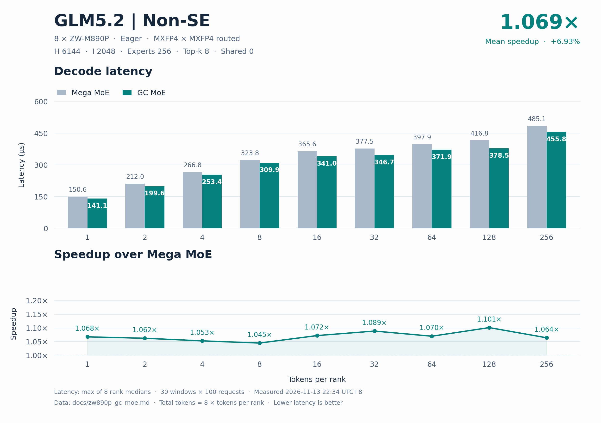
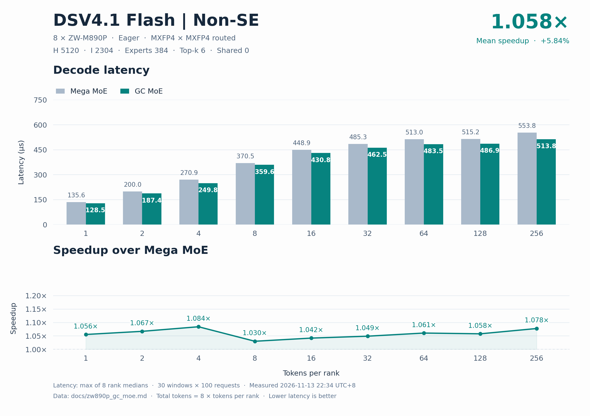

# ZW-M890P 八卡 GC MoE 精度与 decode 性能

两个模型的 default、boundary 和 asymmetric 共 **94/94** 个精度用例通过。八个 rank 的 BF16 输出与独立 MXFP4 参考逐元素一致。

相对 MegaMoE，逐点等权平均加速 **1.063864×**，单点范围 1.030413×～1.101300×，18/18 点领先。

| 模型 | decode 点数 | 平均 MegaMoE / GC | 平均加速收益 | 平均延迟下降 |
| --- | --- | --- | --- | --- |
| GLM5.2 | 9 | 1.069302× | 6.9302% | 6.4598% |
| DSV4.1-Flash | 9 | 1.058426× | 5.8426% | 5.4988% |
| 全部模型等权 | 18 | 1.063864× | 6.3864% | 5.9793% |

平均加速比为 `mean(baseline_us / gc_us)`，平均延迟下降为 `mean(1 − gc_us / baseline_us)`。

## 模型与数据口径

性能复测于 2026-11-13 22:34（北京时间）。单机 EP8，8 × ZW-M890P，GC MoE 0.6.1，PPU SDK 2.2.0-663c22（CUDA 13.0，HGGCRT v3），PPU PyTorch 2.11.0，DeepGEMM `f30d2cd`。使用固定随机种子的合成激活、权重及路由。

| 模型 | H | I | Routed experts | Top-k |
| --- | --- | --- | --- | --- |
| GLM5.2 | 6144 | 2048 | 256 | 8 |
| DSV4.1-Flash | 5120 | 2304 | 384 | 6 |

激活及权重为 MXFP4 E2M1，scale 为 K32 UE8M0，输出为 BF16。每 rank 容量 256，总 token 数为 8T。性能配置为 SwiGLU、alpha=1.0、clamp=10.0、fast_math=true。

每点 10 个预热窗口和 30 个计时窗口，每窗 100 次请求。每窗开始时写零 8 GiB 缓冲冲刷缓存。每次请求单独记录 eager device event，每个窗口先对请求延迟取均值，每个 rank 取 30 个窗口的中位数，再取八个 rank 的最大值。

GC 计时覆盖完整 `ppu_fp4_fp4_gc_moe` 公开 API，包含参数校验和提交。输入量化、输出视图和权重转换在计时前完成。MegaMoE 每次在计时前完成量化和 pre-dispatch，计时覆盖完整 `fp4_fp4_mega_moe`。

调用方写入 workspace 的 packed 激活、UE8M0 scale 和路由视图。GC 通过 push 把路由数据写入接收端 expert 槽位，以实际接收行数执行 FC1/FC2，按 token 和 slot 合并 BF16 贡献。

## 上一轮 T=8、16、32 调度

调度由 token 上界、top-k 与每 rank 本地专家数决定。较大的路由上界使用 48 行 direct tile，合适的小批融合请求使用四级 AIU 缓冲。kernel 根据实际接收行数推进 FC1 和 FC2。

较高 top-k 的 routed direct tile 缩短了就绪轮询间隔。

新旧版本同进程交替运行，每点 45 个计时窗口，每窗 40 次请求。两版均走完整公开 API，输出逐元素一致。

DSV4.1-Flash 的三个 routed 点沿用原调度。前后差异反映重复计时的波动。

| 模型 | T/rank | 调整前 µs | 调整后 µs | 延迟下降 |
| --- | --- | --- | --- | --- |
| GLM5.2 | 8 | 311.630749 | 310.048751 | +0.508% |
| GLM5.2 | 16 | 340.026749 | 339.139748 | +0.261% |
| GLM5.2 | 32 | 343.682001 | 343.631502 | +0.015% |
| DSV4.1-Flash | 8 | 364.244497 | 364.707249 | -0.127% |
| DSV4.1-Flash | 16 | 471.917248 | 458.554001 | +2.832% |
| DSV4.1-Flash | 32 | 460.679000 | 460.277750 | +0.087% |

## GLM5.2 T=2、4、8 复测

小批 top-k=8 routed 请求使用 16 行 tile。对较小的路由上界，FC1 尾部尝试提前预取已就绪 FC2 任务的权重。

以下为调度改动时的新旧对照。新旧版本同进程交替运行，每点 48 个计时窗口，每窗 50 次请求。两版均走完整公开 API，BF16 输出逐元素一致。

T=2 沿用上一轮调度。

| T/rank | 调整前 µs | 调整后 µs | 延迟下降 |
| --- | --- | --- | --- |
| 2 | 198.472400 | 198.084599 | +0.195% |
| 4 | 256.642202 | 255.871700 | +0.300% |
| 8 | 312.268600 | 311.943299 | +0.104% |

## 本轮 GLM5.2 T=2、4、8 复测

以下对照以复测前的同一工作区为起点。新旧版本在同一进程交替运行，每点 45 个计时窗口，每窗 50 次请求。两版均走完整公开 API，BF16 输出逐元素一致。

小批 routed 路径将 FC2 的 BF16 输出成对写入暂存区，保持原有远端写入布局。对较小的路由上界，FC1 一次预取 16 个 K tile 的激活 scale。

| T/rank | 调整前 µs | 调整后 µs | 延迟下降 |
| --- | --- | --- | --- |
| 2 | 203.890401 | 204.550400 | -0.324% |
| 4 | 258.163800 | 257.751398 | +0.160% |
| 8 | 333.857000 | 315.798798 | +5.409% |

另以同一旧实现运行两个对照组，交替测量 42 个窗口，每窗 32 次请求。两列旧版之间的差异可用来判断计时波动。

| T/rank | 旧版 A µs | 旧版 B µs | 新版 µs | 较两组旧版均值延迟下降 |
| --- | --- | --- | --- | --- |
| 2 | 199.116719 | 199.728437 | 199.622812 | -0.100% |
| 4 | 255.388750 | 255.248905 | 255.216407 | +0.040% |
| 8 | 312.603905 | 311.591563 | 311.012499 | +0.348% |

## 精度

独立参考采用分阶段 MXFP4 MoE，按 SM100 的精度测试思路对照 routed 分发、FC1、SwiGLU 及中间量化、FC2 和合并。UT 通过公开 API 运行，使用默认 SwiGLU 配置（无 clamp），逐元素比较 BF16 输出并检查量化输入、输出边界及有限性。

| 模型 | 类别 | 用例通过 | Rank 检查通过 | 最小 GC/ref cosine | 最大 \|GC−ref\| | Finite |
| --- | --- | --- | --- | --- | --- | --- |
| GLM5.2 | default | 9/9 | 72/72 | 0.999999764 | 0.000000 | 全部通过 |
| GLM5.2 | boundary | 23/23 | 184/184 | 0.999999767 | 0.000000 | 全部通过 |
| GLM5.2 | asymmetric | 15/15 | 120/120 | 0.999999764 | 0.000000 | 全部通过 |
| DSV4.1-Flash | default | 9/9 | 72/72 | 0.999999820 | 0.000000 | 全部通过 |
| DSV4.1-Flash | boundary | 23/23 | 184/184 | 0.999999804 | 0.000000 | 全部通过 |
| DSV4.1-Flash | asymmetric | 15/15 | 120/120 | 0.999999820 | 0.000000 | 全部通过 |

### GLM5.2 default 逐组精度

| T/rank 或各 rank token 向量 | 最小 GC/ref cosine | 最大 \|GC−ref\| | 结果 |
| --- | --- | --- | --- |
| 1 | 0.999999886 | 0.000000 | 通过 |
| 2 | 0.999999786 | 0.000000 | 通过 |
| 4 | 0.999999882 | 0.000000 | 通过 |
| 8 | 0.999999764 | 0.000000 | 通过 |
| 16 | 1.000000000 | 0.000000 | 通过 |
| 32 | 0.999999774 | 0.000000 | 通过 |
| 64 | 0.999999771 | 0.000000 | 通过 |
| 128 | 0.999999769 | 0.000000 | 通过 |
| 256 | 0.999999884 | 0.000000 | 通过 |

### GLM5.2 boundary 逐组精度

| T/rank 或各 rank token 向量 | 最小 GC/ref cosine | 最大 \|GC−ref\| | 结果 |
| --- | --- | --- | --- |
| 0 | 1.000000000 | 0.000000 | 通过 |
| 3 | 0.999999918 | 0.000000 | 通过 |
| 5 | 0.999999808 | 0.000000 | 通过 |
| 7 | 0.999999934 | 0.000000 | 通过 |
| 9 | 0.999999810 | 0.000000 | 通过 |
| 15 | 0.999999882 | 0.000000 | 通过 |
| 17 | 0.999999892 | 0.000000 | 通过 |
| 31 | 0.999999939 | 0.000000 | 通过 |
| 33 | 0.999999886 | 0.000000 | 通过 |
| 63 | 0.999999884 | 0.000000 | 通过 |
| 65 | 1.000000000 | 0.000000 | 通过 |
| 95 | 0.999999923 | 0.000000 | 通过 |
| 96 | 0.999999923 | 0.000000 | 通过 |
| 97 | 0.999999849 | 0.000000 | 通过 |
| 127 | 0.999999883 | 0.000000 | 通过 |
| 129 | 1.000000000 | 0.000000 | 通过 |
| 191 | 0.999999922 | 0.000000 | 通过 |
| 192 | 0.999999923 | 0.000000 | 通过 |
| 193 | 0.999999923 | 0.000000 | 通过 |
| 239 | 0.999999938 | 0.000000 | 通过 |
| 240 | 0.999999877 | 0.000000 | 通过 |
| 241 | 0.999999938 | 0.000000 | 通过 |
| 255 | 0.999999767 | 0.000000 | 通过 |

### GLM5.2 asymmetric 逐组精度

| T/rank 或各 rank token 向量 | 最小 GC/ref cosine | 最大 \|GC−ref\| | 结果 |
| --- | --- | --- | --- |
| 0 | 1.000000000 | 0.000000 | 通过 |
| [256, 0, 256, 0, 256, 0, 256, 0] | 0.999999884 | 0.000000 | 通过 |
| [1, 0, 1, 0, 1, 0, 1, 0] | 0.999999940 | 0.000000 | 通过 |
| [1, 2, 4, 8, 16, 32, 64, 128] | 0.999999882 | 0.000000 | 通过 |
| [256, 0, 0, 0, 0, 0, 0, 0] | 1.000000000 | 0.000000 | 通过 |
| 256 | 0.999999884 | 0.000000 | 通过 |
| [256, 256, 0, 256, 256, 256, 256, 256] | 0.999999884 | 0.000000 | 通过 |
| [256, 256, 256, 0, 256, 256, 256, 256] | 0.999999884 | 0.000000 | 通过 |
| [0, 0, 0, 0, 0, 256, 0, 0] | 1.000000000 | 0.000000 | 通过 |
| [0, 0, 0, 0, 0, 0, 256, 0] | 1.000000000 | 0.000000 | 通过 |
| [256, 256, 256, 256, 256, 256, 256, 0] | 0.999999884 | 0.000000 | 通过 |
| [0, 1, 2, 3, 4, 5, 7, 8] | 0.999999764 | 0.000000 | 通过 |
| [9, 15, 16, 17, 31, 32, 33, 63] | 0.999999886 | 0.000000 | 通过 |
| [64, 65, 95, 96, 97, 127, 128, 129] | 0.999999771 | 0.000000 | 通过 |
| [191, 192, 193, 239, 240, 241, 255, 256] | 0.999999878 | 0.000000 | 通过 |

### DSV4.1-Flash default 逐组精度

| T/rank 或各 rank token 向量 | 最小 GC/ref cosine | 最大 \|GC−ref\| | 结果 |
| --- | --- | --- | --- |
| 1 | 0.999999820 | 0.000000 | 通过 |
| 2 | 0.999999897 | 0.000000 | 通过 |
| 4 | 0.999999932 | 0.000000 | 通过 |
| 8 | 0.999999930 | 0.000000 | 通过 |
| 16 | 0.999999935 | 0.000000 | 通过 |
| 32 | 0.999999871 | 0.000000 | 通过 |
| 64 | 1.000000000 | 0.000000 | 通过 |
| 128 | 0.999999866 | 0.000000 | 通过 |
| 256 | 0.999999932 | 0.000000 | 通过 |

### DSV4.1-Flash boundary 逐组精度

| T/rank 或各 rank token 向量 | 最小 GC/ref cosine | 最大 \|GC−ref\| | 结果 |
| --- | --- | --- | --- |
| 0 | 1.000000000 | 0.000000 | 通过 |
| 3 | 0.999999886 | 0.000000 | 通过 |
| 5 | 0.999999890 | 0.000000 | 通过 |
| 7 | 0.999999861 | 0.000000 | 通过 |
| 9 | 0.999999884 | 0.000000 | 通过 |
| 15 | 0.999999931 | 0.000000 | 通过 |
| 17 | 0.999999940 | 0.000000 | 通过 |
| 31 | 0.999999930 | 0.000000 | 通过 |
| 33 | 0.999999934 | 0.000000 | 通过 |
| 63 | 0.999999931 | 0.000000 | 通过 |
| 65 | 0.999999871 | 0.000000 | 通过 |
| 95 | 0.999999818 | 0.000000 | 通过 |
| 96 | 0.999999910 | 0.000000 | 通过 |
| 97 | 0.999999911 | 0.000000 | 通过 |
| 127 | 0.999999932 | 0.000000 | 通过 |
| 129 | 0.999999804 | 0.000000 | 通过 |
| 191 | 0.999999910 | 0.000000 | 通过 |
| 192 | 0.999999911 | 0.000000 | 通过 |
| 193 | 1.000000000 | 0.000000 | 通过 |
| 239 | 0.999999855 | 0.000000 | 通过 |
| 240 | 0.999999858 | 0.000000 | 通过 |
| 241 | 0.999999929 | 0.000000 | 通过 |
| 255 | 0.999999864 | 0.000000 | 通过 |

### DSV4.1-Flash asymmetric 逐组精度

| T/rank 或各 rank token 向量 | 最小 GC/ref cosine | 最大 \|GC−ref\| | 结果 |
| --- | --- | --- | --- |
| 0 | 1.000000000 | 0.000000 | 通过 |
| [256, 0, 256, 0, 256, 0, 256, 0] | 0.999999933 | 0.000000 | 通过 |
| [1, 0, 1, 0, 1, 0, 1, 0] | 0.999999820 | 0.000000 | 通过 |
| [1, 2, 4, 8, 16, 32, 64, 128] | 0.999999871 | 0.000000 | 通过 |
| [256, 0, 0, 0, 0, 0, 0, 0] | 1.000000000 | 0.000000 | 通过 |
| 256 | 0.999999932 | 0.000000 | 通过 |
| [256, 256, 0, 256, 256, 256, 256, 256] | 0.999999932 | 0.000000 | 通过 |
| [256, 256, 256, 0, 256, 256, 256, 256] | 0.999999932 | 0.000000 | 通过 |
| [0, 0, 0, 0, 0, 256, 0, 0] | 0.999999934 | 0.000000 | 通过 |
| [0, 0, 0, 0, 0, 0, 256, 0] | 0.999999933 | 0.000000 | 通过 |
| [256, 256, 256, 256, 256, 256, 256, 0] | 0.999999932 | 0.000000 | 通过 |
| [0, 1, 2, 3, 4, 5, 7, 8] | 0.999999897 | 0.000000 | 通过 |
| [9, 15, 16, 17, 31, 32, 33, 63] | 0.999999871 | 0.000000 | 通过 |
| [64, 65, 95, 96, 97, 127, 128, 129] | 0.999999866 | 0.000000 | 通过 |
| [191, 192, 193, 239, 240, 241, 255, 256] | 0.999999933 | 0.000000 | 通过 |

## GLM5.2 decode 性能

| T/rank | 总 token | MegaMoE µs | GC µs | MegaMoE / GC | 较基线延迟下降 |
| --- | --- | --- | --- | --- | --- |
| 1 | 8 | 150.619100 | 141.088100 | 1.067554× | 6.3279% |
| 2 | 16 | 212.005000 | 199.561400 | 1.062355× | 5.8695% |
| 4 | 32 | 266.826100 | 253.446600 | 1.052790× | 5.0143% |
| 8 | 64 | 323.800850 | 309.893200 | 1.044879× | 4.2951% |
| 16 | 128 | 365.640049 | 341.036101 | 1.072145× | 6.7290% |
| 32 | 256 | 377.450050 | 346.696349 | 1.088705× | 8.1478% |
| 64 | 512 | 397.888649 | 371.917000 | 1.069832× | 6.5274% |
| 128 | 1024 | 416.823800 | 378.483600 | 1.101300× | 9.1982% |
| 256 | 2048 | 485.093299 | 455.845650 | 1.064161× | 6.0293% |



## DSV4.1-Flash decode 性能

| T/rank | 总 token | MegaMoE µs | GC µs | MegaMoE / GC | 较基线延迟下降 |
| --- | --- | --- | --- | --- | --- |
| 1 | 8 | 135.636400 | 128.490350 | 1.055615× | 5.2685% |
| 2 | 16 | 200.035700 | 187.420599 | 1.067309× | 6.3064% |
| 4 | 32 | 270.904850 | 249.839850 | 1.084314× | 7.7758% |
| 8 | 64 | 370.503701 | 359.568149 | 1.030413× | 2.9515% |
| 16 | 128 | 448.926300 | 430.765001 | 1.042161× | 4.0455% |
| 32 | 256 | 485.279050 | 462.493601 | 1.049267× | 4.6953% |
| 64 | 512 | 512.960999 | 483.512451 | 1.060905× | 5.7409% |
| 128 | 1024 | 515.169702 | 486.896701 | 1.058068× | 5.4881% |
| 256 | 2048 | 553.752949 | 513.787202 | 1.077787× | 7.2173% |



## 有效工作量

下列指标使用本次测试的实际路由与逻辑数据量估算。物理事务数由实现决定。SE 的权重与计算指标计入每个 rank 的本地 shared expert。

| 模型 | T/rank | 命中专家数 | Routed assignments | 远程 assignments |
| --- | --- | --- | --- | --- |
| GLM5.2 | 1 | 52 | 64 | 52 |
| GLM5.2 | 2 | 99 | 128 | 110 |
| GLM5.2 | 4 | 156 | 256 | 226 |
| GLM5.2 | 8 | 222 | 512 | 457 |
| GLM5.2 | 16 | 254 | 1024 | 896 |
| GLM5.2 | 32 | 256 | 2048 | 1787 |
| GLM5.2 | 64 | 256 | 4096 | 3574 |
| GLM5.2 | 128 | 256 | 8192 | 7138 |
| GLM5.2 | 256 | 256 | 16384 | 14340 |
| DSV4.1-Flash | 1 | 46 | 48 | 44 |
| DSV4.1-Flash | 2 | 85 | 96 | 88 |
| DSV4.1-Flash | 4 | 156 | 192 | 171 |
| DSV4.1-Flash | 8 | 248 | 384 | 339 |
| DSV4.1-Flash | 16 | 341 | 768 | 669 |
| DSV4.1-Flash | 32 | 376 | 1536 | 1340 |
| DSV4.1-Flash | 64 | 384 | 3072 | 2678 |
| DSV4.1-Flash | 128 | 384 | 6144 | 5375 |
| DSV4.1-Flash | 256 | 384 | 12288 | 10767 |

## 有效 HBM 带宽

每个命中的 expert 计一次逻辑 MXFP4 权重与 K32 scale。每个 expert 为 3 × H × I × (1/2 + 1/32) 字节。单位 GB/s。

### GLM5.2

| T/rank | 基线八卡合计 | GC 八卡合计 | 基线每 PPU 均值 | GC 每 PPU 均值 |
| --- | --- | --- | --- | --- |
| 1 | 6923.48 | 7391.19 | 865.44 | 923.90 |
| 2 | 9364.63 | 9948.56 | 1170.58 | 1243.57 |
| 4 | 11724.59 | 12343.53 | 1465.57 | 1542.94 |
| 8 | 13749.17 | 14366.21 | 1718.65 | 1795.78 |
| 16 | 13930.97 | 14936.01 | 1741.37 | 1867.00 |
| 32 | 13601.34 | 14807.85 | 1700.17 | 1850.98 |
| 64 | 12902.68 | 13803.69 | 1612.83 | 1725.46 |
| 128 | 12316.54 | 13564.20 | 1539.57 | 1695.53 |
| 256 | 10583.18 | 11262.21 | 1322.90 | 1407.78 |

### DSV4.1-Flash

| T/rank | 基线八卡合计 | GC 八卡合计 | 基线每 PPU 均值 | GC 每 PPU 均值 |
| --- | --- | --- | --- | --- |
| 1 | 6376.09 | 6730.70 | 797.01 | 841.34 |
| 2 | 7988.85 | 8526.57 | 998.61 | 1065.82 |
| 4 | 10826.31 | 11739.12 | 1353.29 | 1467.39 |
| 8 | 12584.38 | 12967.11 | 1573.05 | 1620.89 |
| 16 | 14280.78 | 14882.87 | 1785.10 | 1860.36 |
| 32 | 14566.96 | 15284.62 | 1820.87 | 1910.58 |
| 64 | 14074.06 | 14931.25 | 1759.26 | 1866.41 |
| 128 | 14013.72 | 14827.47 | 1751.72 | 1853.43 |
| 256 | 13037.30 | 14051.43 | 1629.66 | 1756.43 |

## 有效 PPU 互连带宽

每个远程 assignment 计 H/2 + H/32 + 2H 字节，覆盖 MXFP4 激活、UE8M0 scale 与 BF16 返回。单位 GB/s。

### GLM5.2

| T/rank | 基线八卡合计 | GC 八卡合计 | 基线每 PPU 均值 | GC 每 PPU 均值 |
| --- | --- | --- | --- | --- |
| 1 | 5.37 | 5.73 | 0.67 | 0.72 |
| 2 | 8.07 | 8.57 | 1.01 | 1.07 |
| 4 | 13.17 | 13.87 | 1.65 | 1.73 |
| 8 | 21.95 | 22.93 | 2.74 | 2.87 |
| 16 | 38.11 | 40.86 | 4.76 | 5.11 |
| 32 | 73.63 | 80.16 | 9.20 | 10.02 |
| 64 | 139.69 | 149.45 | 17.46 | 18.68 |
| 128 | 266.32 | 293.30 | 33.29 | 36.66 |
| 256 | 459.74 | 489.24 | 57.47 | 61.15 |

### DSV4.1-Flash

| T/rank | 基线八卡合计 | GC 八卡合计 | 基线每 PPU 均值 | GC 每 PPU 均值 |
| --- | --- | --- | --- | --- |
| 1 | 4.20 | 4.44 | 0.53 | 0.55 |
| 2 | 5.70 | 6.09 | 0.71 | 0.76 |
| 4 | 8.18 | 8.87 | 1.02 | 1.11 |
| 8 | 11.86 | 12.22 | 1.48 | 1.53 |
| 16 | 19.31 | 20.13 | 2.41 | 2.52 |
| 32 | 35.79 | 37.55 | 4.47 | 4.69 |
| 64 | 67.66 | 71.78 | 8.46 | 8.97 |
| 128 | 135.22 | 143.07 | 16.90 | 17.88 |
| 256 | 251.99 | 271.59 | 31.50 | 33.95 |

## 有效矩阵计算吞吐

每个有效 expert assignment 计 6 × H × I FLOP，覆盖 FC1 与 FC2。单位 TFLOPS。

### GLM5.2

| T/rank | 基线八卡合计 | GC 八卡合计 | 基线每 PPU 均值 | GC 每 PPU 均值 |
| --- | --- | --- | --- | --- |
| 1 | 32.08 | 34.25 | 4.01 | 4.28 |
| 2 | 45.58 | 48.42 | 5.70 | 6.05 |
| 4 | 72.43 | 76.26 | 9.05 | 9.53 |
| 8 | 119.38 | 124.74 | 14.92 | 15.59 |
| 16 | 211.44 | 226.69 | 26.43 | 28.34 |
| 32 | 409.64 | 445.98 | 51.21 | 55.75 |
| 64 | 777.20 | 831.47 | 97.15 | 103.93 |
| 128 | 1483.78 | 1634.09 | 185.47 | 204.26 |
| 256 | 2549.92 | 2713.53 | 318.74 | 339.19 |

### DSV4.1-Flash

| T/rank | 基线八卡合计 | GC 八卡合计 | 基线每 PPU 均值 | GC 每 PPU 均值 |
| --- | --- | --- | --- | --- |
| 1 | 25.05 | 26.44 | 3.13 | 3.31 |
| 2 | 33.97 | 36.25 | 4.25 | 4.53 |
| 4 | 50.16 | 54.39 | 6.27 | 6.80 |
| 8 | 73.36 | 75.59 | 9.17 | 9.45 |
| 16 | 121.08 | 126.19 | 15.14 | 15.77 |
| 32 | 224.03 | 235.07 | 28.00 | 29.38 |
| 64 | 423.88 | 449.69 | 52.98 | 56.21 |
| 128 | 844.12 | 893.14 | 105.52 | 111.64 |
| 256 | 1570.61 | 1692.78 | 196.33 | 211.60 |

两个模型各通过 3000 轮 workspace 复用，覆盖 T=2、4、8、空 rank、集中路由和随机路由。

## 复现

```bash
bash scripts/run_ppu.sh SDK_DIR test --case-category default
bash scripts/run_ppu.sh SDK_DIR test --case-category boundary
bash scripts/run_ppu.sh SDK_DIR test --case-category asymmetric
bash scripts/run_ppu.sh SDK_DIR bench
bash scripts/run_ppu.sh SDK_DIR test --readiness --steps 3000 --tokens 2,4,8
```

`SDK_DIR` 下包含 `PPU_SDK`、`nccl22/pccl` 和 PPU Python 环境 `venv`。可用 `GC_MOE_RESULT_DIR` 指定 JSON 输出目录。
