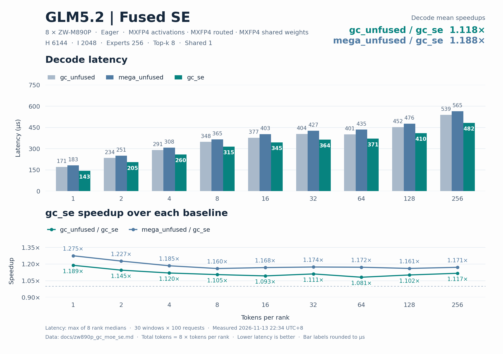
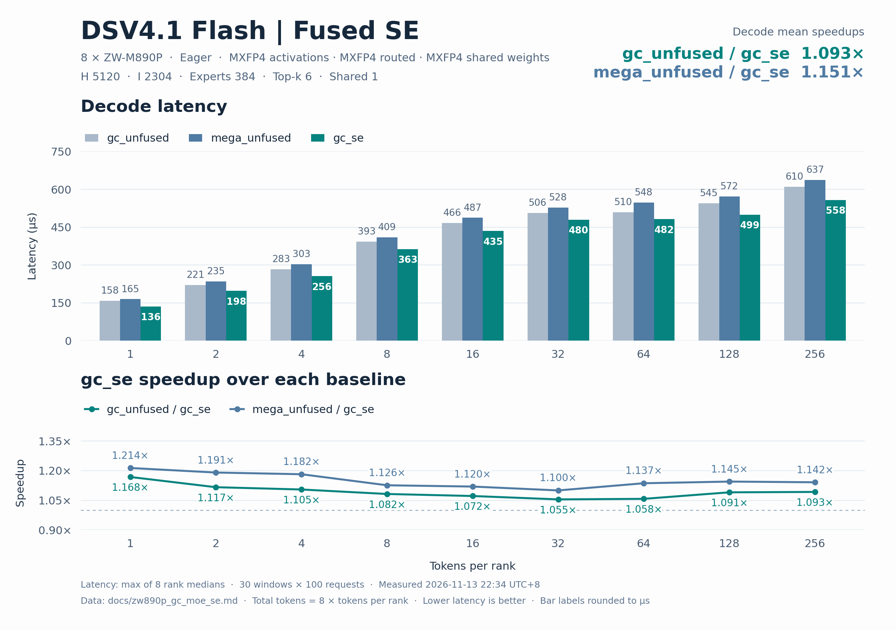

# ZW-M890P 八卡 GC MoE SE 精度与 decode 性能

两个模型的 default、boundary 和 asymmetric 共 **94/94** 个精度用例通过。八个 rank 的 BF16 输出与独立 MXFP4 参考逐元素一致。

相对 MegaMoE + 串行 SE，逐点等权平均加速 **1.169374×**，单点范围 1.100390×～1.274935×，18/18 点领先。

| 模型 | decode 点数 | 平均 MegaMoE + 串行 SE / GC | 平均加速收益 | 平均延迟下降 | 平均未融合 GC / GC SE | 平均 SE 延迟增幅 | 最大 SE 延迟增幅 | 增幅 ≤ 5% |
| --- | --- | --- | --- | --- | --- | --- | --- | --- |
| GLM5.2 | 9 | 1.188002× | 18.8002% | 15.7505% | 1.118252× | +3.3584% | +5.8367% | 8/9 |
| DSV4.1-Flash | 9 | 1.150746× | 15.0746% | 13.0208% | 1.093399× | +3.3979% | +5.5517% | 7/9 |
| 全部模型等权 | 18 | 1.169374× | 16.9374% | 14.3857% | 1.105826× | +3.3781% | +5.8367% | 15/18 |

平均加速比为 `mean(baseline_us / gc_us)`，平均延迟下降为 `mean(1 − gc_us / baseline_us)`。融合开销使用同轮 routed GC 对照，按 `gc_se_us / gc_routed_us − 1` 计算。

## 模型与数据口径

性能复测于 2026-11-13 22:34（北京时间）。单机 EP8，8 × ZW-M890P，GC MoE 0.6.1，PPU SDK 2.2.0-663c22（CUDA 13.0，HGGCRT v3），PPU PyTorch 2.11.0，DeepGEMM `f30d2cd`。使用固定随机种子的合成激活、权重及路由。

| 模型 | H | I | Routed experts | Top-k | Shared experts | Shared recipe |
| --- | --- | --- | --- | --- | --- | --- |
| GLM5.2 | 6144 | 2048 | 256 | 8 | 1 | (1, 1, 32) |
| DSV4.1-Flash | 5120 | 2304 | 384 | 6 | 1 | (1, 1, 32) |

激活及权重为 MXFP4 E2M1，scale 为 K32 UE8M0，输出为 BF16。每 rank 容量 256，总 token 数为 8T。性能配置为 SwiGLU、alpha=1.0、clamp=10.0、fast_math=true。

每点 10 个预热窗口和 30 个计时窗口，每窗 100 次请求。每窗开始时写零 8 GiB 缓冲冲刷缓存。每次请求单独记录 eager device event，每个窗口先对请求延迟取均值，每个 rank 取 30 个窗口的中位数，再取八个 rank 的最大值。

GC 计时覆盖完整 `ppu_fp4_fp4_gc_moe` 公开 API，包含参数校验和提交。输入量化、输出视图和权重转换在计时前完成。MegaMoE 每次在计时前完成量化和 pre-dispatch，计时覆盖完整 `fp4_fp4_mega_moe`。

SE 图展示 `mega_unfused / gc_se` 和 `gc_unfused / gc_se`。两条基线分别用 MegaMoE 和 GC MoE 计算 routed experts，随后串行运行 shared expert。另外记录只计算 routed experts 的 `gc_routed`，用于计算融合额外开销。

融合路径在 Role2 执行本地 shared FFN，Role3 归并 BF16 shared 输出与 routed 贡献。两条串行基线各自完成 routed 阶段，然后执行相同的本地 shared FC1、SwiGLU 与 MXFP4 转换、FC2 和输出相加。

## 上一轮 T=8、16、32 调度

调度由 token 上界、top-k 与每 rank 本地专家数决定。较大的路由上界使用 48 行 direct tile，合适的小批融合请求使用四级 AIU 缓冲。kernel 根据实际接收行数推进 FC1 和 FC2。

新旧版本同进程交替运行，每点 45 个计时窗口，每窗 40 次请求。两版均走完整公开 API，输出逐元素一致。

| 模型 | T/rank | 调整前 µs | 调整后 µs | 延迟下降 |
| --- | --- | --- | --- | --- |
| GLM5.2 | 8 | 324.570249 | 319.479250 | +1.569% |
| GLM5.2 | 16 | 349.265501 | 349.887249 | -0.178% |
| GLM5.2 | 32 | 385.816249 | 364.586248 | +5.503% |
| DSV4.1-Flash | 8 | 371.791499 | 367.632999 | +1.119% |
| DSV4.1-Flash | 16 | 441.208751 | 438.449001 | +0.625% |
| DSV4.1-Flash | 32 | 482.972503 | 471.147748 | +2.448% |

## GLM5.2 T=2、4、8 复测

小批 top-k=8 融合请求使用 16 行 tile 和四级 AIU 缓冲。每个 warp 复用同一个 token 的激活读取，向两个独立的路由槽位写入。

以下为调度改动时的新旧对照。新旧版本同进程交替运行，每点 48 个计时窗口，每窗 50 次请求。两版均走完整公开 API，BF16 输出逐元素一致。

T=4 沿用上一轮调度。

| T/rank | 调整前 µs | 调整后 µs | 延迟下降 |
| --- | --- | --- | --- |
| 2 | 211.656100 | 209.523800 | +1.007% |
| 4 | 260.694098 | 260.288600 | +0.156% |
| 8 | 315.702800 | 316.359600 | -0.208% |

## 本轮 GLM5.2 T=2、4、8 复测

以下对照以复测前的同一工作区为起点。新旧版本在同一进程交替运行，每点 45 个计时窗口，每窗 50 次请求。两版均走完整公开 API，BF16 输出逐元素一致。

小批融合路径用 16 字节为单位的 TSM 地址计算 MMA 片段位置，减少 A/B 片段寻址指令。

| T/rank | 调整前 µs | 调整后 µs | 延迟下降 |
| --- | --- | --- | --- |
| 2 | 208.759400 | 208.384999 | +0.179% |
| 4 | 261.867598 | 261.071799 | +0.304% |
| 8 | 317.330998 | 315.877400 | +0.458% |

另以同一旧实现运行两个对照组，交替测量 42 个窗口，每窗 32 次请求。两列旧版之间的差异可用来判断计时波动。

| T/rank | 旧版 A µs | 旧版 B µs | 新版 µs | 较两组旧版均值延迟下降 |
| --- | --- | --- | --- | --- |
| 2 | 208.552030 | 208.512031 | 208.490000 | +0.020% |
| 4 | 265.418907 | 264.792812 | 261.766718 | +1.260% |
| 8 | 317.579063 | 316.729219 | 315.435314 | +0.542% |

## 精度

独立参考采用分阶段 MXFP4 MoE，按 SM100 的精度测试思路对照 routed 分发、FC1、SwiGLU 及中间量化、FC2 和合并。SE 的独立参考另执行本地 shared FFN。UT 通过公开 API 运行，使用默认 SwiGLU 配置（无 clamp），逐元素比较 BF16 输出并检查量化输入、输出边界及有限性。

| 模型 | 类别 | 用例通过 | Rank 检查通过 | 最小 GC/ref cosine | 最大 \|GC−ref\| | Finite |
| --- | --- | --- | --- | --- | --- | --- |
| GLM5.2 | default | 9/9 | 72/72 | 0.999999868 | 0.000000 | 全部通过 |
| GLM5.2 | boundary | 23/23 | 184/184 | 0.999999824 | 0.000000 | 全部通过 |
| GLM5.2 | asymmetric | 15/15 | 120/120 | 0.999999826 | 0.000000 | 全部通过 |
| DSV4.1-Flash | default | 9/9 | 72/72 | 0.999999815 | 0.000000 | 全部通过 |
| DSV4.1-Flash | boundary | 23/23 | 184/184 | 0.999999804 | 0.000000 | 全部通过 |
| DSV4.1-Flash | asymmetric | 15/15 | 120/120 | 0.999999869 | 0.000000 | 全部通过 |

### GLM5.2 default 逐组精度

| T/rank 或各 rank token 向量 | 最小 GC/ref cosine | 最大 \|GC−ref\| | 结果 |
| --- | --- | --- | --- |
| 1 | 0.999999883 | 0.000000 | 通过 |
| 2 | 0.999999884 | 0.000000 | 通过 |
| 4 | 0.999999871 | 0.000000 | 通过 |
| 8 | 0.999999871 | 0.000000 | 通过 |
| 16 | 0.999999934 | 0.000000 | 通过 |
| 32 | 0.999999868 | 0.000000 | 通过 |
| 64 | 0.999999869 | 0.000000 | 通过 |
| 128 | 0.999999934 | 0.000000 | 通过 |
| 256 | 0.999999934 | 0.000000 | 通过 |

### GLM5.2 boundary 逐组精度

| T/rank 或各 rank token 向量 | 最小 GC/ref cosine | 最大 \|GC−ref\| | 结果 |
| --- | --- | --- | --- |
| 0 | 1.000000000 | 0.000000 | 通过 |
| 3 | 0.999999917 | 0.000000 | 通过 |
| 5 | 0.999999895 | 0.000000 | 通过 |
| 7 | 0.999999926 | 0.000000 | 通过 |
| 9 | 0.999999877 | 0.000000 | 通过 |
| 15 | 0.999999863 | 0.000000 | 通过 |
| 17 | 1.000000000 | 0.000000 | 通过 |
| 31 | 0.999999864 | 0.000000 | 通过 |
| 33 | 0.999999872 | 0.000000 | 通过 |
| 63 | 0.999999867 | 0.000000 | 通过 |
| 65 | 0.999999873 | 0.000000 | 通过 |
| 95 | 0.999999911 | 0.000000 | 通过 |
| 96 | 1.000000000 | 0.000000 | 通过 |
| 97 | 0.999999828 | 0.000000 | 通过 |
| 127 | 0.999999933 | 0.000000 | 通过 |
| 129 | 0.999999870 | 0.000000 | 通过 |
| 191 | 0.999999824 | 0.000000 | 通过 |
| 192 | 0.999999826 | 0.000000 | 通过 |
| 193 | 0.999999826 | 0.000000 | 通过 |
| 239 | 0.999999930 | 0.000000 | 通过 |
| 240 | 0.999999930 | 0.000000 | 通过 |
| 241 | 0.999999930 | 0.000000 | 通过 |
| 255 | 0.999999934 | 0.000000 | 通过 |

### GLM5.2 asymmetric 逐组精度

| T/rank 或各 rank token 向量 | 最小 GC/ref cosine | 最大 \|GC−ref\| | 结果 |
| --- | --- | --- | --- |
| 0 | 1.000000000 | 0.000000 | 通过 |
| [256, 0, 256, 0, 256, 0, 256, 0] | 0.999999934 | 0.000000 | 通过 |
| [1, 0, 1, 0, 1, 0, 1, 0] | 1.000000000 | 0.000000 | 通过 |
| [1, 2, 4, 8, 16, 32, 64, 128] | 0.999999934 | 0.000000 | 通过 |
| [256, 0, 0, 0, 0, 0, 0, 0] | 1.000000000 | 0.000000 | 通过 |
| 256 | 0.999999934 | 0.000000 | 通过 |
| [256, 256, 0, 256, 256, 256, 256, 256] | 0.999999934 | 0.000000 | 通过 |
| [256, 256, 256, 0, 256, 256, 256, 256] | 0.999999934 | 0.000000 | 通过 |
| [0, 0, 0, 0, 0, 256, 0, 0] | 0.999999934 | 0.000000 | 通过 |
| [0, 0, 0, 0, 0, 0, 256, 0] | 1.000000000 | 0.000000 | 通过 |
| [256, 256, 256, 256, 256, 256, 256, 0] | 0.999999934 | 0.000000 | 通过 |
| [0, 1, 2, 3, 4, 5, 7, 8] | 0.999999871 | 0.000000 | 通过 |
| [9, 15, 16, 17, 31, 32, 33, 63] | 0.999999933 | 0.000000 | 通过 |
| [64, 65, 95, 96, 97, 127, 128, 129] | 0.999999935 | 0.000000 | 通过 |
| [191, 192, 193, 239, 240, 241, 255, 256] | 0.999999826 | 0.000000 | 通过 |

### DSV4.1-Flash default 逐组精度

| T/rank 或各 rank token 向量 | 最小 GC/ref cosine | 最大 \|GC−ref\| | 结果 |
| --- | --- | --- | --- |
| 1 | 0.999999910 | 0.000000 | 通过 |
| 2 | 0.999999890 | 0.000000 | 通过 |
| 4 | 0.999999897 | 0.000000 | 通过 |
| 8 | 0.999999815 | 0.000000 | 通过 |
| 16 | 0.999999905 | 0.000000 | 通过 |
| 32 | 0.999999903 | 0.000000 | 通过 |
| 64 | 0.999999904 | 0.000000 | 通过 |
| 128 | 0.999999903 | 0.000000 | 通过 |
| 256 | 0.999999903 | 0.000000 | 通过 |

### DSV4.1-Flash boundary 逐组精度

| T/rank 或各 rank token 向量 | 最小 GC/ref cosine | 最大 \|GC−ref\| | 结果 |
| --- | --- | --- | --- |
| 0 | 1.000000000 | 0.000000 | 通过 |
| 3 | 0.999999878 | 0.000000 | 通过 |
| 5 | 1.000000000 | 0.000000 | 通过 |
| 7 | 0.999999890 | 0.000000 | 通过 |
| 9 | 0.999999911 | 0.000000 | 通过 |
| 15 | 0.999999897 | 0.000000 | 通过 |
| 17 | 0.999999908 | 0.000000 | 通过 |
| 31 | 0.999999899 | 0.000000 | 通过 |
| 33 | 0.999999813 | 0.000000 | 通过 |
| 63 | 0.999999804 | 0.000000 | 通过 |
| 65 | 0.999999903 | 0.000000 | 通过 |
| 95 | 0.999999869 | 0.000000 | 通过 |
| 96 | 0.999999870 | 0.000000 | 通过 |
| 97 | 0.999999807 | 0.000000 | 通过 |
| 127 | 0.999999806 | 0.000000 | 通过 |
| 129 | 0.999999903 | 0.000000 | 通过 |
| 191 | 0.999999935 | 0.000000 | 通过 |
| 192 | 0.999999871 | 0.000000 | 通过 |
| 193 | 0.999999807 | 0.000000 | 通过 |
| 239 | 0.999999896 | 0.000000 | 通过 |
| 240 | 1.000000000 | 0.000000 | 通过 |
| 241 | 0.999999897 | 0.000000 | 通过 |
| 255 | 0.999999806 | 0.000000 | 通过 |

### DSV4.1-Flash asymmetric 逐组精度

| T/rank 或各 rank token 向量 | 最小 GC/ref cosine | 最大 \|GC−ref\| | 结果 |
| --- | --- | --- | --- |
| 0 | 1.000000000 | 0.000000 | 通过 |
| [256, 0, 256, 0, 256, 0, 256, 0] | 0.999999904 | 0.000000 | 通过 |
| [1, 0, 1, 0, 1, 0, 1, 0] | 0.999999910 | 0.000000 | 通过 |
| [1, 2, 4, 8, 16, 32, 64, 128] | 0.999999902 | 0.000000 | 通过 |
| [256, 0, 0, 0, 0, 0, 0, 0] | 0.999999904 | 0.000000 | 通过 |
| 256 | 0.999999903 | 0.000000 | 通过 |
| [256, 256, 0, 256, 256, 256, 256, 256] | 0.999999903 | 0.000000 | 通过 |
| [256, 256, 256, 0, 256, 256, 256, 256] | 0.999999903 | 0.000000 | 通过 |
| [0, 0, 0, 0, 0, 256, 0, 0] | 1.000000000 | 0.000000 | 通过 |
| [0, 0, 0, 0, 0, 0, 256, 0] | 1.000000000 | 0.000000 | 通过 |
| [256, 256, 256, 256, 256, 256, 256, 0] | 0.999999903 | 0.000000 | 通过 |
| [0, 1, 2, 3, 4, 5, 7, 8] | 0.999999894 | 0.000000 | 通过 |
| [9, 15, 16, 17, 31, 32, 33, 63] | 0.999999901 | 0.000000 | 通过 |
| [64, 65, 95, 96, 97, 127, 128, 129] | 0.999999869 | 0.000000 | 通过 |
| [191, 192, 193, 239, 240, 241, 255, 256] | 0.999999871 | 0.000000 | 通过 |

## GLM5.2 decode 性能

| T/rank | 总 token | MegaMoE + 串行 SE µs | GC SE µs | 未融合 GC µs | Routed GC µs | MegaMoE + 串行 SE / GC | 较基线延迟下降 | 未融合 GC / GC SE | SE 延迟增幅 |
| --- | --- | --- | --- | --- | --- | --- | --- | --- | --- |
| 1 | 8 | 182.935400 | 143.486050 | 170.596450 | 140.420450 | 1.274935× | 21.5646% | 1.188941× | +2.1832% |
| 2 | 16 | 251.100150 | 204.640700 | 234.383200 | 197.940250 | 1.227029× | 18.5024% | 1.145340× | +3.3851% |
| 4 | 32 | 307.770250 | 259.785251 | 290.866300 | 254.085000 | 1.184710× | 15.5912% | 1.119641× | +2.2434% |
| 8 | 64 | 365.255900 | 314.884999 | 348.016899 | 309.261250 | 1.159966× | 13.7906% | 1.105219× | +1.8184% |
| 16 | 128 | 402.964350 | 344.859150 | 377.074900 | 337.646401 | 1.168490× | 14.4194% | 1.093417× | +2.1362% |
| 32 | 256 | 427.115100 | 363.925501 | 404.419200 | 349.353899 | 1.173633× | 14.7945% | 1.111269× | +4.1710% |
| 64 | 512 | 434.542999 | 370.882801 | 401.106551 | 354.688600 | 1.171645× | 14.6499% | 1.081491× | +4.5658% |
| 128 | 1024 | 475.879150 | 409.973850 | 451.748350 | 394.638950 | 1.160755× | 13.8492% | 1.101896× | +3.8858% |
| 256 | 2048 | 564.878852 | 482.448850 | 538.922401 | 455.842852 | 1.170857× | 14.5925% | 1.117056× | +5.8367% |



## DSV4.1-Flash decode 性能

| T/rank | 总 token | MegaMoE + 串行 SE µs | GC SE µs | 未融合 GC µs | Routed GC µs | MegaMoE + 串行 SE / GC | 较基线延迟下降 | 未融合 GC / GC SE | SE 延迟增幅 |
| --- | --- | --- | --- | --- | --- | --- | --- | --- | --- |
| 1 | 8 | 164.651149 | 135.649600 | 158.482900 | 129.443900 | 1.213798× | 17.6139% | 1.168326× | +4.7941% |
| 2 | 16 | 235.379600 | 197.664901 | 220.716300 | 187.268300 | 1.190801× | 16.0229% | 1.116619× | +5.5517% |
| 4 | 32 | 302.800799 | 256.129150 | 283.027250 | 247.176700 | 1.182219× | 15.4133% | 1.105018× | +3.6219% |
| 8 | 64 | 409.297200 | 363.375349 | 393.288500 | 357.809500 | 1.126376× | 11.2197% | 1.082320× | +1.5555% |
| 16 | 128 | 487.163450 | 435.010150 | 466.367651 | 429.632800 | 1.119890× | 10.7055% | 1.072085× | +1.2516% |
| 32 | 256 | 527.826550 | 479.672149 | 506.057651 | 468.594550 | 1.100390× | 9.1231% | 1.055007× | +2.3640% |
| 64 | 512 | 547.688100 | 481.854600 | 509.693699 | 464.733250 | 1.136625× | 12.0203% | 1.057775× | +3.6841% |
| 128 | 1024 | 571.790899 | 499.343251 | 544.648901 | 487.884400 | 1.145086× | 12.6703% | 1.090730× | +2.3487% |
| 256 | 2048 | 636.764351 | 557.815150 | 609.530650 | 529.190801 | 1.141533× | 12.3985% | 1.092711× | +5.4091% |



## 有效工作量

下列指标使用本次测试的实际路由与逻辑数据量估算。物理事务数由实现决定。SE 的权重与计算指标计入每个 rank 的本地 shared expert。

| 模型 | T/rank | 命中专家数 | Routed assignments | 远程 assignments |
| --- | --- | --- | --- | --- |
| GLM5.2 | 1 | 52 | 64 | 52 |
| GLM5.2 | 2 | 99 | 128 | 110 |
| GLM5.2 | 4 | 156 | 256 | 226 |
| GLM5.2 | 8 | 222 | 512 | 457 |
| GLM5.2 | 16 | 254 | 1024 | 896 |
| GLM5.2 | 32 | 256 | 2048 | 1787 |
| GLM5.2 | 64 | 256 | 4096 | 3574 |
| GLM5.2 | 128 | 256 | 8192 | 7138 |
| GLM5.2 | 256 | 256 | 16384 | 14340 |
| DSV4.1-Flash | 1 | 46 | 48 | 44 |
| DSV4.1-Flash | 2 | 85 | 96 | 88 |
| DSV4.1-Flash | 4 | 156 | 192 | 171 |
| DSV4.1-Flash | 8 | 248 | 384 | 339 |
| DSV4.1-Flash | 16 | 341 | 768 | 669 |
| DSV4.1-Flash | 32 | 376 | 1536 | 1340 |
| DSV4.1-Flash | 64 | 384 | 3072 | 2678 |
| DSV4.1-Flash | 128 | 384 | 6144 | 5375 |
| DSV4.1-Flash | 256 | 384 | 12288 | 10767 |

## 有效 HBM 带宽

每个命中的 expert 计一次逻辑 MXFP4 权重与 K32 scale。每个 expert 为 3 × H × I × (1/2 + 1/32) 字节。单位 GB/s。

### GLM5.2

| T/rank | 基线八卡合计 | GC 八卡合计 | 基线每 PPU 均值 | GC 每 PPU 均值 |
| --- | --- | --- | --- | --- |
| 1 | 6577.41 | 8385.77 | 822.18 | 1048.22 |
| 2 | 8545.51 | 10485.60 | 1068.19 | 1310.70 |
| 4 | 10686.08 | 12659.91 | 1335.76 | 1582.49 |
| 8 | 12627.92 | 14647.96 | 1578.49 | 1831.00 |
| 16 | 13038.75 | 15235.65 | 1629.84 | 1904.46 |
| 32 | 12395.39 | 14547.65 | 1549.42 | 1818.46 |
| 64 | 12183.51 | 14274.75 | 1522.94 | 1784.34 |
| 128 | 11125.22 | 12913.65 | 1390.65 | 1614.21 |
| 256 | 9372.38 | 10973.72 | 1171.55 | 1371.72 |

### DSV4.1-Flash

| T/rank | 基线八卡合计 | GC 八卡合计 | 基线每 PPU 均值 | GC 每 PPU 均值 |
| --- | --- | --- | --- | --- |
| 1 | 6165.97 | 7484.24 | 770.75 | 935.53 |
| 2 | 7428.25 | 8845.57 | 928.53 | 1105.70 |
| 4 | 10182.62 | 12038.09 | 1272.83 | 1504.76 |
| 8 | 11759.09 | 13245.16 | 1469.89 | 1655.64 |
| 16 | 13468.63 | 15083.38 | 1683.58 | 1885.42 |
| 32 | 13677.69 | 15050.79 | 1709.71 | 1881.35 |
| 64 | 13456.29 | 15294.76 | 1682.04 | 1911.85 |
| 128 | 12889.07 | 14759.09 | 1611.13 | 1844.89 |
| 256 | 11573.91 | 13211.99 | 1446.74 | 1651.50 |

## 有效 PPU 互连带宽

每个远程 assignment 计 H/2 + H/32 + 2H 字节，覆盖 MXFP4 激活、UE8M0 scale 与 BF16 返回。单位 GB/s。

### GLM5.2

| T/rank | 基线八卡合计 | GC 八卡合计 | 基线每 PPU 均值 | GC 每 PPU 均值 |
| --- | --- | --- | --- | --- |
| 1 | 4.42 | 5.64 | 0.55 | 0.70 |
| 2 | 6.81 | 8.36 | 0.85 | 1.04 |
| 4 | 11.42 | 13.53 | 1.43 | 1.69 |
| 8 | 19.46 | 22.57 | 2.43 | 2.82 |
| 16 | 34.58 | 40.41 | 4.32 | 5.05 |
| 32 | 65.07 | 76.37 | 8.13 | 9.55 |
| 64 | 127.91 | 149.87 | 15.99 | 18.73 |
| 128 | 233.27 | 270.77 | 29.16 | 33.85 |
| 256 | 394.80 | 462.26 | 49.35 | 57.78 |

### DSV4.1-Flash

| T/rank | 基线八卡合计 | GC 八卡合计 | 基线每 PPU 均值 | GC 每 PPU 均值 |
| --- | --- | --- | --- | --- |
| 1 | 3.46 | 4.20 | 0.43 | 0.53 |
| 2 | 4.85 | 5.77 | 0.61 | 0.72 |
| 4 | 7.32 | 8.65 | 0.91 | 1.08 |
| 8 | 10.73 | 12.09 | 1.34 | 1.51 |
| 16 | 17.80 | 19.93 | 2.22 | 2.49 |
| 32 | 32.90 | 36.20 | 4.11 | 4.53 |
| 64 | 63.37 | 72.03 | 7.92 | 9.00 |
| 128 | 121.83 | 139.50 | 15.23 | 17.44 |
| 256 | 219.14 | 250.16 | 27.39 | 31.27 |

## 有效矩阵计算吞吐

每个有效 expert assignment 计 6 × H × I FLOP，覆盖 FC1 与 FC2。单位 TFLOPS。

### GLM5.2

| T/rank | 基线八卡合计 | GC 八卡合计 | 基线每 PPU 均值 | GC 每 PPU 均值 |
| --- | --- | --- | --- | --- |
| 1 | 29.71 | 37.88 | 3.71 | 4.74 |
| 2 | 43.30 | 53.13 | 5.41 | 6.64 |
| 4 | 70.65 | 83.70 | 8.83 | 10.46 |
| 8 | 119.06 | 138.10 | 14.88 | 17.26 |
| 16 | 215.83 | 252.20 | 26.98 | 31.52 |
| 32 | 407.26 | 477.97 | 50.91 | 59.75 |
| 64 | 800.59 | 938.01 | 100.07 | 117.25 |
| 128 | 1462.10 | 1697.14 | 182.76 | 212.14 |
| 256 | 2463.48 | 2884.39 | 307.94 | 360.55 |

### DSV4.1-Flash

| T/rank | 基线八卡合计 | GC 八卡合计 | 基线每 PPU 均值 | GC 每 PPU 均值 |
| --- | --- | --- | --- | --- |
| 1 | 24.07 | 29.22 | 3.01 | 3.65 |
| 2 | 33.68 | 40.10 | 4.21 | 5.01 |
| 4 | 52.36 | 61.90 | 6.54 | 7.74 |
| 8 | 77.47 | 87.26 | 9.68 | 10.91 |
| 16 | 130.18 | 145.78 | 16.27 | 18.22 |
| 32 | 240.30 | 264.42 | 30.04 | 33.05 |
| 64 | 463.17 | 526.45 | 57.90 | 65.81 |
| 128 | 887.29 | 1016.02 | 110.91 | 127.00 |
| 256 | 1593.50 | 1819.04 | 199.19 | 227.38 |

两个模型各通过 3000 轮 workspace 复用，覆盖 T=2、4、8、空 rank、集中路由和随机路由。

## 复现

```bash
bash scripts/run_ppu.sh SDK_DIR test --shared-expert --case-category default
bash scripts/run_ppu.sh SDK_DIR test --shared-expert --case-category boundary
bash scripts/run_ppu.sh SDK_DIR test --shared-expert --case-category asymmetric
bash scripts/run_ppu.sh SDK_DIR bench --shared-expert
bash scripts/run_ppu.sh SDK_DIR test --shared-expert --readiness --steps 3000 --tokens 2,4,8
```

`SDK_DIR` 下包含 `PPU_SDK`、`nccl22/pccl` 和 PPU Python 环境 `venv`。可用 `GC_MOE_RESULT_DIR` 指定 JSON 输出目录。
